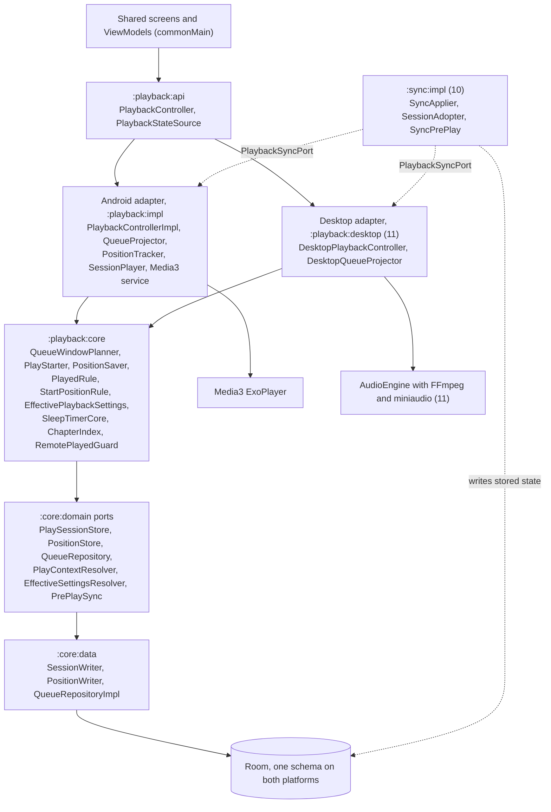
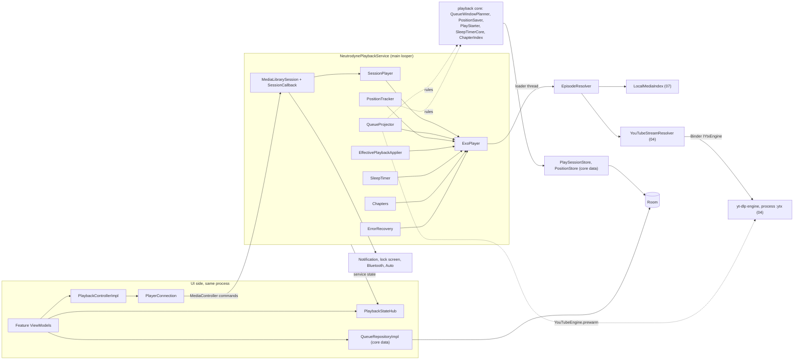
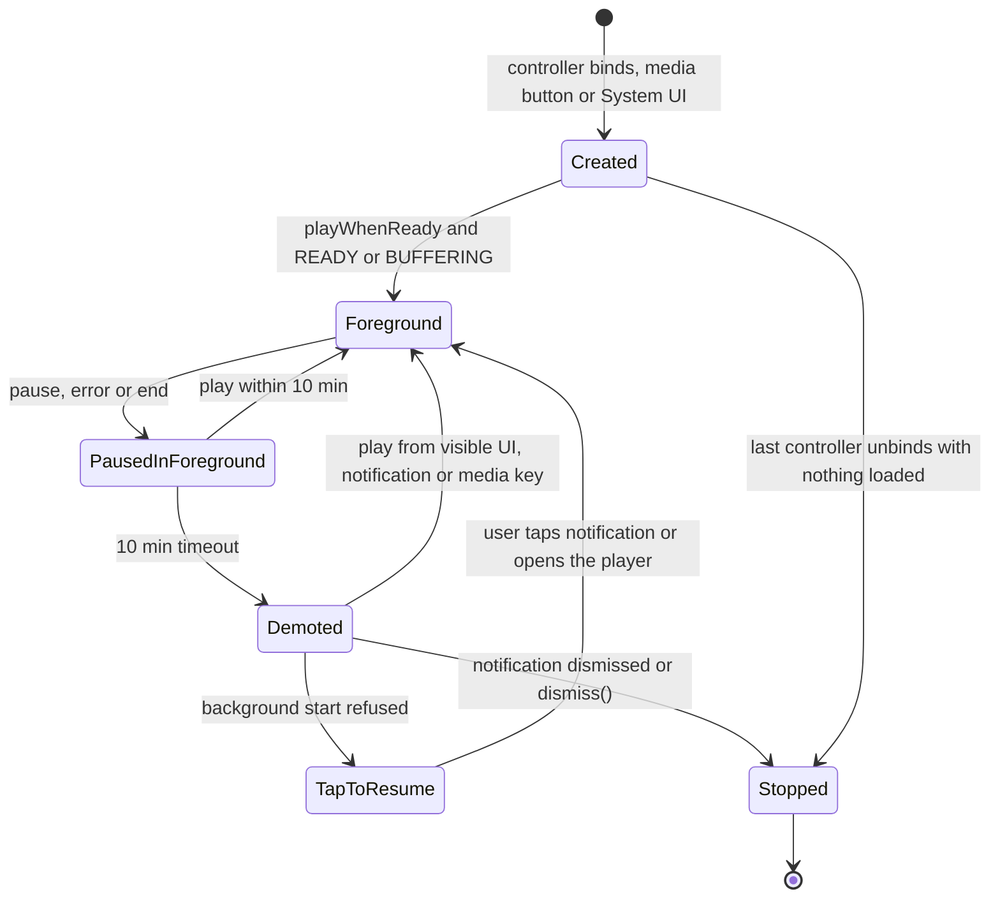
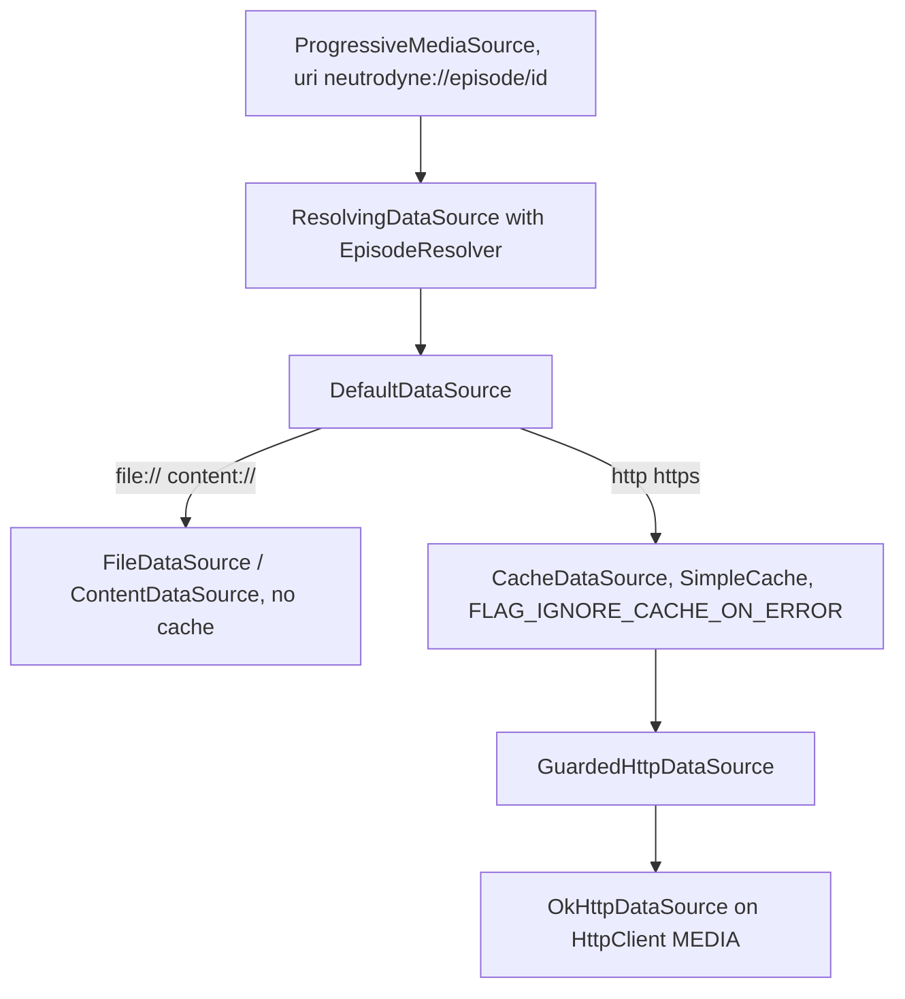
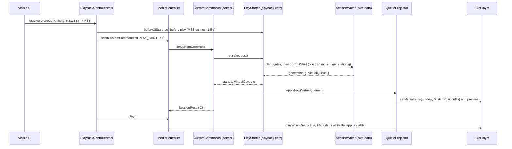
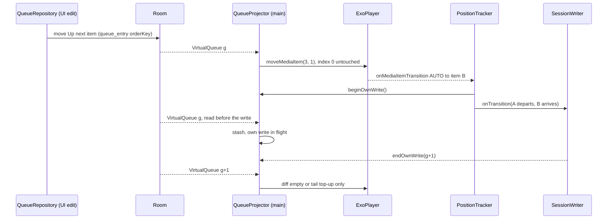
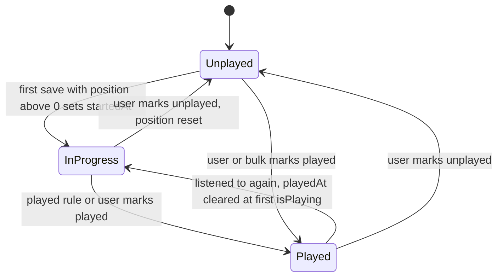
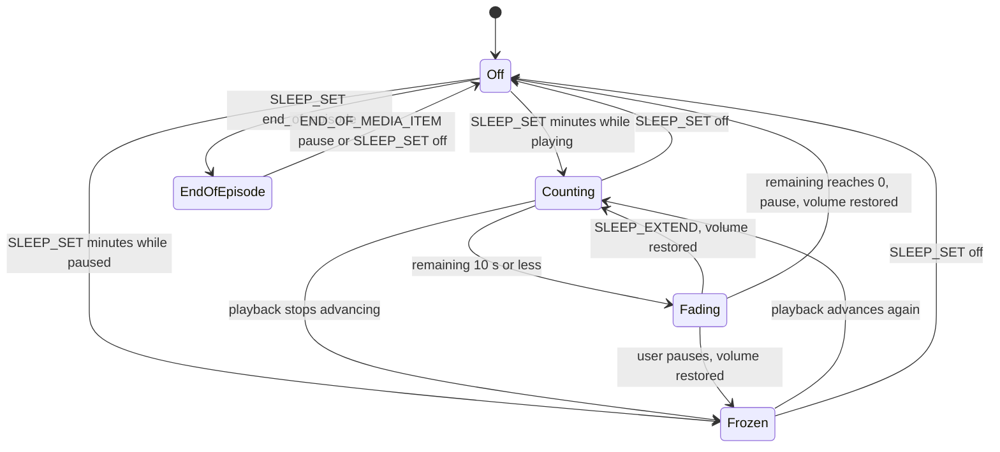

# 06 — Playback

> Status: Draft v1, 2026-10-04; revised 2026-10-05 for the product owner's decisions (embedded yt-dlp engine, external mode as a runtime capability, GitHub Releases only); revised 2026-10-05 for PO-31–PO-35 (notify-only update check, so nothing in playback waits for an install); scope revision 2026-10-05 (S0–S13): the common Player API and the platform-free queue-window, start, position, played, effective-settings, sleep-timer and chapter rules move into the shared KMP module `:playback:core`, which Android's unchanged Media3 service and the desktop engine of 11 adapt, playback persistence moves behind 06-owned `:core:domain` ports implemented once in `:core:data`, Up next is ordered by `orderKey`, the playback side of sync is specified (position safety, pull before play, remote mark-played, session adoption and play context across devices), Hilt becomes Metro, and published APKs are release builds · Implements: R4.1, R4.3, R4.7, R4.8, R2.6 (play group), R2.7 (playback defaults), R3.5, R3.7 (playback side), R3.8, R5.2, R5.3, R7.5 (playback side), R8.5 (shared rules; the desktop engine is 11's) / N1, N2, N5 (YouTube start latency), N6, N7 · Milestones: M0 (M0a), M4, M5, M6, M8, M9 (M9a), M11 (M11b), MD1 (the desktop adapter uses the core), MS2, MS3, M12–M14 · Honours: D2 (release and debug builds; test hooks in `main` stay inert), D8, D12, D20, D37, D38, D39, D40, D41, D42, D43, D44, D45, D64, D65, D72, D73, D76, D77, D78 (no install gate), D79, D81, D82, D86 and D87 (desktop adapter, 11), D92, D93, D96; PO-16, PO-20 defaults; PO-6 (Chromecast not planned); PO-31 (resolved), PO-35 (re-resolved), PO-37 · Owns: D84; `:playback:api`, `:playback:core` and `:playback:impl` — the common Player API, the shared playback core (`QueueWindowPlanner`, `WindowDiff`, `PlayStarter`, `PositionSaver`, `PlayedRule`, `StartPositionRule`, `EffectivePlaybackSettings`, `SleepTimerCore`, `ChapterIndex`, `RemotePlayedGuard`), the playback persistence ports (`PlaySessionStore`, `PositionStore`, `EmbeddedChapterReader`) and their `:core:data` implementations, the Media3 library service and session policy, ExoPlayer configuration, `MediaItem` shape and `EpisodeResolver` (including its YouTube branch, pre-warm and pre-resolve), the streaming cache rules, Up next and play-session semantics with `QueueProjector` (including YouTube capability flips at runtime), positions and played state, applying effective playback settings, sleep timer, chapters, notification and media buttons, system surfaces, video-as-audio, Android 15–17 playback restrictions, what an app update means for playback, the UI ↔ service boundary, and the playback side of sync (`PlaybackSyncPort` on Android, the consumption of `PrePlaySync`, what an adopted session does to the player)

Contents: [Scope](#scope) · [Shared playback core](#shared-playback-core) · [Service architecture](#service-architecture) · [Player configuration](#player-configuration) · [Media items and URI resolution](#media-items-and-uri-resolution) · [Streaming cache](#streaming-cache) · [Queue and play context](#queue-and-play-context) · [Positions and played state](#positions-and-played-state) · [Per-scope playback settings](#per-scope-playback-settings) · [Sleep timer](#sleep-timer) · [Chapters](#chapters) · [Notification and media buttons](#notification-and-media-buttons) · [System surfaces](#system-surfaces) · [Video](#video) · [Background restrictions](#background-restrictions) · [UI boundary](#ui-boundary) · [Settings](#settings) · [Testing](#testing) · [Delivery by milestone](#delivery-by-milestone) · [Open questions](#open-questions) · [Sources](#sources)

---

## Scope

Serves R4.1, R4.3, R4.7, R4.8, R7.5 (playback side), R8.5 (shared rules), N1, N2. Delivered in M4 (core), M5 (features and system surfaces), M6 (local files), M8 (external-mode exclusions), M9a (YouTube branch through the engine), MS2 and MS3 (sync interplay), M11b (device matrix re-run on the published release APKs); the desktop adapter arrives in MD1 ([11 Desktop playback engine](11-desktop.md#desktop-playback-engine)); see [Delivery by milestone](#delivery-by-milestone).

**Two players, one rule set.** The rules that decide what plays, where it starts, what is saved and when an episode is played live once, in the Kotlin Multiplatform module `:playback:core`, behind the common Player API of `:playback:api` ([Shared playback core](#shared-playback-core), [D84](../PLAN.md#3-key-decisions)). Android adapts them to Media3 (this document); the desktop adapts them to its own FFmpeg-based engine ([11 Desktop playback engine](11-desktop.md#desktop-playback-engine), [D86](../PLAN.md#3-key-decisions)). Sections from [Service architecture](#service-architecture) to [Background restrictions](#background-restrictions) describe the Android adapter unless they say otherwise; the desktop's OS media sessions, power and device handling are [11 OS integration](11-desktop.md#os-integration).

On Android, one `MediaLibraryService` ([D37](../PLAN.md#3-key-decisions)) owns one `ExoPlayer`. The database owns *what* plays — Up next (`queue_entry`) and the play context (`play_session`) — and the player holds only a projection window of current + Up next + K = 20 context items ([D38](../PLAN.md#3-key-decisions)). Every playable episode is the URI `neutrodyne://episode/{episodeId}` ([D39](../PLAN.md#3-key-decisions)), resolved on each connection to a local file, a pinned remote enclosure or — where the YouTube engine is available ([D77](../PLAN.md#3-key-decisions)) — a fresh YouTube stream URL that yt-dlp resolves in the separate `:ytx` process ([D72](../PLAN.md#3-key-decisions), [D73](../PLAN.md#3-key-decisions)). Whether YouTube items play in-app is a runtime capability (`YouTubeCapabilitiesSource`), never a build property: in external mode they are never queued or projected ([R3.7](../PLAN.md#21-functional-requirements)). Starting playback is only ever a user-visible or media-key action ([D43](../PLAN.md#3-key-decisions)). A YouTube-engine update never interrupts it; an app update ends it only when the user (or Obtainium) installs one, like any process kill, and nothing plays by itself afterwards ([App updates and playback](#app-updates-and-playback)). A linked sync server never starts, stops or seeks a player either: it changes stored state, and a player takes that state up only where [Sync interplay](#sync-interplay) says ([R7.5](../PLAN.md#21-functional-requirements), [D92](../PLAN.md#3-key-decisions)).

### Responsibilities and boundaries

| This document owns | Owned elsewhere (link, do not restate) |
|---|---|
| The common Player API (`:playback:api`) and the shared rules of `:playback:core`; the playback persistence ports and their `:core:data` implementations | The desktop engine, `DesktopPlaybackController`, `SpanCache` mechanics, OS media sessions, power and device loss — [11 Desktop playback engine](11-desktop.md#desktop-playback-engine), [11 OS integration](11-desktop.md#os-integration) |
| The playback side of sync: Android's `PlaybackSyncPort`, when `PrePlaySync` runs, what a remote mark-played, a remote position and an adopted session do to a player ([Sync interplay](#sync-interplay)) | The protocol, capture triggers, push scheduling, `SyncApplier`, `SessionAdopter`, the conflict rules and the "Continue on this device" card's conditions — [10 Conflict resolution](10-sync.md#conflict-resolution), [10 Client sync engine](10-sync.md#client-sync-engine), [08 Sync screens](08-ui-ux.md#sync-screens) |
| `NeutrodynePlaybackService`, session and controller policy, `PlayerConnection` | Merged manifest and permissions — [01 Manifest and permissions](01-foundation.md#manifest-and-permissions) (06 lists its own entries) |
| ExoPlayer, audio chain, load control, extractor flags | Library versions — [01 Toolchain and versions](01-foundation.md#toolchain-and-versions) |
| `MediaItem` shape, `EpisodeResolver`, pins, error recovery | YouTube extraction, `ResolvedUrlCache`, breaker — [04 Stream resolution](04-youtube.md#stream-resolution), [04 Playback integration](04-youtube.md#playback-integration); the engine, `:ytx`, pre-warm semantics and deadlines — [04 YouTube engine](04-youtube.md#youtube-engine); capability flags and `ExternalReason` — [04 Capability matrix](04-youtube.md#capability-matrix) |
| App updates: none in playback — nothing waits for or blocks an install, and a manual install ends the process like any update ([App updates and playback](#app-updates-and-playback)) | The update check (notify and link only) — [09 Update check](09-quality-and-release.md#update-check) |
| `SimpleCache` for streaming | Downloads, `LocalMediaIndex` implementation, file deletion — [07 Storage layout](07-downloads.md#storage-layout) |
| Up next and `play_session` semantics, `QueueWindowPlanner`, `QueueProjector`, transitions | Which episodes a context contains and where "Play" starts — [05 Playing a group](05-groups-opml-backup.md#playing-a-group); context-tail SQL — [02 Play context](02-data-model.md#play-context) |
| Positions, played state, measured duration, start position | Table DDL and DAO SQL — [02 episode_position](02-data-model.md#episode_position), [02 User-state writes](02-data-model.md#user-state-writes) |
| Applying speed and skip silence; scope writes from the player | Resolution rules and attribution — [05 Effective settings resolution](05-groups-opml-backup.md#effective-settings-resolution) |
| Sleep timer; chapter sources, fetch, priority, current chapter | PSC chapter ingestion — [03 Ingestion and diff](03-feeds-and-discovery.md#ingestion-and-diff); timestamp grammar — [03 Show notes](03-feeds-and-discovery.md#show-notes) |
| Notification buttons, Auto browse tree, Assistant, resumption, Bluetooth | Artwork files, `ArtworkProvider`, monograms — [08 Artwork pipeline](08-ui-ux.md#artwork-pipeline) (06 consumes `ArtworkStore.contentUri`) |
| `PlaybackController`, `PlaybackStateSource`, threading | Player sheet layout, speed/sleep sheets, row overlay — [08 Player sheet](08-ui-ux.md#player-sheet), [08 Live row state](08-ui-ux.md#live-row-state) |

### Modules and public API

| Module | Contents from this document |
|---|---|
| `:playback:api` (KMP, `commonMain` only, `ch.lkmc.neutrodyne.playback.api`) | The common Player API of both platforms ([D84](../PLAN.md#3-key-decisions)): `PlaybackController`, `PlaybackStateSource`, `PlaybackMaintenance` and their data types (below). No Media3 or engine type, no `java.*` or `android.*` ([01 Dependency rules](01-foundation.md#dependency-rules) rules 8 and 10) |
| `:playback:core` (KMP, `commonMain`, `ch.lkmc.neutrodyne.playback.core`) | The shared rules ([Shared playback core](#shared-playback-core)); depends only on `:playback:api` and `:core:{domain, model, common}` (01 rule 6) |
| `:core:domain` | `QueueRepository`, `ChapterRepository` and the playback ports `PlaySessionStore`, `PositionStore`, `EmbeddedChapterReader` (interfaces owned here; the ports are consumed only by `:playback:core` and the two platform adapters). 10's `PlaybackSyncPort` and `PrePlaySync` live here too; 06 implements the first on Android and consumes the second |
| `:core:data` (`commonMain`, package `ch.lkmc.neutrodyne.core.data.playback`) | `QueueRepositoryImpl`, `SessionWriter` (implements `PlaySessionStore`), `PositionWriter` (implements `PositionStore`), `ChapterRepositoryImpl`, `Podcasting20ChaptersParser` — written once for both platforms on 02's DAOs |
| `:core:model` | `UpNextItem`, `VirtualQueue`, `QueueItem`, `QueueOrigin`, `PlaySessionInfo`, `PlayContextInfo`, `AddResult`, `EpisodeChapter` |
| `:playback:impl` (Android library, `ch.lkmc.neutrodyne.playback.impl`) | The Media3 adapter: everything else ([package layout](#package-layout)); `@UnstableApi` opt-in module-wide ([01 Convention plugins](01-foundation.md#convention-plugins)) |
| `:playback:desktop` (desktop, 11) | `DesktopPlaybackController` implements the same API on `:playback:core` ([11 DesktopPlaybackController](11-desktop.md#desktopplaybackcontroller)) |
| `:core:testing` | `FakePlaybackController`, `FakePlaybackStateSource`, `FakeQueueRepository`, `FakeChapterRepository` (M0a); `FakePlaySessionStore`, `FakePositionStore`, `FakeEmbeddedChapterReader` (M4) |

```kotlin
// :playback:api — commands. play* functions are UI-only (D43): on Android they return ServiceUnavailable when the
// process is not STARTED (the desktop never does); with sync linked they first run pull before play (MS3,
// Sync interplay). Transport functions are fire-and-forget, called on the main thread; each implementation
// hops to its player thread (Android main looper, desktop nd-playback).
interface PlaybackController {
    suspend fun playEpisode(episodeId: Long): PlayResult                        // Up next item: context kept; else EXTERNAL
    suspend fun playEpisodeAt(episodeId: Long, positionMs: Long): PlayResult    // timestamps, chapters of non-current items
    suspend fun playFeed(source: FeedSource, filters: FeedFilters, order: FeedOrder,
                         startEpisodeId: Long? = null): PlayResult
    suspend fun play(): PlayResult                                              // resume current, else start Up next
    suspend fun playDownloads(startEpisodeId: Long? = null): PlayResult        // nd.PLAY_CONTEXT, contextType = DOWNLOADS (08's "Play all")
    fun pause()
    fun seekTo(positionMs: Long)                                                // current item
    fun skipBack()
    fun skipForward()
    fun skipToNext()                                                            // always next episode (ignores playback.hardware_buttons)
    fun skipToPrevious()                                                        // > 3 s: restart, else previous episode (same)
    suspend fun setSpeed(speed: Float, scope: SettingScope): ScopeWriteResult
    suspend fun setSkipSilence(enabled: Boolean, scope: SettingScope): ScopeWriteResult
    fun setSleepTimer(mode: SleepTimerMode)
    fun extendSleepTimer(minutes: Int)
    fun nextChapter()
    fun previousChapter()
    fun grantMeteredStreaming()                                                 // answer to NeedsMeteredConsent
    suspend fun dismiss()                                                       // stop, clear current, drop notification
}
sealed interface PlayResult {
    data object Started : PlayResult
    data class NothingToPlay(val externalOnly: Boolean = false) : PlayResult   // true: only external-mode YouTube items left
    data class NeedsMeteredConsent(val episodeId: Long) : PlayResult
    data object MeteredBlocked : PlayResult
    data object Offline : PlayResult
    data class NotPlayable(val episodeId: Long, val reason: UnplayableReason) : PlayResult
    data object ServiceUnavailable : PlayResult
}
enum class ScopeWriteResult { APPLIED, NO_CONTEXT_GROUP, NOTHING_PLAYING }
sealed interface SleepTimerMode {
    data object Off : SleepTimerMode
    data class Minutes(val minutes: Int) : SleepTimerMode                       // 1..240
    data object EndOfEpisode : SleepTimerMode                                   // EndOfChapter: v1.x (M12)
}
```

**Implementation note (2026-10-17, M3).** `PlaybackController` lands in `:playback:api`
with only `pause()` — 05's restore-Replace confirmation is its first caller — plus
`NoPlaybackController`, the no-op binding until M4 implements the rest of this interface.

**Implementation note (2026-10-18, M4).** W1 expands the canonical API with the M4 subset. Sleep, chapter, Downloads and measured-duration writeback members stay in their owning milestones. `togglePlayPause()` is an ordered transport; failed starts emit `PlaybackEvent.StartRefused(PlayResult)`. `playNext(List<Long>)` / `playLast(List<Long>)` are queue-only controller conveniences over `QueueRepository`, not audio starts. `ScopeWriteResult.FAILED` exposes failed scope writes; `PlaybackStateSource.pendingMeteredConsent` retains a pending consent across collector restarts. `SettingScope` and the M4-only `EffectivePlayback(speed, skipSilence)` live in `:core:model`, reusing `SettingSource.PodcastOverride`; W4 owns settings keys and resolver extensions. `SessionStart.contextRetention: ContextRetention` replaces the sample's boolean `keepContext` with `KEEP` / `REPLACE`; `goBack(previous: QueueItem, departure, now)` carries the previous origin so only a context arrival restores the anchor. The persistence signatures retain the design's commit-return values: storage exceptions propagate for adapter mapping/retry, and cancellation propagates. No common no-op controller is contributed: each shell binds its own unavailable controller, empty state and cache maintenance until W8 / MD1; starts return `ServiceUnavailable`. Shells also bind the null local index until M6 and static external YouTube capabilities plus an unsupported resolver until M9 / MD3. These external implementations stay in the shell containers until the engine milestone needs shared implementations. No settings keys, schema, SQL, player or UI behavior lands in W1.


```kotlin
// :playback:api — state (implemented by PlaybackStateHub on Android, DesktopPlaybackController on the desktop; all flows are main-safe)
interface PlaybackStateSource {
    val nowPlaying: StateFlow<NowPlaying?>
    val positionTicks: Flow<PositionSnapshot>       // 1 Hz while advancing, plus one emission per state change
    val sleepTimer: StateFlow<SleepTimerState>
    val currentChapter: StateFlow<CurrentChapter?>
    val effectivePlayback: StateFlow<EffectivePlayback?>   // 05's :core:model type: value + source per setting
    val events: Flow<PlaybackEvent>                 // one-shot, not replayed
}
data class NowPlaying(
    val episodeId: Long, val podcastId: Long, val title: String, val podcastTitle: String,
    val artwork: ArtworkRef,          // in-app art: episode art, else podcast art; YouTube: the episode's 16:9 thumbnail ref
    val sourceType: SourceType, val isVideo: Boolean,
    val phase: PlayerPhase, val isPlaying: Boolean, val playWhenReady: Boolean,
    val position: PositionSnapshot, val hasNext: Boolean, val stream: StreamKind?,  // null until first open
    val issue: PlaybackIssue?, val context: PlayContextInfo?,
)
data class PositionSnapshot(val episodeId: Long, val positionMs: Long, val bufferedMs: Long, val durationMs: Long?,
                            val speed: Float, val advancing: Boolean, val sampledAtElapsedMs: Long) {
    fun positionAt(elapsedMs: Long): Long = if (!advancing) positionMs else
        (positionMs + ((elapsedMs - sampledAtElapsedMs) * speed).toLong()).let { p -> durationMs?.let { minOf(p, it) } ?: p }
}
enum class PlayerPhase { NOT_LOADED, BUFFERING, READY, ENDED, ERROR }
enum class StreamKind { LOCAL, STREAM, YOUTUBE }
enum class PlaybackIssue { NETWORK_LOST, METERED_PAUSE, METERED_BLOCKED, LOCAL_FILE_MISSING,
                           YOUTUBE_RATE_LIMITED, YOUTUBE_BREAKER_OPEN, PLAYER_ERROR }
sealed interface UnplayableReason {
    data class Http(val status: Int) : UnplayableReason          // 404, 410
    data object AuthRequired : UnplayableReason                   // 401, 403 on an RSS enclosure
    data object UnsupportedFormat : UnplayableReason
    data object NoMedia : UnplayableReason                        // no enclosure and no video ID
    data class YouTube(val availability: Availability) : UnplayableReason
    data object YouTubeExtraction : UnplayableReason
    data class YouTubeExternal(val reason: ExternalReason) : UnplayableReason  // YouTube item in external mode (R3.7); 04's enum
}
```

`UnplayableReason.YouTubeExternal` replaces the former `NotInThisBuild`. `ExternalReason` (`NOT_YET_AVAILABLE`, `NOT_IN_THIS_APK`, `DISABLED_BY_USER`, `ENGINE_FAILED`) is owned by 04 ([04 Capability matrix](04-youtube.md#capability-matrix)); because `:playback:api` may depend only on `:core:{model, common}` ([01 Dependency rules](01-foundation.md#dependency-rules) rule 10), the enum is declared in `:core:model`, as `IpFamily` is ([Open questions](#open-questions) 14, resolved). 08 maps each reason to its external-mode text ([08 Capability differences in UI](08-ui-ux.md#capability-differences-in-ui)).

```kotlin
// :playback:api — continued
sealed interface SleepTimerState {
    data object Off : SleepTimerState
    data class Running(val remainingMs: Long, val totalMs: Long, val counting: Boolean, val fading: Boolean) : SleepTimerState
    data class EndOfEpisode(val episodeId: Long) : SleepTimerState
}
data class CurrentChapter(val episodeId: Long, val index: Int, val count: Int, val chapter: EpisodeChapter)
sealed interface PlaybackEvent {
    data class Skipped(val episodeId: Long, val title: String, val reason: UnplayableReason) : PlaybackEvent
    data class MarkedPlayed(val episodeId: Long) : PlaybackEvent
    data object SleepTimerFired : PlaybackEvent
}
interface PlaybackMaintenance {                     // Settings › Playback › Storage
    suspend fun streamingCacheBytes(): Long
    suspend fun clearStreamingCache()
}

// :core:domain
interface QueueRepository {
    fun observeUpNext(): Flow<List<UpNextItem>>
    fun observeSession(): Flow<PlaySessionInfo?>
    fun observeVirtualQueue(k: Int): Flow<VirtualQueue>
    suspend fun addNext(episodeIds: List<Long>): AddResult      // "Play next"
    suspend fun addLast(episodeIds: List<Long>): AddResult      // "Play last"
    suspend fun move(episodeId: Long, toIndex: Int)
    suspend fun remove(episodeIds: List<Long>)
    suspend fun clearUpNext()
    suspend fun clearContext()                                  // "Stop after Up next"
}
interface ChapterRepository {
    fun observe(episodeId: Long): Flow<List<EpisodeChapter>>    // winning source only, hidden chapters excluded
    suspend fun ensureLoaded(episodeId: Long, localFileUri: String? = null)   // 07 calls after COMPLETED
}
```

```kotlin
// :core:domain — playback persistence ports (M4). Implemented once in :core:data on 02's DAOs; consumed only by
// :playback:core and the platform adapters, never by features. Every write is one Room write transaction that starts
// with PlaySessionDao.ensure(now) where it touches play_session (02); none of them runs with sync's applying flag,
// so the capture triggers record each change for sync (02 Sync capture triggers).
interface PlaySessionStore {
    suspend fun virtualQueue(k: Int): VirtualQueue                      // one-shot read: start, resumption, adoption
    suspend fun commitStart(start: SessionStart, now: Long): Long       // returns the new generation
    suspend fun onTransition(departure: Departure?, arrivedEpisodeId: Long, arrivedOrigin: QueueOrigin, now: Long): Long
    suspend fun goBack(previousEpisodeId: Long, departure: Departure, now: Long): Long
    suspend fun endSession(departure: Departure?, now: Long): Long      // last item ended: current and context cleared
    suspend fun clearCurrent(departure: Departure?, now: Long): Long    // dismiss()
}
data class SessionStart(val currentEpisodeId: Long, val context: PlayContextSpec?,   // 05's spec (incl. minSortDate); null = EXTERNAL
                        val keepContext: Boolean, val anchorEpisodeId: Long?, val anchorSortDate: Long?)
data class Departure(val episodeId: Long, val positionMs: Long, val durationMs: Long?, val source: PositionSource,
                     val pinStartedAt: Long, val markPlayed: Boolean, val writePosition: Boolean)   // decided by :playback:core
interface PositionStore {
    fun observe(episodeId: Long): Flow<StoredPosition?>                 // one row; 02's PositionDao.observeFor
    suspend fun save(episodeId: Long, positionMs: Long, durationMs: Long?, source: PositionSource, now: Long,
                     pinStartedAt: Long, allowed: () -> Boolean): Boolean   // allowed() is read inside the transaction
    suspend fun reset(episodeId: Long, now: Long)                       // explicit reset: syncs as pos with reset = true
    suspend fun markPlayed(episodeId: Long, now: Long)                  // 02's mark-played chain (reset, Up next removal)
    suspend fun markUnplayedForReplay(episodeId: Long, now: Long)       // replaying a played episode (Start position)
    suspend fun setMeasuredDuration(episodeId: Long, durationMs: Long)
}
data class StoredPosition(val episodeId: Long, val positionMs: Long, val updatedAt: Long, val playedAt: Long?)
fun interface EmbeddedChapterReader {                                    // M6; Android: MetadataRetriever, desktop: FfDemuxer (11)
    suspend fun read(localFileUri: String): List<EpisodeChapter>?       // null = no container chapters or unreadable
}
```

```kotlin
// :core:model
data class UpNextItem(val entryId: Long, val row: EpisodeRow)
enum class QueueOrigin { CURRENT, UP_NEXT, CONTEXT }
data class QueueItem(val episodeId: Long, val origin: QueueOrigin)
data class VirtualQueue(val generation: Long, val current: QueueItem?, val upNext: List<QueueItem>,
                        val contextTail: List<QueueItem>)
data class PlayContextInfo(val type: ContextType, val id: Long?, val title: String, val order: FeedOrder,
                           val filterFlags: Int, val mediaFilter: MediaFilter)
data class PlaySessionInfo(val currentEpisodeId: Long?, val context: PlayContextInfo?, val generation: Long)
sealed interface AddResult {
    data class Added(val count: Int) : AddResult                // includes moves of already-queued items
    data class Rejected(val reason: RejectReason) : AddResult
}
enum class RejectReason { ALREADY_PLAYING, YOUTUBE_EXTERNAL, UNAVAILABLE }
data class EpisodeChapter(val startMs: Long, val endMs: Long?, val title: String?, val imageUrl: String?,
                          val linkUrl: String?, val source: ChapterSource, val hidden: Boolean)
```

### Package layout

```
playback/core/src/commonMain/kotlin/ch/lkmc/neutrodyne/playback/core/          (:playback:core, both platforms)
  queue/    QueueWindowPlanner  WindowDiff  WindowOp  PlayStarter  StartGate  PlaybackHistory
  state/    PositionSaver  PlayedRule  StartPositionRule  EffectivePlaybackSettings  RecoveryBudget  RemotePlayedGuard
  features/ SleepTimerCore  ChapterIndex
core/data/src/commonMain/kotlin/ch/lkmc/neutrodyne/core/data/playback/        (:core:data, both platforms)
  QueueRepositoryImpl  SessionWriter  PositionWriter  ChapterRepositoryImpl  Podcasting20ChaptersParser
playback/impl/src/main/kotlin/ch/lkmc/neutrodyne/playback/impl/                (:playback:impl, Android)
  NeutrodynePlaybackService.kt  PlaybackModule.kt (Metro bindings, SimpleCache, initializers)
  PlaybackServiceInjector.kt  PlaybackTestHooks.kt
  player/   PlayerFactory  SessionPlayer  NdMediaSourceFactory  NdLoadErrorHandlingPolicy
            BoostLimiterProcessor  EndOfItemPauseArbiter
  media/    MediaItemFactory  EpisodeResolver  EpisodeSourceIndex  GuardedHttpDataSource
            StreamingCache  AdjustableLruCacheEvictor  EnclosureFingerprint  ErrorRecovery
  queue/    QueueProjector
  state/    PositionTracker  PlaybackStateHub  ServiceBridge  EffectivePlaybackApplier  MeteredStreamingGate
            PlaybackPrefs  PlaybackSyncBridge
  features/ SleepTimer  Chapters  MetadataRetrieverChapterReader  PreResolver
  session/  SessionCallback  CustomCommands  MediaButtons  MediaLibraryTree  ResumptionProvider
            PlaybackChannels  TapToResumeNotifier
  ui/       PlayerConnection  PlaybackControllerImpl
```

Metro ([D82](../PLAN.md#3-key-decisions), [01 Components and scopes](01-foundation.md#components-and-scopes)); singletons are `@SingleIn(AppScope::class)`. `PlaybackModule` (`:playback:impl`, a binding container contributed to `AppScope`) binds `PlaybackController` → `PlaybackControllerImpl`, `PlaybackStateSource` → `PlaybackStateHub`, `PlaybackMaintenance` → `StreamingCache`, `EmbeddedChapterReader` → `MetadataRetrieverChapterReader` (M6) and `PlaybackSyncPort` → `PlaybackSyncBridge` (MS2), and provides `SimpleCache`. `:core:data` binds `QueueRepository`, `ChapterRepository`, `PlaySessionStore` and `PositionStore` with `@ContributesBinding` (the same classes serve the desktop graph); the `:playback:core` classes are plain `@Inject` classes. Dependencies that do not exist yet in early milestones are optional parameters with a default value, Metro's optional bindings ([Metro bindings](https://zacsweers.github.io/metro/latest/bindings/); Unverified: the exact form for nullable parameters, recorded by S8): `LocalMediaIndex? = null` and `DownloadController? = null` (absent until M6: no local files, no missing-file reports), `EmbeddedChapterReader? = null` (absent until M6), `PrePlaySync? = null` (bound by `:sync:impl` from MS2, called by `PlayStarter` from MS3) and `YouTubeEngine? = null` (bound by `:app`'s `YouTubeBindingsModule` from M9a, [01 YouTube bindings](01-foundation.md#youtube-bindings); absent before, so pre-warm is skipped). `YouTubeCapabilitiesSource` (bound from M2) is injected into `EpisodeResolver`, `QueueWindowPlanner`, `QueueRepositoryImpl` and `PlayStarter`, which read `capabilities.value` at each use and never cache a snapshot. `PlaybackChannels` (order 10) and, at order 300, `PlaybackPrefs` warm-up and `PlayerConnection` registration are contributed with `@ContributesIntoSet(AppScope::class)` as `AppInitializer`s. Service-side components (`QueueProjector`, `PositionTracker`, `SleepTimer`, `Chapters`, `EffectivePlaybackApplier`, `ErrorRecovery`, `PreResolver`, `MediaButtons`, `SessionCallback`) and the per-player core objects they wrap (`QueueWindowPlanner`, `PositionSaver`, `SleepTimerCore`, `ChapterIndex`, `EffectivePlaybackSettings`, `RecoveryBudget`) are unscoped and member-injected into the service (through the contributed `PlaybackServiceInjector`, 01 DI rule 1), so each service instance gets fresh ones; `EpisodeResolver`, `EpisodeSourceIndex`, `StreamingCache`, `MeteredStreamingGate`, `PlaybackHistory`, `PlaybackPrefs`, `PlaybackStateHub`, `PlaybackSyncBridge`, `RemotePlayedGuard` and `PlayerConnection` are `@SingleIn(AppScope::class)`.

**Database laziness ([01 Application start-up](01-foundation.md#application-start-up), DI rule 7).** The system can create `NeutrodynePlaybackService` (resumption card at boot, media key) while the database is still opening, and member injection runs on the main thread in `onCreate`. Every dependency that reaches `NeutrodyneDatabase` (DAOs, `QueueRepository`, `PlaySessionStore`, `PositionStore`, `ChapterRepository`, `PlayContextResolver`, `EffectiveSettingsResolver`) is injected as `Provider<…>` — also into the `:playback:core` objects — and dereferenced only inside a coroutine on IO after `DatabaseOpener.awaitOpen()`; constructors never touch the database. 01's start-up ordering test constructs the service while the open is pending.

### New names introduced here

| Name | Kind / location | Purpose |
|---|---|---|
| `PlayResult`, `ScopeWriteResult`, `SleepTimerMode`, `SleepTimerState`, `NowPlaying`, `PositionSnapshot`, `PlayerPhase`, `StreamKind`, `PlaybackIssue`, `UnplayableReason`, `CurrentChapter`, `PlaybackEvent`, `PlaybackMaintenance` | `:playback:api` | Public playback contract |
| `UnplayableReason.YouTubeExternal(reason: ExternalReason)` (replaces `NotInThisBuild`); `nd.reason` value `YouTubeExternal:{ExternalReason}` | `:playback:api`; session result extra | A start refused because YouTube is in external mode, with 04's reason |
| `Pin.YouTube.availableAtMs` | `:playback:impl` (`EpisodeResolver`) | Preroll wait of the pinned URL; `GuardedHttpDataSource` does not invalidate on a 403 before it |
| `PlaybackTestHooks` (`@VisibleForTesting object` with `@Volatile var foregroundServiceTimeoutMs: Long? = null`) | `:playback:impl` main sources | `PlaybackServiceTest`'s shortened foreground-service timeout ([Creation and destruction](#creation-and-destruction) step 4). Test hooks in `main` stay inert until an instrumentation test arms them ([D2](../PLAN.md#3-key-decisions), PLAN 7.2, the pattern of 04's `YtxTestHooks`); the instrumented suite runs on the `debug` build ([01 Build variants and ABIs](01-foundation.md#build-variants-and-abis)), so no keep rule is needed (the earlier rule for the retired `benchmark` build type is dropped; R8 may remove the never-armed hook from release builds) |
| `:playback:core` classes `QueueWindowPlanner`, `WindowDiff`, `WindowOp`, `PlayStarter`, `StartGate`, `PlaybackHistory`, `PositionSaver`, `PlayedRule`, `StartPositionRule`, `EffectivePlaybackSettings`, `RecoveryBudget`, `RemotePlayedGuard`, `SleepTimerCore`, `ChapterIndex` | `:playback:core` (`WindowDiff`, `PlayedRule`, `StartPositionRule` and `PlaybackHistory` moved from `:playback:impl`) | The shared rules ([Shared playback core](#shared-playback-core)) |
| `PlaySessionStore`, `PositionStore`, `EmbeddedChapterReader`, `SessionStart`, `Departure`, `StoredPosition` | `:core:domain` | Playback persistence ports and their types |
| `QueueRepositoryImpl`, `SessionWriter`, `PositionWriter`, `ChapterRepositoryImpl`, `Podcasting20ChaptersParser` | `:core:data` `commonMain` (moved from `:playback:impl`) | One implementation for both platforms |
| `PlaybackSyncBridge` (implements 10's `PlaybackSyncPort`), `MetadataRetrieverChapterReader` (implements `EmbeddedChapterReader`), `PlaybackServiceInjector` | `:playback:impl` | Android adapters ([Sync interplay](#sync-interplay), [Embedded chapters](#embedded-chapters), 01 DI rule 1) |
| `FakePlaySessionStore`, `FakePositionStore`, `FakeEmbeddedChapterReader` | `:core:testing` | Core tests in `commonTest` |
| `ChapterSource.winning(rows)` | `:core:model` (pure function next to the enum) | The one chapter-priority selection used by `ChapterIndex` and `ChapterRepositoryImpl` ([Sources and priority](#sources-and-priority)) |
| `PlaybackController.playEpisodeAt`, `play`, `playDownloads`, `grantMeteredStreaming`, `dismiss`, `extendSleepTimer`; `PlaybackStateSource.events` | members added to canonical interfaces | Timestamp seeks, resume, Downloads context (`FeedSource` has no Downloads value), metered consent, stop |
| `QueueRepository` members above; `ChapterRepository` | `:core:domain` | Up next edits; chapter reads and download-time loading |
| `UpNextItem`, `QueueOrigin`, `QueueItem`, `VirtualQueue`, `PlayContextInfo`, `PlaySessionInfo`, `AddResult`, `RejectReason`, `EpisodeChapter` | `:core:model` | Queue and chapter models |
| `nd.PLAY_CONTEXT` args `mediaFilter`, `minSortDate`, `startPositionMs`; command `nd.DISMISS` | session commands | Full `FeedFilters`; timestamp start; stop |
| `nd.result`, `nd.episodeId`, `nd.reason` | `SessionResult.extras` keys of `nd.PLAY_CONTEXT` | Carry the [start outcome](#starting-playback) back to `PlaybackControllerImpl` |
| `episode:{id}@{parentId}` | browse-tree playable media ID | Carries the Auto context (`@group:7`, `@upnext`, `@downloads`, `@podcast:3`) |
| `nd.local` | `MediaItem.RequestMetadata.extras` key (Boolean) | Extractor flags for local files |
| `NOTIF_ID_PLAYBACK = 1001`, `NOTIF_ID_TAP_TO_RESUME = 4001` | notification IDs | Media notification; "Tap to resume" on `alerts` |
| Classes in [Package layout](#package-layout) | `:playback:core`, `:core:data` (package `playback`), `:playback:impl` | — |
| `playback.*` keys | [Settings](#settings) | — |
| `FakePlaybackController`, `FakePlaybackStateSource`, `FakeQueueRepository`, `FakeChapterRepository` | `:core:testing` | Feature tests |

---

## Shared playback core

Serves R4.8, R8.5, R7.4 and R7.5 (playback side), N1, N2. Delivered in M4 (window, start, positions, played rule, effective settings, recovery limits, previous episode), M5 (sleep timer, chapter index), MS2 (Android's `PlaybackSyncPort`, remote mark-played, paused-item pickup) and MS3 (pull before play, adopted sessions); the desktop adapter uses it from MD1 ([11 DesktopPlaybackController](11-desktop.md#desktopplaybackcontroller)). Honours [D84](../PLAN.md#3-key-decisions), [D38](../PLAN.md#3-key-decisions), [D41](../PLAN.md#3-key-decisions), [D43](../PLAN.md#3-key-decisions), [D44](../PLAN.md#3-key-decisions), [D45](../PLAN.md#3-key-decisions), [D81](../PLAN.md#3-key-decisions), [D92](../PLAN.md#3-key-decisions), [D93](../PLAN.md#3-key-decisions).

`:playback:core` holds every playback rule that does not depend on a media framework — once, for both apps — so an episode resumed on the phone and on the laptop behaves the same ([D84](../PLAN.md#3-key-decisions)). It is a KMP module with `commonMain` code only and depends on `:playback:api` and `:core:{domain, model, common}` alone ([01 Dependency rules](01-foundation.md#dependency-rules) rule 6): storage, effective settings, YouTube capabilities and the download index are reached only through `:core:domain` ports and the contracts `:core:domain` re-exports (`YouTubeCapabilitiesSource`, `LocalMediaIndex`). It holds no Media3 or engine type and no `java.*` or `android.*` API (`checkBannedApis`), so it stays usable by a later iOS target ([D81](../PLAN.md#3-key-decisions)). Core objects are not thread-safe: each adapter confines them to its player thread — the Android main looper, the desktop's `nd-playback` dispatcher ([11 Threading model](11-desktop.md#threading-model)) — and they never block; persistence is `suspend` calls on the ports, which run on IO. The two app-scoped exceptions, `PlaybackHistory` and `RemotePlayedGuard`, keep their state in a `MutableStateFlow` and may be read from any thread.



### Core classes

| Class | Decides | Android adapter | Desktop adapter ([11](11-desktop.md#desktopplaybackcontroller)) |
|---|---|---|---|
| `QueueWindowPlanner` | The window: current + up to 100 Up next items + K = 20 context items, minus non-current items that cannot play (availability; YouTube in external mode, read from `YouTubeCapabilitiesSource` at each diff) ([Definitions](#definitions)); the generation guard (own writes in flight, stale snapshots stashed); the edge-case decisions of [QueueProjector](#queueprojector) (current marked played → advance unless frozen by a remote mark; a session written elsewhere → load it paused); which items need a YouTube pre-warm | `QueueProjector`: applies the ops to ExoPlayer, builds `MediaItem`s, fills `EpisodeSourceIndex`, unpins | `DesktopQueueProjector` → `EngineWindowDiff` |
| `WindowDiff`, `WindowOp` | The edit script from the player's items to the window ([QueueProjector](#queueprojector) diff steps): `SetAll(startMs)`, `Clear`, `Remove`, `Move`, `Add`, `ReplaceTail`, `UpdateMetadata`, `Reload`; index 0 (current) is touched only by `SetAll` | `setMediaItems`, `moveMediaItem`, `replaceMediaItem(s)`, … | `setWindow`, `updateWindow` |
| `PlayStarter`, `StartGate` | [Starting playback](#starting-playback) steps 1–3: plan with 05's `PlayContextResolver`, gates (no media, YouTube in external mode, availability, offline; platform `StartGate`s after them), commit through `PlaySessionStore.commitStart`; `beforeUiStart()` runs pull before play | The `nd.PLAY_CONTEXT` handler in the service; `beforeUiStart()` in `PlaybackControllerImpl`; `MeteredStreamingGate` is Android's only `StartGate` | The controller; no metered gate ([11 Behaviour differences from Android](11-desktop.md#behaviour-differences-from-android)) |
| `PlaybackHistory` | The previous-episode rule: the last 20 episodes that were current in this process ([Transitions](#transitions)) | `SessionPlayer`, `skipToPrevious()` | `skipToPrevious()`, the OS "previous" command |
| `PositionSaver` | When and what is saved: every 5 s while advancing, on pause, on a same-item seek (below 1 s an explicit reset), the outgoing item first at a transition, flush at teardown; the zero guard, the played-after-start guard, the remote freeze, the paused-item pickup; a failed write retried at the next tick ([Positions](#positions)) | `PositionTracker` (Media3 listener) | The controller; it also saves on `Suspending` and device loss ([D41](../PLAN.md#3-key-decisions)) |
| `PlayedRule`, `StartPositionRule` | The finished threshold; the start position and smart resume ([Played state](#played-state), [Start position](#start-position)) | `PositionTracker`, `SessionPlayer`, `ResumptionProvider` | The controller |
| `EffectivePlaybackSettings` | Speed and skip silence per window item through 05's `EffectiveSettingsResolver` (podcast → context group → global, [D45](../PLAN.md#3-key-decisions)); scope writes from the player ([Per-scope playback settings](#per-scope-playback-settings)) | `EffectivePlaybackApplier` | `setSpeed`, `setSkipSilence` |
| `SleepTimerCore` | The [Sleep timer](#sleep-timer) state machine on the elapsed clock: counts only while advancing, 20 fade steps over 10 s, end-of-episode arming | `SleepTimer` (player volume, `EndOfItemPauseArbiter`) | `setFade`, end-of-item pause |
| `ChapterIndex` | The winning source by [priority](#sources-and-priority), the current chapter, next and previous targets, whether extracted container chapters differ from the stored rows | `Chapters` | The controller, fed by `TracksKnown` |
| `RecoveryBudget` | At most 3 automatic re-prepares per item per 2 min and at most 5 consecutive skips, then pause ([Error recovery](#error-recovery)); classifying an error stays per platform | `ErrorRecovery` | [11 Engine errors and recovery](11-desktop.md#engine-errors-and-recovery) |
| `RemotePlayedGuard` | Which loaded items a remote mark-played has frozen ([Sync interplay](#sync-interplay)) | `PlaybackSyncBridge` | The controller |

Platform-specific on Android: the Media3 service and session, `SessionPlayer`, the notification, Android Auto and the resumption card, Tap to resume, audio focus and becoming noisy, the metered gate, `EpisodeResolver` with its pins and `SimpleCache`, `PlaybackStateHub`. On the desktop: the engine, `SpanCache`, `DesktopEpisodeSourceResolver`, the OS media sessions, power and device loss ([11 Desktop playback engine](11-desktop.md#desktop-playback-engine)). The cache-key, pin and dynamic-ad-insertion rules of [EpisodeResolver](#episoderesolver) and [Streaming cache](#streaming-cache) bind both platforms; 11 implements them without Media3.

### Persistence

The core reaches the database only through the ports of [Modules and public API](#modules-and-public-api), implemented once in `:core:data` on 02's DAOs: `QueueRepository` (UI edits and observation), `PlaySessionStore` (`SessionWriter`: start, transition, previous, end, dismiss; one transaction each, `generation + 1`), `PositionStore` (`PositionWriter`: guarded saves, explicit resets, the mark-played chain, measured duration) and `ChapterRepository` (`ChapterRepositoryImpl` with `Podcasting20ChaptersParser`; container chapters through the platform's `EmbeddedChapterReader`). Because the capture triggers sit on the tables ([02 Sync capture triggers](02-data-model.md#sync-capture-triggers)), every one of these writes is recorded for sync while a server is linked and nothing is recorded while none is ([R7.1](../PLAN.md#21-functional-requirements)); playback never calls into sync to report a change.

### Adapter contract

**Implementation note (2026-10-18, M4).** W1 freezes projection inputs as `VirtualQueue` (full stored Up next, at most requested context count, generation and `QueueOrigin`) plus current media metadata and runtime capabilities. W1 declares `WindowOp` and `StartOutcome` in `:playback:core`, and `StartGate.check(PlaybackMediaInfo, localUri)` in `:core:domain`; W3 produces the scripts/outcomes and W7 applies them. `UpdateMetadata` may target current with the same ID/source without prepare/unpin; tail operations never replace current identity. `PlaybackMediaLookup` in `:core:domain` supplies `:core:model` metadata without exposing Room; W2 implements it. Adapters own in-memory `currentSinceMs`, set when committing or loading a different current, and pass it as `Departure.pinStartedAt`. Follow the ordered steps below. Services, workers and providers receive Metro `Provider<T>` for every transitive database user, dereferencing only on IO after `awaitOpen()`; graph construction and initializers must not eagerly resolve those users.

Both adapters feed the core in the same order, which is what makes the two players agree:

1. **Item change** (Media3 `onPositionDiscontinuity` to another item; engine `ItemTransition`): `PositionSaver` captures the outgoing position first; `PlayedRule` decides `Departure.markPlayed`; `PlaySessionStore.onTransition` commits in one transaction; `QueueWindowPlanner.endOwnWrite(generation)`; then `StartPositionRule`, `EffectivePlaybackSettings`, `ChapterIndex` and `SleepTimerCore` for the arriving item.
2. **Advancing changes** (play, pause, buffering stall): `PositionSaver` saves when advancing stops; `SleepTimerCore` counts only while advancing.
3. **Same-item seek:** `PositionSaver.onSeek(origin)` — a user seek below 1 s is an explicit reset; seeks the core requests itself (start position, pickup) write nothing.
4. **Database emissions** (virtual queue, capabilities, media lookup): `QueueWindowPlanner` diffs; the adapter applies the `WindowOp`s.
5. **Teardown** (Android `onDestroy`, desktop quit, `Suspending`, device loss): `PositionSaver.flush()`, written on the application scope with `NonCancellable`.

The W1 binding handoff is explicit: W8 replaces the Android controller/state/cache
maintenance providers in `AndroidPlaybackBindings`, retaining its null local index
until M6. W6 supplies the real cache maintenance implementation for W8 to bind.
W5 contributes `ArtworkProviderGraph`; W8 contributes `PlaybackServiceInjector`
through Metro's library injector interfaces (01 DI rule 1), without competing
edits to `AndroidAppGraph`. Workers use the existing `WorkerCreator` map and
`Provider<T>` for database users, with `awaitOpen()` before dereference on IO.

### Sync interplay

Serves R7.4, R7.5, R8.5 (cross-device resume), N1, N2. Delivered in MS2 (port, remote mark-played, pickup) and MS3 (pull before play, adoption; PLAN MS3 AC2 and AC3). Honours [D92](../PLAN.md#3-key-decisions), [D93](../PLAN.md#3-key-decisions), [D43](../PLAN.md#3-key-decisions). Capture, push scheduling and the conflict rules are 10's ([10 Episode-state rules](10-sync.md#episode-state-rules), [10 Now playing and handoff](10-sync.md#now-playing-and-handoff), [10 Scheduling on Android](10-sync.md#scheduling-on-android), [10 Scheduling on the desktop](10-sync.md#scheduling-on-the-desktop)); this is what the players do. Without a server every hook is inert: `PrePlaySync` returns at once, nothing calls `onRemoteMarkedPlayed`, no session is adopted ([R7.1](../PLAN.md#21-functional-requirements)).

**`PlaybackSyncPort`** (10's contract in `:core:domain`; Android `PlaybackSyncBridge`, desktop `DesktopPlaybackController`):

- `active` = `ActivePlayback(episodeId, isPlaying, sinceMs = currentSince)` while an item is loaded in the player, playing or paused; `null` when nothing is loaded (Android: no service, or `phase = NOT_LOADED`; desktop: the restored session before the first Play). 10's `SessionAdopter` adopts only while `active?.isPlaying != true`; its mass-change guard holds a removal of the loaded podcast while it plays; its scheduler runs a round at most every 60 s while `isPlaying`.
- `events`: `PAUSED` (advancing stopped by the user, focus loss, becoming noisy, the sleep timer, suspend or device loss), `STOPPED` (dismiss, end of session, notification dismissal, service destroy, quit), `TRANSITIONED`. Each is emitted **after** the matching position save or transition transaction has committed, so the round 10 starts carries the final position. That is the playback side of the position push cadence: positions are still saved locally every 5 s ([D41](../PLAN.md#3-key-decisions)) and captured each time, and 10 pushes them on these events and at most every 60 s while playing.
- `onRemoteMarkedPlayed(episodeId, device)`: rule 3 below.

**Position safety** (N1; [D92](../PLAN.md#3-key-decisions)'s `LwwPosition`):

1. **Zero never wins by accident.** `PositionWriter.save` keeps 02's guard (never 0 over a non-zero position); only `reset` and the mark-played chain write 0, and only they capture `pos` with `reset: true`. This document's explicit resets are: a user seek below 1 s, "previous" restarting an item more than 3 s in, mark played (transitions, the end of the last item, the end-of-episode sleep timer, the user) and mark unplayed. A start position of 0 from `StartPositionRule` (saved ≤ 5 s, near the end, played) and every seek the core requests itself write nothing, so none of them travels as a reset.
2. **A playing device is never seeked.** `SyncApplier` writes a newer remote position into `episode_position` and never touches a player; the playing device's own saves carry newer clocks and win while it plays ([10 Episode-state rules](10-sync.md#episode-state-rules) rule 3).
3. **Remote played while loaded.** `SyncApplier` calls `onRemoteMarkedPlayed` only when a winning `played = true` makes the merged episode **effectively played** — derived from its raw state plus pending local fields by 10's episode-state rules — and before it projects that state into Room ([10 Episode-state rules](10-sync.md#episode-state-rules) rule 2); an older mark hidden by a newer listening position calls nothing. The adapter adds the episode to `RemotePlayedGuard` synchronously (a `MutableStateFlow<Set<Long>>` changed with `update {}`, callable from any thread) and then notifies its player thread. `PositionSaver`'s `allowed()` check is read **inside** each save transaction, so no save can commit for that item afterwards, not even one whose tick fired before the apply; `QueueWindowPlanner` skips its "current marked played → advance" rule for the item, which keeps playing — nothing stops, seeks or skips (R7.5, PLAN MS3 AC3); its departure writes neither a position nor a mark; 10 shows "Marked played on <device>". The freeze lifts when the item stops being current or becomes unplayed here again (the user's "Mark unplayed", or a newer remote unplayed or in-progress state); the next save then writes normally.
4. **Paused-item pickup.** A position that sync or a restore wrote for the item loaded but paused in the player is taken up at the next resume. `PositionSaver` remembers the last position it wrote or applied for the current item; if the stored row differs from it by more than 1 s (a reset to 0 included), the adapter seeks the paused player to the stored position before playing. The UI's `play()` reads the row after pull before play; notification, media-key, Bluetooth, Android Auto and OS-session resumes compare with the row the adapter observes (`PositionStore.observe(current)`). The pickup seek writes nothing. Without it, resuming from a stale in-memory position would overwrite the newer remote one with a newer clock (R8.5).

**Pull before play** (MS3). `PlayStarter.beforeUiStart()` awaits `PrePlaySync.beforeStart()` (≤ 1.5 s, never throws; returns at once when sync is off, the device is offline or a round finished less than 15 s ago, [10 Episode-state rules](10-sync.md#episode-state-rules) rule 4) before the start is planned, so `StartPositionRule` reads the newest stored position. It runs for UI-started plays only — `playEpisode`, `playEpisodeAt`, `playFeed`, `playDownloads` and `play()` from the shared UI, including the "Continue on this device" card — and never for notification buttons, media keys, Bluetooth, Android Auto, the resumption card or the desktop's OS media sessions, which must react at once. Android runs it in `PlaybackControllerImpl` before the session command, so the start stays on the visible-UI path ([D43](../PLAN.md#3-key-decisions)): if the app left the foreground during the wait, `awaitController` refuses it like any background start. Before MS2 no `PrePlaySync` is bound, and before MS3 `PlayStarter` does not call it (an optional dependency, [Package layout](#package-layout)).

**Session and play context across devices** (MS3). `play_session` is sync's `session/current` record: the current episode reference and the play context (type, group `uuid`, podcast `syncId`, order, filters, `minSortDate`, anchor and anchor sort date); `generation` and `updatedAt` stay device-local ([10 Episode, Up next and session fields](10-sync.md#episode-up-next-and-session-fields)). Every `PlaySessionStore` write is captured, so a start, a transition, "previous", the end of a session and `dismiss()` all travel. On the receiving device:

- `SessionAdopter` writes an adopted session only while this device is not playing, with `generation + 1`. `QueueWindowPlanner` treats every generation it did not write itself as foreign: the adopted current item is loaded with `playWhenReady = false` at its stored position, also when it is the episode already loaded (then a paused seek, only when the stored position differs by more than 1 s). Nothing starts ([D43](../PLAN.md#3-key-decisions), N2); playing it is the user's "Continue on this device" tap, which calls `PlaybackController.play()` — on Android the empty-player path `onPlaybackResumption(isForPlayback = true)` ([Resumption](#resumption)) or a normal resume with pickup, on the desktop the controller's resume.
- The context tail is computed locally from the mapped context over this device's own episodes ([02 Play context](02-data-model.md#play-context)). Every client polls its feeds itself, so the tail can differ where the devices' feeds differ; an episode not yet ingested here is simply not in it. The anchor's sort date places the tail even when the anchor episode is missing here. Up next is not part of the session: it arrives as `upnext` records, which the projector applies like UI edits.
- A context that cannot be mapped here (its group or podcast is unknown) is adopted as `EXTERNAL`: the episode plays, then Up next, then playback stops ([Open questions](#open-questions) 22).
- While this device plays, remote sessions are recorded but not adopted: the complete merged session, with its writer, stays in 10's raw state. When the player pauses, stops or changes items — and once after a restart, when the local player is restored paused — `SessionAdopter` compares that saved session with pending local session writes and offers the newest eligible one, without waiting for a round; usually that is this device's own, whose changes it pushed as they happened ([10 Now playing and handoff](10-sync.md#now-playing-and-handoff)).
- An adopted YouTube item in external mode or a stub episode (10's stubs carry the enclosure URL) goes through the usual [gates](#starting-playback) and [Error recovery](#error-recovery).

**Up next from sync.** `SyncApplier` adds, moves and removes `queue_entry` rows — never the current item and never an effectively played episode ([10 Episode-state rules](10-sync.md#episode-state-rules) rule 1). Like UI edits they do not bump the generation, so the projector diffs them without touching index 0.

Core tests run in `commonTest` on the desktop JVM with `TestClock` and the `:core:testing` fakes; both adapters' suites pass M4 AC1, AC2 and AC6 through the core (PLAN M4 AC17, M5 AC8, MD1 AC1 and AC3, MS3 AC2 and AC3; [Testing](#testing)).

---

## Service architecture

Serves R4.7, N2. Delivered in M4 (service, session, notification), M5 (browse tree, resumption). Honours [D37](../PLAN.md#3-key-decisions), [D43](../PLAN.md#3-key-decisions), [PO-16](../PLAN.md#48-further-product-owner-decisions). Android only; the service's components are the Media3 adapters of [Shared playback core](#shared-playback-core) (dotted edges below).



### Creation and destruction

`NeutrodynePlaybackService : MediaLibraryService` receives its dependencies by Metro member injection (`@Inject lateinit var …: Lazy<…>` fields; [01 Components and scopes](01-foundation.md#components-and-scopes) rule 1); Media3 services are `LifecycleService`s since 1.10, so `lifecycleScope` (main) is the service scope. `onCreate`, all on the main looper:

1. `super.onCreate()`, then `((applicationContext as GraphHolder).graph as PlaybackServiceInjector).inject(this)`.
2. `resolver.clearPins()`; `exo = playerFactory.create()`; `playerFactory.bindPrefs(exo, lifecycleScope)` ([Player configuration](#player-configuration)).
3. `sessionPlayer = SessionPlayer(exo, …)` ([Notification and media buttons](#hardware-buttons-and-sessionplayer)).
4. `setMediaNotificationProvider(…)` and `setListener(tapToResumeListener)` ([Notification and media buttons](#notification-and-media-buttons)); then `PlaybackTestHooks.foregroundServiceTimeoutMs?.let(::setForegroundServiceTimeoutMs)` — null in every normal run, set only by `PlaybackServiceTest` before it binds ([Testing](#testing)). Media3 accepts the call only once the service's context exists in `onCreate`, ignores it for timeouts already running and clamps it to `DEFAULT_FOREGROUND_SERVICE_TIMEOUT_MS`.
5. `session = MediaLibrarySession.Builder(this, sessionPlayer, sessionCallback).setId("neutrodyne").setSessionActivity(openPlayerPendingIntent).setMediaButtonPreferences(mediaButtons.current()).build()`. The session activity is an explicit `MainActivity` intent with data `neutrodyne://open/player`, `FLAG_IMMUTABLE` (route `ExpandPlayer`, [01 Intent routing](01-foundation.md#intent-routing)).
6. Attach listeners in this order (`ExoPlayer`'s listener set notifies in registration order, and the outgoing position must be saved first): `positionTracker`, `queueProjector`, `applier`, `sleepTimer`, `chapters`, `meteredGate`, `errorRecovery`, `preResolver`, `mediaButtons`. The projector's collection is launched in `lifecycleScope` and first suspends on `DatabaseOpener.awaitOpen()` (IO); its first emission loads the window **without** `prepare()`.
7. `stateHub.attach(ServiceBridge(exo, …))`; from MS2 also `syncBridge.attach(…)`, which publishes `PlaybackSyncPort.active` and receives the `PAUSED`/`STOPPED`/`TRANSITIONED` events from `PositionTracker` after their saves commit ([Sync interplay](#sync-interplay)).

`onGetSession(controllerInfo)` returns `session` for every controller. `onDestroy`: `positionTracker.flush()` (captures the snapshot on main, writes it on `@ApplicationScope` with `NonCancellable`), `syncBridge.detach()` (`active = null` after the flush's `STOPPED`), `stateHub.detach()`, `session.release()`, `sessionPlayer.release()` (its `handleRelease()` releases `exo`), `resolver.clearPins()`, `super.onDestroy()`. `onTaskRemoved` keeps Media3's default (keep running while playing, otherwise `pauseAllPlayersAndStopSelf()`); the service can only stop once every bound controller has unbound, which is why [PlayerConnection](#playerconnection) releases at process `onStop`.

### Connection policy

`SessionCallback.onConnectAsync` (Media3 1.11 adds it; `onConnect` is a deprecation candidate) returns `immediateFuture(…)` built with `ConnectionResult.AcceptedResultBuilder(session, controller)`, whose defaults are full commands for trusted controllers and read-only commands for untrusted ones (1.11). "Full" below means `DEFAULT_PLAYER_COMMANDS` + `DEFAULT_SESSION_AND_LIBRARY_COMMANDS` + every `nd.*` command, set explicitly:

| Controller | Detection | Player commands | Session commands |
|---|---|---|---|
| Media notification | `session.isMediaNotificationController(c)` | `DEFAULT_PLAYER_COMMANDS`, **including** `COMMAND_SEEK_TO_PREVIOUS`/`NEXT`; `setMediaButtonPreferences(mediaButtons.current())` | full |
| Own app, System UI, Bluetooth, Wear (via notification listener) | `c.isTrusted` (own UID, system UID, `MEDIA_CONTENT_CONTROL`, `STATUS_BAR_SERVICE` or an enabled notification listener) | full | full |
| Android Auto / AAOS | `session.isAutoCompanionController(c)` or `session.isAutomotiveController(c)` (both exist in 1.11.1; package-name based, "not a security validation") | full, set explicitly: Auto is not necessarily `isTrusted`, and the builder's untrusted default would make the car read-only | full |
| Anything else | — | builder default for untrusted controllers: read-only ([PO-16](../PLAN.md#48-further-product-owner-decisions)) | builder default (no `nd.*`) |

**Why the notification controller keeps previous/next.** In Media3 1.11.1 the media notification controller is more than the notification: (1) its available player commands, intersected with the player's, become the platform session's `PlaybackState` actions (what Bluetooth/AVRCP, Wear and the lock screen see); (2) every media key event (`MediaButtonReceiver`, headset, AVRCP passthrough delivered as a key) is executed *as* the notification controller (`MediaSessionImpl.applyMediaButtonKeyEvent` → `seekToNextForControllerInfo(notificationController)`), and a command it lacks is answered `ERROR_PERMISSION_DENIED`. Removing `COMMAND_SEEK_TO_NEXT`/`PREVIOUS` there (as some samples do to free notification slots) would silently disable headset next/previous and therefore [PO-20](../PLAN.md#48-further-product-owner-decisions)'s setting. Slot placement needs no command removal: when the media button preferences contain `SLOT_BACK`/`SLOT_FORWARD` buttons, `DefaultMediaNotificationProvider` puts them in the previous/next positions and `MediaSessionLegacyStub` drops `ACTION_SKIP_TO_PREVIOUS`/`NEXT` from the platform `PlaybackState` itself, so System UI shows seek back/forward there.

### Lifecycle and foreground state

Media3 runs the service in the foreground while `playWhenReady && (READY || BUFFERING)`, keeps it there for `DEFAULT_FOREGROUND_SERVICE_TIMEOUT_MS = 600_000` after a pause, stop, error or end, then demotes it and keeps the notification. We keep the default timeout; only `PlaybackServiceTest` shortens it, through the inert `PlaybackTestHooks` ([Creation and destruction](#creation-and-destruction) step 4). A transient focus loss (phone call) does not start the timer: ExoPlayer keeps `playWhenReady = true` with `playbackSuppressionReason = TRANSIENT_AUDIO_FOCUS_LOSS` and the state stays `READY`, which `MediaNotificationManager` counts as user-engaged, so the FGS survives a call of any length and resumes in it.

**Notification dismissed** (swipe while paused): Media3 sends `KEYCODE_MEDIA_STOP` as the notification controller and hides the notification. `SessionPlayer.handleStop()` saves the position first, then `exo.stop()`; `play_session` is untouched (the mini player still offers the episode, `phase = NOT_LOADED` once the service is gone), and the service calls `pauseAllPlayersAndStopSelf()`. This differs from the mini player's swipe-to-dismiss, which is `nd.DISMISS` ([PlaybackControllerImpl](#playbackcontrollerimpl)) and clears the current episode.



**Tap to resume.** `MediaSessionService.Listener.onForegroundServiceStartNotAllowedException()` (API 31+; a controller asked to play after demotion while the app is in the background and the request carried no FGS-start exemption, e.g. a Wear or car "play" via a controller binding rather than a media key) → on main: `positionTracker.flush()`, `exo.pause()` (on API 33+ Media3 has already let the player start; without the FGS it would play unprotected and, on Android 17, silently muted), then `TapToResumeNotifier` posts `NOTIF_ID_TAP_TO_RESUME = 4001` on channel `alerts` (only if `POST_NOTIFICATIONS` is granted; otherwise only `NowPlaying.issue = PLAYER_ERROR` in-app): title "Playback paused", text "Android didn't let Neutrodyne resume in the background. Tap to continue." Content intent: explicit `MainActivity`, `neutrodyne://open/player` (routes only navigate, so the user presses Play in the visible player). One action "Resume": `PlaybackPendingIntentBuilder(ctx, Player.COMMAND_PLAY_PAUSE, NeutrodynePlaybackService::class.java).setStartAsForegroundService(true).setSessionId("neutrodyne").build()` (public `@UnstableApi` since Media3 1.10; it builds the same `ACTION_MEDIA_BUTTON` + `KEYCODE_MEDIA_PLAY_PAUSE` intent, via `PendingIntent.getForegroundService` on API 26+, that Media3's own notification uses; the player is paused, so play-pause plays). A notification action tap is an FGS-start exemption and a while-in-use source. The notification auto-cancels and is cancelled when playback starts.

### App updates and playback

Serves N1, R3.9. Delivered in M4 (the position saves that make an update harmless) and M9a (engine side); the update check of M11a adds nothing here. Honours [D43](../PLAN.md#3-key-decisions), [D73](../PLAN.md#3-key-decisions), [D76](../PLAN.md#3-key-decisions), [D78](../PLAN.md#3-key-decisions).

**App updates.** Neutrodyne never installs anything itself ([D78](../PLAN.md#3-key-decisions), [PO-31](../PLAN.md#48-further-product-owner-decisions)): the update check only notifies and links to the GitHub release ([09 Update check](09-quality-and-release.md#update-check)), and the user installs the downloaded APK with Android's installer whenever they choose (or Obtainium does). Like any update, the install ends the app's processes — "By default, all installs will result in the package's running processes being killed before the install completes" ([`PackageInstaller.SessionParams.setDontKillApp`](https://developer.android.com/reference/android/content/pm/PackageInstaller.SessionParams)) — and the service, its notification, `:ytx` and every pre-buffered byte go with them. Playback therefore exposes no busy signal and nothing waits on it; an update during playback is handled exactly like any other process kill:

- **Position.** Saved every 5 s while playing and at every pause ([Positions](#positions)); a kill skips `onDestroy`, so at most the last 5 s are lost (N1).
- **Session.** `play_session`, Up next and the context are in the database and unchanged; the mini player shows the episode with `phase = NOT_LOADED` ([PlaybackStateHub](#playbackstatehub)).
- **No auto-play.** Nothing plays by itself after the update ([D43](../PLAN.md#3-key-decisions)): the next Play, media key or resumption-card tap resumes through [Resumption](#resumption) (`isForPlayback = true`, start position from `StartPositionRule`). Unverified whether System UI keeps the resumption card across a package update ([Open questions](#open-questions) 19).
- **Obtainium.** An update that Obtainium installs, possibly in the background, ends playback the same way; nothing in Neutrodyne can delay it (Unverified whether Obtainium waits while an app plays audio, [Open questions](#open-questions) 19).

**Desktop app updates.** The desktop app also only notifies and links ([D78](../PLAN.md#3-key-decisions)); the user installs the newer package over it ([11 Install and update](11-desktop.md#install-and-update)). Whether the app is quit first or ended by the installer, playback's side is the same: the quit save or the last 5-s save survives (N1), and the next start restores the session paused with nothing resolved ([11 Device loss, sleep and session restore](11-desktop.md#device-loss-sleep-and-session-restore)).

**YouTube-engine updates** ([D76](../PLAN.md#3-key-decisions)) never touch the main process: activation, rollback and "Reset to bundled" restart only `:ytx`, and only while it has no call in flight ([04 Process and lifecycle](04-youtube.md#process-and-lifecycle)). The playing YouTube item keeps streaming from its resolved URL (`ResolvedUrlCache` lives in the main process); its next resolve starts the new version cold.

### Manifest entries (declared by `:playback:impl`)

```xml
<uses-permission android:name="android.permission.FOREGROUND_SERVICE" />
<uses-permission android:name="android.permission.FOREGROUND_SERVICE_MEDIA_PLAYBACK" />
<uses-permission android:name="android.permission.WAKE_LOCK" />
<application>
  <service android:name="ch.lkmc.neutrodyne.playback.impl.NeutrodynePlaybackService"
      android:exported="true" android:foregroundServiceType="mediaPlayback">          <!-- M4 -->
    <intent-filter>
      <action android:name="androidx.media3.session.MediaLibraryService" />
      <action android:name="android.media.browse.MediaBrowserService" />
      <action android:name="android.media.action.MEDIA_PLAY_FROM_SEARCH" />            <!-- M5 -->
    </intent-filter>
  </service>
  <receiver android:name="androidx.media3.session.MediaButtonReceiver" android:exported="true">   <!-- M4 -->
    <intent-filter><action android:name="android.intent.action.MEDIA_BUTTON" /></intent-filter>
  </receiver>
  <meta-data android:name="com.google.android.gms.car.application"
      android:resource="@xml/automotive_app_desc" />   <!-- M5; <automotiveApp><uses name="media"/></automotiveApp> -->
</application>
```

`POST_NOTIFICATIONS` is not needed for the media notification (media sessions are exempt). The session AAR merges `BluetoothValidationActivity` (`BLUETOOTH_PRIVILEGED`-protected AVRCP workaround on API 36/37); keep it.

---

## Player configuration

Serves R4.1, R4.7, R4.8. Delivered in M4. Defaults follow [PO-20](../PLAN.md#48-further-product-owner-decisions) and [Settings](#settings).

```kotlin
internal class PlayerFactory @Inject constructor(
    private val ctx: Application,                               // bound by AndroidAppGraph's factory (01)
    private val mediaSourceFactory: NdMediaSourceFactory,     // DataSource stack: Media items and URI resolution
    private val boost: BoostLimiterProcessor,                  // pass-through (inactive) until M12
    private val prefs: PlaybackPrefs,                          // hot StateFlow of playback.* values
) {
    fun create(): ExoPlayer {
        val s = prefs.current.value                            // defaults until the first DataStore read lands
        val silence = SilenceSkippingAudioProcessor(250_000, 0.2f, 400_000, 10, 1024)  // Unverified tuning; verify by ear
        val renderers = object : DefaultRenderersFactory(ctx) {
            override fun buildAudioSink(c: Context, float: Boolean, params: Boolean): AudioSink =
                DefaultAudioSink.Builder(c).setEnableFloatOutput(float)
                    .setEnableAudioOutputPlaybackParameters(false)                  // Sonic speed, pitch preserved
                    .setAudioProcessorChain(DefaultAudioSink.DefaultAudioProcessorChain(
                        arrayOf<AudioProcessor>(boost), silence, SonicAudioProcessor()))
                    .build()
        }
        return ExoPlayer.Builder(ctx, renderers)
            .setMediaSourceFactory(mediaSourceFactory)
            .setAudioAttributes(audioAttributes(s.pauseForNavigation), /* handleAudioFocus = */ true)
            .setHandleAudioBecomingNoisy(true)
            .setWakeMode(C.WAKE_MODE_NETWORK)                                     // switched per item
            .setSeekBackIncrementMs(s.skipBackMs).setSeekForwardIncrementMs(s.skipForwardMs)
            .setLoadControl(DefaultLoadControl.Builder()
                .setBufferDurationsMs(60_000, 600_000, 1_500, 3_000)
                .setBackBuffer(60_000, /* retainBackBufferFromKeyframe = */ true).build())
            .setName("neutrodyne").build()
            .apply { trackSelectionParameters = trackSelectionParameters.buildUpon()
                .setTrackTypeDisabled(C.TRACK_TYPE_VIDEO, true)                   // v1.0: audio only (Video)
                .setTrackTypeDisabled(C.TRACK_TYPE_TEXT, true).build() }
    }
    fun audioAttributes(pauseForNav: Boolean) = AudioAttributes.Builder().setUsage(C.USAGE_MEDIA)
        .setContentType(if (pauseForNav) C.AUDIO_CONTENT_TYPE_SPEECH else C.AUDIO_CONTENT_TYPE_MUSIC).build()
}
```

| Aspect | Rule | Why |
|---|---|---|
| Audio focus | `handleAudioFocus = true`; `USAGE_MEDIA`; content type SPEECH when `playback.pause_for_navigation` (default on), else MUSIC | With SPEECH, ExoPlayer pauses instead of ducking for navigation prompts; transient loss (call) auto-resumes, permanent loss (other media app) does not |
| Becoming noisy | `setHandleAudioBecomingNoisy(true)` | Pause on headphone unplug (R4.7) |
| Wake mode | `WAKE_MODE_LOCAL` for `StreamKind.LOCAL`, `WAKE_MODE_NETWORK` otherwise, set in `onMediaItemTransition` and before the first `prepare()` | NETWORK adds a Wi-Fi lock for screen-off streaming |
| Load control | min 60 s, max 600 s, start 1.5 s, after rebuffer 3 s, back buffer 60 s (`setBufferDurationsMs` sets the streaming and local profiles alike; `DefaultLoadControl` treats every item as streaming anyway, because `neutrodyne` is not in `LOCAL_PLAYBACK_SCHEMES`) | Instant "back 10 s"; the default audio byte cap (200 × 64 KiB ≈ 12.8 MB) still bounds memory (≈ 13 min at 128 kbps) — do **not** prioritise time over size (Android 17 memory limits) |
| Audio chain | `[BoostLimiterProcessor] → SilenceSkippingAudioProcessor → SonicAudioProcessor` | Custom processors run before silence skipping and speed; boost slot exists from day one ([D65](../PLAN.md#3-key-decisions)); `GainProcessor` only attenuates |
| Audio offload | Off in v1 | Processors are bypassed in offload mode |
| Seek increments | From `playback.skip_back_ms` / `playback.skip_forward_ms`; updated at runtime with `setSeekBackIncrementMs`/`setSeekForwardIncrementMs` (1.9+) **and** `session.setMediaButtonPreferences` | Notification icons follow the interval |
| Seek parameters | `SeekParameters.DEFAULT` (exact) | Chapters and resume positions land where expected |
| Repeat / shuffle | `REPEAT_MODE_OFF`, shuffle off; `COMMAND_SET_REPEAT_MODE` and `COMMAND_SET_SHUFFLE_MODE` removed in `SessionPlayer` | The database defines order |
| Video | Video and text track types disabled ([Video](#video)) | No decoding without a surface |

`PlaybackPrefs` (`@SingleIn(AppScope::class)`) collects the `playback.*` keys into `current: StateFlow<PlaybackPrefsSnapshot>`, started eagerly on `@ApplicationScope` by the order-300 initializer, so `create()` never blocks. `PlayerFactory.bindPrefs(exo, lifecycleScope)` (called right after `create()`) applies later changes at runtime: `setAudioAttributes(…, true)` for `pause_for_navigation`, `setSeekBack/ForwardIncrementMs` for the skip intervals.

Extractors: `NdMediaSourceFactory` delegates to two `DefaultMediaSourceFactory` instances sharing the DataSource stack. Remote: `DefaultExtractorsFactory().setConstantBitrateSeekingEnabled(true).setDisableArtworkMetadata(true)` (seekable header-less CBR MP3; embedded APIC/`covr` art dropped — OOM risk; chapters kept). Local (`requestMetadata.extras["nd.local"] == true`): same plus `setMp3ExtractorFlags(Mp3Extractor.FLAG_ENABLE_INDEX_SEEKING)` (accurate VBR seeks on files without a precise TOC; Media3 1.9+ still prefers Xing/VBRI when present). The hint is set by the projector from `LocalMediaIndex` at item build; a stale hint only affects seek accuracy.

`NdLoadErrorHandlingPolicy : DefaultLoadErrorHandlingPolicy`: for `InvalidResponseCodeException` 401/403/404/410 on a DataSpec whose key starts with `ep:`, retry once after 1 s (the retry falls back from a stale pinned final URL, [EpisodeResolver](#episoderesolver)), then `C.TIME_UNSET` (fatal). Everything else (including `yt:` 403/410, [04 Playback integration](04-youtube.md#playback-integration)) keeps the default backoff `min((n − 1) · 1 s, 5 s)`.

---

## Media items and URI resolution

Serves R4.1, R4.3, R3.5, R3.7, R5.2. Delivered in M4 (remote), M6 (local), M8 (external-mode exclusion), M9a (YouTube through the engine). Honours [D39](../PLAN.md#3-key-decisions), [D42](../PLAN.md#3-key-decisions).

### MediaItem shape

`MediaItemFactory.build(row: MediaLookupRow, positionMs: Long?, isLocal: Boolean): MediaItem` from a row of 02's `EpisodeDao.observeMediaInfo(ids)` / `mediaInfo(ids)` ([02 Media lookup](02-data-model.md#media-lookup)); `positionMs` feeds the completion extras, `isLocal` the `nd.local` hint.

| Field | Value |
|---|---|
| `mediaId` | `episode:{episodeId}` (queue diffing, Auto, resumption) |
| `uri` | `neutrodyne://episode/{episodeId}` |
| `mimeType` | never set — extractors sniff (wrong feed MIME types are common; `application/x-mpegURL` would select an absent HLS module) |
| `customCacheKey` | RSS: `ep:{episodeId}:{EnclosureFingerprint}`; YouTube: `yt:{videoId}` (fixed per item; the resolver replaces it with `yt:{videoId}:{formatId}` on each `DataSpec`, [04](04-youtube.md#playback-integration)) |
| `requestMetadata` | `mediaUri` = the same URI (external controllers can re-request); `extras` = `nd.local` hint |
| `mediaMetadata.title` / `displayTitle` | episode title |
| `artist`, `albumTitle` | podcast title (`customTitle` first); `albumArtist` = podcast author. Many Bluetooth head units show only title and artist |
| `artworkUri` | [Artwork rule](#artwork-rule) |
| `durationMs` | `measuredDurationMs ?: feed durationMs` when > 0 (System UI shows no progress without it) |
| `releaseYear/Month/Day` | from `pubDate` (UTC) |
| `mediaType` | `MEDIA_TYPE_PODCAST_EPISODE` for every item in v1.0 (video plays as audio) |
| `isPlayable` / `isBrowsable` | true / false |
| `mediaMetadata.extras` | `MediaConstants.EXTRAS_KEY_COMPLETION_STATUS` (Int: `EXTRAS_VALUE_COMPLETION_STATUS_NOT_PLAYED` / `_PARTIALLY_PLAYED` / `_FULLY_PLAYED` from `playedAt` and the position), `EXTRAS_KEY_COMPLETION_PERCENTAGE` (Double 0.0–1.0, only when partially played), `EXTRAS_KEY_DOWNLOAD_STATUS` (Long: `EXTRAS_VALUE_STATUS_NOT_DOWNLOADED` / `_DOWNLOADING` / `_DOWNLOADED` from `downloadState`; M6). Names verified in the 1.11.1 `MediaConstants.java`. The position comes from a one-shot `PositionDao.observeFor(ids).first()` at build time (never observed: a stale percentage in Auto is acceptable, a 5-s re-projection is not) |

**Immutable `LocalConfiguration`.** `uri`, `customCacheKey`, `mimeType` and the tag never change for a given item instance, so metadata refreshes use `replaceMediaItem` without re-preparing (`ProgressiveMediaSource.canUpdateMediaItem` compares URI, `customCacheKey` and image duration). If an RSS enclosure URL or length changes in the feed, the fingerprint changes: the projector replaces non-current items (re-prepare is harmless) and leaves the current item untouched until it is no longer current.

`EnclosureFingerprint.of(url, length) = sha1Hex("$url|${length ?: -1}").take(16)` over the raw stored `enclosureUrl`, so a new token or re-upload never shares cache bytes with the old file.

### Artwork rule

`artworkUri = ArtworkStore.contentUri(key, version)` — always a local `content://${applicationId}.artwork/…` URI, never `http(s)` (Auto requires `content://` or `android.resource://`; boot-time resumption has no network):

1. `YOUTUBE_CHANNEL`: `podcastArtworkKey` (square channel avatar, [04 Artwork and thumbnails](04-youtube.md#artwork-and-thumbnails)), never the 16:9 thumbnail.
2. RSS with its own art: the episode `artworkKey` only if `ArtworkStore.pinnedFile(key) != null` (episode art is pinned for downloads, [R5.3](../PLAN.md#21-functional-requirements)); otherwise the podcast key.
3. 08's `ArtworkProvider` serves the monogram when the file for a key is missing ([08 Artwork pipeline](08-ui-ux.md#artwork-pipeline)), so 06 never needs a fallback branch.

This rule is for system surfaces only. `NowPlaying.artwork` (in-app player, rendered by 08 through Coil) is `ArtworkRef(mediaInfo.artworkKey, …)` — the episode's own art when present, for YouTube the 16:9 video thumbnail — because the full player draws a 16:9 box for YouTube items.

The session keeps Media3's default bitmap loader (`DataSourceBitmapLoader` behind `CacheBitmapLoader`), which reads `content://` URIs through `DefaultDataSource`; no Coil dependency in the service. `pinnedFile` touches the disk, so `MediaItemFactory` runs on `@Dispatcher(IO)`.

### DataSource stack



`OkHttpDataSource` uses the island's MEDIA client (`NetworkClients[HttpClientKind.MEDIA]`, [01 One client family](01-foundation.md#one-client-family); the desktop's `HttpByteSource` uses the same client, [11 Sources and SpanCache](11-desktop.md#sources-and-spancache)): shared pool, User-Agent, `Accept-Encoding: identity` (byte-exact ranges) and the same-origin `AuthInterceptor`, so Basic-auth private feeds need no per-item headers. OkHttp follows http→https redirects (tracking prefixes such as Podtrac/OP3 do this; `DefaultHttpDataSource` would refuse cross-protocol redirects).

### EpisodeSourceIndex

`resolveDataSpec` runs on Media3's loader thread for every new connection and may block, but must not hit the database on the common path. `EpisodeSourceIndex` (`@SingleIn(AppScope::class)`, `ConcurrentHashMap<Long, EpisodeSource>`) is filled by the projector for every window item **before** the item is handed to the player, and entries are removed when items leave the window.

```kotlin
internal data class EpisodeSource(
    val episodeId: Long, val podcastId: Long, val sourceType: SourceType,
    val enclosureUrl: String?, val enclosureLength: Long?, val videoId: String?,   // externalMediaId
    val isVideo: Boolean, val audioAlternateUrl: String?,                          // first audio/* alternate (M5)
    val audioAlternateLength: Long?, val availability: Availability,
) {
    val streamUrl: String? get() = if (isVideo && audioAlternateUrl != null) audioAlternateUrl else enclosureUrl
}
```

`MediaItemFactory` computes `customCacheKey` from the same `streamUrl` choice, so item and resolver agree on the fingerprint.

Miss (an item set by an external controller or by Media3 before the projector indexed it): `runBlocking { withTimeout(5_000) { opener.awaitOpen(); episodeDao.get().mediaInfo(listOf(id)) } }` — the only `runBlocking` DB call, allowed on the loader thread ([01 Coroutines and threading](01-foundation.md#coroutines-and-threading)); the result is put into the index. [Resumption](#resumption) and `onSetMediaItems` call `EpisodeSourceIndex.putAll` before returning items, so the miss is a safety net, not a path.

### EpisodeResolver

`EpisodeResolver : ResolvingDataSource.Resolver` (`@SingleIn(AppScope::class)`). A **pin** fixes, per episode and for the life of one playback of it, where the bytes come from:

```kotlin
internal sealed interface Pin {
    data class Local(val uri: String) : Pin
    data class Remote(val originalUrl: String, val cacheKey: String,
                      @Volatile var finalUrl: String? = null, @Volatile var totalLength: Long? = null) : Pin
    data class YouTube(val videoId: String, @Volatile var format: PinnedFormat? = null,
                       @Volatile var availableAtMs: Long? = null) : Pin              // preroll wait of the current URL
}
internal data class PinnedFormat(val itag: Int, val formatId: String, val contentLength: Long?, val lastModifiedMicros: Long?)
```

`resolveDataSpec(spec)`:

1. `spec.uri.scheme != "neutrodyne"` → return `spec` unchanged.
2. `id` from the path; `source = index[id] ?: dbFallback(id) ?: throw EpisodeGoneException` (→ skip, [Error recovery](#error-recovery)).
3. `pin = pins.getOrPut(id)`:
   1. `localMediaIndex.localUriOrNull(id)` non-null → `Local` (a completed download always wins, also for YouTube).
   2. `sourceType == YOUTUBE_CHANNEL && videoId != null` → if `!capabilitiesSource.capabilities.value.inAppPlayback` (external mode) throw `YouTubeResolveException(Unsupported)`; else `YouTube(videoId)`.
   3. Else `url = streamUrl ?: throw NoMediaException`; `Remote(url, "ep:$id:${EnclosureFingerprint.of(url, length)}")` (length of the chosen URL), and `streamingCache.resetResource(cacheKey)` (DAI rule below).
4. By pin:
   - `Local` → `spec.withUri(uri)` (DefaultDataSource routes it past the cache).
   - `Remote` → `spec.buildUpon().setUri(finalUrl ?: originalUrl).setKey(cacheKey).build()`.
   - `YouTube` → `runBlocking { withTimeout(YOUTUBE_RESOLVE_WATCHDOG_MS) { yt.resolveAudio(videoId, audioPref(pinnedItag = pin.format?.itag)) } }` (named constant `YOUTUBE_RESOLVE_WATCHDOG_MS = 35_000L`: cold 25 s + host kill 5 s + callback grace 5 s). `Ok(audio)`: if `pin.format != null` and any of `formatId`, `contentLength`, `lastModifiedMicros` differs → throw `YouTubeFormatChangedException(videoId, old.formatId, audio.formatId)`. On the first `Ok` of the pin, the **cross-session cache check**: if `ContentMetadata.getContentLength(cache.getContentMetadata(key))` is known and differs from `audio.contentLength`, `removeResource(key)` before opening; then `pin.format = PinnedFormat(…)`. Then the **preroll wait**: `pin.availableAtMs = audio.availableAtMs`; if it lies in the future by ≤ 30 s, sleep on the loader thread until then (interruptible, step 5), if by more, throw `YouTubeResolveException(Transient(NETWORK))` — Media3's retries re-enter here and wait once the remainder is ≤ 30 s; if they run out first, the item pauses per [Error recovery](#error-recovery) and Play retries ([Open questions](#open-questions) 15) (yt-dlp derives `available_at` from preroll ad placements, and googlevideo may refuse the URL before it; [yt-dlp `_get_available_at_timestamp`](https://github.com/yt-dlp/yt-dlp/blob/2026.08.19/yt_dlp/extractor/youtube/_video.py), [04 Resolve algorithm](04-youtube.md#resolve-algorithm)). Return `uri = audio.url`, `key = "yt:$videoId:${audio.formatId}"` (the canonical `yt:{videoId}:{itag}` for every single-track non-DRC format; `-drc` / `~{trackId}` suffixes otherwise, per 04). Any other result → throw `YouTubeResolveException(result)`; the 35 s watchdog expiring → `YouTubeResolveException(Transient(TIMEOUT))` (cancelling this waiter; 04's single flight cancels the `:ytx` call through `IYtxEngine.cancel` when no other waiter, such as a pre-resolve, remains). The watchdog sits above 04's path — 20 s warm / 25 s cold resolve deadlines plus the 5 s host kill (engine deadlines unchanged) — so 06 never cuts an engine call short; a hung or dead `:ytx` answers `Transient(TIMEOUT)` or `Transient(ENGINE_UNAVAILABLE)` before or at the wrap ([04 Threading and coroutines](04-youtube.md#threading-and-coroutines), [04 Process and lifecycle](04-youtube.md#process-and-lifecycle)). Contract, `AudioPref` (from `youtube.audio_quality`, `youtube.volume_levelling` and the app language) and `formatId`: [04 Playback integration](04-youtube.md#playback-integration).
5. Thread interruption (Media3 cancelling a load) surfaces from `runBlocking` as `InterruptedException` → rethrown as `InterruptedIOException`.

**Pin lifetime.** Created at the first open of the item (often while pre-buffering it as the next item); released by `unpin(id)` when the item leaves the window, when it stops being current after having been current, on [error recovery](#error-recovery), and by `clearPins()` at service start and destroy.

**Dynamic ad insertion (risk [T7](../PLAN.md#8-risks-and-mitigations)).** DAI hosts (Megaphone, Acast, Art19, …) serve different bytes and lengths per request, so bytes from two responses must never be stitched:

- The source (local vs remote) never switches during a pin.
- `GuardedHttpDataSource` records the post-redirect URL of the first successful response (`OkHttpDataSource.getUri()`, which returns `response.request().url()`, i.e. the last hop OkHttp followed) into `pin.finalUrl`; later range requests of the same pin go straight to it, which keeps them on the same stitched rendition. It also records the total length (`Content-Range` total or `Content-Length` of a 200 at offset 0); a later response with a different total throws `ContentChangedException` (an `IOException` the policy treats as fatal) → [Error recovery](#error-recovery).
- A 401/403/404/410 on a request that used `finalUrl` clears `finalUrl` (signed CDN URLs expire) and rethrows; the single policy retry goes through the original URL. Final URLs live only in memory ([D50](../PLAN.md#3-key-decisions)).
- Each new `Remote` pin starts with an empty cache resource for its key (`resetResource`), so cached bytes are reused only within one pin. Positions are time-based; `episode_position.positionSource` records STREAM vs DOWNLOAD (risk T7). v1.0 shows no "position may differ" hint (08 has no data path for it); the column keeps the option open for v1.x.

**Implementation note (2026-10-18, M4).** `GuardedHttpDataSource` also compares the full `Content-Length` of an HTTP 200 when a server ignores a nonzero Range request. Media3 skips the requested offset inside that response; accepting a changed total would splice renditions. The guard records the upstream final URL in the pin but reports the requested URI to `CacheDataSource`, preventing Media3 from persisting signed redirect URLs in cache metadata. `PlaybackMediaInfo` carries optional podcast author and publication date from the existing media lookup row for the system metadata; audio alternates and download-status extras remain M5/M6.

**Downloads during playback** (M6):

| Event | Behaviour |
|---|---|
| Download completes for the **current** item | Pin stays `Remote` until the item is no longer current (DAI) |
| Download completes for a **non-current** window item | Projector sees the download state change (`observeMediaInfo`); if the item is pinned `Remote` it calls `resolver.unpin(id)` and removes and re-adds that item (drops its pre-buffer, so the next open resolves locally) |
| Download deleted for a **non-current** window item | 07 removes the `LocalMediaIndex` entry before the row and deletes the file at once (only the current episode is deferred). The projector sees the state change; if the item is pinned `Local` it unpins and re-adds it (the next open resolves to the stream). A pre-buffered read that loses the file first takes the missing-file path below |
| File of the current item deleted or missing | 07 defers every deletion of `play_session.currentEpisodeId`'s file (user, cleanup, unsubscribe, move) until `currentEpisodeId` changes ([07 Deferral while playing](07-downloads.md#deferral-while-playing)); if the file still disappears, the next re-open fails with `ERROR_CODE_IO_FILE_NOT_FOUND` → [Error recovery](#error-recovery) re-pins to remote at the same position and calls `DownloadController.reportFileMissing(id)` (07 re-checks the file before marking `MISSING`) |
| Removable volume unmounted mid-play | Same as missing file |

### YouTube branch

Owned by [04 Playback integration](04-youtube.md#playback-integration): branch condition, `DataSpec` key, format pinning, expiry through the cache TTL, 403/410 self-heal, pre-warm and pre-resolve triggers, preroll wait and error mapping. The engine behind `YouTubeStreamResolver` — yt-dlp in CPython in the `:ytx` process, reached over Binder — is 04's ([04 YouTube engine](04-youtube.md#youtube-engine)); 06 only ever sees `resolveAudio` results. 06 implements:

- `GuardedHttpDataSource` for keys starting `yt:`: on `InvalidResponseCodeException` 403 or 410, `yt.invalidate(videoId)` (videoId parsed from the key) at most twice per item per 60 s, then rethrow; Media3's retry re-enters `resolveDataSpec` at the same byte offset. A 403 that arrives before the pin's `availableAtMs` is rethrown without invalidating, so it is never reported to the breaker.
- **Pre-warm** (`PROJECTION`): `QueueProjector` calls `youTubeEngine.prewarm(PrewarmReason.PROJECTION)` (main thread, non-blocking, a no-op in external mode or without a binding) when a YouTube item without a local file enters the window, and again when such an item becomes the next item (window index 1). The second call matters because `:ytx` stops 3 min after its last call or pre-warm ([04 Process and lifecycle](04-youtube.md#process-and-lifecycle)): an item that entered the window behind a 50-min episode would otherwise find `:ytx` stopped. Other triggers belong to 08 (`SCREEN`), 07 (`DOWNLOAD`) and Discover (`SEARCH`) ([04 Capability consumers](04-youtube.md#capability-consumers)).
- `PreResolver`: on `PositionTracker`'s 5-s tick, when the current item has ≤ 60 s of media left and the next window item is YouTube without a local file, `appScope.launch { yt.resolveAudio(videoId, pref) }` once per item; the result is ignored (it warms `ResolvedUrlCache` and starts `:ytx` if needed — a cold resolve, PB18 p50 ≤ 3 s, fits easily into the 60 s lead).
- **Preroll wait** and the **35 s watchdog**: [EpisodeResolver](#episoderesolver) step 4.
- `Transient(ENGINE_UNAVAILABLE)` (`:ytx` died or could not start) is handled exactly like `Transient(TIMEOUT)` ([Error recovery](#error-recovery)); Media3's retry calls the engine again, which starts a fresh `:ytx`. Engine trouble never stops the player itself: the bytes of a pinned item come from googlevideo through the main process's MEDIA client, so killing `:ytx` mid-item affects only the next resolve (PLAN M9 acceptance 5, 04's `YtxIsolationTest`).
- `YouTubeFormatChangedException` (once per item): when only `clen`/`lmt` changed, `streamingCache.removeResource("yt:$videoId:${e.oldFormatId}")`; then `unpin(id)` and `prepare()` at the current position (after a player error, `prepare()` re-creates the media period, so the next open re-enters `resolveDataSpec` and pins the new format; an identical `replaceMediaItem` would be a no-op because `canUpdateMediaItem` keeps the source); a second one for the same item is handled as `Transient(EXTRACTION)` ([04 Error mapping](04-youtube.md#error-mapping)).

**Start latency** (budgets N5 and PB18–PB19 in [09 Budgets](09-quality-and-release.md#budgets); measured in the M9a spike, PLAN M9 acceptance 4, on the published `arm64-v8a` release APK; the desktop's numbers are PB29, [11 Desktop YouTube engine host](11-desktop.md#desktop-youtube-engine-host)). The player shows `BUFFERING` while `resolveDataSpec` blocks.

| Situation | Resolve cost | What hides it |
|---|---|---|
| Auto-advance to a YouTube item | none: `ResolvedUrlCache` hit | `PreResolver` 60 s ahead |
| User starts a YouTube episode, `:ytx` running | warm resolve, p50 ≤ 1.5 s | — (pre-warm cannot pre-resolve an item the user has not chosen) |
| User starts a YouTube episode, `:ytx` stopped | cold resolve, p50 ≤ 3 s (interpreter start + resolve) | `SCREEN` pre-warm when the episode or podcast screen opened (08), `PROJECTION` when the item entered the window as next |
| Seek, rebuffer or reconnect within a pinned item | none while the URL is valid (until `expire − 10 min`, ≤ 5 h) | — |
| After a default-network change (`invalidateAll()`) or a 403/410 | one warm or cold resolve | — |

**External mode** (`inAppPlayback == false`: the `armeabi-v7a` APK, the engine turned off, `ENGINE_FAILED`, every APK before M9a; [04 Capability matrix](04-youtube.md#capability-matrix)). YouTube items are never projected (context tail `youtubePlayable = false`, `QueueRepository` rejects adds, starts are refused with `NotPlayable(YouTubeExternal(reason))`), so the branch is not reached; `ExternalOnlyYouTubeStreamResolver` and `YtDlpStreamResolver` in external mode return `Unsupported` defensively. Completed YouTube downloads are not played either (local files win only for projected items; 04's open question, default no in v1); 07 lists them with Delete and Share.

**Capability flips at runtime.** `capabilities` changes while the app runs (the "Play YouTube in the app" switch, a third failed `:ytx` start, "Try again"), so 06 observes it and never caches a snapshot:

- `QueueRepositoryImpl.observeVirtualQueue(k)` re-runs the context-tail query with the new `youtubePlayable` ([02 Play context](02-data-model.md#play-context)), and `QueueProjector` re-diffs: YouTube items that became external leave the window (their pins and index entries are dropped as for any removed item); Up next rows stay in the database, greyed by 08 with the reason; a flip back re-adds them. A flip does not bump `play_session.generation`, so the snapshot is applied normally.
- The **current** item is never removed by a flip (it is `play_session`'s, [Definitions](#definitions)): it plays on from buffered and cached bytes until it needs a new connection (a seek beyond the buffer, a dropped connection, a URL refresh); that connection resolves `Unsupported` (04's engine-backed implementations check capabilities before the cache) and [Error recovery](#error-recovery) skips it ([04 Capability computation](04-youtube.md#capability-computation)).
- A paused current YouTube item after a flip is refused at the next own-UI `play()` with `NotPlayable(YouTubeExternal(reason))` ([Starting playback](#starting-playback)); a play from a notification or media key reaches the player and ends in the same `Unsupported` skip.

### Metered and offline gate

R4.1 setting `playback.stream_on_metered` = `ALLOW` (default) / `ASK` / `NEVER`. The offline row is `PlayStarter`'s and applies on both platforms; everything metered is Android's `StartGate` (the desktop treats every network as unmetered, [11 Behaviour differences from Android](11-desktop.md#behaviour-differences-from-android)). `MeteredStreamingGate` (`@SingleIn(AppScope::class)`, Android's `StartGate`, [Shared playback core](#core-classes)) holds an in-memory grant that is cleared when `NetworkMonitor.status.isMetered` becomes false or the process dies. An item "needs network" when it would not pin `Local`.

| Situation | Behaviour |
|---|---|
| UI starts an item (`play*`), network metered, `ASK`, no grant | No state change; `PlayResult.NeedsMeteredConsent(episodeId)`. UI dialog (08): "Stream on mobile data?" [Once] → `grantMeteredStreaming()` and retry · [Always] → set `ALLOW` and retry · [Cancel] |
| Same with `NEVER` | `PlayResult.MeteredBlocked` ("Streaming on mobile data is off" + Settings link) |
| No connected network and the item needs network | `PlayResult.Offline` ("You're offline — downloaded episodes still play") |
| Network becomes metered during an item | The current item continues |
| The next window item needs network, metered, no grant, policy ≠ `ALLOW` | `EndOfItemPauseArbiter` sets `pauseAtEndOfMediaItems`; at the pause `NowPlaying.issue = METERED_PAUSE` (UI banner "Continue on mobile data?"). A play from notification, media key or Auto counts as consent under `ASK` (grant) and is refused under `NEVER` (`issue = METERED_BLOCKED`) |

`EndOfItemPauseArbiter` owns the single `pauseAtEndOfMediaItems` flag: `flag = sleepTimer.endOfEpisodeArmed || meteredGate.blockBeforeNext`, recomputed whenever either input, the network or the window changes.

### Error recovery

`ErrorRecovery.onPlayerError(error)` on the main looper. Classification walks the cause chain.

| Condition | Action | `NowPlaying.issue` / event |
|---|---|---|
| `YouTubeResolveException` with `Transient(NETWORK)`, `Transient(TIMEOUT)` or `Transient(ENGINE_UNAVAILABLE)`, after Media3's retries (each re-enters `resolveDataSpec`, so each calls the engine again and may start a fresh `:ytx`) | Keep the item; without a validated network as in the network row below (auto-resume within the foreground window); with one (an engine timeout or a dead `:ytx`), pause — Play retries | `NETWORK_LOST` without a validated network, else `PLAYER_ERROR` |
| Other `YouTubeResolveException`, `YouTubeFormatChangedException` | [04 Error mapping](04-youtube.md#error-mapping) (skip, pause, or one re-prepare); `Unsupported` (external mode reached while the item was current) skips | per 04 |
| `ERROR_CODE_IO_FILE_NOT_FOUND` on a `Local` pin | `unpin`, `reportFileMissing(id)`, `prepare()` at the current position (re-pins `Remote`, or `Offline` → pause) | `LOCAL_FILE_MISSING` until playing |
| HTTP 404/410 on an RSS pin (after the stale-final-URL retry) | Skip to next | `Skipped(Http(status))` |
| HTTP 401/403 on an RSS pin | Skip to next | `Skipped(AuthRequired)` |
| HTTP 416, or `ContentChangedException` (DAI length change) | Once per item: `unpin`, `resetResource`, `prepare()` at the current position; second time: skip | — |
| `ERROR_CODE_IO_NETWORK_CONNECTION_FAILED`, `_TIMEOUT`, other network `IOException` | Keep the item; when `NetworkMonitor` reports a validated network **within the foreground window (≤ 10 min after the error)** and the user has not paused since, `prepare()` and resume; later, wait for the user | `NETWORK_LOST` |
| `ERROR_CODE_PARSING_*`, `ERROR_CODE_DECODING_*`, `ERROR_CODE_DECODER_INIT_FAILED`, `UnrecognizedInputFormatException` (also HLS enclosures) | Skip to next | `Skipped(UnsupportedFormat)` |
| `EpisodeGoneException`, `NoMediaException` | Skip to next | `Skipped(NoMedia)` |
| `ERROR_CODE_AUDIO_TRACK_*` | `prepare()` once, then pause | `PLAYER_ERROR` |
| Anything else | Pause, keep position | `PLAYER_ERROR` |

Limits (`RecoveryBudget`, `:playback:core`; the desktop applies the same ones, [11 Engine errors and recovery](11-desktop.md#engine-errors-and-recovery)): at most 3 automatic re-prepares per item per 2 min; at most 5 consecutive skips, then pause with `PLAYER_ERROR` (prevents spinning through a queue while offline). "Skip" = `exo.seekToNextMediaItem(); exo.prepare()` with `playWhenReady` unchanged; the resulting `SEEK` transition is handled like any other ([Transitions](#transitions)) and never marks the failed item played. With no next item: `exo.stop()`, phase `ERROR`. Every skip emits `PlaybackEvent.Skipped` (08 shows "Skipped “{title}”: {reason}").

Other failure modes:

| Failure | Behaviour |
|---|---|
| `SessionWriter.commitStart` fails (SQLite error, e.g. disk full) | Nothing changes; command result `SessionError.ERROR_UNKNOWN` → `PlayResult.ServiceUnavailable` (08: "Couldn't start playback"); logged redacted |
| `SessionWriter.onTransition` fails | Retried once on the next main-loop turn, then logged; the player keeps playing and the next transition rewrites `play_session` (positions are saved separately) |
| Controller cannot connect (service crashed, 5 s timeout) | `PlayResult.ServiceUnavailable`; the next call reconnects |
| Process killed while playing | ≤ 5 s of position lost (N1); media key or the resumption card restarts from the database ([Resumption](#resumption)) |
| `SimpleCache` write error | Ignored (`FLAG_IGNORE_CACHE_ON_ERROR`) |
| Chapter JSON fetch fails | No chapters from that source; retried at most once per 24 h ([Chapters](#chapters)) |

---

## Streaming cache

Serves R4.1, N6. Delivered in M4. Honours [D40](../PLAN.md#3-key-decisions). The keys, the reset at each new RSS pin, the cross-session reuse of YouTube keys only, the LRU limit `playback.stream_cache_mb`, the separation from downloads and the clear action are rules for both platforms; the table describes Android's `SimpleCache`, and the desktop's `SpanCache` implements the same rules in `<cache>/media` ([11 Sources and SpanCache](11-desktop.md#sources-and-spancache)).

| Aspect | Rule |
|---|---|
| Instance | One process-wide `SimpleCache(File(filesDir, "media-cache"), AdjustableLruCacheEvictor(maxBytes), StandaloneDatabaseProvider(ctx))`, `@SingleIn(AppScope::class)`, created lazily on first player creation (its index initialises on Media3's own thread). A second instance on the same folder throws |
| Location | `filesDir/media-cache/` (not `cacheDir`: the OS may purge files under the index). Never in Auto Backup (include-only rules, [D34](../PLAN.md#3-key-decisions)); Media3's `StandaloneDatabaseProvider` keeps its index in its own database file, also not backed up |
| Size | `playback.stream_cache_mb` (100, 250, **500**, 1000, 2000). `AdjustableLruCacheEvictor` is our `CacheEvictor` with a `@Volatile maxBytes` (LRU by last touch, like Media3's `LeastRecentlyUsedCacheEvictor`, which is final); a change applies immediately and evicts down to the new size on IO |
| Keys | RSS `ep:{episodeId}:{fingerprint}` — reset at each new pin (DAI); YouTube `yt:{videoId}:{formatId}` — kept across sessions (one format's bytes are identical across URLs; the first `Ok` of a pin drops the resource when `clen` differs, [EpisodeResolver](#episoderesolver)) |
| Flags | `FLAG_IGNORE_CACHE_ON_ERROR`; default `CacheDataSink` fragment size |
| Separation | Downloads never read or write it; local files bypass it; downloads are never LRU-evicted ([D46](../PLAN.md#3-key-decisions)) |
| Clear | `PlaybackMaintenance.clearStreamingCache()`: `cache.keys` minus keys of current pins → `removeResource` on IO. Never `SimpleCache.delete()` or file deletion while the cache is open |
| Usage | `streamingCacheBytes()` = `cache.cacheSpace`; shown in Settings › Playback beside the clear action |
| Disk full | A failed cache write is ignored (`FLAG_IGNORE_CACHE_ON_ERROR`); playback continues from the network |

---

## Queue and play context

Serves R4.8, R2.6, R3.7, R7.5. Delivered in M4; M8 (external-mode exclusions), M9a (runtime capability flips, pre-warm), MS2/MS3 (sync, [Sync interplay](#sync-interplay)). Honours [D38](../PLAN.md#3-key-decisions), [D44](../PLAN.md#3-key-decisions), [D77](../PLAN.md#3-key-decisions), [D84](../PLAN.md#3-key-decisions), [D92](../PLAN.md#3-key-decisions), [PO-11](../PLAN.md#48-further-product-owner-decisions). Tables: [02 queue_entry](02-data-model.md#queue_entry), [02 play_session](02-data-model.md#play_session). The definitions, start rules, Up next operations, transition rules, the window and its diff are platform-free and live in `:playback:core` (`QueueWindowPlanner`, `WindowDiff`, `PlayStarter`, `PlaybackHistory`) and in `:core:data` (`QueueRepositoryImpl`, `SessionWriter`); the Media3 parts (`nd.PLAY_CONTEXT`, `QueueProjector`, external controllers) are Android's, and the desktop's counterparts are [11 DesktopPlaybackController](11-desktop.md#desktopplaybackcontroller).

### Definitions

**Implementation note (2026-10-18, M4).** The 100-item cap applies to the player projection, not storage or UI. `VirtualQueue` carries all queued IDs so automatic starts can find a playable entry beyond unplayable rows. W3 projects at most 100 Up next items and suppresses context while the stored queue exceeds 100. W2 supplies bounded context reads and low-churn media lookup; no position ticks join the projection query. `PlayContextResolver.startItem` accepts `ContextEligibility.INCLUDE_EXTERNAL_YOUTUBE` for the external-only emptiness probe; all other predicates remain identical. Downloads query/command production stays M6.

- **Current** = `play_session.currentEpisodeId`. An item that becomes current is **removed from `queue_entry`** in the same transaction, so Up next never contains the playing item and played items leave Up next automatically.
- **Up next** = `queue_entry` ordered by `(orderKey, id)` (fractional-index keys, [02 Up next ordering](02-data-model.md#up-next-ordering), [D92](../PLAN.md#3-key-decisions)); user-owned, and synced as per-item records so concurrent edits on two devices both survive ([10 Ordered lists](10-sync.md#ordered-lists)).
- **Play context** = `contextType`/`contextId` + order + filters + anchor (05's `PlayContextSpec` persisted in `play_session`); the **context tail** is the next items after the anchor that are unplayed, `AVAILABLE`, visible, playable with the current YouTube capabilities (`youtubePlayable`) and not in Up next ([02 Play context](02-data-model.md#play-context)); which episodes a context contains and where "Play" starts are 05's rules ([05 Playing a group](05-groups-opml-backup.md#playing-a-group)).
- **Virtual queue** = `[current] ++ upNext ++ contextTail`. `QueueRepository.observeVirtualQueue(k)` emits current, the complete stored Up next ID order and at most `k` eligible context items (queried as `k + 1`, the current item removed). Anchor `null` means "before the first item" (`(+∞, +∞)` for `NEWEST_FIRST`, `(−∞, −∞)` for `OLDEST_FIRST`).
- **Window** = the virtual queue minus non-current items that cannot play: `availability != AVAILABLE`, YouTube when `!capabilities.inAppPlayback` (external mode, read from `YouTubeCapabilitiesSource` at each diff). Up next keeps such items in the database (08 greys them); the window skips them. The current item is `play_session`'s and is never filtered out — the start gates, [Error recovery](#error-recovery) and the [capability-flip rule](#youtube-branch) deal with it.

### Starting playback

**Implementation note (2026-10-18, M4).** Automatic/no-argument starts and empty-player resumption select the first playable Up next entry, retaining unplayable rows greyed in place, then fall back to eligible context. Explicit row starts return that row's refusal. A queue-selected start keeps a null anchor; a context fallback anchors at its selected item. W3 implements selection in `PlayStarter`. This owner-adopted rule also applies wherever this document abbreviates selection as "Up next head".

Steps 1–3 below are `PlayStarter` (`:playback:core`); steps 4–5 are the adapter's. On Android all UI starts go through the session command `nd.PLAY_CONTEXT` so the database write, the projection and `prepare()` happen in the service, atomically with respect to the projector; the client then calls `MediaController.play()` from the visible UI ([D43](../PLAN.md#3-key-decisions)). With sync linked (MS3), `PlaybackControllerImpl` first runs pull before play (`PlayStarter.beforeUiStart()`, ≤ 1.5 s, [Sync interplay](#sync-interplay)). The desktop runs the same steps in `DesktopPlaybackController` without a session command.



`nd.PLAY_CONTEXT` args: `contextType` (absent for `playEpisode`), `contextId`, `order`, `filterFlags`, `mediaFilter`, `minSortDate`, `startEpisodeId?`, `startPositionMs?`. The handler turns them back into `FeedSource`/`FeedFilters` and asks 05's `PlayContextResolver` for the context ([05 Playing a group](05-groups-opml-backup.md#playing-a-group) owns membership and start rules; 06 applies them):

1. **Plan** (read-only): `spec = playContextResolver.spec(source, filters, order)` (`downloadsSpec()` for `DOWNLOADS`).
   - `startEpisodeId` given (a row's play button, Auto pick) → current = it, anchor = it (05 start rule 1).
   - "Play" without a start, playable Up next available → current = first playable Up next entry, anchor `null` (the tail starts at the beginning of the order after Up next — [D44](../PLAN.md#3-key-decisions), M4 acceptance 6).
   - "Play" without a start, no playable Up next entry → current = `playContextResolver.startItem(spec)`, anchor = it; `null` → `nd.result = NOTHING_TO_PLAY`, or `NOTHING_TO_PLAY_EXTERNAL` when `!capabilities.inAppPlayback` and 02's start-item query with `youtubePlayable = 1` finds an item — 08 shows "Nothing unplayed in 'tech'" or "Episodes in 'tech' open in YouTube".
   - `playEpisode`/`playEpisodeAt` (no `contextType`): if the episode is already current → no commit, `seekTo(startPositionMs)` when given, result `STARTED`; if it is in Up next, it becomes current and the existing context and anchor are kept (Up next screen taps); otherwise context `EXTERNAL` (no tail — 05's entry-point table): it plays, then Up next, then playback stops.
2. **Gates** on the planned current, in this order: no enclosure and no playable video ID → `NotPlayable(NoMedia)`; YouTube in external mode (`!inAppPlayback`) → `NotPlayable(YouTubeExternal(caps.externalReason))` (non-null whenever `inAppPlayback` is false, 04), also when the episode has a completed download; `availability != AVAILABLE` → `NotPlayable(YouTube(availability))`; the [metered and offline gate](#metered-and-offline-gate) (the offline check is `PlayStarter`'s on both platforms, the metered check Android's `StartGate`).
3. **Commit** (`PlaySessionStore.commitStart`, implemented by `SessionWriter` in `:core:data`: one write transaction that, like every `SessionWriter` transaction, starts with `PlaySessionDao.ensure(now)`, [02 play_session](02-data-model.md#play_session)): `play_session` current, context columns from `spec`, anchor (`contextAnchorEpisodeId`, `contextAnchorSortDate`), `contextMinSortDate`, `generation + 1`, `updatedAt`; delete the new current from `queue_entry`; `EpisodeStateDao.touchLastPlayed`.
4. **Project now**: read the virtual queue once (not waiting for the Flow), build items, `applier.applyFor(current)` (speed and skip silence before the first `prepare()`), `setMediaItems(window, 0, startPositionMs ?: StartPositionRule(...))`, `prepare()`; `appliedGeneration = g`, so the Flow's own emission of `g` diffs to nothing.
5. **Result**: `SessionResult(RESULT_SUCCESS, extras)` with `nd.result` ∈ `STARTED`, `NOTHING_TO_PLAY`, `NOTHING_TO_PLAY_EXTERNAL`, `NEEDS_METERED_CONSENT`, `METERED_BLOCKED`, `OFFLINE`, `NOT_PLAYABLE` (+ `nd.episodeId`, and `nd.reason` = the `UnplayableReason` name, with the `Availability` name for `YouTube` and the `ExternalReason` name for `YouTubeExternal`, e.g. `YouTubeExternal:DISABLED_BY_USER`); a failed commit returns `SessionResult(SessionError.ERROR_UNKNOWN)`, a timeout or disconnect is caught by the client. `PlaybackControllerImpl` maps these 1:1 to `PlayResult` (`ERROR_UNKNOWN`/timeout → `ServiceUnavailable`) and calls `controller.play()` only for `STARTED`.

`play()` (resume): from the own UI, pull before play first (MS3); then the external-mode gate of step 2 and the [metered and offline gate](#metered-and-offline-gate) on `play_session.currentEpisodeId` (or the Up next head when there is none); for an item loaded but paused, the [paused-item pickup](#sync-interplay) (a `controller.seekTo(stored)` when sync or a restore moved its stored position, MS2); then `controller.play()`. Media3 does the rest in the session: an `IDLE` player is prepared and an `ENDED` one seeks to its default position (`Util.handlePlayButtonAction`), and a play request on an **empty** player calls `onPlaybackResumption(controller, isForPlayback = true)` and applies the returned items before playing — so [Resumption](#resumption) is the one empty-player path for every controller (own UI, notification, media key, Auto), delivered in M4. The previously current item that a new start interrupts is not re-queued; it stays "in progress" in its feeds.

### Up next operations

| Operation | Rule |
|---|---|
| Play next / Play last | `addNext` / `addLast` (02: `orderKey = OrderKey.before(first)` / `OrderKey.after(last)`, [02 Up next ordering](02-data-model.md#up-next-ordering)); an already-queued item moves (one row's key changes); inserts chunked at 500 |
| Reject | the current item (`ALREADY_PLAYING`); YouTube when `!inAppPlayback`, i.e. in external mode at the time of the add (`YOUTUBE_EXTERNAL`, [04 Capability consumers](04-youtube.md#capability-consumers)); `availability != AVAILABLE` (`UNAVAILABLE`). YouTube items already in Up next stay when the mode later flips to external ([capability flips](#youtube-branch)) |
| Reorder | `move(episodeId, toIndex)`: one row written, `orderKey = OrderKey.between(a, b)` of the new neighbours (`before`/`after` at the ends); the list is rewritten in one transaction when a key would exceed 64 characters or neighbours carry equal keys ([02 Up next ordering](02-data-model.md#up-next-ordering)) |
| Remove / Clear | `remove(ids)`, `clearUpNext()`; the current item is unaffected |
| Stop after Up next | `clearContext()`: `contextType = NULL`, `generation + 1` |
| Played anywhere | Every path that marks episodes played (06 transitions, `EpisodeRepository.setPlayed`/`markFeedPlayed` (03), import "treat as played" (05), an effectively played episode applied by 10's `SyncApplier`) deletes those episodes from `queue_entry` in the same transaction; sync never inserts an effectively played episode ([10 Episode-state rules](10-sync.md#episode-state-rules) rule 1) |
| From sync (MS2) | `SyncApplier` adds, moves and removes `queue_entry` rows by their `upnext` records, never the current item; the projector diffs them like UI edits (no generation bump) |
| Context header | `observeSession()` → `PlayContextInfo` with a display title (group name, podcast title, "All", "Ungrouped", "Downloads") for "Then: tech, newest first" (08) |

### Transitions

`PositionTracker` hands every item change to `PositionSaver`, which builds the `Departure` (position, `PlayedRule`'s decision; for an item frozen by a remote mark-played neither a position nor a mark, [Sync interplay](#sync-interplay)) and commits it with `PlaySessionStore.onTransition(departure, arrival, origin)` (`SessionWriter`, one write transaction, `generation + 1`). The rules are the core's; the reasons are Media3's (the desktop engine reports `AUTO`, `SEEK_TO_ITEM` and `SKIP`, [11 Transitions](11-desktop.md#transitions)):

| Player reason | Departing item | Arriving item |
|---|---|---|
| `MEDIA_ITEM_TRANSITION_REASON_AUTO` | Position saved; marked played ([played rule](#played-state)) | Becomes current; removed from `queue_entry`; if its origin is `CONTEXT`, anchor = it |
| `…_SEEK` (next/previous, Auto queue pick, skip after error) | Position saved; marked played only if within the threshold and it was playing at least once since it became current | Same as AUTO |
| `…_PLAYLIST_CHANGED` | Our own `setMediaItems` (or Media3 applying `onSetMediaItems`/resumption items): no session write, the database already describes it. The outgoing item's position is still saved from the `DISCONTINUITY_REASON_REMOVE` discontinuity, and a start that interrupts it applies the [played rule](#played-state) | — |
| `…_REPEAT` | Never (repeat off) | — |

The window keeps a side map `mediaId → QueueOrigin` so the writer knows whether the arriving item came from Up next or the context. When the last item ends (`STATE_ENDED`, nothing next): mark it played, `PlaySessionStore.endSession()` (current and context cleared), the projector clears the player and the service calls `pauseAllPlayersAndStopSelf()`; the notification disappears and a later Play starts Up next if it has items.

**Previous episode.** `PlaybackHistory` (`:playback:core`, `@SingleIn(AppScope::class)`, in memory, last 20 episode IDs that were current in this process; the desktop's "previous" uses the same rule). `skipToPrevious()` and hardware/Bluetooth "previous" ([SessionPlayer](#hardware-buttons-and-sessionplayer)): position > 3 s → seek to 0 (an explicit reset, [positions](#positions)); else if history is non-empty → `PlaySessionStore.goBack(prevId)` (`SessionWriter`): the current item is re-inserted at the front of Up next, `prevId` becomes current (its context origin restores the anchor to it); else seek to 0.

### QueueProjector

The Android adapter of `QueueWindowPlanner` ([Shared playback core](#core-classes)): the planner owns the window rules, the generation guard, the `WindowDiff` steps and the edge-case decisions below; `QueueProjector` turns its `WindowOp`s into ExoPlayer calls and owns everything that touches Media3 (`MediaItem`s, `EpisodeSourceIndex`, pins, pre-warm). Runs on the main looper (`lifecycleScope`); collects `observeVirtualQueue(20)` combined with `YouTubeCapabilitiesSource.capabilities` (keyed on `inAppPlayback`; `distinctUntilChanged`, `conflate()`), then loads `MediaLookupRow`s for the window (one `EpisodeDao.observeMediaInfo(ids)` query, low-churn tables only) and builds items on IO. After each applied diff it issues the YouTube pre-warm calls of [YouTube branch](#youtube-branch) (an item without a local file that entered the window or became index 1).



**Generation guard** (`QueueWindowPlanner`). `appliedGeneration` and `ownWritesInFlight` live on the player thread (main). A snapshot is applied only if `ownWritesInFlight == 0` and `snapshot.generation ≥ appliedGeneration`; otherwise it is stashed (latest wins) and re-evaluated when the write completes. UI edits of `queue_entry` and sync's Up next edits do not bump the generation, so they never look stale. A higher generation that arrives while no own write is in flight was written elsewhere (05's restores and group delete, 10's `SessionAdopter`) and is foreign (last edge case below).

**Diff (`WindowDiff`, `:playback:core`, pure Kotlin; the steps are its `WindowOp`s as the Android adapter executes them).** `have` = player `mediaId`s, `want` = window `mediaId`s.

1. `want` empty → `exo.stop(); exo.clearMediaItems()` (if not already empty).
2. `have` empty or `want[0] != have[currentIndex]` → current changed through the database: `setMediaItems(window, 0, StartPositionRule(...))`; `prepare()` only if `playWhenReady` or a play is pending.
3. Otherwise: remove items before the current index (`removeMediaItems(0, cur)`; history lives in `PlaybackHistory`, not the player). Tail: compute the LCS of `haveTail` and `wantTail`; remove only IDs absent from the desired tail (descending index), retain LCS identities as stable anchors, then place moved or new items with `moveMediaItem` or `addMediaItem` — so reordering only the next item is one `moveMediaItem` and its pre-buffer survives. If the edit script exceeds 30 operations, `replaceMediaItems(1, size, wantTailItems)` instead. **Index 0 (current) is never replaced by tail edits**; step 4 may update its metadata without prepare or unpin.
4. Same IDs, changed metadata (title, artwork version, completion, download state) → `replaceMediaItem(i, item)` (no re-prepare; [immutable LocalConfiguration](#mediaitem-shape)).
5. Changed `LocalConfiguration` (fingerprint) on a non-current item, or a newly local item pinned `Remote` → `unpin` + remove + add at the same index.
6. Before handing items over: `EpisodeSourceIndex.putAll(window)`; after removals: `index.remove` and `resolver.unpin` for items that left.

**Implementation note (2026-10-18, M4).** W3 retains non-LCS identities for moves, resolving the original remove/non-LCS wording in favour of preserving the next item's prebuffer. `WindowEntry` carries metadata and the local-file hint for diffing; changed current source fields are deferred until its next load. A foreign generation loads paused, including a restored position on the same paused current item; MS3 will refine that case to a paused seek. A context-only generation change keeps an already-playing current item running. `WindowPlan` carries the pause directive and current advance/end decision separately from W1's edit operations. Adapters bracket own writes, pass only committed generations to `endOwnWrite`, apply each returned plan before requesting another, and retain an outgoing `PositionCapture` for transaction retry. Failed position writes return `PositionSaveResult.Failed` for reporting and retry. `PlaybackMediaInfo.sortDate` is additive and defaults to null for existing callers; W2 media lookup populates it for keyset anchors. `StartOutcome.AlreadyCurrent` carries an optional explicit seek, avoiding an implicit start-position seek or commit when resuming the loaded item. The adapter passes its loaded episode ID; cold resumption loads the stored current without a new commit. `SessionStart.departure` is additive with a null default: `PlayStarter` invokes the adapter's departure capture only after gates pass, and W2 saves/marks it inside the start transaction before arrival. This closes W1's missing interrupted-start persistence input; W7 must avoid marking it again on the resulting playlist-change callback. No sync implementation, smart-resume setting wiring or measured-duration writeback lands in W3.

**External controllers.** `onSetMediaItems` (Auto, Assistant, Bluetooth browse) and `onAddMediaItems` write the database **first**, then return items, so the next database emission never reverts the user's choice in the car ([System surfaces](#android-auto-and-assistant)). Because Media3 applies the returned items asynchronously (after the future completes), the callback brackets the write with `projector.beginOwnWrite()` and registers `expectExternalApply(generation, mediaIds)`; the own write ends when the player's media IDs equal `mediaIds` (checked in `onTimelineChanged`, reason `PLAYLIST_CHANGED`) or after 2 s, so the projector never issues a second `setMediaItems` for the same start. `onSetMediaItems` also fills `EpisodeSourceIndex` and applies effective settings before returning. Player-level playlist edits that bypass these callbacks (a trusted controller calling `moveMediaItem`/`removeMediaItems`) are not persisted; the next projector diff restores the database order.

**Edge cases.**

- Current episode deleted (unsubscribe cascade sets `currentEpisodeId` NULL): window becomes empty → player cleared; 03 pauses first ([03 Unsubscribe](03-feeds-and-discovery.md#unsubscribe-and-other-podcast-operations)).
- Context group deleted (05 clears the context, `generation + 1`): the current item continues, then Up next, then stop.
- Current item marked played after it became current (`mediaInfo(current).playedAt ≥ currentSince`, where `currentSince` is the `Clock.now()` at which `SessionWriter` made it current; an older `playedAt` belongs to a replay and is ignored): if playing → `seekToNextMediaItem()` (a `SEEK` transition that does not mark again); if paused → the same, leaving the next item current and paused. This covers 03's `setPlayed`/`markFeedPlayed`, the user's "Mark played" on the playing row and 06's own `END_OF_MEDIA_ITEM` marking — but not a mark-played that sync applies for the loaded item: an item in `RemotePlayedGuard` never advances, stops or seeks; it plays on with its position writes frozen ([Sync interplay](#sync-interplay), PLAN MS3 AC3). Callers must therefore not add their own skip: 08's "Mark played and skip" is `setPlayed(listOf(id), true)` alone ([Open questions](#open-questions) 12). With nothing after it, the player is cleared as at `STATE_ENDED` ([Transitions](#transitions)).
- YouTube capabilities flip (switch, third failed `:ytx` start, "Try again"): re-diff without a generation bump; external YouTube items leave or re-enter the window, the current item is untouched ([capability flips](#youtube-branch)).
- Up next with > 100 items: the window holds the first 100 and no tail; it tops up as items are consumed.
- A 2,000-episode group never materialises more than K = 20 context items in the player (timeline serialisation to System UI, Auto and Wear stays small).
- `play_session` rewritten outside the service (05's Replace restore, a Merge restore into a session without a current item, or 10's `SessionAdopter`, which writes only while this device is not playing): the new current item is loaded with `playWhenReady = false` at its stored position and never starts on its own ([D43](../PLAN.md#3-key-decisions)). While the player is not playing, a foreign generation whose current item is the episode already loaded becomes a paused `seekTo(stored)` when the stored position differs from the player's by more than 1 s — that is how an adopted session's position reaches a paused phone or laptop ([Sync interplay](#sync-interplay)); the seek writes nothing.

---

## Positions and played state

Serves R4.1, R4.8, R8.5, R7.5, N1. Delivered in M4 (positions, played rule), M5 (measured duration, smart resume), MS2 (remote freeze, paused-item pickup). Honours [D41](../PLAN.md#3-key-decisions), [D84](../PLAN.md#3-key-decisions), [D92](../PLAN.md#3-key-decisions). SQL: [02 User-state writes](02-data-model.md#user-state-writes). The triggers, guards and rules below are `PositionSaver`, `PlayedRule` and `StartPositionRule` in `:playback:core` and bind both platforms; the Media3 callbacks named are the Android adapter's (the desktop's are in [11 DesktopPlaybackController](11-desktop.md#desktopplaybackcontroller)).

### Positions

`PositionTracker : Player.Listener` (service, main looper) feeds `PositionSaver`. Each save is one write transaction through `PositionStore.save` (`PositionWriter`, `:core:data`): `insertIfAbsent` + `updateGuarded` + (if position > 0) `ensure` + `markStarted` ([02](02-data-model.md#user-state-writes)), with `positionSource` = DOWNLOAD for `Local` pins, STREAM otherwise, and `durationMs` from the player.

| Trigger | Saved |
|---|---|
| Every 5 s while `isPlaying` (`delay(5_000)` loop in `lifecycleScope`) | current item, `exo.currentPosition` |
| `onIsPlayingChanged(false)` (pause, buffering stall, focus loss) | current item |
| `onPositionDiscontinuity(old, new, reason)` with a different `mediaId` | the **outgoing** item at `old.positionMs` — before anything else reacts (registered first) — via `PlaySessionStore.onTransition` ([Transitions](#transitions)) |
| `onPositionDiscontinuity(…, DISCONTINUITY_REASON_SEEK)` same item | new position; a user seek to < 1 s is an explicit reset (`PositionStore.reset`); seeks the core requests itself (start position, pickup) write nothing |
| `onDestroy` | snapshot captured on main, written on `@ApplicationScope` (`NonCancellable`) |
| Desktop only: quit, `Suspending`, output-device loss | the current item ([D41](../PLAN.md#3-key-decisions), [11 Device loss, sleep and session restore](11-desktop.md#device-loss-sleep-and-session-restore)) |

Guards (N1: at most 5 s lost on a process kill; never 0 over non-zero):

1. `updateGuarded` never replaces a non-zero position with 0; only `reset` (explicit reset, mark played) does.
2. The start position is applied before playback of an item proceeds (`setMediaItems(…, startPositionMs)` or `seekTo` inside `onMediaItemTransition`, both on main before the next tick), so a tick never records a few hundred milliseconds over a saved 45 minutes.
3. Played-after-start guard: inside the save transaction, if `episode_state.playedAt ≥ pinStartedAt` (the episode was marked played by another path after this playback began) the position is not written. 02's `updateGuarded` parameter `pinStartedAt` is bound to the item's `currentSince` ([edge cases](#queueprojector)), not to the resolver pin's creation time (a pin can be created while pre-buffering).
4. A failed write (`SQLITE_FULL`) is retried on the next tick.
5. Remote freeze (MS2): no save is written for an item in `RemotePlayedGuard`; `PositionWriter` evaluates `allowed()` inside the transaction, so a save already queued when sync applies a remote mark-played cannot land after it ([Sync interplay](#sync-interplay) rule 3). 3 covers the same case when the clocks agree; 5 does not depend on the remote device's `playedAt`.
6. Paused-item pickup (MS2): before a paused, loaded item resumes, a stored position that differs by more than 1 s from the last one `PositionSaver` wrote or applied (written by sync or a restore meanwhile) is sought first, so a stale in-memory position never overwrites a newer synced one ([Sync interplay](#sync-interplay) rule 4).

What each save means for sync (all through the capture triggers, [02 Sync capture triggers](02-data-model.md#sync-capture-triggers)): every save updates the outbox's single `pos` row for the episode; only `reset` and the mark-played chain carry `reset: true`; 10 pushes positions on the `PAUSED`, `STOPPED` and `TRANSITIONED` events and at most every 60 s while playing ([Sync interplay](#sync-interplay)).

### Start position

`StartPositionRule(saved, savedAt, durationMs, played, now, smartResume)`:

```kotlin
fun startPositionMs(saved: Long?, savedAt: Long?, durationMs: Long?, played: Boolean, now: Long, smartResume: Boolean): Long {
    if (played || saved == null || saved <= 5_000) return 0
    if (durationMs != null && saved >= durationMs - 30_000) return 0
    val rewind = if (smartResume && savedAt != null && now - savedAt > 5 * 60_000) 5_000 else 0
    return (saved - rewind).coerceAtLeast(0)
}
```

Applied to the first item of `setMediaItems` and in `onMediaItemTransition` (AUTO and SEEK) for the arriving item. **Smart resume** within a live session: the adapter (`SessionPlayer` on Android) records the elapsed clock of the last user pause and `StartPositionRule` decides; a play after > 5 min rewinds 5 s (`playback.smart_resume`, default on), also after a paused-item pickup. Playing an episode that is marked played starts at 0 and, at its first `isPlaying = true`, `PositionStore.markUnplayedForReplay` (it is being listened to again); an item that is played only because sync froze it while loaded is not a replay and stays played ([Sync interplay](#sync-interplay)).

### Played state

`PlayedRule`: an item is finished when `durationMs − positionMs ≤ max(30_000, durationMs · 3 / 100)`; `durationMs` = player duration if known, else `measuredDurationMs`, else the feed hint; unknown → only end-of-media counts.

Marked played (one transaction, `PositionStore.markPlayed` or the `Departure` of a transition: `EpisodeStateDao.markPlayed`, `PositionDao.reset`, delete from `queue_entry`; captured for sync as `played`, a `pos` reset and `upnext.in = false` from one transaction; emits `PlaybackEvent.MarkedPlayed`) when:

- an AUTO transition leaves an item, or `STATE_ENDED`;
- `onPlayWhenReadyChanged(false, PLAY_WHEN_READY_CHANGE_REASON_END_OF_MEDIA_ITEM)` (sleep "end of episode" or the metered pause);
- a SEEK transition or a new start leaves an item within the threshold **and** the item was playing at least once since it became current (skipping a never-started item does not mark it).

Pausing near the end never marks played (pressing Play would otherwise restart from 0). `EpisodeRepository.setPlayed(ids, false)` (03) = 02's `markUnplayed` (clears `playedAt` and `startedAt`) + `PositionDao.reset` (fully unplayed).



### Measured duration

When the player reports a duration for the current item (Android: `onPlaybackStateChanged(READY)`, not `C.TIME_UNSET`; desktop: `TracksKnown`) and it differs from the stored `measuredDurationMs` by > 1 s (or none is stored): `PositionStore.setMeasuredDuration` (`EpisodeStateDao.ensure` + `setMeasuredDuration`; a synced hint, [10 Episode, Up next and session fields](10-sync.md#episode-up-next-and-session-fields)) once per time the item becomes current (`itunes:duration` is often wrong; YouTube Atom feeds carry none). Lists read `COALESCE(s.measuredDurationMs, e.durationMs)` ([02 Feed pages](02-data-model.md#feed-pages)). Delivered in M5.

---

## Per-scope playback settings

**Implementation note (2026-10-18, M4).** W4 supplies the platform-free
`EffectivePlaybackSettings`: `prepareWindow` resolves distinct podcast IDs for
one context before prepare or transition, and `cached` requires the matching
context ID. The adapter owns a `followCurrent` collection job, cancels and joins
it before changing the followed item, and publishes the class's attributed
`effectivePlayback` flow through `PlaybackStateSource`. A null podcast clears
that flow. `setSpeed`, `setSkipSilence`, `writeScope` and `cycleSpeed` return
explicit durable-write outcomes. Sources retain M2's `PodcastOverride` and
`Group(uuid, name)` types. Trusted external speed changes belong to the adapter
and do not write these settings; preparing the next transition restores the
resolved preference. `observePreferences` supplies live skip increments,
navigation policy, metered policy, cache limit and presets to the adapter.
The eight M4 keys are registered in the portable backup whitelist with the
classifications below; M5 keys and settings UI remain in their own work items.

Serves R2.7, R4.8. Delivered in M4 (speed, skip silence), M12 (boost, intro/outro). Honours [D20](../PLAN.md#3-key-decisions), [D45](../PLAN.md#3-key-decisions), [D65](../PLAN.md#3-key-decisions), [D84](../PLAN.md#3-key-decisions).

05's `EffectiveSettingsResolver` decides values and attribution ([05 Effective settings resolution](05-groups-opml-backup.md#effective-settings-resolution)); 06 supplies the inputs and applies the result. Inputs, caching and scope writes are `EffectivePlaybackSettings` (`:playback:core`, both platforms); applying the values is the adapter's (`EffectivePlaybackApplier` below; the desktop's `setSpeed`/`setSkipSilence`, [11 DesktopPlaybackController](11-desktop.md#desktopplaybackcontroller)). With sync linked, the podcast and group overrides `playbackSpeed` and `skipSilence` sync, and so do the global `playback.speed` and `playback.skip_silence` while "Sync playback settings" is on ([10 What syncs](10-sync.md#what-syncs), [PO-37](../PLAN.md#48-further-product-owner-decisions)); a synced change reaches the playing item through the same `observePlayback(…)` emission as a local edit (an applied value, not a seek or a stop, so R7.5 holds).

- **Inputs.** `podcastId` of the item and `contextGroupId` = `play_session.contextId` when `contextType == GROUP`, else null. 05's resolver checks membership itself, so an Up next item from a podcast outside the group does not inherit the group's speed. Globals are `playback.speed` and `playback.skip_silence` ([Settings](#settings)), read by the resolver.
- **When.** `EffectivePlaybackSettings` keeps `EffectiveSettingsResolver.playback(podcastId, contextGroupId)` results for every window item (re-resolved when the window changes, and kept current for the playing item with `observePlayback(…)`), so application is synchronous: before the first `prepare()` of a start, in `onMediaItemTransition`, and on every emission for the current item. Android's `EffectivePlaybackApplier` calls `exo.playbackParameters = PlaybackParameters(effective.speed.value)` and `exo.skipSilenceEnabled = effective.skipSilence.value`, and publishes 05's `EffectivePlayback` (values with `SettingSource`) as `PlaybackStateSource.effectivePlayback`; 08 renders "1.5× (from group 'news')" (M4 acceptance 7). Audio already processed at the old speed (≈ 0.5 s) may play after a transition — accepted. `boostDb` is ignored until M12.
- **Writes from the player** (`EffectivePlaybackSettings.writeScope`). `setSpeed(speed, scope)` → `nd.SPEED_SET_SCOPE(speed, scope)` on Android: clamp to 0.5–3.0, round to 0.05, apply to the player immediately, then write through 05's `ScopeSettingsRepository` ([05 Writing overrides](05-groups-opml-backup.md#writing-overrides)): `PODCAST` → `updatePodcast(podcastId) { it.copy(playbackSpeed = s) }`; `GROUP` → `updateGroup(contextGroupId) { … }` only when the context is a group containing the podcast, else `ScopeWriteResult.NO_CONTEXT_GROUP`; `GLOBAL` → `SettingsRepository.set(playback.speed, s)`. Writing a scope also clears the same setting at the more specific scopes on the current chain (GLOBAL clears the podcast's and the context group's override; GROUP clears the podcast's), so the chosen value takes effect now; 08's sheet says so. `setSkipSilence` / `nd.SKIP_SILENCE` work the same way.
- **Speed cycle** (`nd.SPEED_CYCLE`, notification): next value of `playback.speed_presets` above the current speed (wrapping), written at the scope the current value comes from (`SettingSource.Podcast` → `PODCAST`, `Group` → `GROUP`, `AppDefault` → `GLOBAL`).
- **External `Player.setPlaybackSpeed`** from a trusted controller (and, on the desktop, `SetRate` from an OS media session, [11 Remote commands](11-desktop.md#remote-commands)): applied for the current item only, not persisted; the next transition restores the effective value.
- **v1.x hooks (M12).** The desktop chain reserves the same boost slot (`GainStage`, [D86](../PLAN.md#3-key-decisions)). `BoostLimiterProcessor` reads a `@Volatile gainDb` (0 = inactive); `IntroOutroSkipper` will seek past `introSkipMs` at item start and schedule `exo.createMessage { … seekToNextMediaItem() }.setPosition(duration − outroSkipMs)`. Columns are reserved in [02 podcast_settings](02-data-model.md#podcast_settings); `nd.BOOST` is reserved.

---

## Sleep timer

Serves R4.8, R8.5. Delivered in M5. Honours [PO-20](../PLAN.md#48-further-product-owner-decisions) (counts only while playing, 10 s fade), [D84](../PLAN.md#3-key-decisions).

The state machine, the counting rule, the fade steps and end-of-episode arming are `SleepTimerCore` (`:playback:core`, PLAN M5 AC8): it consumes "advancing" changes and elapsed-clock ticks and emits volume factors, pause and arm/disarm commands. Android's `SleepTimer` (below) executes them with the player volume and `EndOfItemPauseArbiter`; the desktop drives `setFade` and its end-of-item pause ([11 DesktopPlaybackController](11-desktop.md#desktopplaybackcontroller)). The timer is device-local and never synced; `playback.sleep_last_minutes` is a synced setting.

`SleepTimer` (service, main looper) is driven by `nd.SLEEP_SET` (`mode` = `minutes` / `end_of_episode` / `off`, `minutes` 1–240) and `nd.SLEEP_EXTEND` (`minutes`), and publishes `SleepTimerState` to the hub. In-memory only: it dies with the service.



- **Minutes.** `remainingMs` decreases by `Clock.elapsedRealtime()` deltas only while `exo.isPlaying` (a loop waking every second, or at the fade start if that is sooner). In the last 10 s, `exo.volume` (player volume, not a stream volume, so Android 17's volume hardening does not apply) ramps 1 → 0 in 20 steps of 500 ms that also advance only while playing (a buffering stall holds the current step), then `pause()`, then `volume = 1`, state `Off`, event `SleepTimerFired`. A pause during the fade restores the volume immediately. Extend adds minutes and restores the volume. `playback.sleep_last_minutes` remembers the last choice for 08's sheet.
- **End of episode.** Arms `EndOfItemPauseArbiter` (`pauseAtEndOfMediaItems = true`): the player pauses at the end of the current item without transitioning; `PositionTracker` marks it played (the `END_OF_MEDIA_ITEM` reason); the timer goes `Off`, which clears the flag (forgetting it would pause every later episode). Switching items while armed keeps it armed for the new current item.
- **After firing.** Media3 keeps the FGS for 10 min, then demotes; resuming needs a user action, which satisfies [D43](../PLAN.md#3-key-decisions).
- **v1.x (M12).** End of chapter: `exo.createMessage { _, _ -> exo.pause() }.setPosition(index, chapter.endMs).setDeleteAfterDelivery(true)`, re-armed on seeks and chapter changes. Shake to extend: accelerometer registered only in the last 60 s and for 5 min after firing; no permission needed.

---

## Chapters

Serves R4.8, R3.5, R8.5. Delivered in M5 (P2.0 JSON, PSC, ID3, MP4), M6 (download-time extraction), M9a (YouTube descriptions). Table: [02 chapter](02-data-model.md#chapter). Placement: the priority, the current chapter and the next/previous targets are `ChapterIndex` (`:playback:core`); `ChapterRepositoryImpl` and `Podcasting20ChaptersParser` are `:core:data` code for both platforms; reading container chapters is the platform's `EmbeddedChapterReader` (Android `MetadataRetrieverChapterReader`, desktop `DesktopChapterExtractor`, [11 Chapters and metadata](11-desktop.md#chapters-and-metadata)) and, during playback, the adapter (Android `Chapters`, desktop `TracksKnown`). Chapters are device-local: each device fetches and extracts its own ([10 Never synced](10-sync.md#never-synced)).

### Sources and priority

The first source with at least one visible (non-hidden) chapter wins; sources are never merged (M5 acceptance 2). The priority is the declaration order of `ChapterSource` (`:core:model`) and the selection is one pure function there, `ChapterSource.winning(rows)`, which `ChapterIndex` and `ChapterRepositoryImpl.observe` both call (`:core:data` cannot depend on `:playback:core`, [01 Dependency rules](01-foundation.md#dependency-rules) rule 6), so features, the Android service and the desktop controller always show the same list.

| Priority | `ChapterSource` | Written by | When |
|---|---|---|---|
| 1 | `PODCASTING20_JSON` | 06 `ChapterRepositoryImpl` (asked by the adapter) | When an item with `chaptersUrl` becomes current, and on `ChapterRepository.ensureLoaded` after a download completes |
| 2 | `PSC` | 03 ingestion | At ingest ([03 Ingestion and diff](03-feeds-and-discovery.md#ingestion-and-diff)) |
| 3 | `ID3` (MP3 `CHAP`) | 06 | `onTracksChanged` of the current item (desktop: `TracksKnown`); `ensureLoaded` with a local file through `EmbeddedChapterReader` |
| 4 | `MP4` (Nero/QuickTime in M4A/M4B/MP4; Media3 1.11 on Android, FFmpeg's mov demuxer on the desktop) | 06 | same |
| 5 | `YOUTUBE_DESC` | 06 via 04's `YouTubeChapters.parse(description, durationMs)` | When a YouTube item becomes current and no rows of priorities 1–4 exist ([04 Chapters from the description](04-youtube.md#chapters-from-the-description)) |

Writers replace all rows of one `(episodeId, source)` pair per transaction ([02 chapter](02-data-model.md#chapter)). Each source is written at most once each time the item becomes current (ID3/MP4 rows only when the extracted list differs from the stored one).

### Podcasting 2.0 JSON

`Podcasting20ChaptersParser` (`:core:data` `commonMain`, `Json.parseToJsonElement`, no generated serializers): fetch `chaptersUrl` with `NeutrodyneHttpClients.client(HttpClientKind.API)` (Ktor over the island's API client, 8 s call timeout, [01 One client family](01-foundation.md#one-client-family)), body cap 1 MiB, accept `application/json+chapters` and `application/json` (and anything that parses). Rules: `version` must be a string and `chapters` an array, else reject; each chapter needs a numeric `startTime` ≥ 0 (seconds, float) else that chapter is dropped; `title`, `img`, `url` optional (`img`/`url` resolved against the chapters URL, only `http(s)` kept); `toc: false` → `hidden = true`; `endTime` → `endMs`; `location` ignored. Sort by start, drop duplicate starts (keep first), `endMs` defaults to the next start; cap 1,000 chapters. Failure → no rows; retried the next time the item becomes current, at most once per 24 h per episode (in-memory). When ingestion sees `chaptersUrl` change it deletes that episode's `PODCASTING20_JSON` rows, so the next time the item becomes current they are fetched again ([03 Diff algorithm](03-feeds-and-discovery.md#diff-algorithm)). The fetch needs a connected network and is skipped offline (no failure is recorded).

### Embedded chapters

In `onTracksChanged(tracks)` for the current item: iterate `tracks.groups` → `getTrackFormat(i).metadata` entries that implement Media3's `androidx.media3.extractor.metadata.Chapter` (`@UnstableApi`; `ChapterFrame` for ID3 → `ID3`; MP4 Nero/QuickTime entries → `MP4`) and map `getStartTimeMs()` (`C.TIME_UNSET` → entry dropped), `getEndTimeMs()` (`C.TIME_UNSET` → null), `getTitle()?.value` (a `Label`, not a `String`) and `isHidden()`. Times are offsets from the period start; for progressive media the window offset (`Timeline.Window.positionInFirstPeriodUs`) is 0, so they are used as-is. For downloads, `ChapterRepository.ensureLoaded(episodeId, localFileUri)` (M6, `@ApplicationScope`, IO) reads the same metadata without a player through `EmbeddedChapterReader`, whose Android implementation `MetadataRetrieverChapterReader` (`:playback:impl`) runs `MetadataRetriever.Builder(ctx, MediaItem.fromUri(localFileUri)).build().use { it.retrieveTrackGroups().await() }` (`androidx.media3.inspector.MetadataRetriever`, moved to `media3-inspector` in 1.11; `AutoCloseable`), so chapters exist offline before first play. A call with `localFileUri == null` only fetches the Podcasting 2.0 JSON.

### Current chapter and commands

`Chapters` (Android adapter of `ChapterIndex`) observes `ChapterRepository.observe(currentId)`; `ChapterIndex` finds the chapter containing the position by binary search, and the adapter schedules the next evaluation at `(nextStartMs − positionMs) / speed` while playing; it re-evaluates on discontinuities, speed changes and chapter-list changes, and publishes `CurrentChapter` (no per-second ticker). `nd.CHAPTER_NEXT` → seek to the next visible chapter start (none → no-op); `nd.CHAPTER_PREV` → position − current start > 3 s ? current start : previous visible start. Chapter list taps and show-notes timestamps ([03 Timestamp linkifier](03-feeds-and-discovery.md#timestamp-linkifier)) call `seekTo` when the episode is current, else `playEpisodeAt(episodeId, positionMs)` (M5 acceptance 5). Chapter titles in the notification and Auto (wrapping `MediaMetadata.subtitle`) are v1.x (M13).

---

## Notification and media buttons

Serves R4.7, R5.2. Delivered in M4 (notification), M5 (hardware button setting). Honours [PO-20](../PLAN.md#48-further-product-owner-decisions). Android; the desktop maps the same commands and `playback.hardware_buttons` from SMTC, Now Playing and MPRIS ([11 Remote commands](11-desktop.md#remote-commands)).

`DefaultMediaNotificationProvider.Builder(this).setChannelId("playback").setChannelName(R.string.channel_playback).setNotificationId(NOTIF_ID_PLAYBACK).build()` with `setSmallIcon(R.drawable.ic_stat_neutrodyne)` (`:playback:impl` ships a monochrome placeholder of that name; from M0b `:app`'s generated brand silhouette of the same name overrides it at resource merge, [D97](../PLAN.md#3-key-decisions), [08 Brand assets](08-ui-ux.md#brand-assets)). `PlaybackChannels` (initializer order 10) creates `playback` (IMPORTANCE_LOW) and `alerts` (IMPORTANCE_DEFAULT, "App alerts").

`MediaButtons.current()` (media button preferences; on API 33+ System UI builds controls from the session):

| Order | Slot | Command | Icon | Label |
|---|---|---|---|---|
| 1 | `SLOT_BACK` | `COMMAND_SEEK_BACK` | `ICON_SKIP_BACK_{5,10,15,30}` matching the interval, else `ICON_SKIP_BACK` + custom icon | "Back {n} seconds" |
| 2 | `SLOT_FORWARD` | `COMMAND_SEEK_FORWARD` | `ICON_SKIP_FORWARD_{5,10,15,30}`, else `ICON_SKIP_FORWARD` + custom icon | "Forward {n} seconds" |
| 3 | `SLOT_OVERFLOW` | session command `nd.SPEED_CYCLE` | `ICON_PLAYBACK_SPEED_{0_5,0_8,1_0,1_2,1_5,1_8,2_0}` matching the speed, else `ICON_PLAYBACK_SPEED` + custom icon | "Speed {x}×" |
| 4 | `SLOT_OVERFLOW` | `COMMAND_SEEK_TO_NEXT_MEDIA_ITEM` | `ICON_NEXT` | "Next episode" |

System UI (API 33+) shows play/pause, then `SLOT_BACK`, `SLOT_FORWARD`, then overflow buttons; the compact layout (lock screen, Wear, partly Auto) shows the first three — hence seek back/forward in slots 2–3. Changes of skip intervals or effective speed call `session.setMediaButtonPreferences(MediaButtons.current())` on main.

### Hardware buttons and SessionPlayer

`SessionPlayer : ForwardingSimpleBasePlayer(exo)` (Media3 ≥ 1.5.0) is the player given to the session (own UI, notification, media keys, Bluetooth, Auto all go through it); 06's components keep using `exo` directly, and `ForwardingSimpleBasePlayer` re-reads `exo`'s state on every change. Its default `handleSeek` forwards each seek command to the matching `exo` method; the overrides below replace that for four commands. `BasePlayer.seekToNext()` with no next item still calls `handleSeek(C.INDEX_UNSET, C.TIME_UNSET, COMMAND_SEEK_TO_NEXT)`, so the hardware mapping also works on a one-item window.

| Override | Behaviour |
|---|---|
| `handleSeek(…, COMMAND_SEEK_TO_NEXT)` — media keys (`KEYCODE_MEDIA_NEXT`, headset double-click), AVRCP and steering-wheel "next", platform `skipToNext` | `playback.hardware_buttons` (read live from `PlaybackPrefs`) `= EPISODE` (default): next episode (`exo.seekToNextMediaItem()`, no-op without one); `SKIP`: `exo.seekForward()` |
| `handleSeek(…, COMMAND_SEEK_TO_PREVIOUS)` — the same sources for "previous" | `EPISODE`: [previous-episode rule](#transitions); `SKIP`: `exo.seekBack()` |
| `handleSeek(…, COMMAND_SEEK_TO_NEXT_MEDIA_ITEM)` — own UI `skipToNext()`, notification "Next episode" | Always next episode, independent of the setting |
| `handleSeek(…, COMMAND_SEEK_TO_PREVIOUS_MEDIA_ITEM)` — own UI `skipToPrevious()` | Always the [previous-episode rule](#transitions), independent of the setting |
| `getState()` | Advertises `COMMAND_SEEK_TO_NEXT`/`PREVIOUS` and `…_MEDIA_ITEM` whenever an item is loaded (Media3 intersects controller and player commands, so a missing command would deny media keys); removes `COMMAND_SET_REPEAT_MODE` and `COMMAND_SET_SHUFFLE_MODE` |
| `handleSetPlayWhenReady(true)` | The paused-item pickup for notification, media-key, Bluetooth and Auto resumes (MS2: a stored position that sync or a restore moved by more than 1 s, read from the row `PositionTracker` observes, is sought first; [Sync interplay](#sync-interplay)), smart resume (rewind 5 s after > 5 min paused, [Start position](#start-position)) and, when `session.controllerForCurrentRequest` is not this app's own controller, the [metered gate](#metered-and-offline-gate) for an item that needs network: `ASK` → grant and play; `NEVER` → stay paused with `issue = METERED_BLOCKED`. The own UI has already passed the gate in `PlaybackControllerImpl` |
| `handleStop()` | Position flush, then `exo.stop()` (notification dismissal, [Lifecycle](#lifecycle-and-foreground-state)) |

Empty-player play requests never reach `SessionPlayer`: Media3 routes them to `onPlaybackResumption(isForPlayback = true)` first ([Resumption](#resumption)).

Headset clicks: Media3 turns a double-click of `KEYCODE_HEADSETHOOK`/`PLAY_PAUSE` from an external source into `KEYCODE_MEDIA_NEXT`; other multi-clicks are not interpreted. Unverified for every head unit: some AVRCP passthroughs arrive as platform transport controls rather than key events — both paths end in `SessionPlayer.handleSeek(COMMAND_SEEK_TO_NEXT)`, so the setting applies either way (M5 device matrix).

---

## System surfaces

Serves R4.7, R5.2. Delivered in M4 (lock screen, System UI, Bluetooth metadata), M5 (resumption, Auto, Assistant), M9a (external-mode YouTube omitted from the Auto tree). Honours [D42](../PLAN.md#3-key-decisions), [D64](../PLAN.md#3-key-decisions), [PO-6](../PLAN.md#po-6-chromecast). Android; the desktop's system surfaces (SMTC, Now Playing, MPRIS, tray, the session restored paused at start instead of a resumption card) are [11 OS integration](11-desktop.md#os-integration).

| Surface | Mechanism | Our work |
|---|---|---|
| Lock screen, quick-settings media carousel (API 33+ builds controls from the session) | Session metadata + media button preferences | `durationMs` and `content://` artwork in metadata; airplane-mode cover from the artwork store (M4 acceptance 5) |
| Bluetooth / AVRCP | Session (transport, metadata); AVRCP browsing needs `MediaLibraryService` (fixed for API 36/37 in 1.11.0) | Title + artist set; browse tree as below |
| Wear OS phone-media controls | Automatic from the session | none |
| Android Auto | Browse tree, search, completion/download extras; listed only after the user enables Auto's "Unknown sources" developer setting, because every install is sideloaded | Below |
| AAOS | The same `MediaLibraryService`, tree and connection policy (`isAutomotiveController`) | No AAOS-specific work or testing in v1.0. Unverified: cars with Google built-in install apps only from their store, so a GitHub-only Neutrodyne reaches AAOS only on developer setups ([D64](../PLAN.md#3-key-decisions), polish in M13) |
| Chromecast | — | Not planned ([PO-6](../PLAN.md#po-6-chromecast), [D64](../PLAN.md#3-key-decisions)): Media3's Cast integration needs the proprietary `play-services-cast-framework`, which would land in every APK; nothing in 06 depends on a remote player |
| Resumption card after reboot | `MediaLibraryService` recent root → `onPlaybackResumption(isForPlayback = false)` | Below |
| Assistant "play X on Neutrodyne" | `MEDIA_PLAY_FROM_SEARCH`, `onSetMediaItems` with `requestMetadata.searchQuery` | Below |

### Android Auto and Assistant

`MediaLibraryTree` (`onGetLibraryRoot`, `onGetChildren`, `onGetItem`, `onSearch`, `onGetSearchResult`) reads the database through DAOs on IO and builds items with `MediaItemFactory`. Browse items carry `EXTRAS_KEY_CONTENT_STYLE_*` hints (lists for episodes, grid for podcasts).

| Media ID | Children (≤ 100 playable items per node, paged by `page`/`pageSize`) |
|---|---|
| `root` | `upnext`, `groups`, `downloads`, `podcasts` (if `EXTRAS_KEY_ROOT_CHILDREN_LIMIT` < 4, drop `podcasts`, then `downloads`) |
| `upnext` | current + Up next as `episode:{id}@upnext` |
| `groups` | browsable `group:{groupId}` in group order (`ORDER BY orderKey, id`, [02 Group and member ordering](02-data-model.md#group-and-member-ordering)) (artwork: the group mosaic `g-{groupUuid}` from M10, before that the first member's cover) |
| `group:{groupId}` | the group's context-eligible episodes (05's Play-group set: unplayed, available, playable, group filters and `hideOlderThanDays`) in `playOrder`, as `episode:{id}@group:{groupId}` |
| `downloads` | completed downloads, newest first, `episode:{id}@downloads` (empty until M6) |
| `podcasts` | browsable `podcast:{podcastId}` by title |
| `podcast:{podcastId}` | unplayed and in-progress episodes in the podcast's `episodeOrder`, `episode:{id}@podcast:{podcastId}` |

`onSetMediaItems(items, startIndex, startPositionMs)` (Auto `playFromMediaId`, Assistant `playFromSearch`, Bluetooth browse; Media3 passes `C.INDEX_UNSET`/`C.TIME_UNSET` for platform requests): parse `episode:{id}@{parent}`; parent `group:`/`podcast:`/`downloads` → start that context at `id` (`GROUP`/`PODCAST`/`DOWNLOADS`; spec from `PlayContextResolver`, 05 start rule 1) — M5 acceptance 4; parent `upnext` or none → `playEpisode` semantics (an Up next item keeps the context, anything else is `EXTERNAL`). Several items without a parent → first becomes current, the rest are added to the front of Up next, context `EXTERNAL` (no tail). The same [gates](#starting-playback) apply (a refused start returns a failed future; the car shows Media3's error state). The returned `MediaItemsWithStartPosition` is the projected window with start index 0 and, when `startPositionMs == C.TIME_UNSET`, the `StartPositionRule` position. `requestMetadata.searchQuery` (Assistant "play X on Neutrodyne"): empty → resume (same as [Resumption](#resumption) with `isForPlayback = true`); else, case-insensitively, an exact group name → play the group; else the first podcast whose title contains the query → play the podcast; else the newest episode from 02's `EpisodeDao.searchTitles(pattern, 1)` → `playEpisode` semantics; else a failed future. `onSearch`/`onGetSearchResult` return matching groups and podcasts (≤ 20 each, browsable) and episodes (≤ 20, `searchTitles`, playable as `episode:{id}`). Browse actions (download, mark played, add to Up next) are v1.x (M13). In external mode the tree omits YouTube: YouTube channels under `podcasts`, YouTube items under `upnext`, `downloads` and in search results (the `group:` nodes already list only playable items, 02's `youtubePlayable`); on a capability flip `MediaLibraryTree` calls `session.notifyChildrenChanged` for `upnext`, `downloads` and `podcasts`, and a request for a YouTube item from a stale car list after a capability flip fails the [gates](#starting-playback) like any refused start.

**Sideloaded installs and Android Auto.** Neutrodyne ships only through GitHub Releases ([D79](../PLAN.md#3-key-decisions)), so every install counts as "not installed from a trusted source": Android Auto shows a media app like Neutrodyne only after the user enables Auto's developer mode (Android Auto settings → About → tap "Version and permission info" 10 times) and then "Unknown sources" in its developer settings ([Android for Cars testing](https://developer.android.com/training/cars/testing): the option "lets you run apps that aren't installed from a trusted source" and applies to media apps; [Android Authority, 2026-07-05](https://www.androidauthority.com/sideload-apps-on-android-auto-3681820/)). There is no store car review to pass ([D64](../PLAN.md#3-key-decisions)). The README's "Install and update" section and 08's [Install and updates help](08-ui-ux.md#install-and-updates-help) carry these steps (PLAN M5 acceptance 4); the Desktop Head Unit needs the same setting.

### Resumption

`ResumptionProvider.onPlaybackResumption(session, controller, isForPlayback)`, from the database only — never the network. Every call first awaits `DatabaseOpener.awaitOpen()` (which runs migrations) — never a raw query on an unmigrated file.

- `isForPlayback = true` (M4): Media3 calls it for **any** play request on an empty player — the own UI's `play()` after `dismiss()` or session end, a fresh service whose projector has not loaded yet, a media key or Bluetooth play while the service is dead, a tap on the resumption card. If `currentEpisodeId == null` and Up next is non-empty, `SessionWriter.commitStart` makes the Up next head current (context unchanged). Returns the projected window (`QueueProjector.buildWindow()`, which also fills `EpisodeSourceIndex` and sets `appliedGeneration`), start index 0, `StartPositionRule` position; effective settings are applied before Media3 prepares.
- "Continue on this device" (MS3): the card's tap is the own UI's `play()` after pull before play; with the service down or the player empty it lands here, so a session adopted from another device ([Sync interplay](#sync-interplay)) starts at `StartPositionRule` of the synced position, like any stored session. Sync itself never calls this path.
- `isForPlayback = false` (M5, System UI card at boot through the `MediaLibraryService` recent root): one item for `currentEpisodeId` with metadata, `content://` artwork and completion extras, start position from `episode_position`.
- Nothing to resume → failed future (`UnsupportedOperationException`); Media3 logs and ignores the request (the own UI shows `NothingToPlay` from its gate check first).
- A current YouTube item in external mode (the engine was turned off or failed after the item became current) is not resumable: `isForPlayback = true` → failed future (the own UI has already shown `NotPlayable(YouTubeExternal(reason))`), `isForPlayback = false` → no card.

`MediaButtonReceiver` (declared in M5) starts the service for media keys when it is not running (Media3 requires `onPlaybackResumption` for it, which exists from M4); its default `onForegroundServiceStartNotAllowedException(Context, Intent, e)` only logs, which is kept (nothing was playing, so there is nothing to tap-resume). Nothing is ever started from `BOOT_COMPLETED`.

---

## Video

Serves R4.7. Delivered in M5 (audio-only), M14 (video surface, PiP, YouTube video). Honours [D64](../PLAN.md#3-key-decisions), PO-9 (YouTube audio-only). The desktop also plays video podcasts as audio in v1.0 (video through libmpv in v1.x, M17; [11 Desktop playback engine](11-desktop.md#desktop-playback-engine)).

**v1.0: video plays as audio.** Video and text track types are disabled in `trackSelectionParameters` for the whole session, so no video decoder runs and the screen can be off (M5 acceptance 6). Muxed MP4 bytes are still downloaded; to save bandwidth the resolver prefers the first `episode_alt_enclosure` with an `audio/*` type and an `http(s)` source for `isVideo` episodes (Podcasting 2.0 `alternateEnclosure`; columns in [02 Media lookup](02-data-model.md#media-lookup); 07 downloads the same alternate). 08 shows a video badge from `episode.isVideo`. YouTube is always audio-only (itags per [D52](../PLAN.md#3-key-decisions)).

**v1.x plan (M14).** An Android-only video surface (`media3-ui-compose` `PlayerSurface`; whether it lives in `:feature:player`'s `androidMain` or its own Android module is 08's and 01's M14 decision, because `:feature:player` is shared code) receives the session `Player` under a qualifier declared in `:playback:impl` — not in `:playback:api`, which stays free of Media3 types ([D84](../PLAN.md#3-key-decisions), [01 Dependency injection](01-foundation.md#components-and-scopes) rule 4); the video track is enabled while a surface is attached or in PiP and disabled otherwise (short catch-up stall accepted); PiP via `setPictureInPictureParams(autoEnterEnabled = true, aspectRatio)` on API 31+ and `onUserLeaveHint` → `enterPictureInPictureMode()` on 26–30 (`core-pip` is alpha and not used); `MainActivity` `configChanges` revisited ([01 Attribute decisions](01-foundation.md#application-element-and-components)). YouTube video mode needs adaptive video + audio streams merged by a custom lazy `MediaSource` (`MergingMediaSource`); muxed progressive is often only 360p. Auto stays audio-only.

---

## Background restrictions

Serves N2, N7. Delivered in M4, verified in M5 and M11. Honours [D43](../PLAN.md#3-key-decisions); risk [T4](../PLAN.md#8-risks-and-mitigations). Compliance table rows P5, P6, P11–P13 of [01 Platform compliance](01-foundation.md#platform-compliance) point here. Android; the desktop's equivalent (never start at start-up, on wake or from sync; pause on suspend; idle sleep inhibited only while playing) is [11 Power: suspend, wake and idle sleep](11-desktop.md#power-suspend-wake-and-idle-sleep). Sync adds no start path on either platform ([Sync interplay](#sync-interplay)).

| Rule (version, scope) | Our mechanism | Source |
|---|---|---|
| Android 12+: background FGS starts are restricted; the documented exemptions include user interaction with a notification, widget or activity (media buttons are not on that page; the platform's media-key dispatch to the active session is relied on, and the Android 17 page lists media key events among the while-in-use sources) | Playback starts only from visible UI, the notification, media keys; continuous playlist so auto-advance never restarts the FGS; `onForegroundServiceStartNotAllowedException` → Tap to resume | [Background FGS start restrictions](https://developer.android.com/develop/background-work/services/fgs/restrictions-bg-start) |
| Android 14: FGS type `mediaPlayback` with `FOREGROUND_SERVICE_MEDIA_PLAYBACK` | Declared in the service manifest entry | [FGS service types](https://developer.android.com/develop/background-work/services/fgs/service-types) |
| Android 15 (target 35): `mediaPlayback` FGS cannot start from `BOOT_COMPLETED` | No boot receiver in playback; the resumption card is passive until tapped | [Android 15 behaviour changes](https://developer.android.com/about/versions/15/behavior-changes-15) |
| Android 15 (target 35): audio focus only for the top app or an app running an FGS | Focus is requested by ExoPlayer at `play()`, which happens in visible UI, in a running FGS (auto-advance) or from a media key | [Android 15 behaviour changes](https://developer.android.com/about/versions/15/behavior-changes-15) |
| Android 16: job quotas apply to jobs running beside an FGS | Not a playback concern; refresh and downloads are resumable (03, 07) | [Android 16 behaviour changes](https://developer.android.com/about/versions/16/behavior-changes-all) |
| Android 17 (all apps): playback, focus and volume need a visible activity or a non-`shortService` FGS; target 37: the FGS needs while-in-use capability; violations: playback **silently muted**, `requestAudioFocus` returns `AUDIOFOCUS_REQUEST_FAILED`, volume calls silently ignored | Start paths below; never start audio from workers, alarms, receivers (except media buttons) or "download finished"; no auto-play on Bluetooth connect | [Android 17 background audio](https://developer.android.com/about/versions/17/changes/bg-audio), [Android 17 changes (all apps)](https://developer.android.com/about/versions/17/behavior-changes-all) |
| Media-session notifications are exempt from `POST_NOTIFICATIONS` | No permission prompt for playback; "Tap to resume" needs it and degrades to in-app state | [Notification permission](https://developer.android.com/develop/ui/views/notifications/notification-permission) |

**Allowed start paths:** (1) `MediaController.play()` from visible UI (`PlaybackController.play*`, guarded by `PlayerConnection` refusing to connect unless the process is STARTED); (2) notification buttons and the Tap-to-resume action; (3) media keys, headset and Bluetooth/AVRCP (`MediaButtonReceiver` when the service is dead); (4) Android Auto and the System UI resumption card (platform media surfaces; Unverified: their while-in-use grant under Android 17 — covered by the M5 device checklist); (5) auto-advance, resume after transient focus loss (the FGS never lapses during a call, [Lifecycle](#lifecycle-and-foreground-state)) and resume after a network drop **while the FGS is still running** (≤ 10 min after the error). Everything else waits for the user. Out of scope: alarm wake-up podcasts (needs `USAGE_ALARM` and exact alarms), auto-play on connect, play-when-downloaded.

**Demotion.** 10 min after a pause, error or end Media3 demotes the service (notification stays). A later background play request is refused by the platform and lands in Tap to resume.

**Testing hooks.** `adb shell cmd audio set-enable-hardening throw` on an API 37 image turns silent muting into exceptions (M4 acceptance 4); a reboot test on an API 35+ image for the resumption card (M5; at targetSdk 37 the `BOOT_COMPLETED` FGS restriction is always in force, and `adb shell am compat enable FGS_BOOT_COMPLETED_RESTRICTIONS ch.lkmc.neutrodyne` forces it on a build with a lower target). While-in-use sources per the Android 17 page: a service started while the app is visible, notification clicks, widget interactions and media key events from an external device; a `BOOT_COMPLETED`-started FGS never qualifies.

---

## UI boundary

Serves R4.7, R4.8, N4. Delivered in M4. Fixes the Media3 placement for features that 01's catalog notes (`media3-ui-compose` unused until M14). The features are shared `commonMain` code ([D81](../PLAN.md#3-key-decisions)), so they see only `:playback:api` on both platforms; `PlayerConnection`, `PlaybackControllerImpl` and `PlaybackStateHub` are the Android side of that API, `DesktopPlaybackController` the desktop's ([11 DesktopPlaybackController](11-desktop.md#desktopplaybackcontroller)).

### PlayerConnection

```kotlin
@SingleIn(AppScope::class)
class PlayerConnection @Inject constructor(private val ctx: Application) : DefaultLifecycleObserver {
    val controller: StateFlow<MediaController?>                     // main thread only
    @MainThread suspend fun awaitController(timeoutMs: Long = 5_000): MediaController?  // connects lazily
    override fun onStop(owner: LifecycleOwner)                      // MediaController.releaseFuture(f), value = null
}
```

Registered on `ProcessLifecycleOwner` by an `AppInitializer` (order 300, switches to main). The controller is built (`MediaController.Builder(ctx, SessionToken(ctx, ComponentName(ctx, NeutrodynePlaybackService::class.java))).buildAsync().await()`) on the first `awaitController()` while the process is STARTED — not at app start, so opening the app does not create the service (cold start, N5); UI state never needs it because `PlaybackStateHub` is in-process. `awaitController` returns null when `ProcessLifecycleOwner.get().lifecycle.currentState` is below STARTED (read directly, so it also works before the order-300 registration has run; enforcing [D43](../PLAN.md#3-key-decisions)) or after 5 s. Releasing at process `onStop` matters: a leaked controller keeps the service bound, so it could never stop after the user pauses and leaves. Uses `lifecycle-process` (in 01's `:playback:impl` dependency list).

### PlaybackControllerImpl

| Call | Path |
|---|---|
| `playEpisode`, `playEpisodeAt`, `playFeed`, `playDownloads` | From MS3 `PlayStarter.beforeUiStart()` (pull before play, ≤ 1.5 s, [Sync interplay](#sync-interplay)); then `sendCustomCommand(nd.PLAY_CONTEXT)` (10 s timeout), then `controller.play()` ([Starting playback](#starting-playback)) |
| `play()` | From MS3 pull before play; the external-mode gate ([Starting playback](#starting-playback) step 2) and the [metered and offline gate](#metered-and-offline-gate) for the current (or Up next head) item; for a loaded, paused item the paused-item pickup (`PositionStore` read, `controller.seekTo` when the stored position moved, MS2); then `controller.play()`; Media3 prepares an idle player and resumes an empty one through [Resumption](#resumption). `NothingToPlay` when there is no current item and Up next is empty |
| `pause`, `seekTo`, `skipBack`, `skipForward`, `skipToNext`, `skipToPrevious` | `MediaController` methods (`pause`, `seekTo`, `seekBack`, `seekForward`, `seekToNextMediaItem`, `seekToPreviousMediaItem` — the `…_MEDIA_ITEM` commands, so the in-app buttons ignore `playback.hardware_buttons`, [SessionPlayer](#hardware-buttons-and-sessionplayer)); if no controller is connected (background caller such as 03's unsubscribe), `pause` goes to `ServiceBridge` (in-process handle; pausing never starts an FGS); other transport calls are dropped |
| `setSpeed`, `setSkipSilence`, `setSleepTimer`, `extendSleepTimer`, `nextChapter`, `previousChapter`, `dismiss` | `nd.SPEED_SET_SCOPE`, `nd.SKIP_SILENCE`, `nd.SLEEP_SET`, `nd.SLEEP_EXTEND`, `nd.CHAPTER_NEXT`/`PREV`, `nd.DISMISS` |
| `grantMeteredStreaming` | `MeteredStreamingGate.grant()` (same process) |

`nd.DISMISS`: save position, `PlaySessionStore.clearCurrent()` (`SessionWriter`: current and context NULL; travels to other devices as an empty session), clear the player, `pauseAllPlayersAndStopSelf()`. Used by the mini player's swipe-to-dismiss (08).

### PlaybackStateHub

`PlaybackStateSource` is served in-process by `PlaybackStateHub`, written by the service's components (`ServiceBridge`) on main and read by any collector:

| Flow | Source | Rate |
|---|---|---|
| `nowPlaying` | Service running: rebuilt in `onEvents` for is-playing, playback-state, play-when-ready, discontinuity, parameters, item-transition, timeline and error events. Service not running: derived from `observeSession()` + media lookup + `PositionDao.observeFor(listOf(current))` with `phase = NOT_LOADED` (the mini player shows the last episode, ready to resume — also an adopted session and synced positions, which therefore appear without the service) | event-driven; `stateIn(@ApplicationScope, WhileSubscribed(5_000))` |
| `positionTicks` | `nowPlaying.position.positionAt(now)` — computed from the snapshot, no player access | 1 Hz while `advancing`, plus one emission per state change |
| `sleepTimer`, `currentChapter`, `effectivePlayback` | `SleepTimer`, `Chapters`, `EffectivePlaybackApplier` | event-driven |
| `events` | `ErrorRecovery`, `PositionTracker`, `SleepTimer` | `MutableSharedFlow(extraBufferCapacity = 8)` |

The full player's scrubber interpolates every frame with `PositionSnapshot.positionAt(clock.elapsedRealtime())` (`:core:common`'s `Clock`: `SystemClock.elapsedRealtime()` on Android, a monotonic clock on the desktop, the same clock `sampledAtElapsedMs` uses on each platform), read inside the frame loop (no 60 Hz flow; the frame time is not on that clock). 08's `EpisodeLiveStateSource` combines `nowPlaying` (is-now-playing, is-playing) and `positionTicks` for the playing row with 02's `IN (:ids)` position query for the others ([08 Live row state](08-ui-ux.md#live-row-state)).

### No Media3 in features (v1.0)

`:feature:player` and `:feature:queue` are shared `commonMain` code and depend only on `:playback:api` and `:core:domain` ([D12](../PLAN.md#3-key-decisions)); they are tested with `:core:testing` fakes in `commonTest` on the desktop JVM and need no Robolectric `Player`. `media3-ui-compose` state holders are replaced as follows, on both platforms; the library enters Android-only code only in M14 for `PlayerSurface` ([Video](#video)).

| `media3-ui-compose` holder | Neutrodyne equivalent |
|---|---|
| `rememberPlayPauseButtonState` | `NowPlaying.isPlaying` / `playWhenReady` / `phase` + `play()` / `pause()` |
| `rememberProgressStateWithTickInterval` | `NowPlaying.position.positionAt(…)` + `positionTicks` |
| `rememberPlaybackSpeedState` | `effectivePlayback` + `setSpeed` |
| `rememberNextButtonState`, previous | `NowPlaying.hasNext` + `skipToNext` / `skipToPrevious` |
| seek back / forward states | `skipBack` / `skipForward`; labels from `playback.skip_back_ms` / `skip_forward_ms` via `SettingsRepository` |

### Threading rules

| Code | Thread | Rule |
|---|---|---|
| Player, session, `SessionPlayer`, projector diffs, listeners, `SleepTimer`, `Chapters` and the per-player `:playback:core` objects they wrap | Application main looper (Media3 1.11 makes session getters throw elsewhere) | Never block; DB and network via `withContext(IO)` and back. On the desktop the same core objects live on `nd-playback` ([11 Threading model](11-desktop.md#threading-model)) |
| `MediaController` calls | Main (`PlaybackControllerImpl` switches with `withContext(Dispatchers.Main.immediate)`) | — |
| DB reads and writes | Room's IO context | One write transaction per transition, start or save; no I/O inside |
| `MediaItemFactory`, `ArtworkStore.pinnedFile`, chapter fetch and parse | `@Dispatcher(IO)` | — |
| `EpisodeResolver.resolveDataSpec`, `GuardedHttpDataSource` | Media3 loader threads | Blocking allowed; in-memory index; `runBlocking` only for the DB fallback (5 s) and YouTube resolve (35 s watchdog), plus the interruptible preroll sleep (≤ 30 s) |
| `YouTubeEngine.prewarm` from `QueueProjector`; `YouTubeCapabilitiesSource.capabilities` reads | Main | Non-blocking (04 binds `:ytx` asynchronously); no Binder call on main |
| `BoostLimiterProcessor`, `SilenceSkippingAudioProcessor` | Playback thread | Parameters are `@Volatile`, applied at buffer boundaries |
| Final position write in `onDestroy`, pre-resolve | `@ApplicationScope` | Survive service teardown |
| `PrePlaySync.beforeStart()` (MS3) | The caller's coroutine in `PlaybackControllerImpl` (UI scope); network on IO inside 10's implementation | Bounded at 1.5 s; never on the main looper's critical path of a media-key or notification command |
| `PlaybackSyncPort.onRemoteMarkedPlayed` | 10's apply coroutine (any thread) | Updates `RemotePlayedGuard` synchronously (lock-free), then posts to main; never blocks the apply |
| `PlaybackSyncBridge.active` / `events` | Written on main after the matching transaction commits; collected by 10 on any dispatcher | `StateFlow` / `SharedFlow`, main-safe |

---

## Settings

Serves R4.1, R4.8, R2.7, R7.3. Keys follow [01 DataStore files and typed setting keys](01-foundation.md#datastore-files-and-typed-setting-keys) (`object PlaybackSettingKeys`). All are portable (`settings`, included in the backup whitelist); playback has no device-bound keys. "Synced" is `SettingKey.synced` ([10 What syncs](10-sync.md#what-syncs), [PO-37](../PLAN.md#48-further-product-owner-decisions)): those keys are applied and pushed only while this device's "Sync playback settings" (`sync.sync_playback_settings`, on by default) is on; the others describe this device's hardware, network or storage and never travel. Both apps read the same keys; the desktop column says where it differs ([11 Behaviour differences from Android](11-desktop.md#behaviour-differences-from-android)).

| Key | Type | Default | File | Synced | UI location | Desktop | Milestone |
|---|---|---|---|---|---|---|---|
| `playback.speed` | Float32, 0.5–3.0 step 0.05 | 1.0 | `settings` | yes | Settings › Playback › Default speed; speed sheet (GLOBAL scope) | same | M4 |
| `playback.skip_silence` | Bool | false | `settings` | yes | Settings › Playback; speed sheet | same | M4 |
| `playback.speed_presets` | Text (comma-separated) | `0.8,1.0,1.2,1.5,1.8,2.0` | `settings` | yes | Speed sheet › Edit presets | same; also the macOS `supportedPlaybackRates` | M4 |
| `playback.skip_back_ms` | Int64, one of 5/10/15/20/30/45/60 s | 10 000 | `settings` | yes | Settings › Playback | same; also the OS skip intervals | M4 |
| `playback.skip_forward_ms` | Int64, one of 10/15/20/30/45/60/90 s | 30 000 | `settings` | yes | Settings › Playback | same | M4 |
| `playback.pause_for_navigation` | Bool | true | `settings` | no | Settings › Playback ("Pause for navigation prompts") | hidden (no audio focus) | M4 |
| `playback.stream_on_metered` | Choice `ALLOW`/`ASK`/`NEVER` | `ALLOW` | `settings` | no | Settings › Playback ("Streaming on mobile data") | "Not used on computers" (every network unmetered) | M4 |
| `playback.stream_cache_mb` | Int32, one of 100/250/500/1000/2000 | 500 | `settings` | no | Settings › Playback › Storage (+ usage and "Clear streaming cache") | `SpanCache` limit | M4 |
| `playback.hardware_buttons` | Choice `EPISODE`/`SKIP` | `EPISODE` | `settings` | no | Settings › Playback ("Headset next/previous") | maps media-key next/previous of the OS sessions | M5 |
| `playback.smart_resume` | Bool | true | `settings` | yes | Settings › Playback ("Rewind 5 s after long pauses") | same | M5 |
| `playback.sleep_last_minutes` | Int32, 1–240 | 30 | `settings` | yes | Sleep sheet (last choice) | same | M5 |

Per-podcast and per-group overrides (`podcast_settings.playbackSpeed`, `.skipSilence`; same in `podcast_group_settings`; `boostDb`, `introSkipMs`, `outroSkipMs` reserved for M12; all synced, [10 Per-scope overrides](10-sync.md#per-scope-overrides)) are edited on 05's settings screens and from the player ([Per-scope playback settings](#per-scope-playback-settings)). YouTube audio preferences are 04's (`youtube.audio_quality`, `youtube.volume_levelling`; they take effect only where the engine runs), and so is `youtube.engine_enabled` ("Play YouTube in the app"), whose changes 06 sees only through `YouTubeCapabilitiesSource` ([capability flips](#youtube-branch)). The update check's `updates.*` keys are 09's ([09 Update check](09-quality-and-release.md#update-check)); playback reads none of them.

---

## Testing

Serves N1, N2, N11; risk [M3r](../PLAN.md#8-risks-and-mitigations) (Media3 `@UnstableApi` churn). Runners and CI wiring: [09 Test strategy](09-quality-and-release.md#test-strategy). Three layers: **`:playback:core`'s `commonTest`** on the desktop JVM (`TestClock` and the `:core:testing` fakes; no Media3, no Robolectric; the same suites guard the desktop adapter — PLAN M4 AC17, M5 AC8, MD1 AC1); **`:core:data`'s store tests** on the desktop JVM with an in-memory Room database on the bundled driver (02's convention); **Android adapter tests** with Robolectric, `media3-test-utils(-robolectric)` (`TestExoPlayerBuilder`, `FakeClock`, `TestPlayerRunHelper`, `FakeMediaSource`) and an in-memory `TestDb` with `AndroidSQLiteDriver`. The desktop adapter's tests are 11's ([11 Testing](11-desktop.md#testing)).

| Test class | Runner | Cases | Milestone |
|---|---|---|---|
| `WindowDiffTest` | `commonTest` (`:playback:core`), table-driven | equal lists → no ops; current changed → one `SetAll`; next item reordered → exactly one `Move`, index 0 untouched; insert/remove in the tail; > 30 ops → `ReplaceTail`; metadata-only → `UpdateMetadata`; fingerprint change on current deferred, on non-current `Reload` | M4 |
| `QueueWindowPlannerTest` | `commonTest`, fakes for `QueueRepository`, `YouTubeCapabilitiesSource` and `PositionStore` | PLAN M4 AC17: window = current + ≤ 100 Up next + 20 context items; unavailable and external-mode YouTube items skipped, the current item never; stale snapshot during an own write stashed, latest wins; a capability flip re-diffs without a generation bump; current marked played after it became current → advance, an older `playedAt` → none; an item in `RemotePlayedGuard` marked played → no op (MS3 AC3); a foreign generation while not playing → the new current `SetAll` paused at its stored position, the same current with a stored position > 1 s away → a paused seek op that writes nothing (MS3 AC2) | M4, MS2, MS3 |
| `QueueProjectorTest` | Robolectric | M4 acceptance 1: DB → player → DB loop converges with one `setMediaItems` per start; stale-generation snapshot during an own write dropped; YouTube items filtered when `inAppPlayback = false`; Up next cap 100; unavailable Up next items skipped; `onSetMediaItems` writes the DB first and the projector issues no second `setMediaItems`; current marked played while playing → exactly one advance, while paused → next item current and paused, an older `playedAt` (replay) → no advance; a deleted download of a non-current `Local`-pinned item is re-added; M9a with `FakeYouTubeCapabilitiesSource` and `FakeYouTubeEngine`: a flip to external mid-session removes the non-current YouTube items (and unpins them) while the current YouTube item stays at index 0, a flip back re-adds them, neither bumps the generation; `prewarm(PROJECTION)` is called when a YouTube item without a local file enters the window and again when it becomes index 1, never for a local file, never in external mode, and not at all without a `YouTubeEngine` binding | M4, M6, M8, M9 |
| `PlayStarterTest` | `commonTest`, fakes for `PlayContextResolver`, `PlaySessionStore`, `YouTubeCapabilitiesSource`, `NetworkMonitor`, `PrePlaySync` | Play group with two Up next items → current = first, anchor null, then group tail newest first, played ones skipped (M4 acceptance 6, AC17); start with `startEpisodeId`; nothing to play (`NOTHING_TO_PLAY_EXTERNAL` when only external-mode YouTube items remain); a YouTube start in external mode → `NotPlayable(YouTubeExternal(reason))` for each `ExternalReason`, also with a completed download; offline → `Offline`; platform `StartGate`s run after the core gates; `beforeUiStart()` awaits `PrePlaySync.beforeStart()` before planning (the plan sees the position the fake wrote) and `start()` alone never calls it (MS3) | M4, M8, M9, MS3 |
| `QueueRepositoryImplTest`, `SessionWriterTest` | `:core:data` on the desktop JVM, in-memory Room (bundled driver) | `addNext`/`addLast` move duplicates; reject current, YouTube in external mode (`YOUTUBE_EXTERNAL`), unavailable; a capability flip re-runs the context tail with the new `youtubePlayable`; `move` writes one row's `orderKey`, a key above 64 characters rewrites the list; AUTO marks played and moves the anchor; SEEK below threshold does not mark; marking played removes from Up next; previous re-queues current; `generation` increments; `endSession` | M4, M8, M9 |
| `PositionSaverTest` | `commonTest`, `TestClock`, `FakePositionStore` (evaluates `allowed()` at commit) | M4 acceptance 2 and AC17 (and MD1 AC1, shared): saves on the 5-s tick, pause, same-item seek, transition (outgoing value first), flush; non-zero never replaced by 0 except reset/played; a user seek below 1 s resets, core-requested seeks write nothing; played-after-start guard; MS2: a freeze set from another thread stops every later save of that item, including one already queued; thaw on transition and on local unplayed; pickup when the stored position differs by > 1 s (a remote reset included), none within 1 s | M4, MS2 |
| `PositionTrackerTest` | Robolectric + `FakeClock` + `TestDb` | The Media3 adapter for M4 acceptance 2: saves on the 5-s tick, pause, seek, transition (outgoing value, listener registered first), destroy; non-zero never replaced by 0 except reset/played; start seek never leaves a small value; played-after-start guard; `positionSource`; `startedAt` once; seek to < 1 s resets | M4 |
| `PlayedRuleTest`, `StartPositionRuleTest` | `commonTest`, table-driven | durations unknown / 20 s / 20 min / 3 h; threshold max(30 s, 3 %); never-started item; saved ≤ 5 s, ≥ duration − 30 s, played, smart-resume rewind | M4, M5 |
| `EpisodeResolverTest` | Robolectric, fakes for `LocalMediaIndex`, `YouTubeStreamResolver` and `YouTubeCapabilitiesSource`; `FakeClock` | local wins; remote pin survives a download completing; new pin resets the cache resource; final URL reused and cleared on 404; YouTube key `yt:{videoId}:{formatId}` (`140`, `140-drc`); a change of `formatId`, `clen` or `lmt` → `YouTubeFormatChangedException`; cached content length ≠ `clen` on the first `Ok` → resource removed; external mode → `Unsupported` before any resolve; `Transient(ENGINE_UNAVAILABLE)` and `Transient(TIMEOUT)` → `YouTubeResolveException` with that result; the 35 s watchdog expiring → `Transient(TIMEOUT)` and the fake resolver sees its call cancelled; a cold resolve succeeding just under 25 s returns `Ok` (the watchdog never cuts the engine path short); `availableAtMs` 10 s ahead → the `DataSpec` is returned only after the wait, 40 s ahead → `Transient(NETWORK)`, then (clock advanced) a retry waits the remaining ≤ 30 s and opens; interrupt during the preroll sleep → `InterruptedIOException`; index miss → DB fallback after `awaitOpen()`; interrupt → `InterruptedIOException` | M4, M6, M9 |
| `GuardedHttpDataSourceTest` | Robolectric + MockWebServer | `Accept-Encoding: identity` sent; total-length change → `ContentChangedException`; googlevideo 403 → `invalidate` + rethrow, ≤ 2 per 60 s; a 403 before the pin's `availableAtMs` → rethrow without `invalidate`; redirect chain → final URL recorded | M4, M9 |
| `ErrorRecoveryTest` | Robolectric, `FakeMediaSource` errors | every row of [Error recovery](#error-recovery), including `Transient(ENGINE_UNAVAILABLE)` with and without a validated network (`PLAYER_ERROR` vs `NETWORK_LOST`) and `Unsupported` for a current item after a capability flip (skip); 3 re-prepares per 2 min and 5 consecutive skips → pause (limits from `RecoveryBudget`, itself covered by `RecoveryBudgetTest` in `commonTest`); `Skipped` events | M4, M6, M9 |
| `MeteredStreamingGateTest` | JVM | ASK → consent result; grant cleared on unmetered; NEVER blocks; local bypass; arbiter flag combines sleep EOE and metered | M4 |
| `EffectivePlaybackSettingsTest` | `commonTest`, `FakeEffectiveSettingsResolver`, `FakeScopeSettingsRepository` | group value only when the podcast is a member (M4 acceptance 7 attribution); scope write clamps, rounds and clears more specific overrides; speed cycle scope; external speed not persisted; a synced override change re-emits for the current item | M4, MS2 |
| `EffectivePlaybackApplierTest` | Robolectric, fake resolver | applied before first `prepare`; on transition; external `setPlaybackSpeed` reverted at the next transition | M4 |
| `SessionCallbackConnectTest`, `SessionPlayerTest` | Robolectric (`MediaController` against the session) | notification controller **has** `COMMAND_SEEK_TO_NEXT`/`PREVIOUS` and a `KEYCODE_MEDIA_NEXT` intent reaches `SessionPlayer.handleSeek` (not `ERROR_PERMISSION_DENIED`); platform `PlaybackState` lacks `ACTION_SKIP_TO_PREVIOUS`/`NEXT` while `SLOT_BACK`/`SLOT_FORWARD` buttons exist; untrusted controller read-only; Auto/AAOS package gets full commands; hardware next/previous per setting for key events and the platform `skipToNext`/`skipToPrevious` transport controls, while `seekToNextMediaItem`/`seekToPreviousMediaItem` ignore the setting; one-item window still honours `SKIP`; changing `playback.skip_back_ms`/`skip_forward_ms` updates the seek increments and the `SLOT_BACK`/`SLOT_FORWARD` button preferences without interrupting playback (M4 acceptance 15); external play under `ASK` grants, under `NEVER` stays paused; smart resume; notification-dismiss STOP saves the position | M4, M5 |
| `SleepTimerCoreTest` | `commonTest`, `TestClock` | M5 acceptance 1 and AC8: counts only while advancing; 20-step fade over 10 s; a stall holds the step; pause restores the factor; extend; end of episode arms and disarms | M5 |
| `SleepTimerTest` | Robolectric + `FakeClock` | The Media3 adapter for M5 acceptance 1: counts only while playing; 20-step fade over 10 s; pause restores volume; extend; EOE pauses at the end, marks played, clears the flag | M5 |
| `ChapterIndexTest` | `commonTest` | M5 AC8: first non-empty source wins (`ChapterSource.winning`); hidden chapters skipped; current-chapter boundaries; next/previous targets; container lists written only when they differ | M5 |
| `Podcasting20ChaptersParserTest`, `ChaptersTest` | `:core:data` `commonTest` with a fake Ktor engine; Robolectric with media fixtures | M5 acceptance 2: JSON with `toc: false`, relative `img`, unsorted, missing `version` rejected; PSC; ID3 MP3; M4B; first non-empty source wins; current-chapter boundaries; next/prev; M6: `ensureLoaded(id, fileUri)` on the fixtures yields the same lists through `MetadataRetrieverChapterReader` | M5, M6 |
| `MediaLibraryTreeTest`, `ResumptionTest` | Robolectric (`MediaBrowser`) | M4: `play()` on an empty player (after `dismiss()`, after session end with Up next items, on a fresh service before the projector loaded) calls `onPlaybackResumption(true)` and plays the Up next head or the stored current, with no second `setMediaItems` from the projector; M5: root ≤ limit; children IDs and paging; `episode:{id}@group:7` sets the group context and `onSetMediaItems` with `C.TIME_UNSET` uses `StartPositionRule`; search cascade group → podcast → episode; resumption at boot returns one item with `content://` art and MockWebServer records zero requests; M8/M9: in external mode the tree has no YouTube channel under `podcasts` and no YouTube item under `upnext`, `downloads` or search, a capability flip calls `notifyChildrenChanged` for those nodes, a stale `episode:{id}@upnext` YouTube request fails, and a current external YouTube item yields a failed resumption future and no boot card | M4, M5, M8, M9 |
| `PlaybackSyncBridgeTest` | Robolectric + `FakeClock` + `TestDb`, `FakeSyncController` | MS2: `active` while an item is loaded (playing and paused), `null` without a service; `PAUSED`, `STOPPED` and `TRANSITIONED` emitted only after their transactions commit (a collector reading `episode_position` on `PAUSED` sees the final position); `onRemoteMarkedPlayed` from a background thread for the playing item → no seek, no stop, no transition, no further `episode_position` write, the item ends normally (MS3 AC3); after the user's "Mark unplayed" saves resume; paused-item pickup through `play()` and through a media-key play; MS3: an adopted session written while paused is loaded paused at its position and nothing plays until `play()` (MS3 AC2) | MS2, MS3 |
| `PlaybackServiceTest` (instrumented; GMD `api26`, `api34`, `api36`; API 37 in 09's `api37-16k` emulator-runner job) | `MediaController` against the real service with a MockWebServer enclosure | play/pause/seek; headphone-unplug and focus-loss simulation (M4 acceptance 8); 30 min background auto-advance with screen off, no FGS exception (M4 acceptance 3, nightly on `api34`); hardening `throw` on API 37 for UI, notification and media-key starts (M4 acceptance 4, `api37-16k`); Tap to resume: a background play after a shortened foreground timeout pauses the player and posts `NOTIF_ID_TAP_TO_RESUME`, and its action resumes — the test sets `PlaybackTestHooks.foregroundServiceTimeoutMs` (5 s) in `@Before`, while the service is not running, and clears it in `@After`; the instrumented suite runs on the `debug` build ([01 Build variants and ABIs](01-foundation.md#build-variants-and-abis)), no build type carries a shortened timeout, and the hook stays null in release builds ([D2](../PLAN.md#3-key-decisions)) | M4 |

**Implementation note (2026-10-18, M4).** W6 generates only `cbr_128k_2s.mp3` (no Xing header), `vbr_xing_2s.mp3` and `silence_gaps_3s.mp3` for small source/extractor tests. The longer seek, chapter and video corpus below remains M5. Processor tuning still requires listening on a device.

Fixtures in `playback/impl/src/test/resources/media/`, generated by `scripts/fixtures/make-playback-fixtures.sh` with ffmpeg from synthetic tones (no third-party audio): `cbr_128k_60s.mp3` (no Xing header), `vbr_xing_60s.mp3`, `id3_chap_3.mp3`, `m4b_nero_3.m4b`, `video_10s.mp4` (H.264 + AAC), `silence_gaps_30s.mp3`; `chapters_pc20_full.json`, `chapters_pc20_invalid.json`. Unverified: ffmpeg's ID3 `CHAP` writing for MP3; fall back to a hand-built ID3 tag in the script.

**Manual device matrix** (M5, repeated before M11; recorded in the PR): Bluetooth headset (play, next, double-tap) with both `hardware_buttons` values; an AVRCP car head unit and the Android Auto Desktop Head Unit (the GitHub-installed published APK, which Auto lists only after "Unknown sources" is on — confirm that it is hidden before); Wear watch; lock screen; phone call; navigation prompt (SPEECH pause vs MUSIC duck); wired-headphone unplug; airplane mode mid-stream; deleting a download while it plays; reboot → resumption card with art and no network; on an Android 17 image with `set-enable-hardening throw`: play from the Desktop Head Unit and from the resumption card with the app in the background (resolves [Open questions](#open-questions) 10). The matrix runs on the published release APKs (R8-minified, not debuggable, [D96](../PLAN.md#3-key-decisions)), because that is what users install; Media3's own consumer rules keep what it needs, and the run confirms that nothing in playback was stripped ([01 Release build and baseline profiles](01-foundation.md#release-build-and-baseline-profiles)). Listen for audio dropouts at 3× speed with skip silence on the oldest test device; none are expected, because the audio processors do little work per buffer (Unverified until the matrix has run).

**YouTube additions** (M9a, on the published `arm64-v8a` release APK with the engine, joining 04's M9 device checklist): a 7-hour pause on a YouTube item (URL expiry); start a YouTube episode with `:ytx` stopped and with it running and record the `BUFFERING` time against PB18/PB19; kill `:ytx` mid-item (this step uses the `debug` build, because `run-as` refuses non-debuggable packages: `adb shell run-as ch.lkmc.neutrodyne.debug kill <pid>` with the PID from `pidof ch.lkmc.neutrodyne.debug:ytx`; on the release APK the same check runs on an emulator image that allows `adb root`; 04's `YtxIsolationTest` automates it) → playback continues, the next resolve starts a fresh `:ytx`; turn "Play YouTube in the app" off while a YouTube item plays → it plays on until a seek beyond the buffer, which skips it; later YouTube items leave the window and the Auto tree, their Up next rows stay greyed; an engine-update activation (M9b) while a YouTube item plays → no audible interruption.

**Manual app update** (the playback side of 09's [Device checklist (M11a)](09-quality-and-release.md#device-checklist-m11a), which installs a newer release over the running app for PLAN M11 acceptance 3, and again in the M11b re-run for acceptance 9; two consecutive tester builds): install the newer APK with Android's installer while an episode streams → playback stops with the process; afterwards the mini player shows the same episode, ≤ 5 s behind (N1), with Up next and the context unchanged; nothing plays until Play or a media key, which resumes at the saved position; record whether the System UI resumption card survived ([App updates and playback](#app-updates-and-playback), [Open questions](#open-questions) 19).

**Cross-device additions** (MS3, the playback part of 10's cross-device checklist and PLAN M11 AC14; an Android phone on the release APK, a desktop on each OS and a test server): pause on the phone, open the desktop → "Continue on this device" shows the episode and position, a click plays from it within 1 s of the phone's position (MS3 AC2, R8.5); with the desktop playing, pause and resume on the phone's mini player → the desktop never seeks or stops; mark the desktop's playing episode played on the phone → the desktop plays on to the end, its position no longer changes on the phone, and "Marked played on <device>" appears (MS3 AC3); listen on the desktop, then press Play on the phone's paused mini player → it resumes at the desktop's position (pull before play and pickup), and with the phone offline it resumes at its own; start a group on the desktop, adopt it on the phone → the phone's context header names the same group and its tail follows that group's order with the phone's episodes; a media-key play on the phone right after a remote change starts at once (no 1.5-s wait).

---

## Delivery by milestone

**Implementation note (2026-10-18, M4).** The standard Media3 `MediaButtonReceiver`
declaration moves from the M5 row below into M4 for cold media-key starts. W8 owns
its manifest/dependency wiring; boot-card resumption (`isForPlayback = false`) and
hardware `SKIP` mapping stay M5. W1 adds contracts and shell stubs only.

| Milestone | Delivered in this area |
|---|---|
| [M0](../PLAN.md#m0-scaffold-and-ci) | M0a: `:playback:api` as a common-only KMP module with its interfaces and data types; `QueueRepository`/`ChapterRepository` interfaces and `:core:model` types; `:core:testing` fakes; `:playback:core` (KMP, empty) and `:playback:impl` (Android library) compiling stubs. M0b: the brand notification small icon overrides `:playback:impl`'s placeholder (08) |
| [M4](../PLAN.md#m4-playback-core) | `:playback:core`: `QueueWindowPlanner`, `WindowDiff`, `PlayStarter` with the offline gate, `PlaybackHistory`, `PositionSaver`, `PlayedRule`, `StartPositionRule`, `EffectivePlaybackSettings`, `RecoveryBudget` and their `commonTest` suites (PLAN M4 AC17); the ports `PlaySessionStore` and `PositionStore` with `SessionWriter`, `PositionWriter`, `QueueRepositoryImpl` in `:core:data` (Up next on `orderKey`); the Android adapter: `NeutrodynePlaybackService` with `MediaLibrarySession` (root + `upnext` only), connection policy, `PlayerFactory`, `NdMediaSourceFactory`, `EpisodeResolver` (remote branch; local returns nothing until M6; YouTube throws `Unsupported` until M9a, because `YouTubeCapabilitiesSource` is static with `NOT_YET_AVAILABLE`), the external-mode start gate and `YOUTUBE_EXTERNAL` reject, `GuardedHttpDataSource`, `SimpleCache` + `AdjustableLruCacheEvictor`, `QueueProjector`, `PositionTracker`, `EffectivePlaybackApplier` (speed, skip silence), `MeteredStreamingGate`, `ErrorRecovery`, `MediaButtons`, `SessionPlayer` (previous-episode rule with `PlaybackHistory`, metered gate, stop; `EPISODE` mapping only until M5), `ResumptionProvider` with `isForPlayback = true` (the empty-player play path), `PlaybackChannels`, Tap to resume with `PlaybackTestHooks`, `PlayerConnection`, `PlaybackControllerImpl`, `PlaybackStateHub`; settings `playback.speed` … `stream_cache_mb` |
| [M5](../PLAN.md#m5-playback-features-and-system-surfaces) | `SleepTimerCore` and `ChapterIndex` in `:playback:core` (PLAN M5 AC8), `ChapterRepositoryImpl` and `Podcasting20ChaptersParser` in `:core:data`; the adapters `SleepTimer` and `Chapters` (P2.0 JSON, PSC, ID3, MP4), chapter commands, timestamp seeks; `MediaButtonReceiver`, `ResumptionProvider` boot card (`isForPlayback = false`); `playback.hardware_buttons` (`SKIP` mapping); smart resume; measured duration; full `MediaLibraryTree` with extras, `MEDIA_PLAY_FROM_SEARCH`; video-as-audio and audio alternates |
| [M6](../PLAN.md#m6-downloads) | `PlaybackController.playDownloads` (context `DOWNLOADS`); local branch through `LocalMediaIndex`, re-pin of newly local window items, missing-file recovery and `reportFileMissing`, `ChapterRepository.ensureLoaded` through the `EmbeddedChapterReader` port (`MetadataRetrieverChapterReader`), Auto download extras and `downloads` node content |
| [M8](../PLAN.md#m8-youtube-subscriptions-in-all-builds) | YouTube items excluded from projection, Up next and Auto in external mode (every APK until M9, reason `NOT_YET_AVAILABLE`; afterwards the `armeabi-v7a` APK and the engine off or failed); `NotPlayable(YouTubeExternal(reason))`; avatar artwork for YouTube items |
| [M9](../PLAN.md#m9-youtube-playback-and-downloads-via-the-embedded-yt-dlp-engine) | M9a: YouTube branch per 04 through the engine (`YtDlpStreamResolver` bound by `:app`), 403/410 self-heal, pre-warm (`PROJECTION`, window entry and index 1), `PreResolver`, preroll wait (`availableAtMs`), `ENGINE_UNAVAILABLE`/`TIMEOUT` handling, capability flips at runtime (projector re-diff, Auto `notifyChildrenChanged`, resumption rule), error mapping, description chapters; the YouTube additions of the device matrix. M9b: nothing new in 06 — engine updates restart only `:ytx` ([App updates and playback](#app-updates-and-playback)); the device check that an activation does not interrupt a playing YouTube item |
| [M10](../PLAN.md#m10-covers-theming-adaptive-layouts-and-accessibility) | Group mosaics as Auto group artwork |
| [M11](../PLAN.md#m11-release-hardening-and-v10) | M11a: nothing to build — the update check does not touch playback; the playback side of 09's manual-install device check ([Testing](#testing), "Manual app update"). M11b: device matrix re-run (including the manual app update and the cross-device additions, PLAN M11 AC14), hardening and boot tests on the published release APKs (`x86_64` on emulators, `arm64-v8a` on devices; the `armeabi-v7a` APK on one 32-bit device for external mode) |
| [MD1](../PLAN.md#md1-desktop-playback) | Nothing new in 06's modules: `:playback:desktop` adapts `:playback:core` (11); a rule the desktop adapter needs changed lands in `:playback:core` with its `commonTest` case, and both adapters re-run (MD1 AC1, AC3; MD1b AC5 through `SleepTimerCore`) |
| [MS2](../PLAN.md#ms2-client-sync) | `PlaybackSyncBridge` (`PlaybackSyncPort`: `active`, the `PAUSED`/`STOPPED`/`TRANSITIONED` events after commit), `RemotePlayedGuard` with the in-transaction save check, the paused-item pickup, the planner's frozen-item rule; `PlaybackSyncBridgeTest` |
| [MS3](../PLAN.md#ms3-live-updates-and-handoff) | `PlayStarter.beforeUiStart()` on `PrePlaySync` (pull before play) in `PlaybackControllerImpl` and on the desktop; foreign-generation handling for adopted sessions (load paused, paused seek); "Continue on this device" through `play()`; the cross-device additions of [Testing](#testing) (MS3 AC2, AC3) |
| M12 / M13 / M14 | Boost, intro/outro skip, end-of-chapter timer, shake (M12); Auto polish, browse actions, chapter subtitle, widgets (M13); video surface, PiP, YouTube video mode (M14). Chromecast is not planned ([PO-6](../PLAN.md#po-6-chromecast)) |

---

## Open questions

Numbering is stable (04 and 08 cite items 3 and 9); resolved items stay listed with their resolution.

1. Resolved: [D45](../PLAN.md#3-key-decisions) now says the context group's playback values apply only when the item's podcast is a member of that group.
2. Resolved: [D40](../PLAN.md#3-key-decisions)'s rationale states that every new RSS pin starts with an empty cache resource; cross-session reuse remains for YouTube keys only.
3. Resolved: PLAN [5.2](../PLAN.md#52-runtime-flows)'s "Play an episode" sequence now shows the service writing `play_session` on `nd.PLAY_CONTEXT`, and [D44](../PLAN.md#3-key-decisions) states that "Play group" with a non-empty Up next interrupts the playing item for the Up next head; 08 uses `playFeed(source, filters, playOrder, startEpisodeId)` from feed rows and `playEpisode` elsewhere.
4. Resolved: a scope write from the player clears the same setting at more specific scopes on the current chain; 05 [Writing overrides](05-groups-opml-backup.md#writing-overrides) adopts the rule and 08's speed sheet warns before it happens.
5. Resolved: 02 defines `EpisodeDao.observeMediaInfo`, the extended `mediaInfo` columns ([02 Media lookup](02-data-model.md#media-lookup)), the Auto list and search queries ([02 Play context](02-data-model.md#play-context)), `markUnplayed` clearing `startedAt` and the mark-played chain removing Up next entries ([02 User-state writes](02-data-model.md#user-state-writes)).
6. Resolved: 03's `setPlayed`/`markFeedPlayed` run 02's chains (Up next removal, position reset), and ingestion deletes `PODCASTING20_JSON` rows when `chaptersUrl` changes ([03 Diff algorithm](03-feeds-and-discovery.md#diff-algorithm)).
7. Resolved, and 07's open question 8 confirmed: 07 defers file deletion only for `play_session.currentEpisodeId`; other window items rely on this document's re-add and `LOCAL_FILE_MISSING` recovery ([Downloads during playback](#episoderesolver)); `reportFileMissing` re-checks the file before marking `MISSING`; 07 calls `ChapterRepository.ensureLoaded(id, finalUri)` after `COMPLETED`; downloads of `isVideo` episodes prefer the first audio alternate, as streaming does ([Video](#video)).
8. Resolved: 01 lists `lifecycle-process`, `kotlinx-serialization-json` and `kotlinx-coroutines-guava` for `:playback:impl`; `:feature:player` has no Media3 artifact in v1.0 and `media3-ui-compose` stays unused until M14.
9. Resolved: channel `alerts` is created by `PlaybackChannels` (initializer order 10); 04's `YouTubeAlertNotifier` creates it idempotently with the identical ID, name and importance before posting ([04 Circuit breaker](04-youtube.md#circuit-breaker)).
10. Unverified (resolved during M4/M5 by tests or the device matrix): Android 17 while-in-use for plays from Android Auto and from the resumption card (not media keys, not notification taps); whether every AVRCP head unit delivers next/previous as key events or transport controls (both are handled); the tuned `SilenceSkippingAudioProcessor` parameters; MP3 seek accuracy on VBR files with coarse Xing TOCs; whether Android Auto highlights the playing item in browse lists when browse IDs carry the `@{parent}` suffix (item 13); that the current Android Auto release still lists a GitHub-installed media app once "Unknown sources" is on, on the Desktop Head Unit and on a real head unit (M5 acceptance 4).
11. Moved to [PO-20](../PLAN.md#48-further-product-owner-decisions)'s follow-ups (defaults: replaying a played episode marks it unplayed at its first `isPlaying`; an external play under "Ask" counts as consent to stream on mobile data).
12. **Owner 08:** "Mark played and skip" in the full player's overflow must call only `EpisodeRepository.setPlayed(listOf(id), true)`; the projector already advances when the current item is marked played ([QueueProjector](#queueprojector) edge cases), so an extra `skipToNext()` skips two episodes.
13. Resolved: (a) Auto playable children use `episode:{id}@{parent}` (`@upnext`, `@group:7`, `@downloads`, `@podcast:3`) so the context survives a tap in the car; player items keep the canonical `episode:{id}`. (b) YouTube cache keys are `yt:{videoId}:{formatId}` in [D52](../PLAN.md#3-key-decisions) and PLAN 5.2. (c) `nd.PLAY_CONTEXT` gains `mediaFilter`, `minSortDate`, `startPositionMs` and result extras; `nd.DISMISS` is new (both listed in [New names introduced here](#new-names-introduced-here)).
14. Resolved (PLAN [5.1](../PLAN.md#51-module-graph)): `ExternalReason` is declared in `:core:model` (04 keeps ownership of its values, `:youtube:api` uses it), as `IpFamily` is, so `UnplayableReason.YouTubeExternal(reason: ExternalReason)` in `:playback:api` needs no mirror enum.
15. Unverified: whether `visionos` player responses ever carry preroll placements, i.e. whether `availableAtMs` is ever in the future on the JS-free path ([04 Open questions](04-youtube.md#open-questions) 17). The ≤ 30 s wait ships either way; if M9a fixtures show waits above 30 s, raise the limit rather than looping through `Transient(NETWORK)` retries.
16. Resolved 2026-10-05 (PO-31): no install gate. The app never installs updates ([D78](../PLAN.md#3-key-decisions)), so playback exposes no busy signal and nothing waits on it; a manual install ends playback like any process kill ([App updates and playback](#app-updates-and-playback)).
17. **Owner 08:** (a) the `NotPlayable` snackbar mapping replaces `NotInThisBuild` with `YouTubeExternal(reason)` and uses the external-reason texts of [08 Capability differences in UI](08-ui-ux.md#capability-differences-in-ui); (b) Settings › YouTube copy for the "Play YouTube in the app" switch must not promise an immediate stop: a playing YouTube episode continues until it needs a new connection ([capability flips](#youtube-branch)).
18. Unverified: whether Android Automotive OS cars with Google built-in can run an app that is not from their store outside developer setups ([System surfaces](#system-surfaces)); nothing in v1.0 depends on it (AAOS polish is M13).
19. Unverified (recorded by the "Manual app update" device check, [Testing](#testing)): whether System UI keeps the resumption card after Neutrodyne is updated, and whether Obtainium's background updates wait while an app plays audio. Neither changes the design: positions are saved before the kill (N1) and nothing plays by itself afterwards ([App updates and playback](#app-updates-and-playback)).
20. **Owner 01** (scope revision 2026-10-05): the binding table of [01 Components and scopes](01-foundation.md#components-and-scopes) should name `:core:data` (not `:playback:impl` and `:playback:desktop`) as the binder of `QueueRepository` and `ChapterRepository`, plus the new ports `PlaySessionStore` and `PositionStore`; `:playback:impl` binds `PlaybackSyncPort` (MS2) and `EmbeddedChapterReader` (M6). `Podcasting20ChaptersParser` moved to `:core:data`, so `:playback:impl` may drop `kotlinx-serialization-json` unless another use appears. `ChapterSource.winning(rows)` is a pure function in `:core:model` ([Sources and priority](#sources-and-priority)).
21. **Owner 11:** `DesktopChapterExtractor` implements the `EmbeddedChapterReader` port (`ChapterRepositoryImpl.ensureLoaded` delegates the container part to it) rather than `ChapterRepository.ensureLoaded` itself; `DesktopPlaybackController` uses `RemotePlayedGuard` with the in-transaction save check, the paused-item pickup and `RecoveryBudget`, and emits `PlaybackSyncPort.events` only after the matching save commits ([Sync interplay](#sync-interplay)); a Play from an OS media session or the tray is not UI-started and skips pull before play.
22. **Owner 10:** (a) when `SessionAdopter` cannot map the remote context (group or podcast unknown here), 06 expects the session to be written as `EXTERNAL`; an unknown anchor episode keeps `contextAnchorSortDate` so the tail starts in the same place; (b) `PlaybackSyncPort.active` is non-null for a loaded but paused item, so "only on a device that is not playing" means `active?.isPlaying != true`; (c) `onRemoteMarkedPlayed` must be called before the apply transaction starts (06's freeze relies on it, [Sync interplay](#sync-interplay) rule 3).
23. Unverified (S8): the exact Metro form of an optional binding for a nullable constructor parameter with a default value (`LocalMediaIndex? = null`, `YouTubeEngine? = null`, `PrePlaySync? = null`); fallback: bind explicit no-op implementations in each shell until the real binding exists.
24. Unverified (MS3 manual check): whether a 1.5-s pull before play on a slow network is noticeable enough to need a visible "Syncing…" state on the play button; 08 decides the treatment if the cross-device checklist records it.

---

## Sources

Checked 2026-10-04; the YouTube-engine, app-update and Android Auto sideloading items 2026-10-05; the scope-revision items (Metro, release builds, KMP placement, sync interplay) 2026-10-05.

- Media3 releases and source: https://developer.android.com/jetpack/androidx/releases/media3 · https://github.com/androidx/media/blob/release/RELEASENOTES.md · https://github.com/androidx/media/tree/release (`MediaSessionService.java`, `MediaLibrarySessionImpl.java` recent-root resumption, `MediaNotificationManager.java` 10-min foreground timeout, `ProgressiveMediaPeriod.java`/`ProgressiveMediaSource.java` cache key and `canUpdateMediaItem`, `ResolvingDataSource.java` "allowed to block", `DefaultLoadErrorHandlingPolicy.java` backoff, `DefaultLoadControl.java` byte cap, `SilenceSkippingAudioProcessor.java`, `DefaultAudioSink.java` processor chain and offload bypass, `GainProcessor.java`, `AudioFocusManager.java` speech pauses, `SimpleCache.java` one instance per folder, `Mp3Extractor.java`, `CommandButton.java` icons and slots, `extractor/metadata/Chapter.java`, `id3/ChapterFrame.java`, `demos/session/src/main/AndroidManifest.xml`, `demos/session_service/DemoPlaybackService.kt`) · re-checked 2026-10-05 on the `release` branch (= 1.11.1): `MediaSessionImpl.java` (`applyMediaButtonKeyEvent` runs media keys as the notification controller; play on an empty player → `onPlaybackResumption(…, true)`), `MediaSessionStub.java` (`ERROR_PERMISSION_DENIED` for unavailable commands), `MediaSessionLegacyStub.java` (`SLOT_BACK`/`SLOT_FORWARD` remove `ACTION_SKIP_TO_PREVIOUS`/`NEXT`), `MediaSession.java` (`isTrusted`, `isAutomotiveController`, `isAutoCompanionController`, `AcceptedResultBuilder`), `MediaNotificationManager.java` (user-engaged rule, dismissal), `DefaultMediaNotificationProvider.java` (slot placement), `PlaybackPendingIntentBuilder.java`, `MediaButtonReceiver.java`, `MediaConstants.java`, `ForwardingSimpleBasePlayer.java`, `BasePlayer.java`, `SimpleBasePlayer.java`, `DefaultLoadControl.java` (`LOCAL_PLAYBACK_SCHEMES`), `DefaultExtractorsFactory.java`, `OkHttpDataSource.java` (`getUri`), `extractor/metadata/Chapter.java`, `inspector/MetadataRetriever.java` — all under https://github.com/androidx/media/tree/release/libraries · Google Maven metadata https://dl.google.com/android/maven2/androidx/media3/media3-exoplayer/maven-metadata.xml
- Session API: https://developer.android.com/reference/androidx/media3/session/MediaSession.Callback · background playback and resumption https://developer.android.com/media/media3/session/background-playback · System UI media controls https://developer.android.com/media/implement/surfaces/mobile
- Platform: https://developer.android.com/develop/background-work/services/fgs/service-types · https://developer.android.com/develop/background-work/services/fgs/restrictions-bg-start · https://developer.android.com/about/versions/15/behavior-changes-15 · https://developer.android.com/about/versions/16/behavior-changes-all · https://developer.android.com/about/versions/17/changes/bg-audio · https://developer.android.com/about/versions/17/behavior-changes-all · https://developer.android.com/about/versions/17/behavior-changes-17 · https://developer.android.com/develop/ui/views/notifications/notification-permission
- App updates: `PackageInstaller.SessionParams.setDontKillApp` ("By default, all installs will result in the package's running processes being killed before the install completes"; re-checked 2026-10-05; cited only for that platform behaviour — Neutrodyne never uses `PackageInstaller`) https://developer.android.com/reference/android/content/pm/PackageInstaller.SessionParams
- Test hooks and build types: `MediaSessionService.setForegroundServiceTimeoutMs` (`@UnstableApi`; only once the context is initialised in `onCreate`, no effect on running timeouts, clamped to `DEFAULT_FOREGROUND_SERVICE_TIMEOUT_MS`) https://github.com/androidx/media/blob/release/libraries/session/src/main/java/androidx/media3/session/MediaSessionService.java · `run-as` refuses packages that are not debuggable (why the `:ytx` kill check uses the `debug` build) https://android.googlesource.com/platform/system/core/+/refs/heads/main/run-as/run-as.cpp · release builds with R8 (BSD-3-Clause) and baseline profiles: PLAN D96, https://r8.googlesource.com/r8/+/refs/heads/main/LICENSE
- Scope revision (2026-10-05): Metro optional bindings through default parameter values ("Kotlin's native support for default parameter values"; missing dependencies are permitted where a default is given) https://zacsweers.github.io/metro/latest/bindings/ · Metro graphs and aggregation https://zacsweers.github.io/metro/latest/ · Kotlin Multiplatform hierarchy (no shared JVM+Android source set, why `:playback:core` is `commonMain` only) https://kotlinlang.org/docs/multiplatform/multiplatform-hierarchy.html · Room KMP https://developer.android.com/kotlin/multiplatform/room · hybrid logical clocks (the clocks that order positions and played marks across devices) https://cse.buffalo.edu/tech-reports/2014-04.pdf · fractional indexing for Up next order (CC0) https://github.com/rocicorp/fractional-indexing; sync rules per [10 Conflict resolution](10-sync.md#conflict-resolution), the desktop engine per [11 Desktop playback engine](11-desktop.md#desktop-playback-engine)
- YouTube engine: yt-dlp 2026.08.19 `available_at` from preroll ad placements (`_get_available_at_timestamp`) https://github.com/yt-dlp/yt-dlp/blob/2026.08.19/yt_dlp/extractor/youtube/_video.py and the downloader's wait for it https://github.com/yt-dlp/yt-dlp/blob/2026.08.19/yt_dlp/downloader/common.py; process model, deadlines and budgets per [04 YouTube engine](04-youtube.md#youtube-engine) and PLAN N5
- Android Auto: artwork URIs https://developer.android.com/training/cars/media/create-media-browser/media-artwork · testing, developer mode and "Unknown sources" ("run apps that aren't installed from a trusted source"; media apps included) https://developer.android.com/training/cars/testing · sideloading in practice (2026-07-05) https://www.androidauthority.com/sideload-apps-on-android-auto-3681820/
- Podcasting 2.0 chapters: https://github.com/Podcastindex-org/podcast-namespace/blob/main/docs/tags/chapters.md · https://github.com/Podcastindex-org/podcast-namespace/blob/main/docs/examples/chapters/jsonChapters.md
- Prior art (behaviour only, no code copied): AntennaPod `ExoPlayerWrapper` (boost via `LoudnessEnhancer`, 100 MB `SimpleCache`, CBR seeking) https://github.com/AntennaPod/AntennaPod/blob/develop/playback/service/src/main/java/de/danoeh/antennapod/playback/service/internal/ExoPlayerWrapper.java · AntennaPod 3.12.0 playback rewrite https://github.com/AntennaPod/AntennaPod/releases/tag/3.12.0 and 3.12.2 position-reset fix https://github.com/AntennaPod/AntennaPod/releases/tag/3.12.2 · 3.12 beta regressions https://forum.antennapod.org/t/3-12-0-beta-bugs-in-playback-service-rewrite/8588 · Podcini FGS start failure on auto-next https://github.com/XilinJia/Podcini/issues/88 · NewPipe lazy YouTube sources https://github.com/TeamNewPipe/NewPipe/tree/dev/app/src/main/java/org/schabi/newpipe/player
- `core-pip` status: https://dl.google.com/android/maven2/androidx/core/core-pip/maven-metadata.xml
