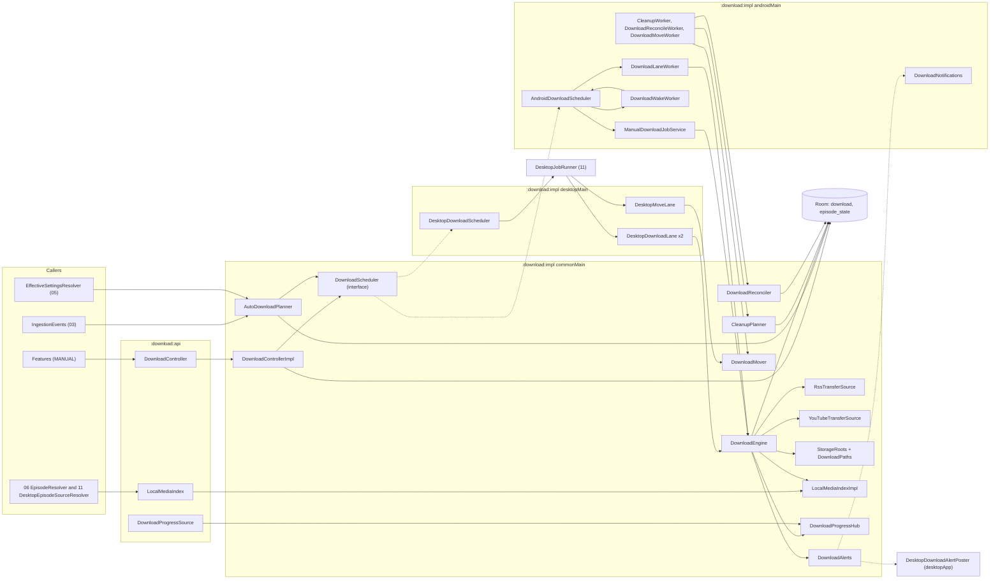
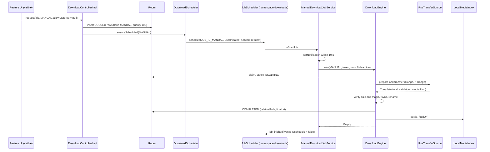
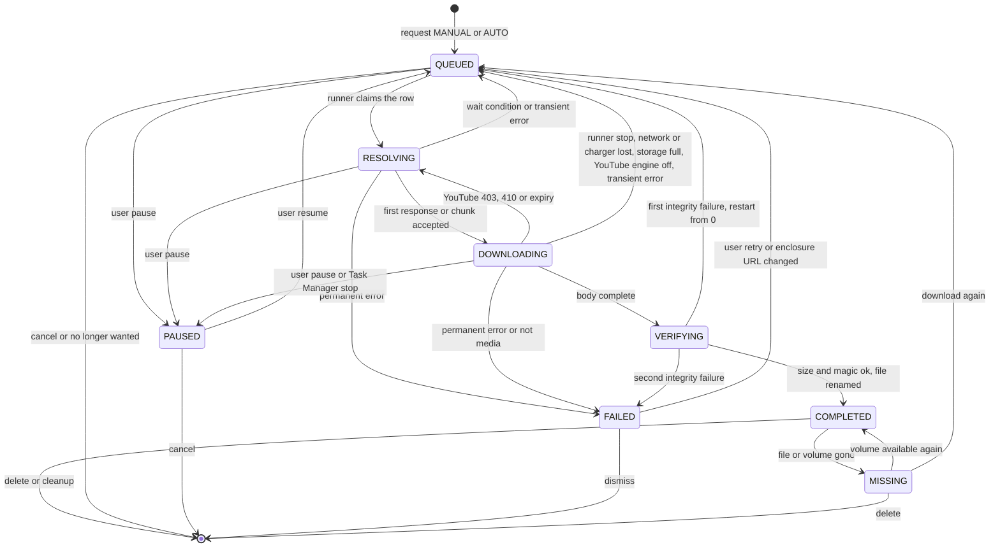
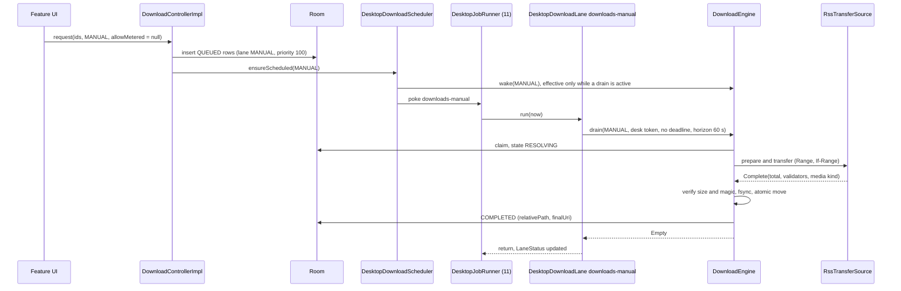
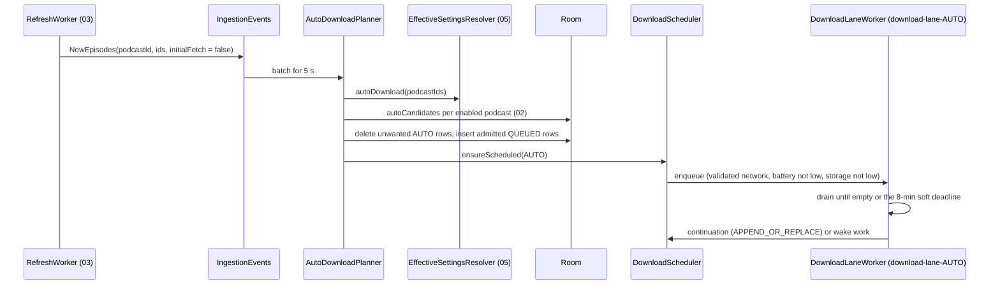

# 07 — Downloads

> Status: Draft v1, 2026-10-04; revised 2026-10-05 for the product owner's decisions (embedded yt-dlp engine, external mode as a runtime capability, GitHub Releases only, app update check); revised 2026-10-05 for PO-31–PO-35 (notify-only update check without an APK download, published debug builds — the latter superseded by the scope revision); scope revision 2026-10-05 (S0–S13): the engine, state machine, claim rules, transfer core (now Ktor streaming into Okio `.part` files), YouTube transfers, planner, cleanup, reconciliation and the move algorithm become common code in the KMP module `:download:impl`, Android keeps its UIDT and WorkManager runners unchanged in `androidMain`, the desktop drains the same lanes in-process in `DesktopJobRunner` with its own storage roots, alerts and folder moves, sync never carries downloads but its played, favourite, Up next and unsubscribe changes drive cleanup and planning, Hilt becomes Metro, and device tests run on release builds; **final cross-document review 2026-10-05:** `JobLanePoker` and the Ktor User-Agent resolved · Implements: R4.2, R4.3 (local files), R4.4, R4.5, R4.6, R3.6, R3.7 (no YouTube downloads without the engine), R2.6 (download all), R2.7 (auto-download defaults), R1.8 (download exclusion), R5.3 (episode art of downloads), R7.3 (downloads never sync), R8.7 (desktop download lanes), R8.8 (desktop roots and moves; the folder UI and OS specifics are 11's) / N1, N2, N3, N6, N7 · Milestones: M0 (M0a), M6 (M6a, M6b), M8, M9 (M9a), MD2, MD3, MS2, M11 (M11b), M15 · Honours: D1, D14, D15, D17, D45, D46, D47, D48, D49, D50, D66, D67, D73, D74, D77, D78, D81, D82, D85, D87, D90, D93, D96; PO-12 default, PO-37 · Owns: `:download:api` and `:download:impl` — the download engine and its state machine, runner selection on Android (UIDT job, WorkManager lanes, `dataSync`) and the desktop download lanes (`DesktopDownloadLane`, `DesktopMoveLane`), HTTP transfer rules, YouTube transfer mechanics (engine-resolved URLs, 10 MiB chunks, re-resolve, pacing), the engine-absent rules for YouTube rows, storage roots and their identifiers on both platforms, naming and integrity, live progress, download notifications (Android) and the content of the desktop's download alerts, auto-download planning, cleanup and quota, reconciliation and lifecycle, moving downloads between roots, download manifest entries

Contents: [Scope](#scope) · [Engine architecture](#engine-architecture) · [State machine](#state-machine) · [Runners and scheduling](#runners-and-scheduling) ([Desktop runners](#desktop-runners)) · [Transfer core](#transfer-core) · [YouTube transfers](#youtube-transfers) · [Storage layout](#storage-layout) · [Progress and notifications](#progress-and-notifications) · [Auto-download policy](#auto-download-policy) · [Cleanup and quota](#cleanup-and-quota) · [Lifecycle and reconciliation](#lifecycle-and-reconciliation) · [Backup exclusion](#backup-exclusion) · [Settings](#settings) · [Testing](#testing) · [Manifest entries](#manifest-entries) · [Error handling and failure modes](#error-handling-and-failure-modes) · [Delivery by milestone](#delivery-by-milestone) · [Open questions](#open-questions) · [Sources](#sources)

---

## Scope

Serves R4.2–R4.6, R3.6, R3.7, R7.3 (download side), R8.7, R8.8, N1, N2, N6. Delivered in [M6](../PLAN.md#m6-downloads) (engine, runners, RSS transfers, storage, auto-download, cleanup, reconciliation — on Android and the desktop, M6a and M6b), [M9](../PLAN.md#m9-youtube-playback-and-downloads-via-the-embedded-yt-dlp-engine) (M9a: YouTube transfers on the APKs with the YouTube engine, and the engine-absent rules) and [MD3](../PLAN.md#md3-desktop-youtube-engine) (the same YouTube transfers on every desktop build), with API stubs in M0a, the YouTube rejection rule in M8, the desktop alerts and busy signal in MD2 and the sync interplay in MS2 ([Delivery by milestone](#delivery-by-milestone)).

Neutrodyne downloads episodes with its **own small engine** that writes real, user-copyable audio files ([D46](../PLAN.md#3-key-decisions)). The engine, its state machine, the claim rules, the **transfer core** (Ktor streaming into Okio `.part` files over the island's OkHttp DOWNLOAD client), YouTube transfers, the auto-download planner, cleanup, reconciliation and the move algorithm are **common code** in `:download:impl`'s `commonMain` and behave identically on Android and the desktop ([D81](../PLAN.md#3-key-decisions)); only the runners, storage roots, notifications and a few file-system details are per platform. The `download` row in Room is the only record of download state; there is no Media3 `DownloadManager`, no system `DownloadManager` and no `WorkInfo`-based progress. Two **lanes** partition the queue: `MANUAL` (the user asked) and `AUTO` (a policy asked). On **Android** the runner that drains a lane depends on the lane and the API level ([D47](../PLAN.md#3-key-decisions)): a user-initiated data transfer (UIDT) job on API 34+ for `MANUAL`, WorkManager expedited work (promoted to a `dataSync` foreground service only when started while the app is visible) on API 26–33 for `MANUAL`, and a regular WorkManager worker with an 8-minute soft deadline for `AUTO` everywhere. On the **desktop** both lanes drain in-process in 11's `DesktopJobRunner` while the app runs, with the same claim rules and slots and without quotas, soft deadlines or wake work ([Desktop runners](#desktop-runners), [D85](../PLAN.md#3-key-decisions)). Files live in app-specific storage on Android and in `<data>/Downloads` or a folder the user chose on the desktop ([D48](../PLAN.md#3-key-decisions)), in one layout for RSS and YouTube ([D49](../PLAN.md#3-key-decisions)). Live byte counts never touch the database between state transitions ([D17](../PLAN.md#3-key-decisions)), and resolved stream or CDN URLs never touch it at all ([D50](../PLAN.md#3-key-decisions)). Downloads are device-local: sync never carries audio files, `download` rows or `downloads.*` settings, although synced played state, favourites, Up next and unsubscribes drive cleanup and planning here ([D93](../PLAN.md#3-key-decisions), [Sync interplay](#sync-interplay)).

### Responsibilities and boundaries

| This document owns | Owned elsewhere (link, do not restate) |
|---|---|
| `:download:api` (`DownloadController`, `LocalMediaIndex`, `DownloadProgressSource`) and `:download:impl` | `download` entity, DAO SQL, indices — [02 download](02-data-model.md#download), [02 Downloads](02-data-model.md#downloads) |
| State machine, `waitReason` meanings and their UI strings, transition persistence rules | Downloads screen layout, row visuals, dialogs — [08 Screens](08-ui-ux.md#screens), [08 Components](08-ui-ux.md#components) |
| Runner selection, JobScheduler and WorkManager requests, soft deadlines, stop reasons (Android); what the desktop lanes `downloads-manual`, `downloads-auto` and `downloads-move` do in a run, and the busy signal they report | Merged manifest, the Ktor client factory and the DOWNLOAD `OkHttpClient` — [01 Manifest and permissions](01-foundation.md#manifest-and-permissions), [01 One client family](01-foundation.md#one-client-family); `DesktopJobRunner` (tick, pokes, wake and restart catch-up, quit), the close and tray behaviour — [11 Background work](11-desktop.md#background-work), [11 Window and tray behaviour](11-desktop.md#window-and-tray-behaviour) |
| HTTP transfer rules, sniffing, retries, integrity, rename | How playback resolves `neutrodyne://episode/{id}` to a local file — [06 Media items and URI resolution](06-playback.md#media-items-and-uri-resolution) (Android), [11 Sources and SpanCache](11-desktop.md#sources-and-spancache) (desktop) |
| YouTube transfer mechanics (chunking, re-resolve loop, pacing) and the engine-absent rules for YouTube rows | YouTube resolution (yt-dlp in `:ytx` on Android, in a CPython child on the desktop), `ResolvedUrlCache`, IP-family matching, capabilities and `ExternalReason`, breaker, the YouTube download rules — [04 YouTube engine](04-youtube.md#youtube-engine), [04 Capability matrix](04-youtube.md#capability-matrix), [04 Download integration](04-youtube.md#download-integration), [04 Error handling and circuit breaker](04-youtube.md#error-handling-and-circuit-breaker); the desktop host — [11 Desktop YouTube engine host](11-desktop.md#desktop-youtube-engine-host) |
| App updates: none in downloads — the update check never downloads an APK or installer, nothing waits for or blocks an install, and a manual install ends the process like any update ([App update](#app-update)) | The update check (notify and link only, [D78](../PLAN.md#3-key-decisions)) — [09 Update check](09-quality-and-release.md#update-check) |
| Storage roots and their identifiers on both platforms, file naming, free-space checks, `LocalMediaIndex` | Effective auto-download policy merge (D45) — [05 Effective settings resolution](05-groups-opml-backup.md#effective-settings-resolution); the desktop folder dialog and validation, the Windows path-length rule, "Show in folder", desktop disk-full detection, removable and network drives, macOS folder privacy — [11 Desktop downloads and storage](11-desktop.md#desktop-downloads-and-storage) |
| `AutoDownloadPlanner`, `CleanupPlanner`, quota, tombstone writes | Which episodes "Download all unplayed" offers and its confirmation — [05 Group actions](05-groups-opml-backup.md#group-actions) |
| Reconciliation, Task Manager stops, reboot, update, uninstall, moving roots | Auto Backup XML — [05 Auto Backup](05-groups-opml-backup.md#auto-backup) (07 only states what must stay out) |
| Download notifications (`downloads`, `download_errors`) and `DownloadActionReceiver` (Android); the content of the desktop's download alerts (`DownloadAlerts`) | `EpisodeLiveStateSource` implementation — [08 Live row state](08-ui-ux.md#live-row-state) (07 supplies inputs); the desktop notification back ends — [11 Notifications](11-desktop.md#notifications) |
| `downloads.*` settings keys (device-local, never synced); how pulled sync changes reach downloads ([Sync interplay](#sync-interplay)) | Artwork pinning internals — [08 Artwork pipeline](08-ui-ux.md#artwork-pipeline) (07 calls `ArtworkStore.pin`); what syncs and how pages are applied — [10 What syncs](10-sync.md#what-syncs), [10 Client sync engine](10-sync.md#client-sync-engine) |

### Modules and public API

**Implementation note (2026-10-19, M6a).** Kotlin declarations are the frozen
boundary: download:api plus download:impl's TransferContracts, StorageContracts
and RunnerContracts. DeleteReason replaces byUser; RootChangeMode replaces
moveExisting. Moves return Unsupported; folder registration rejects UNSUPPORTED
until M6b. Orphan deletion returns Deleted(bytes) or Unavailable. AUTO admission
rejects IDs as UNAVAILABLE in M6a. LocalMediaChanges publishes changed IDs after
index updates; LocalMediaIndexStore freezes the internal replace/put/remove writer.
DownloadQueries, DownloadSourceQueries, DownloadStateQueries and
DownloadSessionQueries freeze SQL-facing contracts without changing Room/schema.
Engine owns claimMutex through paging/claim/slot reservation; pause/cancel/delete
share it. Engine alone commits transfer states, including ProgressSink.started
before accepted bytes; token ownership lasts through child cleanup/final commits.
Scheduler owns lane exit mutex/rechecks; reconcile and deletion each serialize.
File ports use byte arrays with Okio behind the implementation boundary.
ChapterRepository.ensureLocalLoaded(id, fileUri) returns EmbeddedChapterResult;
it and PlaybackController.playDownloads explicitly report unavailable until W8.


| Module | Package | Contents |
|---|---|---|
| `:download:api` (`neutrodyne.kmp.library`, `commonMain` only, Unlicense) | `ch.lkmc.neutrodyne.download.api` | `DownloadController`, `LocalMediaIndex`, `DownloadProgressSource` and the data types below; depends on `:core:{model, common}` only ([01 Dependency rules](01-foundation.md#dependency-rules)) |
| `:download:impl` (`neutrodyne.kmp.library`; `commonMain`, `androidMain`, `desktopMain`) | `ch.lkmc.neutrodyne.download.impl` | **`commonMain`:** `DownloadControllerImpl`, `DownloadEngine`, `DownloadScheduler` (interface), `RssTransferSource`, `YouTubeTransferSource`, `StorageRoots` (interface), `DownloadPaths`, `MediaSniffer`, `PartFile`, `DownloadFileSystem` (Okio), `LocalMediaIndexImpl`, `DownloadProgressHub`, `AutoDownloadPlanner`, `CleanupPlanner`, `DownloadReconciler`, `DownloadMover`, `DeferredDeletes`, `DownloadAlerts` and its `DownloadAlertPoster` port, `DownloadDiagnostics`, `YouTubeEngineRules` (M9a). **`androidMain`:** `AndroidDownloadScheduler`, `ManualDownloadJobService`, `DownloadLaneWorker`, `DownloadWakeWorker`, `CleanupWorker`, `DownloadReconcileWorker`, `DownloadMoveWorker`, `AndroidStorageRoots`, `DownloadNotifications` (Android `DownloadAlertPoster`), `DownloadActionReceiver`, `DownloadComponentsInjector`, `ExitReasonProbe`, `JobSchedulerFacade`, `ChargingMonitor`, `AppVisibility`, the manifest entries. **`desktopMain`:** `DesktopDownloadScheduler`, `DesktopDownloadLane`, `DesktopMoveLane`, `DesktopStorageRoots`, `DesktopDownloadActivity`. Consumes 04's `YouTubeCapabilitiesSource`, `YouTubeEngine` (`prewarm`), `YouTubeStreamResolver` and `YouTubeHealth` through `:youtube:api`, never `:youtube:ytdlp`, `:youtube:engine` or `:youtube:ytdlp-desktop` |
| `:desktopApp` | `ch.lkmc.neutrodyne.desktop` | `DesktopDownloadAlertPoster` (MD2): a few lines mapping `DownloadAlert`s onto 11's `DesktopNotifier`; it lives in the shell because `:download:impl` may not see the desktop-only `:desktop:system` ([PLAN 5.1](../PLAN.md#51-module-graph) rule 6), as 03's `DesktopNewEpisodePoster` does |
| `:core:model` | `ch.lkmc.neutrodyne.core.model` | Canonical enums `DownloadState`, `DownloadLane`, `WaitReason`, `DownloadError`, `SourceKind`, `NetworkPolicy`, `DeleteAfter`; new `ManualMeteredPolicy`; `DownloadSettingKeys` (package `…core.model.settings`) |

`commonMain` holds no `java.*` or `android.*` type ([D81](../PLAN.md#3-key-decisions)): files go through Okio's `FileSystem`, HTTP through Ktor, digests and `file:` URIs through two small platform seams (`SriHasher`, `LocalUris`) whose `androidMain` and `desktopMain` implementations are the same few JDK lines twice, because Kotlin has no source set shared by the Android and JVM targets ([01 Source sets and JVM islands](01-foundation.md#source-sets-and-jvm-islands)).

```kotlin
// :download:api — canonical members kept; additions marked "+"
interface DownloadController {
    suspend fun request(episodeIds: List<Long>, trigger: DownloadLane, allowMetered: Boolean?): RequestResult
    suspend fun pause(episodeIds: Collection<Long>)
    suspend fun resume(episodeIds: Collection<Long>)
    suspend fun cancel(episodeIds: Collection<Long>)                    // user: drops row and .part, writes tombstone
    suspend fun retry(episodeIds: Collection<Long>)
    suspend fun promote(episodeId: Long): RequestResult                 // "Download now": AUTO → MANUAL, priority 200
    suspend fun delete(episodeIds: Collection<Long>, reason: DeleteReason)   // any state; tombstone only for USER
    suspend fun setAllowMetered(episodeIds: Collection<Long>, allowed: Boolean)  // + "Use mobile data"
    suspend fun pauseAll()                                              // +
    suspend fun resumeAll()                                             // +
    suspend fun reportFileMissing(episodeId: Long)                      // + called by 06 on FILE_NOT_FOUND
    fun observe(episodeId: Long): Flow<DownloadStatus?>                 // row merged with live progress
    fun observeAll(): Flow<DownloadsOverview>                           // Downloads screen
    fun observeStorage(): Flow<StorageUsage>
    fun observeFailedCount(): Flow<Int>                                 // + (2026-10-05) Downloads tab badge (08 open question 10)
    fun observeBusy(): Flow<Boolean>                                    // + (2026-10-05) desktop close behaviour (11); see Desktop runners
    suspend fun storageRoots(): List<StorageRootInfo>                   // +
    suspend fun registerFolderRoot(absolutePath: String): FolderRootResult   // + (2026-10-05) desktop "Change folder…"; Android: Rejected(UNSUPPORTED)
    suspend fun changeRoot(rootId: String, mode: RootChangeMode): RootChangeResult       // + settings; moves are M6b only
    suspend fun deleteOrphanFiles(): OrphanDeleteResult                               // + bytes freed or explicitly unavailable
    suspend fun shareableFile(episodeId: Long): ShareableFile?          // + "Share file" (Android); null unless COMPLETED on a shareable root; always null on the desktop
}
fun interface LocalMediaIndex { fun localUriOrNull(episodeId: Long): String? }   // canonical, synchronous
interface DownloadProgressSource {
    fun observe(ids: Set<Long>): Flow<Map<Long, LiveProgress>>          // ≤ 4 Hz
}
```

```kotlin
// :download:api — data types (all immutable, commonMain)
sealed interface RequestResult {
    data class Queued(val queued: Int, val alreadyPresent: Int, val rejected: Map<Long, RejectReason>,
                      val askNotificationPermission: Boolean) : RequestResult
    data class NeedsMeteredDecision(val count: Int, val knownBytes: Long, val unknownSizeCount: Int) : RequestResult
}
enum class RejectReason { EPISODE_GONE, NOT_DOWNLOADABLE, UNSUPPORTED_STREAM, YOUTUBE_NOT_SUPPORTED, UNAVAILABLE }
data class LiveProgress(val state: DownloadState, val downloadedBytes: Long, val totalBytes: Long?,
                        val bytesPerSecond: Long?)
data class DownloadStatus(
    val episodeId: Long, val lane: DownloadLane, val state: DownloadState, val waitReason: WaitReason,
    val downloadedBytes: Long, val totalBytes: Long?, val estimatedBytes: Long?, val bytesPerSecond: Long?,
    val nextAttemptAt: Long?, val lastError: DownloadError?, val lastHttpStatus: Int?,
    val allowMetered: Boolean, val requireCharging: Boolean, val sourceKind: SourceKind, val completedAt: Long?)
data class DownloadEntry(val status: DownloadStatus, val podcastId: Long, val podcastTitle: String,
                         val episodeTitle: String, val artwork: ArtworkRef, val sortDate: Long,
                         val played: Boolean, val favorite: Boolean)
data class DownloadsOverview(val inProgress: List<DownloadEntry>, val completed: List<DownloadEntry>,
                             val failed: List<DownloadEntry>, val storage: StorageUsage, val notices: Set<DownloadNotice>)
data class StorageUsage(val rootId: String, val usedBytes: Long, val partialBytes: Long, val orphanBytes: Long,
                        val freeBytes: Long?, val capBytes: Long?, val autoBlockedByCap: Boolean)
data class StorageRootInfo(val rootId: String, val kind: RootKind, val label: String?, val freeBytes: Long?,
                           val available: Boolean, val path: String? = null)   // + path: desktop roots only (display, "Show in folder")
enum class RootKind { PRIMARY_EXTERNAL, REMOVABLE, INTERNAL, DESKTOP_DEFAULT, DESKTOP_FOLDER }   // + the two desktop kinds
sealed interface FolderRootResult {                                      // + (2026-10-05)
    data class Ok(val root: StorageRootInfo) : FolderRootResult
    data class Rejected(val reason: FolderRejectReason) : FolderRootResult
}
enum class FolderRejectReason { NOT_A_DIRECTORY, NOT_WRITABLE, INSIDE_APP_DIRECTORIES, UNSUPPORTED }   // 11's validation list
data class ShareableFile(val contentUri: String, val mimeType: String)   // content://${applicationId}.fileprovider/… (Android)
enum class DownloadNotice { DATA_SAVER, BACKGROUND_RESTRICTED, NOTIFICATIONS_OFF, CAP_REACHED, STORAGE_LOW,
                            ROOT_UNAVAILABLE, YOUTUBE_PAUSED, MOVE_IN_PROGRESS, ORPHAN_FILES }
```

Callers: features (`:feature:downloads`, `:feature:episode`, `:feature:podcast`, `:feature:feeds`, and Settings › Desktop for `registerFolderRoot`/`changeRoot` on the desktop) call `DownloadController` with `trigger = MANUAL` only; `AUTO` is used by `AutoDownloadPlanner` inside `:download:impl`. 03's unsubscribe and merge (including unsubscribes pulled by sync) use core:domain lifecycle ports; 06's error recovery and 11's desktop playback resolver take `DownloadController` and `LocalMediaIndex` as optional bindings (a nullable constructor parameter defaulting to `null` before M6; Metro's exact form is S8's, [06 Open questions](06-playback.md#open-questions) 23). `DownloadController`, `LocalMediaIndex` and `DownloadProgressSource` are `@SingleIn(AppScope::class)` bindings contributed by `:download:impl` to both app graphs ([01 Dependency injection](01-foundation.md#dependency-injection)); 11's close behaviour reads `observeBusy()` and 08's Downloads tab badge reads `observeFailedCount()` (a `COUNT(*)` over `download` rows in `FAILED`, so the badge does not load the full lists).

### Threading and coroutines

**Implementation note (2026-10-19, M6b).** W1 exposes the orchestration ports
in `ch.lkmc.neutrodyne.core.domain` so `core:testing` can supply fakes without
an implementation-module dependency. The concrete owners remain in
`download:impl`. Planner, cleanup and mover each own a separate single-flight
mutex. Queue mutations coordinate with the shared claim mutex; file/network IO
stays outside DB transactions. `DownloadMover.run(target, deadline)` takes a
nullable monotonic elapsed-ms deadline, null on desktop, and returns
COMPLETE, PENDING, DEADLINE or STORAGE_FULL. Scheduler lane/wake signatures stay
unchanged; W5 extends their Android implementation to AUTO.

| Component | Runs on | Rules |
|---|---|---|
| `DownloadControllerImpl` | caller's coroutine; main-safe | DAO calls on Room's query context; scheduling on `@Dispatcher(IO)`; never blocks the caller beyond one write transaction per call |
| `DownloadEngine.drain(...)` | the runner's coroutine (Android: UIDT service scope or `CoroutineWorker.doWork`; desktop: the lane's `run` on 11's `DesktopJobRunner`, `Dispatchers.IO`) | transfers are **children** of the runner, so stopping a runner cancels exactly its transfers; shared state (slots, active registry, progress) is thread-safe |
| One transfer | `@Dispatcher(IO)` | Ktor `prepareGet(…).execute { }` on the DOWNLOAD client: cancelling the coroutine cancels the underlying OkHttp call (Ktor's OkHttp engine; S12 checks it, [01 One client family](01-foundation.md#one-client-family)); `bodyAsChannel()` reads suspend, so no `runInterruptible` is needed; 256 KiB buffer into an Okio sink |
| State writes on stop | `withContext(NonCancellable)` in `finally` | at most one write transaction; never network or file I/O inside it |
| `LocalMediaIndexImpl` | any thread, including Media3's loader thread and the main thread (Android) and 11's `nd-prepare` and `nd-engine` threads and the Swing EDT (desktop) | an immutable map in a `MutableStateFlow` (copy-on-write; writes are rare — one per completion, deletion or move — and reads are lock-free in `commonMain`); on the UI thread it never blocks; all threads return the current memory snapshot immediately |
| `DownloadProgressHub` | ticker on `@Dispatcher(Default)` | publishes a snapshot every 250 ms while any transfer is active, idle otherwise |
| `AutoDownloadPlanner`, `CleanupPlanner`, `DownloadReconciler`, `DownloadMover` | `@ApplicationScope`, the calling worker or the calling desktop lane | each guarded by its own `Mutex` (single flight) |
| `ManualDownloadJobService` callbacks (Android) | main thread | return within milliseconds (Android 14 ANR rule); work runs in a service scope (`SupervisorJob() + Default`) |
| `DownloadActionReceiver` (Android) | `goAsync()` + `@ApplicationScope` | `finish()` within 10 s ([01 Coroutines and threading](01-foundation.md#coroutines-and-threading)) |
| Time | `Clock` | deadlines, in-runner waits and speed use `Clock.elapsedRealtime()`; persisted `nextAttemptAt`, `requestedAt`, `completedAt` use `Clock.now()` |

**Single-process assumption.** On Android, engine, runners, receivers and planners run in the main process (the WorkManager and JobScheduler default; `:acra` and `:ytx` run none of them); on the desktop they run in the one JVM process ([D85](../PLAN.md#3-key-decisions)). YouTube extraction runs in 04's engine host — the `:ytx` process on Android, the CPython child on the desktop — behind `YtDlpClient` ([04 Shared engine module](04-youtube.md#shared-engine-module)), but yt-dlp never downloads media: every googlevideo byte is fetched by this engine in the app process. In-memory registries (active transfers, lane phases, `LocalMediaIndex`, deferred deletes) are therefore authoritative for the life of the process, and everything persistent is re-derived from the database at the next process start ([Lifecycle and reconciliation](#lifecycle-and-reconciliation)).

### New names introduced here

| Name | Kind / location | Purpose |
|---|---|---|
| `RequestResult`, `RejectReason`, `DownloadStatus`, `DownloadEntry`, `DownloadsOverview`, `StorageUsage`, `StorageRootInfo` (+ `path`, 2026-10-05), `RootKind` (+ `DESKTOP_DEFAULT`, `DESKTOP_FOLDER`), `DownloadNotice`, `LiveProgress`, `ShareableFile`; `FolderRootResult`, `FolderRejectReason` (2026-10-05) | data types, `:download:api` (`commonMain`) | Public API shapes |
| `DownloadController.registerFolderRoot`, `observeBusy`, `observeFailedCount` (2026-10-05) | API members, `:download:api` | Desktop folder roots, the desktop busy signal for 11's close behaviour, 08's Downloads badge |
| `ManualMeteredPolicy { ASK, ALWAYS, NEVER }` | enum, `:core:model` | `downloads.manual_metered` |
| `WaitReason.YOUTUBE_ENGINE_OFF` (M9a) | constant appended to the canonical enum (02 stores it) | A YouTube row waits for the engine ([Engine absent or disabled](#engine-absent-or-disabled)) |
| `DownloadSettingKeys` | object, `:core:model` (`…core.model.settings`) | The `downloads.*` keys of [Settings](#settings) |
| `DownloadControllerImpl`, `LocalMediaIndexImpl`, `DownloadProgressHub`, `DownloadPaths`, `MediaSniffer`, `MediaKind`, `ContentRange`, `PartFile`, `DownloadFileSystem`, `DeferredDeletes`, `DownloadSlots`, `ActiveTransfers`, `StopIntent`, `TransferSource`, `TransferPlan`, `Prepared`, `TransferResult`, `TransferEnd`, `ProgressSink`, `DrainRequest`, `DrainOutcome`, `RunnerToken`, `Conditions`, `YouTubeAutoPacer`, `YouTubeGateView`, `DownloadDiagnostics`, `DownloadInitializers`, `YouTubeEngineRules`; (2026-10-05) `DownloadScheduler` (now an interface), `StorageRoots` (now an interface), `StorageFailure`, `DownloadMover`, `DownloadAlerts`, `DownloadAlert`, `DownloadAlertPoster`, `SriHasher`, `LocalUris` | classes, `:download:impl` `commonMain` (internal except the ports) | Engine internals; `DownloadAlertPoster` is implemented by each platform |
| `AndroidDownloadScheduler` (2026-10-05; the former `DownloadScheduler` class), `LaneRegistry`, `UidtReporter`, `NotificationReporter`, `ChargingMonitor`, `AppVisibility`, `ExitReasonProbe`, `JobSchedulerFacade`, `AndroidStorageRoots` (2026-10-05), `DownloadComponentsInjector` (2026-10-05, Metro member injection of `ManualDownloadJobService` and `DownloadActionReceiver`) | classes, `:download:impl` `androidMain` | Android runners and platform seams |
| `DesktopDownloadScheduler`, `DesktopDownloadLane` (lanes `downloads-manual`, `downloads-auto`), `DesktopMoveLane` (lane `downloads-move`), `DesktopStorageRoots`, `DesktopDownloadActivity` (2026-10-05) | classes, `:download:impl` `desktopMain` | [Desktop runners](#desktop-runners), [Roots](#roots) |
| `DesktopDownloadAlertPoster` (2026-10-05) | class, `:desktopApp` | Desktop `DownloadAlertPoster` over 11's `DesktopNotifier` (MD2) |
| `JobLanePoker` (2026-10-05, requested from 11) | `fun interface`, `:core:common` `desktopMain`, bound to 11's `DesktopJobRunner` | Lets `:download:impl` poke its lanes without depending on `:core:data` ([PLAN 5.1](../PLAN.md#51-module-graph) rule 4; [Open questions](#open-questions) 20) |
| `DownloadWakeWorker`; unique work `download-wake-MANUAL`, `download-wake-AUTO` (one-time, policy `REPLACE`, tag `download`) | worker and work names, `:download:impl` | Delayed or condition-bound re-arming of a lane ([Wake work](#wake-work)) |
| `NOTIF_ID_DOWNLOAD_ERRORS = 2002`, `NOTIF_ID_STORAGE_FULL = 2003`, `NOTIF_ID_DOWNLOADS_WAITING = 2004` | notification IDs (range 2000–2999) | Error summary, storage full, "open the app to continue" |
| Actions `ch.lkmc.neutrodyne.download.action.PAUSE_ALL`, `…RETRY_FAILED`, `…DISMISS_ERRORS` | explicit intents to `DownloadActionReceiver` | Notification actions |
| `STOP_PROCESS_DEATH = -1`, `STOP_SOFT_DEADLINE = -2`, `STOP_USER_PAUSE = -3`, `STOP_USER_TASK_MANAGER = -4`, `STOP_HANDOVER = -5`, `STOP_APP_QUIT = -6` (2026-10-05, desktop) | `download.lastStopReason` values below 0 (≥ 0 are platform `STOP_REASON_*`) | Diagnostics, the torn-tail rule, `AUTO` → UIDT handover, a desktop quit |
| Runner tokens `uidt:{startedAtMs}`, `work:{workSpecId}:{startedAtMs}`, `desk:{lane}:{startedAtMs}` (2026-10-05) | format of `download.runnerToken` | Live-runner check and the Task Manager rule ([Pause, cancel and Task Manager stops](#pause-cancel-and-task-manager-stops)) |
| Root IDs `dir:default`, `dir:{key}` (2026-10-05) | format of `download.rootId` on the desktop | [Roots](#roots) |
| `downloads.planner_baseline_at` | `device_settings` key | [No backfill watermark](#no-backfill-watermark) |
| `downloads.desktop_roots`, `downloads.move_target`, `downloads.cleanup_last_at` (2026-10-05, desktop) | `device_settings` keys | [Roots](#roots), [Moving between roots](#moving-between-roots), [Desktop runners](#desktop-runners) |
| `DownloadDao` functions `claimNext`, `candidates`, `observeEntries()`, `observePlayedCompletedIds()`, `queuedNeeds(lane, now)`, `markWait(…)`, `clearStorageWaits()`, `requeueChangedEnclosures(now)`, `rowsOnOtherRoots(target, limit)`, `pathsByRoot()`, `autoCandidates(…)`, `cleanupCandidates(…)`, (2026-10-05) `observeFailedCount()`, `rootsInUse()`; `EpisodeDao.downloadSources(ids)`; `PlaySessionDao.observeCurrentEpisodeId()` | DAO functions defined by 02 ([02 Downloads](02-data-model.md#downloads)); `candidates` gains an `offset` parameter ([Open questions](#open-questions)); the two 2026-10-05 functions are requested from 02 ([Open questions](#open-questions) 21) | SQL owned by 02 |

---

## Engine architecture

Serves R4.2, R4.6, R8.7, N1, N2. Delivered in M6 (RSS, both platforms), M9a (YouTube on Android), MD3 (YouTube on the desktop). Honours [D46](../PLAN.md#3-key-decisions), [D17](../PLAN.md#3-key-decisions), [D81](../PLAN.md#3-key-decisions).



| Component | Responsibility |
|---|---|
| `DownloadControllerImpl` | Validates requests, inserts and updates rows, applies the metered rule, translates user actions into DB updates or `StopIntent`s, calls `DownloadScheduler.ensureScheduled(lane)` |
| `DownloadScheduler` | Interface (`ensureScheduled(lane)`, `wake(lane)`): arms whatever drains a lane. `AndroidDownloadScheduler` chooses and arms the Android runner ([Runners and scheduling](#runners-and-scheduling)) and owns `LaneRegistry` and the per-lane `Mutex`; `DesktopDownloadScheduler` wakes a draining lane and pokes 11's runner ([Desktop runners](#desktop-runners)) |
| `DownloadEngine` | `drain(request)`: claims rows, admits them against `DownloadSlots`, runs transfers through a `TransferSource`, verifies and finalises files, writes transitions, feeds `DownloadProgressHub` |
| `RssTransferSource`, `YouTubeTransferSource` | One attempt of one row: prepare (source refresh, invariants) and transfer (bytes into the `.part`) ([Transfer core](#transfer-core), [YouTube transfers](#youtube-transfers)) |
| `DownloadSlots` | Global `Semaphore(3)`, per-host `Semaphore(2)` keyed by the enclosure URL's host, YouTube `Semaphore(1)`; `AUTO` may hold at most 2 global slots so one slot is always free for `MANUAL` (kotlinx-coroutines `Semaphore`, common) |
| `ActiveTransfers` | `episodeId → (Job, lane, runnerToken, AtomicReference<StopIntent?>)`; the cancel registry (`kotlin.concurrent.atomics`, experimental and common since Kotlin 2.1.20, [what's new](https://kotlinlang.org/docs/whatsnew2120.html)) |
| `StorageRoots`, `DownloadPaths` | Root resolution, naming, free-space checks ([Storage layout](#storage-layout)); `AndroidStorageRoots` and `DesktopStorageRoots` implement the platform part |
| `LocalMediaIndexImpl` | In-memory mirror `episodeId → finalUri` of `COMPLETED` rows for 06 and 11 |
| `DownloadProgressHub` | `DownloadProgressSource` implementation and notification feed |
| `AutoDownloadPlanner`, `CleanupPlanner` | Policy-driven inserts and deletions ([Auto-download policy](#auto-download-policy), [Cleanup and quota](#cleanup-and-quota)) |
| `DownloadReconciler` | Start-up and daily repair ([Lifecycle and reconciliation](#lifecycle-and-reconciliation)) |
| `DownloadMover` | The move algorithm between roots, run by `DownloadMoveWorker` (Android) or `DesktopMoveLane` ([Moving between roots](#moving-between-roots)) |
| `YouTubeEngineRules` | Applies 04's capabilities to YouTube rows: marks and clears `YOUTUBE_ENGINE_OFF` waits, fails rows in a build without the engine ([Engine absent or disabled](#engine-absent-or-disabled)) |
| `DownloadAlerts` | Decides when the failure summary and the storage-full alert change and hands `DownloadAlert` values to the platform `DownloadAlertPoster` ([Progress and notifications](#progress-and-notifications)) |
| `DownloadNotifications` (Android) | Channels, aggregated progress, error and storage notifications |

### Claiming and slots

Every runner claims through one critical section so that two runners (on Android the UIDT job draining `MANUAL` and the `AUTO` worker; on the desktop the `downloads-manual` and `downloads-auto` lanes) never take the same row and never overshoot a slot limit:

```kotlin
// DownloadEngine (sketch)
private val claimMutex = Mutex()
private suspend fun claimOne(lanes: List<DownloadLane>, token: String, c: Conditions): DownloadEntity? =
    claimMutex.withLock {
        youTubeRules.syncIfChanged(capabilities.value)               // M9a: engine-absent rules before any claim
        if (!c.connected) return@withLock null                        // offline: rows wait in NETWORK, no busy loop
        val skipped = mutableListOf<Long>()
        var row: DownloadEntity? = null
        for (page in 0 until 10) {                                    // pages of 20 candidates, at most 200 rows
            row = dao.claimNext(lanes, c.now, c.unmetered, c.charging, c.youtubeAllowed, token, offset = page * 20) { r ->
                slots.canStart(r).also { ok -> if (!ok) skipped += r.episodeId }   // host, YouTube, AUTO cap
            }
            if (row != null || skipped.size < (page + 1) * 20) break   // claimed, or fewer than 20 candidates left
        }
        row?.let { slots.acquire(it) }
        if (skipped.isNotEmpty()) dao.markWait(skipped, WaitReason.SLOT, null)   // writes only rows not already SLOT
        row
    }
```

`claimNext` is 02's transaction (candidates ordered `priority DESC, requestedAt ASC, episodeId ASC`, then `claim` sets `RESOLVING`, `waitReason = NONE`, `runnerToken`; [02 Downloads](02-data-model.md#downloads)). Paging matters for throughput: after "Download all" of 200 episodes from one host, the first 20 candidates all wait for that host's 2 slots, and a row from another host further down must still get the third slot. `Conditions` comes from `NetworkMonitor.status` (`connected = isConnected`, `unmetered = isConnected && !isMetered`; on the desktop `isMetered` is always false, [01 NetworkMonitor](01-foundation.md#networkmonitor)), `ChargingMonitor.isCharging` (Android; the desktop sets `charging = true`, so charging rules never hold a row there), and `youtubeAllowed = capabilities.value.downloads && YouTubeGateView.blockedUntil(health.state.value, now) == null`, where `capabilities` is 04's `YouTubeCapabilitiesSource.capabilities`, read at every claim and never cached (it flips at run time, [04 Capability computation](04-youtube.md#capability-computation)). `YouTubeGateView` is a pure read of 04's `YouTubeHealthState` (breaker `OPEN` with `breakerOpenUntil > now`, or `rateLimitedUntil > now`). The engine never calls `YouTubeHealth.extractionGate` for claims: that call hands out the breaker's single half-open trial ([04 Circuit breaker](04-youtube.md#circuit-breaker)), which must go to the resolver's own call. Slots are released in the transfer's `finally`. `pause`, `cancel` and `delete` of queued rows also take `claimMutex`, so a row is never paused in the database while a runner is claiming it.

**Implementation note (2026-10-19, M6a).** Candidate selection also excludes IDs still
registered in `ActiveTransfers`, even after a final requeue clears the database
token. Registration lasts through post-commit cleanup and slot release. A runner
stop received during a suspended claim is applied to the registered child before
it starts transfer work.

### Drain loop

`suspend fun drain(req: DrainRequest): DrainOutcome` where `DrainRequest(lanes, runnerToken, softDeadlineElapsed: Long?, waitHorizonMs, reporter, exit: DrainExit)`; `DrainExit` is the platform scheduler's hook for steps 2 and 3.3 (Android: `LaneRegistry` and the exit protocol; desktop: a plain return, [Desktop runners](#desktop-runners)):

1. Once per process: `DownloadReconciler.resetOrphanedRunners()` (cheap, idempotent; [Lifecycle and reconciliation](#lifecycle-and-reconciliation)) and `CredentialLookup.awaitLoaded()` (01's interface, implemented by 03's `SecretStore` implementations, `KeystoreCredentialStore` and `DesktopSecretStore`), so a private enclosure is never fetched before its Basic-auth credential is in memory.
2. Register the token as `DRAINING` (Android: in `LaneRegistry`, [Lane registry and the exit protocol](#lane-registry-and-the-exit-protocol); desktop: in `DesktopDownloadActivity`).
3. Loop:
   1. If `softDeadlineElapsed` has passed (Android lane workers only; null for the UIDT job, foreground workers and the desktop lanes): stop accepting, set `StopIntent.Requeue(SYSTEM, STOP_SOFT_DEADLINE)` on every own transfer, await them, return `DeadlineReached`.
   2. While a global slot is free: `claimOne(...)`; for each row launch a child coroutine running [the transfer lifecycle](#transfer-lifecycle). A `MANUAL` lane worker stops claiming while the UIDT job is running (`LaneRegistry.uidtRunning`) and lets the job take the remaining rows.
   3. If nothing is active and nothing was claimed: call `exit` (on Android the [exit protocol](#lane-registry-and-the-exit-protocol)); return `Empty`, `Waiting(earliest)` or `Blocked(reason)`.
   4. Otherwise suspend until one of: a transfer ended; `wake(lane)` was signalled (new request, resume, freed slot, network or charging change, freed storage); the soft deadline; the earliest due `nextAttemptAt` of the lane within the **wait horizon** `waitHorizonMs` — 5 min for the UIDT job, 60 s for Android lane workers and for the desktop lanes. The UIDT job is quota-exempt, so it can wait out the first backoffs (about 1, 2 and 4 min) of a user's download instead of handing it to a quota-bound worker. Its notification then shows "Retrying in {t}". Lane workers must not burn quota waiting; the desktop has no quota but 11's runner ticks every 60 s anyway, so a longer horizon would only hold the lane open.
4. `finally`: unregister the token.

**Implementation note (2026-10-19, M6a).** The wait horizon limits an otherwise
idle drain. While it still owns transfers, the drain arms the earliest future
retry even when older due candidates are blocked by host slots, and even beyond
the idle horizon. Otherwise two long transfers from one host could leave the
third slot unused when another host's backoff expires. A wake or the soft
deadline still interrupts this timer.

The engine also collects `NetworkMonitor.status` and (Android) `ChargingMonitor` while any transfer is active; on the desktop only the disconnect rule can fire:
- on "metered", transfers whose row has `allowMetered = false` get `StopIntent.Requeue(UNMETERED_NETWORK)`;
- on "disconnected", every transfer gets `Requeue(NETWORK)` (no attempt is counted), and claims pause until `connected`;
- on "unplugged", `AUTO` transfers with `requireCharging` get `Requeue(CHARGING)`.

Every `finish` that leaves a row `QUEUED` calls `ensureScheduled(row.lane)` after its commit, so a row requeued by a runner of the other lane (for example, after a handover) is re-armed.

### Transfer lifecycle

```kotlin
// one child coroutine per claimed row (sketch)
suspend fun runTransfer(row: DownloadEntity, source: TransferSource) {
    val active = activeTransfers.register(row, coroutineContext.job)
    var end: TransferEnd = TransferEnd.Unknown
    try {
        end = withInRunnerRetries(row) { attemptOnce(row, source) }   // prepare → DOWNLOADING → transfer → verify
    } catch (c: CancellationException) {
        end = TransferEnd.Stopped(active.intent.get() ?: StopIntent.RunnerStopped(runnerStopReason()))
        throw c
    } finally {
        withContext(NonCancellable) { finish(row, end); activeTransfers.remove(row.episodeId); slots.release(row) }
    }
}
```

`StopIntent` is `Pause`, `Cancel(tombstone)`, `Delete(byUser)`, `Requeue(waitReason, stopReason)` or `RunnerStopped(platformStopReason)`. `finish` maps the end to exactly one persisted transition ([State machine](#state-machine)).

### Persisted transitions

The `download` table is low-churn: paged feeds join it ([D16](../PLAN.md#3-key-decisions)). The engine writes only these transitions; byte progress lives in `DownloadProgressHub`, and the `.part` length is the authoritative resume offset.

| Transition | Columns written (besides `state`) |
|---|---|
| insert `QUEUED` | everything known at request time ([Requests](#requests)) |
| `QUEUED → RESOLVING` (claim) | `waitReason = NONE`, `runnerToken` |
| `RESOLVING → DOWNLOADING` (first accepted response or chunk) | `totalBytes`; RSS: `etag` (only when the response `ETag` is strong) and `lastModified` (only when the response carried no `ETag` at all and its `Date` is at least 60 s after `Last-Modified`, [RSS prepare](#rss-prepare) step 5); YouTube: `lastModified` = `lmt`; `mimeType`, `resolvedItag`, `sourceRef` (if refreshed), `rootId`/`tempPath` (if reassigned), `downloadedBytes = offset` |
| `→ COMPLETED` | `relativePath`, `finalUri`, `totalBytes`, `downloadedBytes`, `completedAt`, `tempPath = NULL`, `runnerToken = NULL`, `lastError = NULL`, `attempt = 0` |
| `→ QUEUED(waitReason)`, `→ PAUSED`, `→ FAILED` | `waitReason`, `nextAttemptAt`, `attempt`, `integrityFailures`, `lastError`, `lastHttpStatus`, `lastStopReason`, `downloadedBytes = .part length`, `runnerToken = NULL` |
| `COMPLETED ↔ MISSING` | `lastError` (`STORAGE_UNAVAILABLE` or `NULL`) |

Not persisted in v1 (in-memory sub-states visible through `LiveProgress.state`): `VERIFYING` (a same-volume rename takes milliseconds; a crash there is recovered by the [completed-file adoption](#transfer-lifecycle-recovery) rule) and the YouTube `DOWNLOADING → RESOLVING → DOWNLOADING` re-resolve loop. `VERIFYING` becomes persisted when verification includes a copy (SAF roots, v1.x). Waiting rows' `waitReason`/`nextAttemptAt` updates are written only when the value changes.

#### Transfer lifecycle recovery

At `RESOLVING`, before any network request, the engine checks for a process death between the rename and the `COMPLETED` write. If the row has no `.part`, its `totalBytes` is known, and the podcast's `[p{podcastId}]` folder on the row's root holds a file named `… [e{episodeId}].{ext}` of exactly that length, the engine skips straight to verification and completes the row. The file is found by its suffix: the title and date part of the name may have changed since. If the row's `lastStopReason == STOP_PROCESS_DEATH`, the `.part` is truncated by `min(64 KiB, length)` before resuming, which drops a possibly torn tail (Unverified necessity on ext4/f2fs; cheap insurance).

### Requests

`request(episodeIds, trigger, allowMetered)`:

1. Load `EpisodeDao.downloadSources(ids)` (chunks of 500): episode, podcast and first audio alternate enclosure.
2. Per episode, reject with a `RejectReason`: row gone → `EPISODE_GONE`; no enclosure and no YouTube video ID → `NOT_DOWNLOADABLE`; effective type `application/x-mpegurl` or a `.m3u8` path ([03 Enclosure types](03-feeds-and-discovery.md#enclosure-types-and-media-acceptance)) → `UNSUPPORTED_STREAM`; YouTube while `!capabilities.value.downloads` (external mode: the `armeabi-v7a` APK, an emergency build, the engine turned off or failed, every APK before M9a and every desktop build before MD3) → `YOUTUBE_NOT_SUPPORTED`; `availability != AVAILABLE` → `UNAVAILABLE`.
3. Metered rule for `MANUAL` with `allowMetered == null`: `downloads.manual_metered` `ALWAYS` → `true`; `NEVER` → `false`; `ASK` → if the network is connected and metered and at least one episode would be inserted or re-queued (not merely `alreadyPresent` or rejected), return `NeedsMeteredDecision(count, knownBytes, unknownSizeCount)` over those episodes **without writing anything**; otherwise `false` (the row waits for Wi-Fi if the network changes and offers "Use mobile data"). 08's dialog answers with `request(ids, MANUAL, true)` ("Download now"), `request(ids, MANUAL, false)` ("Wait for Wi-Fi"), or sets `ALWAYS` and retries ("Always use mobile data"). On the desktop every network is unmetered, so this step always yields `false`, which no condition ever enforces, and `NeedsMeteredDecision` is never returned.
4. Existing rows: `COMPLETED` → `alreadyPresent`; in flight or `QUEUED` → for `MANUAL` over an `AUTO` row: `lane = MANUAL`, `priority = max(priority, 100)`, `requireCharging = false` ([handover](#handover-from-auto-to-uidt) if it is in flight); a non-null `allowMetered` from the caller is applied to any non-`COMPLETED` row (this is how 08's "Use mobile data" works); `PAUSED` → resume; `FAILED` → retry semantics; `MISSING` → back to `QUEUED` (file fields cleared).
5. New rows in one write transaction: `lane = trigger`, `priority` (`MANUAL` 100, `AUTO` 0), `requestedAt = now + index` (keeps the caller's order, e.g. newest first for "Download all"), `sourceKind`, `sourceRef` (enclosure URL — the first audio alternate for `isVideo` episodes, same rule as 06's streaming; YouTube video ID), `formatPref` (YouTube: `youtube.audio_quality` name; RSS: null), `rootId = StorageRoots.current()` (`downloads.root_id` on Android; the root of `desktop.downloads_dir` on the desktop, [Roots](#roots)), `allowMetered`, `requireCharging` (`AUTO`: from policy; always false on the desktop), `estimatedBytes` ([Estimates](#estimates)).
6. `MANUAL` requests clear the episode's tombstone (`EpisodeStateDao.clearDismissed`): the user changed their mind ([R4.4](../PLAN.md#21-functional-requirements)).
7. `ensureScheduled(trigger)`; return `Queued(…, askNotificationPermission)` where the flag is true when API ≥ 33, `POST_NOTIFICATIONS` is not granted and `downloads.notification_prompted` is false (08 shows the contextual prompt and sets the flag; [01 Platform compliance](01-foundation.md#platform-compliance) P22); always false on the desktop, which has no notification permission prompt of its own (11 [Notifications](11-desktop.md#notifications)).

#### Estimates

**Implementation note (2026-10-19, M6b).** W2 shares the manual and automatic
estimate helper: 128 kbit/s is `durationMs × 16` bytes (16,000 bytes per second).
Duration hints are clamped before multiplication to avoid overflow.

`estimatedBytes` = `enclosureLength` when ≥ 100 KB (smaller values are bogus placeholders, never used for integrity); else `durationMs × 16` (128 kbit/s) when a positive duration is known; else `null`. The free-space check then falls back to 150 MB ([Free space](#free-space-and-allocation)). 05's "Download all" confirmation uses the same rule.

### Other controller operations

| Call | Effect |
|---|---|
| `pause(ids)` | Under `claimMutex`: `QUEUED → PAUSED` in the DB; in-flight rows get `StopIntent.Pause` (→ `PAUSED`, `lastStopReason = STOP_USER_PAUSE`). `PAUSED` rows never resume by themselves |
| `resume(ids)` | `PAUSED` and `QUEUED(NEEDS_FOREGROUND)` → `QUEUED(NONE)`, `nextAttemptAt = NULL`; `ensureScheduled` (on Android from visible UI, so `MANUAL` gets a UIDT job) |
| `retry(ids)` | `FAILED` → `QUEUED(NONE)` with `attempt = 0`, `integrityFailures = 0`, `lastError = NULL`; `QUEUED(BACKOFF)` → `nextAttemptAt = NULL` ("Retry now") |
| `promote(id)` | "Download now": any queued row gets `priority = 200` ("download next"); an `AUTO` row also becomes `MANUAL` with `requireCharging = false` and the metered rule of step 3 (may return `NeedsMeteredDecision`); a `PAUSED` row is also resumed. A row in flight in an `AUTO` runner is handed over ([below](#handover-from-auto-to-uidt)) |
| `cancel(ids)` | Non-`COMPLETED` rows: in-flight → `StopIntent.Cancel(tombstone = true)`; otherwise delete row and `.part` (through the [deletion journal](#deleting-a-download)); tombstone (`downloadDismissedAt = now`) in the same transaction. `COMPLETED` rows are untouched (use `delete`) |
| `delete(ids, byUser)` | [Deleting a download](#deleting-a-download) |
| `setAllowMetered(ids, allowed)` | Updates `allowMetered` of non-`COMPLETED` rows; `ensureScheduled` |
| `pauseAll()`, `resumeAll()` | All lanes; `pauseAll` is also the notification action |
| `reportFileMissing(id)` | Re-checks the file: gone → `MISSING`, index entry removed; present → no-op |

#### Handover from AUTO to UIDT

Android only (on the desktop both lanes are equally privileged, so an in-flight `AUTO` row simply continues with `lane = MANUAL` set for its next attempt). When a `request(…, MANUAL, …)` or `promote` turns an `AUTO` row that is in flight in an `AUTO` lane worker into a `MANUAL` row, and the same call scheduled the UIDT job (API 34+, visible), the transfer is stopped with `StopIntent.Requeue(NONE, STOP_HANDOVER)`. No attempt is counted, and the `.part` is kept. The UIDT job claims the row within seconds and resumes from the `.part` outside the job quota. Without a UIDT job (API ≤ 33, or scheduling failed), the transfer simply continues in its current runner.

### Deleting a download

`delete(ids, byUser)` for each row, in this order:

1. In flight → set `StopIntent.Delete(byUser)`, cancel the transfer and await it; its `finish` then performs steps 2–6.
2. `LocalMediaIndexImpl.remove(id)` (before the row disappears, so 06 never resolves a file that is about to vanish).
3. Journal: add the row's `.part` and final paths to `DeferredDeletes` (one DataStore edit per call, not per row). A process death between the next step and the file deletion then leaves a journal entry instead of an untracked file, which reconcile deletes. Orphan files are never deleted automatically ([Orphans and stale partial files](#orphans-and-stale-partial-files)).
4. One write transaction: delete the `download` row; if `byUser`, `EpisodeStateDao.ensure` + `setDismissed(id, now)` (tombstone, [02 User-state writes](02-data-model.md#user-state-writes)).
5. `ArtworkStore.unpin(episodeArtworkKey, PinReason.DOWNLOAD, ownerId = id)` if it was pinned.
6. Delete the `.part` and the final file, then remove their journal entries — unless the episode is `play_session.currentEpisodeId` or its root is unavailable; then the entries stay in `DeferredDeletes` until [Deferral while playing](#deferral-while-playing) executes them.

`byUser = true`: Downloads screen, episode and podcast actions, bulk delete, `cancel`. `byUser = false`: cleanup, unsubscribe and merge (03), policy changes. Tombstones are written only for user deletions so that automatic cleanup never blocks a later automatic download ([R4.4](../PLAN.md#21-functional-requirements)).

### Manual download sequence

Android, API 34+, requested from visible UI; the desktop equivalent is in [Desktop runners](#desktop-runners).



### Start-up hooks

`DownloadInitializers` contribute `AppInitializer`s ([01 Application start-up](01-foundation.md#application-start-up)); the common ones are contributed from `commonMain`, the others from the platform source sets:

| Order | Platform | Hook |
|---|---|---|
| 10 | Android | `DownloadNotifications.ensureChannels()` (`downloads`, `download_errors`) |
| 130 | both | `LocalMediaIndexImpl` initial load (after the database open at 100), so the restored session (06; 11 on the desktop) resolves a downloaded file at once |
| 200 | Android | `download-cleanup` periodic work (`UPDATE`) |
| 210 | Android | `download-reconcile` one-time work (`KEEP`); the desktop runs the same start-up reconcile in the first lane run of the process ([Desktop runners](#desktop-runners)) |
| 310 | both | collectors on `@ApplicationScope`: `IngestionEvents` and `RefreshController.observeStatus()` for the planner, `observeAutoDownload()`, the played-downloads observer, `PlaySessionDao.observeCurrentEpisodeId()` for `DeferredDeletes`, `NetworkMonitor` transitions (and, on Android, charger transitions) → `ensureScheduled`, `YouTubeCapabilitiesSource.capabilities` → `YouTubeEngineRules` (M9a; MD3 on the desktop, [Engine absent or disabled](#engine-absent-or-disabled)); on Android also a `ProcessLifecycleOwner` observer (added on the main thread) that mirrors visibility into `AppVisibility` and calls `ensureScheduled(MANUAL)` and `ensureScheduled(AUTO)` on `ON_START`. Band 300+ because these only launch collectors and nothing on the cold-start path waits for them ([01 Application start-up](01-foundation.md#application-start-up) reserves 200–299 for enqueueing work) |

---

## State machine

Serves R4.2, R4.6, R3.7, N1. Delivered in M6; `YOUTUBE_ENGINE_OFF` in M9a. The persisted states are the canonical `DownloadState`; `waitReason` refines `QUEUED`; `lastError` explains `FAILED` (and informs `QUEUED(BACKOFF)` and `MISSING`).



### Transitions

| From → to | Trigger | Notes |
|---|---|---|
| — → `QUEUED` | `request` (UI, "Download all", re-download offer of 05) or `AutoDownloadPlanner` | [Requests](#requests) |
| `QUEUED → RESOLVING` | `claimNext` by a runner | only rows with `nextAttemptAt ≤ now` whose network and charging needs are met |
| `RESOLVING → QUEUED` | storage short, root unavailable, YouTube gate, pacing or preroll wait, YouTube engine off, offline, transient error | `waitReason` per [Wait reasons](#wait-reasons); gates, pacing and engine waits do not count as an attempt |
| `RESOLVING → DOWNLOADING` | first accepted 200/206 (RSS) or first chunk (YouTube) | persisted with validators |
| `DOWNLOADING → VERIFYING` | end of body (RSS) or offset == `clen` (YouTube) | in memory in v1 |
| `DOWNLOADING → RESOLVING` | YouTube 403/410, URL within 10 min of expiry | in memory; ≤ 2 re-resolutions per attempt ([YouTube transfers](#youtube-transfers)) |
| `DOWNLOADING → QUEUED` | runner stop (`onStopJob`, worker stopped, soft deadline, desktop quit, process death via reconcile), network/charger loss, ENOSPC, YouTube engine turned off or failed (at the next chunk boundary), transient error after in-runner retries | `.part` kept; `downloadedBytes` = `.part` length |
| `* → FAILED` | permanent HTTP status, `NOT_MEDIA` on a validated network, second integrity failure, YouTube `Unavailable`, `attempt` reaching 8 | user can retry or dismiss |
| `VERIFYING → QUEUED` | size or magic mismatch, `integrityFailures` becomes 1 | `.part` deleted, restart from 0 immediately |
| `QUEUED/RESOLVING/DOWNLOADING → PAUSED` | user pause, `pauseAll`, Task Manager stop detected at the next start (Android API 34+) | never resumed automatically |
| `QUEUED/PAUSED → FAILED` | reconcile in a build without the engine (`ExternalReason.NOT_IN_THIS_APK`: the `armeabi-v7a` APK or an emergency APK installed over a 64-bit one, or an emergency desktop build installed over a normal one) | `UNSUPPORTED_STREAM`, `.part` deleted; [Engine absent or disabled](#engine-absent-or-disabled) |
| `PAUSED → QUEUED` | `resume`, `resumeAll`, `request` of a paused row | `ensureScheduled` |
| `FAILED → QUEUED` | `retry`; `requeueChangedEnclosures` after a refresh changed the episode's enclosure URL | `attempt = 0` |
| `COMPLETED → MISSING` | reconcile finds the file gone or its root unavailable; 06 `reportFileMissing` | `LocalMediaIndex` entry removed |
| `MISSING → COMPLETED` | reconcile finds the root mounted again and the file intact | only for `lastError = STORAGE_UNAVAILABLE` |
| `MISSING → QUEUED` | user "Download again", planner still wants it | file fields cleared |
| row deleted | `delete`, `cancel`, cleanup, planner "no longer wanted", unsubscribe cascade, YouTube `Unavailable(UPCOMING or LIVE)` on an `AUTO` row ([YouTube transfers](#youtube-transfers)) | [Deleting a download](#deleting-a-download) |

**Cancellation is a transition, not a state**: the row and its `.part` disappear in one step (with a tombstone when the user cancelled).

### Wait reasons

Row texts are the English source strings of 08's `DownloadStatusText` ([08 Download status text](08-ui-ux.md#download-status-text)), which owns the final wording; this table owns the meanings. Entries marked ‡ refine 08's v1 text and are requested from 08. `{…}` are placeholders.

| `waitReason` | Meaning | Set when | Cleared when | Row text | Row action |
|---|---|---|---|---|---|
| `NONE` | Eligible, waiting for its turn | insert, resume, retry | claim | "Queued" | Download now · Cancel |
| `NETWORK` | No usable network | connection lost mid-transfer; job stopped for connectivity; HTML received on an unvalidated network (captive portal: `nextAttemptAt = now + 1 min`, so the portal is not polled in a loop; Android only, the desktop has no validation signal, [Error handling and failure modes](#error-handling-and-failure-modes)) | a runner claims it again (claims pause while `NetworkMonitor` reports no connection) | "Waiting for a connection" | — |
| `UNMETERED_NETWORK` | Row may not use the current metered network (Android; never set on the desktop) | network is metered and `allowMetered = false` | unmetered network | "Waiting for Wi-Fi" | `MANUAL`: "Use mobile data" (`setAllowMetered` or a `request` with `allowMetered = true`); `AUTO`: "Download now" (`promote`) |
| `CHARGING` | `AUTO` row requires a charger (Android; never set on the desktop) | not charging at claim or unplugged mid-transfer | charging | "Waiting for charging" | "Download now" |
| `STORAGE` | Not enough free space (`lastError = STORAGE_FULL`) or root unavailable (`STORAGE_UNAVAILABLE`) | free-space check failed, ENOSPC, root unmounted | space freed (delete, cleanup), root back, 30-min re-check | "Waiting for storage space"; ‡ with `STORAGE_UNAVAILABLE`: "Waiting for the SD card" (‡ desktop: "Waiting for the download folder") | "Manage storage" (Android); ‡ "Show folder" (desktop, 11's `RevealInFolder` on the root) |
| `BACKOFF` | Waiting until `nextAttemptAt` | transient error, `Retry-After`, YouTube gate, pacing or preroll wait (`availableAtMs`) | `nextAttemptAt` passes, "Retry now" | "Retrying in {relative time}" ("Retrying soon" when null or past); ‡ YouTube gate: "YouTube downloads paused until {time}" | "Retry now" |
| `SYSTEM` | Runner stopped without user intent (Android: quota, job stop, process death; desktop: quit, crash) | runner stop without user intent | a runner claims it again | "Paused by Android, resumes automatically"; ‡ desktop: "Interrupted, resumes automatically" | "Download now" |
| `NEEDS_FOREGROUND` | `MANUAL` row cannot progress in the background (UIDT not schedulable and background work restricted; Android only) | [Fallbacks](#fallbacks-and-mixed-networks) | app opened, `resume` | "Tap to resume" (the notification says "Open Neutrodyne to continue") | tap = `resume` |
| `SLOT` | Eligible but its host or YouTube slot is busy | skipped by `DownloadSlots` during a claim | claim | "Queued" | Download now · Cancel |
| `YOUTUBE_ENGINE_OFF` (M9a) | YouTube row waiting for the YouTube engine; not runnable, so it never arms a runner ([Engine absent or disabled](#engine-absent-or-disabled)) | capabilities turn external with `ExternalReason` `DISABLED_BY_USER`, `ENGINE_FAILED` or `NOT_YET_AVAILABLE`; a transfer meets the flip at its next chunk | capabilities back (`externalReason == null`) | ‡ `DISABLED_BY_USER`: "Waiting — in-app YouTube is off"; ‡ `ENGINE_FAILED` (and `NOT_YET_AVAILABLE`): "Waiting for the YouTube engine" | ‡ "YouTube settings" (Settings › YouTube, where the reason line offers the switch or "Try again") · Cancel |

Other states: `RESOLVING` and `VERIFYING` show an indeterminate ring; `DOWNLOADING` shows bytes and percent; `PAUSED` "Paused"; `MISSING` "File missing" (‡ with `STORAGE_UNAVAILABLE`: "Storage isn't available"; ‡ desktop: "The download folder isn't available"). "Download now" is `promote(id)`: an `AUTO` row becomes `MANUAL`, any queued row gets priority 200.

### Errors

`lastError` values (canonical `DownloadError`), their class, and the `FAILED` text of 08's `DownloadStatusText`. "Transient" means in-runner retries, then `QUEUED(BACKOFF)` until `attempt` reaches 8, then `FAILED` with the same error.

| `DownloadError` | Cause | Class | `FAILED` text |
|---|---|---|---|
| `HTTP_NOT_FOUND` | 404 | permanent (re-queued if the feed changes the enclosure URL) | "The file is no longer on the server" |
| `HTTP_GONE` | 410 | permanent (same) | same |
| `HTTP_AUTH` | 401; 403 after the final-URL fallback | permanent | "The server asked for a password" |
| `HTTP_CLIENT` | other 4xx, 416 that cannot be resolved, redirect loop | permanent | "Server error ({lastHttpStatus})" |
| `HTTP_SERVER` | 5xx, 408 | transient | same |
| `HTTP_RATE_LIMITED` | 429 (RSS); YouTube 429 | transient | "The server is busy, try later" |
| `NETWORK_IO` | `IOException` classified by 01's `NetErrorClassifier` (timeout, reset, DNS, TLS handshake); YouTube `Transient(NETWORK, TIMEOUT or ENGINE_UNAVAILABLE)` | transient; `Tls(UNTRUSTED_CERTIFICATE)`, `Tls(CERTIFICATE_TRANSPARENCY)` and `LocalNetworkUnsupported` are permanent | "Connection lost" |
| `NOT_MEDIA` | HTML, XML, JSON or `text/*` without a media signature; empty body | permanent on a validated network (on the desktop every connected network counts as validated) | "The server sent a web page instead of audio" |
| `SIZE_MISMATCH` | file length ≠ expected total, twice | permanent after the second | "The file was incomplete" |
| `STORAGE_FULL` | free-space check or ENOSPC | wait (`STORAGE`), never `FAILED` | — |
| `STORAGE_UNAVAILABLE` | root unmounted or unreachable, EROFS/EIO (wait); `EFBIG`, the FAT32 4 GB limit (permanent; the desktop detects it before the transfer from the file store's type, [11 Disk full](11-desktop.md#disk-full)) | wait, or permanent for `EFBIG` | "Storage isn't available" (‡ `EFBIG`: "This file is too large for the selected storage") |
| `YT_UNAVAILABLE` | `ResolveResult.Unavailable(reason)` | permanent | the episode's availability text ([04 Content flags and filtering](04-youtube.md#content-flags-and-filtering)) |
| `YT_EXTRACTION` | `Transient(EXTRACTION)` | transient | "YouTube download failed" |
| `YT_FORBIDDEN` | googlevideo 403/410 after 2 re-resolutions | transient | same |
| `UNSUPPORTED_STREAM` | HLS playlist received, unknown YouTube MIME, `Unsupported` while the engine is available (defensive); a YouTube row in a build without the engine (`NOT_IN_THIS_APK`, [Engine absent or disabled](#engine-absent-or-disabled)) | permanent | "This format isn't supported" (‡ YouTube row without the engine: "This version of Neutrodyne can't download YouTube videos") |
| `CANCELLED_BY_SYSTEM` | informational on rows reset after a runner stop or process death (row is `QUEUED(SYSTEM)`) | — | "Download failed" (never shown on a waiting row) |
| `UNKNOWN` | defensive default when reconcile finds an inconsistent row | permanent | "Download failed" |

"Dismiss" on a `FAILED` row is `cancel(ids)` (row removed, tombstone written).

### Pause, cancel and Task Manager stops

**Implementation note (2026-10-19, M6b).** Adopted resolution 2 keeps the
three-condition inference rule: USER_REQUESTED, exit newer than the stale UIDT
token, and no pending manual job. If an OEM Recents swipe also removes that job,
AC11's Recents distinction is a named device gap, not presumed verified.
Adopted resolution 3 freezes a dedicated
`resetTaskManagerStoppedRunners(liveTokens, stopReason)` DAO transaction before
generic orphan reset. Only stale active MANUAL `uidt:` owners and the unclaimed
MANUAL queue pause; other stale rows retain generic SYSTEM recovery. No schema
change is needed. W6 owns inference and invocation.


**Implementation note (2026-10-19, M6a).** Adopted resolution 7: M6a handles actual
callback stop reasons and stale-runner recovery only. ApplicationExitInfo historical
Task Manager inference is M6b AC11. Stop may bypass onStopJob; callback tests do
not prove AC11 or distinguish every process death.

- **User pause** is persistent: `PAUSED` rows are never claimed, never auto-resumed after a reboot or an app update, and are not removed by the planner (the user touched them).
- **Runner stops** (job stopped, quota, soft deadline, desktop quit, process death) are not user intent: rows return to `QUEUED(SYSTEM)` and resume automatically.
- **Task Manager stop** (Android API 34+ "Stop" on the UIDT entry; the desktop has no equivalent — quitting the app is not a pause): the platform kills the process at once, does not call `onStopJob`, and never reschedules the job. If a stop through a system affordance does reach `onStopJob`, its return value is treated as `false` ([UIDT](https://developer.android.com/develop/background-work/background-tasks/uidt), [JobService.onStopJob](https://developer.android.com/reference/android/app/job/JobService)).
  - At the next start, `ExitReasonProbe` reads `ActivityManager.getHistoricalProcessExitReasons(packageName, 0, 1)`. The process start counts as "after a user stop" only when all three hold:
    1. the latest exit reason is `REASON_USER_REQUESTED` (10: Force stop, removal from Recents, and — Unverified — the Task Manager "Stop");
    2. the exit's timestamp is later than the `startedAtMs` in the stale `uidt:` runner token;
    3. `JobSchedulerFacade.pendingManualJob()` is null. An ordinary kill leaves the persisted job scheduled; a Task Manager stop removes it.
  - Then the `MANUAL` rows that the stopped job was in charge of — those with a stale `uidt:` token and every `MANUAL` row in `QUEUED` — become `PAUSED`, with `lastStopReason = STOP_USER_TASK_MANAGER`. The user stopped the whole "Downloading {n} episodes" job, so reconcile must not restart its queue through a lane worker. Every other stale row becomes `QUEUED(SYSTEM)`. A Settings "Force stop" during a UIDT transfer is treated the same way.
  - The rule runs only on API 34+. UIDT does not exist below 34, and before API 34 `REASON_USER_REQUESTED` was also recorded for app updates; `REASON_PACKAGE_UPDATED` (16) separates updates from API 34 ([ApplicationExitInfo](https://developer.android.com/reference/android/app/ApplicationExitInfo), checked 2026-10-05).
  - `REASON_USER_STOPPED` (11) means a stopped secondary *user* and is not a Task Manager signal. The M6 device checklist records the actual reason and the pending-job state after a Task Manager stop.

---

## Runners and scheduling

**Implementation note (2026-10-19, M6a).** Adopted resolution 4: manual wake work is M6a;
AUTO wake is M6b. Startup/initializer310 schedules manual work and deferred deletes
only. Planner, played cleanup, daily AUTO pass and periodic cleanup remain M6b.

Serves R4.2, R8.7, N2. Delivered in M6. Honours [D47](../PLAN.md#3-key-decisions), [D85](../PLAN.md#3-key-decisions). Mitigates risks [T3](../PLAN.md#8-risks-and-mitigations) and [T10](../PLAN.md#8-risks-and-mitigations).

Everything from [Runner matrix](#runner-matrix) to [Platform constraints](#platform-constraints) is Android (`androidMain`, `AndroidDownloadScheduler`), unchanged by the scope revision; the desktop lanes are in [Desktop runners](#desktop-runners). Both drive the same common `DownloadEngine`.

Implementation note (2026-10-19, M6a): W6 implements only the MANUAL Android
hosts. Its `AndroidDownloadRuntime` composition provider fails explicitly until
W4/W5 supply the common runner, stop/wake hooks, reconciler and controller;
tests use the frozen runner contracts with fakes. The Android index binding
is replaced with W5 during integration, and the desktop binding stays with W7.
The pinned SDK/WorkManager API gate compiles the service notification and byte
methods and exercises persisted UIDT network/backoff builders on host API34/36.
These host results do not prove real UIDT execution. The AC3/AC10 device smoke
sources compile; the 20-minute, reboot, playback and permission journeys still
require device execution with the integrated engine.

The scheduler uses a queued-row snapshot to correlate due time and metered
permission. The frozen aggregate cannot distinguish an allowed-metered row in
backoff from a due Wi-Fi-only row; broadening a UIDT network request from that
aggregate would be incorrect. No schema or entity change is needed. Full
queue-read cost remains a profiling consideration for large libraries.

`DrainRequest.claimsAllowed()` is an additive default claim gate: the common
engine checks it before every claim so a worker yields new rows to a live UIDT
job without cancelling its active transfers. `DrainRequest.cancellationIntent()`
lets cancellation cleanup read WorkManager's stop reason before its transition;
`CoroutineWorker.onStopped` is final in the pinned library, and the host catch
runs after engine cleanup. `StopIntent.RunnerStopped.mode`
defaults to REQUEUE; PAUSE preserves the real callback stop reason while pausing
the stopped job's rows. These are W4 integration obligations.

`DrainReporter.transferred(bytes)` is an additive default callback for network
bytes received by this invocation. W4 must emit deltas excluding the resumed
file prefix; UIDT reports those independently of aggregate file progress. The
assigned JobParameters network versus the existing DOWNLOAD client's process
default remains unverified on devices with Wi-Fi/mobile/VPN/Data Saver. W6
retains the documented client path and does not bind the process or add a client.

### Runner matrix

| Lane | API 34+ | API 31–33 | API 26–30 |
|---|---|---|---|
| `MANUAL` | **UIDT job** `JOB_ID_MANUAL = 1001` in namespace `downloads` (`ManualDownloadJobService`); fallback: `download-lane-MANUAL` | `download-lane-MANUAL`, expedited (`RUN_AS_NON_EXPEDITED_WORK_REQUEST`); `setForeground(dataSync)` when the app is visible at worker start, else runs as a plain job | `download-lane-MANUAL`, expedited **only when enqueued while the app is visible**: below API 31, WorkManager runs expedited work as a foreground service via `getForegroundInfo()`, and D47 allows `dataSync` only for user-started work. Background enqueues (wake work, reconcile, network trigger) are regular work. `setForeground` as in 31–33 |
| `AUTO` | `download-lane-AUTO`: regular one-time work, never expedited, never foreground, 8-min soft deadline | same | same |
| Re-arming | `download-wake-MANUAL`, `download-wake-AUTO` ([Wake work](#wake-work)) | same | same |

Why: UIDT jobs are quota-exempt and recommended for user-started transfers but may only be scheduled while the app is visible and must not serve automatic features; Android 16 counts jobs running beside a foreground service (our playback) against the quota; Android 15 caps `dataSync` at 6 h per 24 h, which never applies because `dataSync` only runs on API ≤ 33 ([Platform constraints](#platform-constraints)).

### ensureScheduled

```kotlin
// AndroidDownloadScheduler (sketch; implements DownloadScheduler)
suspend fun ensureScheduled(lane: DownloadLane) = laneMutex(lane).withLock {
    val needs = dao.queuedNeeds(lane, clock.now())        // counts, metered/charging needs, earliest due, remaining bytes
    if (needs.queued == 0) { cancelWake(lane); return@withLock }
    val c = conditions(); val visible = visibility.isVisible()
    // UIDT first: only while visible (else schedule() fails), and never while the job runs (schedule() would stop it)
    val viaUidt = lane == MANUAL && sdk >= 34 && visible && needs.due > 0 &&
        (registry.uidtRunning || uidt.schedule(needs.dueNeeds) == SCHEDULED)
    when (registry.phase(lane)) {
        Phase.ACTIVE -> engine.wake(lane)                             // a draining runner rescans
        Phase.CLOSING -> registry.requestReopen(lane)                 // the closing runner continues instead
        Phase.PENDING -> if (lane == MANUAL && sdk < 31 && visible && !registry.pendingExpedited(lane))
                             enqueueLaneWorker(lane, policy = REPLACE, expedited = true)   // upgrade; not started yet
        Phase.IDLE -> if (!viaUidt && needs.runnableNow(c)) enqueueLaneWorker(lane)        // KEEP or APPEND_OR_REPLACE
    }
    armWake(lane, if (viaUidt) needs.notDue() else needs.notRunnableNow(c))
    if (lane == MANUAL && !viaUidt && !visible && backgroundLimited()) markNeedsForeground()
}
```

The UIDT job is scheduled only when some `MANUAL` row is due (`nextAttemptAt ≤ now`). Its network request covers the due rows: any network if one of them allows mobile data, else unmetered. A pending job therefore starts by itself when that network appears. Rows still in backoff are re-armed by the wake work, never by a job that would start only to find nothing claimable. A visible `MANUAL` call schedules the UIDT job even while a `MANUAL` lane worker drains: the worker stops claiming once the job runs ([Drain loop](#drain-loop)), so user-started rows move to the quota-exempt runner.

`enqueueLaneWorker(lane)` makes the request expedited for `MANUAL` (API 31+ always; API 26–30 only when `visible`, [Runner matrix](#runner-matrix)). The policy is `KEEP` for the first enqueue of the lane in this process and `APPEND_OR_REPLACE` afterwards ([below](#lane-registry-and-the-exit-protocol)). The call sets the lane's `pendingWorker` flag.

Callers:
- every controller write, the planner and `resumeAll`;
- the wake worker, the reconcile worker and runner exits (including every `finish` that requeues a row);
- `NetworkMonitor` transitions to connected or unmetered, charger connected, and storage freed;
- app foreground: the `ProcessLifecycleOwner` `ON_START` observer registered by an initializer.

Definitions:
- `runnableNow`: some `QUEUED` row of the lane is due (`nextAttemptAt ≤ now`) and the current conditions meet its network and charging needs.
- `backgroundLimited()`: `ActivityManager.isBackgroundRestricted()` (API 28) or standby bucket `RESTRICTED` (`UsageStatsManager.getAppStandbyBucket()`, API 28); false below API 28.

### Lane registry and the exit protocol

`LaneRegistry` (one per process, guarded by the lane mutexes) keeps per lane:
- the live runners (`token → DRAINING | CLOSING`);
- `pendingWorker`: a lane worker enqueued by this process that has not started yet, and whether that request is expedited;
- `uidtRunning`: from `onStartJob` until `jobFinished` or `onStopJob`;
- whether a lane worker has already started in this process.

`phase(lane)` is:
- `ACTIVE` if any runner is `DRAINING`;
- else `CLOSING` if any runner is `CLOSING`;
- else `PENDING` if `pendingWorker` is set;
- else `IDLE`.

A lane worker's `doWork` clears `pendingWorker` as its first statement, before anything that can fail; a new process starts with no flags. While `PENDING`, `ensureScheduled` enqueues nothing more, because the pending worker drains every row when it starts; without this rule, each tap would append another worker to the chain. The exit protocol closes the race between "the queue is empty, finish" and "a row was just inserted":

1. The drain loop finds nothing to claim and nothing active → takes the lane mutex → re-checks `queuedNeeds.runnableNow`; if runnable, continue draining.
2. Otherwise mark the runner `CLOSING`, release the mutex, compute the outcome.
3. Take the mutex again: if `ensureScheduled` requested a reopen meanwhile → `DRAINING` again, continue. Else, for UIDT: `jobFinished(params, false)` **inside** the mutex, then unregister and clear `uidtRunning`; for a lane worker: unregister, arm the wake work, return `Result.success()`.

WorkManager cannot report synchronously that a returning worker is gone, so a `KEEP` enqueue right after step 3 could be swallowed by the unique work that is still `RUNNING`. Therefore:
- The **first** enqueue of a lane in a process uses `ExistingWorkPolicy.KEEP` (canonical). It keeps a pending request from an earlier process, which then counts as `PENDING`.
- Every enqueue after a lane worker of that lane has started in this process uses `APPEND_OR_REPLACE` (canonical continuation semantics): it runs after the finishing worker, or starts a new chain if none exists.
- Lane workers are only enqueued when something is runnable now and carry only static constraints, so a pending lane request is never stuck on stale constraints. Everything conditional goes to the wake work.

**Never reschedule a running UIDT job**: `JobScheduler.schedule()` with the ID of a running job stops it ([JobScheduler](https://developer.android.com/reference/android/app/job/JobScheduler)). `uidtRunning` guards this. While the job is only pending (scheduled, constraints unmet), a visible `schedule()` replaces it, which is how changed network needs reach a pending job. `schedule()` is never called while invisible: it would return `RESULT_FAILURE`, and whether a failed call disturbs an already pending job is unspecified.

### UIDT job (API 34+)

```kotlin
// JobSchedulerFacade.scheduleManual (sketch); JobScheduler = context.getSystemService(JobScheduler::class.java).forNamespace("downloads")
val network = NetworkRequest.Builder()
    .addCapability(NetworkCapabilities.NET_CAPABILITY_INTERNET)
    .addCapability(NetworkCapabilities.NET_CAPABILITY_VALIDATED)                // captive portals (Unverified: implicit)
    .apply { if (!needs.anyMeteredAllowed) addCapability(NetworkCapabilities.NET_CAPABILITY_NOT_METERED) }
    .build()
val info = JobInfo.Builder(JOB_ID_MANUAL, ComponentName(context, ManualDownloadJobService::class.java))
    .setUserInitiated(true)
    .setRequiredNetwork(network)
    .setEstimatedNetworkBytes(needs.remainingBytes, 0)
    .setPersisted(true)                                                          // RECEIVE_BOOT_COMPLETED
    .setBackoffCriteria(30_000, JobInfo.BACKOFF_POLICY_EXPONENTIAL)
    .build()
if (!js.canRunUserInitiatedJobs()) return NOT_ALLOWED
return if (js.schedule(info) == JobScheduler.RESULT_SUCCESS) SCHEDULED else FAILED   // RESULT_FAILURE when not visible
```

No storage-not-low constraint on the `MANUAL` job: the engine's own free-space check gives the user a precise "Not enough storage" with a "Manage storage" action instead of an opaque pending job.

```kotlin
// :download:impl androidMain — Metro member injection (01 Dependency injection, rule 1)
class ManualDownloadJobService : JobService() {          // ch.lkmc.neutrodyne.download.impl — name stable forever
    @Inject lateinit var engine: Lazy<DownloadEngine>
    @Inject lateinit var notifications: Lazy<DownloadNotifications>
    @Inject lateinit var scheduler: Lazy<AndroidDownloadScheduler>
    @Inject lateinit var clock: Clock
    private val scope = CoroutineScope(SupervisorJob() + Dispatchers.Default)
    private var current: JobParameters? = null             // strong ref: Android 16 abandoned-job stop reason
    private var token: RunnerToken? = null                 // "uidt:{startedAtMs}", one per job start

    override fun onCreate() {
        super.onCreate()
        ((applicationContext as GraphHolder).graph as DownloadComponentsInjector).inject(this)
    }
    override fun onStartJob(params: JobParameters): Boolean {
        current = params; token = RunnerToken.uidt(startedAtMs = clock.now())
        scheduler.value.markUidtRunning(true)
        notifications.value.ensureChannels()
        setNotification(params, NOTIF_ID_MANUAL_DOWNLOAD, notifications.value.manualInitial(), JOB_END_NOTIFICATION_POLICY_REMOVE)
        scope.launch {
            engine.value.drain(DrainRequest(listOf(MANUAL), token!!, softDeadlineElapsed = null, waitHorizonMs = 5 * 60_000L,
                reporter = UidtReporter(this@ManualDownloadJobService, params), exit = scheduler.value.exitFor(MANUAL)))
            // jobFinished is called inside the exit protocol (lane mutex), then current = null, uidtRunning = false
        }
        return true
    }
    override fun onStopJob(params: JobParameters): Boolean {
        engine.value.stopRunner(token!!, params.stopReason)          // rows → QUEUED(NETWORK or SYSTEM), or PAUSED
        scope.coroutineContext.cancelChildren()
        scheduler.value.markUidtRunning(false)
        return params.stopReason != JobParameters.STOP_REASON_USER    // reschedule unless the user stopped it
    }
    override fun onNetworkChanged(params: JobParameters) { engine.value.wake(MANUAL) }   // API 34: e.g. now on Wi-Fi
}
```

- `setNotification` is called synchronously in `onStartJob`, well inside the 10-second limit (missing it → ANR and the job is stopped, [JobService](https://developer.android.com/reference/android/app/job/JobService)); `onStartJob`/`onStopJob` return immediately (Android 14 ANR rule). JobScheduler forgets the notification when the job ends, so every start calls it again.
- `UidtReporter` calls `updateEstimatedNetworkBytes(params, remaining, 0)` when the `MANUAL` queue changes and `updateTransferredNetworkBytes(params, transferredThisJob, 0)`, both at most once per second.
- Progress updates call `setNotification(params, NOTIF_ID_MANUAL_DOWNLOAD, updated, JOB_END_NOTIFICATION_POLICY_REMOVE)` again, at most once per second. The platform shows the most recently provided notification for an ID ([JobService](https://developer.android.com/reference/android/app/job/JobService)). Unverified: whether a plain `NotificationManagerCompat.notify` with the same ID is equivalent. The M6 checklist compares both on API 34 and 36; `setNotification` stays the default.
- `onStopJob` maps `STOP_REASON_CONSTRAINT_CONNECTIVITY` → `NETWORK`, `STOP_REASON_USER` → `PAUSED`, anything else → `SYSTEM`; the reason is stored in `lastStopReason`.
- Transfers use the process default network through 01's DOWNLOAD client; they do not bind to `JobParameters.getNetwork()`. Unverified: whether binding is needed under Data Saver (M6 checklist).
- **One job, many episodes**: the single job drains the database queue, giving one Task Manager entry and one notification. `JobScheduler.enqueue(JobWorkItem)` is not used (its interplay with UIDT and persisted jobs is unverified).

### Lane worker

```kotlin
// :download:impl androidMain — created by MetroWorkerFactory from the multibound worker map, @WorkerKey(DownloadLaneWorker::class)
@AssistedInject internal class DownloadLaneWorker(@Assisted ctx: Context, @Assisted params: WorkerParameters,
    private val engine: DownloadEngine, private val scheduler: AndroidDownloadScheduler,
    private val notifications: DownloadNotifications, private val visibility: AppVisibility,
    private val clock: Clock) : CoroutineWorker(ctx, params) {

    override suspend fun doWork(): Result {
        val lane = DownloadLane.valueOf(inputData.getString(KEY_LANE)!!)
        scheduler.onLaneWorkerStarted(lane)                 // first statement: clears pendingWorker
        val foreground = lane == MANUAL && Build.VERSION.SDK_INT < 34 && visibility.isVisible() &&
            suspendRunCatching { setForeground(notifications.manualForegroundInfo()) }.isSuccess  // FGS start may be denied 31–33
        val deadline = if (foreground) null else clock.elapsedRealtime() + 8.minutes.inWholeMilliseconds
        engine.drain(DrainRequest(listOf(lane), RunnerToken.worker(id, clock.now()), deadline, waitHorizonMs = 60_000L,
                                  NotificationReporter(lane, foreground), exit = scheduler.exitFor(lane)))
        return Result.success()          // re-arming (continuation or wake work) happened in the exit protocol
    }
    override suspend fun getForegroundInfo() = notifications.manualForegroundInfo()   // expedited on API < 31
}
```

- `manualForegroundInfo()` = `ForegroundInfo(NOTIF_ID_MANUAL_DOWNLOAD, notification, FOREGROUND_SERVICE_TYPE_DATA_SYNC)` (the type argument only on API 29+).
- `AppVisibility.isVisible()` = `ProcessLifecycleOwner` at least `STARTED` (`lifecycle-process`, requested for `:download:impl` from 01).
- On `DrainOutcome.DeadlineReached`, the exit protocol enqueues the lane worker again with `APPEND_OR_REPLACE` (a continuation), so the system never times the worker out (frequent timeouts can push the app into the restricted bucket, [optimize battery](https://developer.android.com/develop/background-work/background-tasks/optimize-battery)).
- A worker stopped by WorkManager (quota, constraints, `STOP_REASON_*`) delivers `CancellationException` to the engine; its rows return to `QUEUED(SYSTEM)` with `lastStopReason = stopReason` (`ListenableWorker.getStopReason()`, added in WorkManager 2.9.0, [WorkManager releases](https://developer.android.com/jetpack/androidx/releases/work)), and WorkManager reruns the work by itself.
- A `MANUAL` worker running with `setForeground` has no soft deadline (it is a long-running worker on API ≤ 33, where neither the Android 15 `dataSync` cap nor the Android 16 quota rule exists).

### Wake work

Implementation note (2026-10-19, M6a): below API28, WorkManager's CONNECTED
fallback cannot require VALIDATED. While connected but unvalidated, the manual
wake therefore waits at least one minute to prevent a captive-portal wake loop.
API28+ retains the validated NetworkRequest constraint. Empty queues also clear
the foreground-wait notification, including when cancellation emptied the queue
before the next foreground event.


`download-wake-{lane}` (`DownloadWakeWorker`, one-time, policy `REPLACE`, tag `download`) re-arms a lane when rows wait for a time or a condition. Its `doWork()` only calls `withContext(NonCancellable) { ensureScheduled(lane) }`. `ensureScheduled` usually re-arms the wake work with `REPLACE`, which cancels the running wake worker itself; `NonCancellable` lets the call finish. From the background, `MANUAL` on API 34+ falls back to `download-lane-MANUAL`, because UIDT is never scheduled while invisible.

`armWake(lane, needs)` over the waiting rows W (those not runnable now):

1. Network constraint = `CONNECTED` if any row in W allows metered, else `UNMETERED`; charging required only if every row in W requires it (`AUTO` also gets `setRequiresBatteryNotLow(true)`).
2. Covered rows = rows of W whose needs are guaranteed by those constraints. `initialDelay = max(0, min(nextAttemptAt of covered rows) − now)`; rows whose `nextAttemptAt` is null count as due.
3. Network constraint set with `Constraints.Builder.setRequiredNetworkRequest(request, NetworkType)` including `NET_CAPABILITY_VALIDATED` (API 28+; `NetworkType` fallback below, [Constraints.Builder](https://developer.android.com/reference/kotlin/androidx/work/Constraints.Builder)).
4. W empty → cancel the wake work.

Because the delay only considers rows whose needs the request already guarantees, a wake always finds at least one runnable row or rows whose `nextAttemptAt` moved (gates, storage re-check), so wakes never spin. Rows with stricter needs than the request (e.g. Wi-Fi-only rows when another row allows mobile data) are picked up by any later runner, by the in-process `NetworkMonitor` trigger, or by the next wake; the worst case while the process is dead is the covered rows' backoff (≤ 6 h).

**Implementation note (2026-10-19, M6b).** The aggregate wake constraints
can cover no row when network and charging needs are disjoint (one row needs
Wi-Fi without charging, another allows mobile but needs charging). Android then
uses the earliest row's complete constraints and retry time, including the
pre-28 portal delay. This preserves the guarantee that a wake covers a row.

### Work requests

| Unique name | Request | Constraints | Policy | Enqueued by |
|---|---|---|---|---|
| `download-lane-MANUAL` | one-time, `setExpedited(RUN_AS_NON_EXPEDITED_WORK_REQUEST)` (API 26–30: only when enqueued while visible), input `lane=MANUAL`, tag `download`, backoff exponential 30 s | validated network (`CONNECTED`); expedited work accepts only network and storage constraints | first enqueue in a process `KEEP`, then `APPEND_OR_REPLACE`; `REPLACE` only to upgrade a not-yet-started request to expedited (API 26–30) | `ensureScheduled` on API < 34 or UIDT fallback |
| `download-lane-AUTO` | one-time, never expedited, input `lane=AUTO`, tag `download` | validated network, `setRequiresBatteryNotLow(true)`, `setRequiresStorageNotLow(true)` | same | `ensureScheduled(AUTO)` |
| `download-wake-MANUAL`, `download-wake-AUTO` | one-time, `initialDelay` per [Wake work](#wake-work) | per [Wake work](#wake-work) | `REPLACE` | exit protocol, `ensureScheduled` |
| `download-cleanup` | periodic 24 h, flex 6 h | `setRequiresBatteryNotLow(true)` | `UPDATE` | initializer (order 200) |
| `download-reconcile` | one-time | none | `KEEP` | initializer (order 210) at every process start |
| `download-move` | one-time, input `targetRootId` | `setRequiresStorageNotLow(true)` | `APPEND_OR_REPLACE` | `changeRoot(…, moveExisting = true)`, its own continuations |

`AUTO` rows that require unmetered networks or charging are not expressed as lane-worker constraints (the engine enforces them per row through the claim query); the wake work carries them. Expedited requests never set charging or battery constraints (they throw `IllegalArgumentException`, [setExpedited](https://developer.android.com/reference/android/app/job/JobInfo.Builder#setExpedited(boolean))).

### Fallbacks and mixed networks

- **Mixed-network `MANUAL` queue.** A UIDT job scheduled for "any network" (some rows allow mobile data) drains what the current network allows; rows waiting for Wi-Fi stay `QUEUED(UNMETERED_NETWORK)`. At exit the job is not rescheduled from the background (not visible); `download-wake-MANUAL` with `UNMETERED` re-arms the lane when Wi-Fi arrives (then `download-lane-MANUAL`, quota-bound), and the next app foreground upgrades the lane back to a UIDT job. Rows keep `lane = MANUAL`, so cleanup still treats them as manual downloads.
- **UIDT not available**: the app is not visible (for example a notification "Retry" tap handled by `DownloadActionReceiver`; `schedule()` is not attempted), `canRunUserInitiatedJobs() == false`, or `schedule()` returned `RESULT_FAILURE`. Then use `download-lane-MANUAL`.
- **`NEEDS_FOREGROUND`**: only when the fallback cannot be expected to progress — the app is background-restricted or in the `RESTRICTED` standby bucket while invisible. Those `MANUAL` rows get `QUEUED(NEEDS_FOREGROUND)` and one `NOTIF_ID_DOWNLOADS_WAITING` notification ("Downloads paused — open Neutrodyne to continue"); the next foreground clears the reason and schedules UIDT.
- **Promote** ("Download now" on an `AUTO` row) is a visible action, so it always reaches a UIDT job on API 34+.
- **Data Saver** on and the network metered: background metered traffic is restricted for the app; `DownloadNotice.DATA_SAVER` explains it ([Progress and notifications](#progress-and-notifications)). Unverified: how JobScheduler treats UIDT jobs under Data Saver.

### Stop reasons and diagnostics

Each runner stop writes `lastStopReason` on the affected rows (platform `STOP_REASON_*` from `JobParameters.getStopReason()` (API 31) or `WorkInfo`, or the negative internal codes). `DownloadDiagnostics` (M11b, shown by 09's diagnostics screen) keeps a 50-entry in-memory ring of runner stops (time, runner, reason, rows), plus `UsageStatsManager.getAppStandbyBucket()`, `ActivityManager.isBackgroundRestricted()`, `ConnectivityManager.getRestrictBackgroundStatus()`, and on API 36+ `JobScheduler.getPendingJobReasons(JOB_ID_MANUAL)` and `getPendingJobReasonsHistory(JOB_ID_MANUAL)`, plus on API 37 `getPendingJobReasonStats(JOB_ID_MANUAL): Map<Int, Duration>` (throws `IllegalArgumentException` when the job is not pending; not persisted across reboots; [JobScheduler](https://developer.android.com/reference/android/app/job/JobScheduler), checked 2026-10-05).

### Reboot and persistence

- The UIDT job is persisted (`setPersisted(true)`, `RECEIVE_BOOT_COMPLETED`); the system reschedules it after boot and it may start in the background because it was scheduled while visible. WorkManager reschedules its own work after boot. No foreground service is ever started from `BOOT_COMPLETED` (forbidden for `dataSync` from Android 15, [FGS types](https://developer.android.com/develop/background-work/services/fgs/service-types)).
- Rows left `RESOLVING`/`DOWNLOADING` by the shutdown are reset at the first `drain` of the new process, before any claim, so the post-boot job resumes them from their `.part` files.
- `ManualDownloadJobService`'s class name, namespace `downloads` and `JOB_ID_MANUAL` are stable forever (persisted jobs reference them across updates).

### Without notification permission

`POST_NOTIFICATIONS` (API 33+) is requested contextually on the first manual download ([Requests](#requests) step 7). If denied, UIDT and foreground-worker notifications are not shown in the shade but the work still runs (the job remains visible in Task Manager; Unverified for UIDT), error and storage notifications are skipped, and the Downloads screen carries every state on its own (`DownloadNotice.NOTIFICATIONS_OFF` with an "Allow" action). Media notifications (06) are exempt and unaffected.

### Platform constraints

**Implementation note (2026-10-19, M6a).** Adopted resolution 9: W6 must verify assigned job network
versus process default under Wi-Fi/mobile/VPN/Data Saver before fixing transport
policy. If binding is needed, extend the network island with a scoped DOWNLOAD
socket/DNS transport seam and record the D10/D47 amendment in its owning docs.
Never bind the whole process or construct a client inside downloads. W1 makes no
claim that this platform experiment has passed.

| Rule | Consequence here | Source |
|---|---|---|
| UIDT (API 34): `RUN_USER_INITIATED_JOBS`; schedulable only while visible or allowed to start activities; must specify a network; `setNotification` within 10 s; not subject to quotas; "should not be used for automatic features"; a Task Manager stop prevents rescheduling; no Jetpack wrapper | `MANUAL` only; own `JobService`; fallbacks above | [UIDT](https://developer.android.com/develop/background-work/background-tasks/uidt), [setUserInitiated](https://developer.android.com/reference/android/app/job/JobInfo.Builder#setUserInitiated(boolean)), [JobService](https://developer.android.com/reference/android/app/job/JobService) |
| `schedule()` stops a running job with the same ID; `forNamespace`, `canRunUserInitiatedJobs` (API 34); `getPendingJobReasons` (API 36) | registry guard; diagnostics | [JobScheduler](https://developer.android.com/reference/android/app/job/JobScheduler) |
| Android 14 (target 34): JobScheduler network constraints need `ACCESS_NETWORK_STATE`; slow `onStartJob`/`onStopJob` → ANR | permission declared by `:core:network`; callbacks return immediately | [Android 14 changes](https://developer.android.com/about/versions/14/behavior-changes-14) |
| Android 15: `dataSync` FGS limited to 6 h per 24 h (`onTimeout`); no `dataSync` FGS from `BOOT_COMPLETED` | `dataSync` only on API 26–33, never from boot | [FGS timeout](https://developer.android.com/develop/background-work/services/fgs/timeout), [FGS types](https://developer.android.com/develop/background-work/services/fgs/service-types) |
| Android 16: job runtime quota also applies to jobs started while visible and to jobs running beside an FGS; long-running (foreground) workers can exhaust it; `STOP_REASON_TIMEOUT_ABANDONED` | UIDT for `MANUAL`; 8-min soft deadline for workers; strong `JobParameters` reference and `jobFinished` always called | [Android 16 changes](https://developer.android.com/about/versions/16/behavior-changes-all), [long-running workers](https://developer.android.com/develop/background-work/background-tasks/persistent/how-to/long-running) |
| Quotas: regular jobs Active 20 min/60 min, Working set 10 min/4 h, Frequent 10 min/12 h, Rare 10 min/24 h, Restricted once a day; expedited 30/15/10/10/5 min per 24 h ("subject to change") | `AUTO` progress on slow networks is quota-bound; "only while charging" and "Download now" are the escape hatches | [Power details](https://developer.android.com/topic/performance/power/power-details), [App Standby](https://developer.android.com/topic/performance/appstandby) |
| Android 12+ background FGS starts: running a job is not an exemption | `setForeground` only when visible; failure caught | [Background FGS restrictions](https://developer.android.com/develop/background-work/services/fgs/restrictions-bg-start) |
| Expedited work: only network, storage-not-low and persistence constraints; ≥ 1 min of execution; needs `getForegroundInfo()` before Android 12; WorkManager backoff ≥ 10 s, default exponential 30 s | `MANUAL` worker has no charging constraint | [setExpedited](https://developer.android.com/reference/android/app/job/JobInfo.Builder#setExpedited(boolean)), [Define work](https://developer.android.com/develop/background-work/background-tasks/persistent/getting-started/define-work) |
| Android 17: no JobScheduler or FGS quota change; RAM-based memory limits | fixed 256 KiB buffers, never whole bodies in memory | [Android 17 changes](https://developer.android.com/about/versions/17/behavior-changes-all) |
| Google's transfer guidance: WorkManager for background or automatic transfers, UIDT for user-initiated transfers needing progress | matches D47 | [Data transfer options](https://developer.android.com/develop/background-work/background-tasks/data-transfer-options), [dataSync migration](https://developer.android.com/about/versions/15/changes/datasync-migration) |

### Desktop runners

**Implementation note (2026-10-19, M6a).** W7 binds the manual lane to the
existing `JobLanePoker` runner and default root. The first lane invocation awaits
reconciliation before draining; the runner retains concurrent pokes and owns the
minute retry tick. Lane activity refreshes the controller's busy calculation at
run end, including when a retry becomes due without a database write. Runner
cancellation supplies `STOP_APP_QUIT` before child cleanup, keeps parts and
validators, and retains live tokens through final commits. Callback pause modes
are honored directly; historical Task Manager inference remains M6b. Manual
failure and storage-full alerts use the existing in-app banner notifier. MD1 is
still an open prerequisite for audible desktop offline playback; MD2 owns native
alerts and tray behavior. No desktop audio implementation is included here.
Active episode ownership protects journal and orphan deletion during final rename
and root reassignment. Smoke shutdown stops and joins graph jobs before closing
Room and removing temporary files, then disarms its watchdog.

**Implementation note (2026-10-19, M6a).** Adopted resolution 2: transfer/restart mechanics can ship
independently, but AC14's audible offline playback requires MD1. M6a acceptance
remains open until that proof exists. MD2 owns tray/native alerts, not M6a.

Serves R4.2, R8.7, R8.8, N2 (desktop). Delivered in M6a (`downloads-manual`, the start-up pass, the default root), M6b (`downloads-auto`, the daily pass, `downloads-move`), MD2 (the busy signal behind 11's close behaviour, desktop alerts, wake catch-up through 11's hardened runner), MD3 (YouTube rows). Honours [D47](../PLAN.md#3-key-decisions) (desktop note), [D48](../PLAN.md#3-key-decisions), [D85](../PLAN.md#3-key-decisions); runner contract, tick, pokes, wake detection and quit: [11 Background work](11-desktop.md#background-work).

The desktop app downloads only while it runs, in-process, from the same persisted queue as Android: the `download` rows (`state`, `waitReason`, `nextAttemptAt`) are the whole schedule, so a quit, a crash or a sleep loses nothing and the next lane run continues from the `.part` files. There is no UIDT job, no WorkManager, no JobScheduler, no quota, no soft deadline and no wake work ([D85](../PLAN.md#3-key-decisions)); the common `DownloadEngine`, claim mutex, `DownloadSlots` and transfer core are the same code as on Android.

```kotlin
// :download:impl desktopMain
internal class DesktopDownloadLane(
    private val lane: DownloadLane, private val engine: DownloadEngine, private val reconciler: DownloadReconciler,
    private val cleanup: CleanupPlanner, private val planner: AutoDownloadPlanner, private val network: NetworkMonitor,
    private val activity: DesktopDownloadActivity, private val settings: DeviceSettingsStore, private val clock: Clock,
) : JobLane {
    override val name = if (lane == DownloadLane.MANUAL) "downloads-manual" else "downloads-auto"
    override suspend fun run(now: Instant)               // 11's DesktopJobRunner: every 60 s, and at once when poked
}
@BindingContainer @ContributesTo(AppScope::class)       // two lanes of one class; Metro syntax confirmed by S8
object DesktopDownloadLanes {
    @Provides @IntoSet fun manual(/* … */): JobLane = DesktopDownloadLane(DownloadLane.MANUAL, /* … */)
    @Provides @IntoSet fun auto(/* … */): JobLane = DesktopDownloadLane(DownloadLane.AUTO, /* … */)
}
@SingleIn(AppScope::class) @ContributesBinding(AppScope::class)
@Inject internal class DesktopDownloadScheduler(
    private val engine: Lazy<DownloadEngine>, private val poker: JobLanePoker,      // JobLanePoker: requested from 11
) : DownloadScheduler {
    override suspend fun ensureScheduled(lane: DownloadLane) {
        engine.value.wake(lane)                          // a draining lane rescans at once
        poker.poke(laneName(lane))                       // else 11's runner starts the lane now, or re-runs it after the current run
    }
}
```

**`DesktopDownloadLane.run(now)`:**

1. **Start-up pass, once per process** (a `Mutex`-guarded flag shared by both lanes; the `AUTO` lane waits for it): `DownloadReconciler.resetOrphanedRunners()` — rows with a stale `desk:` token, left by a crash or by a kill after 11's quit grace, go to `QUEUED(SYSTEM)` with `STOP_PROCESS_DEATH` and get the torn-tail trim ([Transfer lifecycle recovery](#transfer-lifecycle-recovery)) — then steps 3–7 of [DownloadReconciler](#downloadreconciler) against the desktop roots and one planner pass. 11's first tick runs ≤ 5 s after the database opens, so this takes the place of Android's `download-reconcile` work.
2. **Daily pass (`AUTO` lane only):** when `downloads.cleanup_last_at` is absent or at least 24 h old: reconcile steps 3–5, `CleanupPlanner.run(DAILY)`, a planner pass, then `downloads.cleanup_last_at = now`. This is `CleanupWorker`'s job on Android; the persisted time keeps the cadence across restarts, and after a long sleep the pass runs at the first tick.
3. Return at once while `NetworkMonitor.status.value.isConnected` is false; 11's runner pokes both download lanes when the network returns.
4. `engine.drain(DrainRequest(listOf(lane), RunnerToken.desktop(lane, clock.now()), softDeadlineElapsed = null, waitHorizonMs = 60_000L, reporter = activity, exit = DrainExit.Return))`: claims, transfers and waits exactly as in the [drain loop](#drain-loop), and returns when nothing is active and nothing becomes claimable within 60 s.
5. Exceptions other than cancellation propagate to 11's runner, which logs them redacted and backs the lane off; per-row failures never do — they live on the rows.

| Aspect | Desktop rule |
|---|---|
| Lanes | `downloads-manual` (`MANUAL`), `downloads-auto` (`AUTO`) and `downloads-move` (`DesktopMoveLane`, [Moving between roots](#moving-between-roots)); the names are 11's lane table |
| Scheduling | `DesktopDownloadScheduler.ensureScheduled(lane)` wakes the lane's drain when one is active and pokes the lane. A poke that arrives while the lane runs makes 11's runner run it again right after, which closes the race Android's exit protocol handles, so no `LaneRegistry` and no wake work exist. Callers are those of Android's [ensureScheduled](#ensurescheduled): controller writes, the planner, `resumeAll`, every requeuing `finish`, network regained (11's runner and the 310 collector), freed storage. Rows waiting for a time are found by the 60-s tick, at most about a minute late |
| Slots and claims | The same `DownloadSlots` (3 global, 2 per host, 1 YouTube; `AUTO` at most 2 global) and the same claim mutex; the two lanes drain concurrently like Android's UIDT job and `AUTO` worker, and `MANUAL` rows win through `priority` |
| Network | Every connected network counts as unmetered and validated ([01 NetworkMonitor](01-foundation.md#networkmonitor)): `allowMetered`, `downloads.manual_metered` and `downloads.auto_download_network` have no effect, `UNMETERED_NETWORK` is never set and `NeedsMeteredDecision` is never returned; the metered rows say "Not used on computers" (08). A disconnect still requeues running transfers as `NETWORK` without counting an attempt |
| Charging | Ignored: `Conditions.charging = true`, the planner writes `requireCharging = false`, `CHARGING` is never set, and the charging rows are hidden ([11 Behaviour differences from Android](11-desktop.md#behaviour-differences-from-android)) |
| Deadline and handover | None: no soft deadline, no continuation, no `AUTO` → UIDT handover (`STOP_HANDOVER` unused), no `NEEDS_FOREGROUND`, no Task Manager rule |
| Close, hide and quit | Closing the window while busy hides the app to the tray and the lanes keep running ([D85](../PLAN.md#3-key-decisions), [11 Window and tray behaviour](11-desktop.md#window-and-tray-behaviour)). **Busy** is `observeBusy()`: true while `ActiveTransfers` is non-empty, while a `QUEUED` row of either lane is runnable now (`queuedNeeds(lane, now).runnableNow`, which `DesktopDownloadActivity` re-evaluates after every write, every lane-run end and every network change), or while a move is pending (`downloads.move_target` set). Rows waiting in `BACKOFF`, `STORAGE`, `SLOT` behind a busy host or `YOUTUBE_ENGINE_OFF` alone do not keep the app alive. An explicit Quit runs 11's `ShutdownCoordinator`: `DesktopJobRunner.stop(grace = 3 s)` cancels the lanes, and each transfer's `finish` writes `QUEUED(SYSTEM)` with `lastStopReason = STOP_APP_QUIT` and keeps its `.part`, from whose length it resumes at the next start. A kill after the grace leaves stale `desk:` tokens for the next start-up pass |
| Sleep and wake | Nothing is cancelled at suspend (11). Sockets do not survive sleep: a transfer's next read fails with an `IOException`, its in-runner retries resume from the `.part` (restart from 0 without a reliable validator, [Retries and backoff](#retries-and-backoff)), and 11's wake handling (pool eviction, network wait, a poke of both lanes) restarts claims, so overdue downloads start within 2 min ([R8.7](../PLAN.md#21-functional-requirements), PLAN MD2 AC6) |
| Notifications | Progress only in the window (rows, Downloads screen, player sheet); `MANUAL` failures and storage-full through `DownloadAlerts` to `DesktopDownloadAlertPoster` (from MD2; before that only in the app) ([Progress and notifications](#progress-and-notifications)) |
| YouTube | From MD3 the same `YouTubeTransferSource` runs in these lanes against the CPython-hosted engine; before MD3 capabilities report `NOT_YET_AVAILABLE` and no YouTube row exists ([Engine absent or disabled](#engine-absent-or-disabled)) |
| Diagnostics | `DownloadDiagnostics` (runner stops with `STOP_APP_QUIT`, `STOP_PROCESS_DEATH` and network losses; free space and availability per root) in 11's diagnostics screen, next to each lane's `LaneStatus` ([11 Runner diagnostics](11-desktop.md#runner-diagnostics)) |



---

## Transfer core

**Implementation note (2026-10-19, M6a).** W3 keeps the transfer and file classes
unbound. `Prepared.Adopted` reports verified crash recovery to the engine, which
still owns the guarded completion commit. `TransferPlan.integrity` carries the
selected alternate's SRI; `originalUrl` and `Transient.retryUrl` let the engine
retry a CDN rendition in memory and fall back to the original source. Fresh
prepare always selects the current source again. Long HTTP pacing waits carry
`countsAsAttempt` and `httpStatus`; storage and network gates retain the defaults.
`StorageRoots.maximumFileBytes` distinguishes a known FAT file limit from free
space. Shared JVM hash/date mechanics live in `jvmMain`, consumed by both targets;
commonMain retains only their platform seams and reuses core:common's NFC helper.
Part handles open on first IO so prepare can reassign an unavailable old root;
closing a handle always releases it even during coroutine cancellation.

Serves R4.2, N1, N3, N9. Delivered in M6 (both platforms). Honours [D46](../PLAN.md#3-key-decisions), [D50](../PLAN.md#3-key-decisions), [D10](../PLAN.md#3-key-decisions), [D81](../PLAN.md#3-key-decisions). Mitigates risk [T7](../PLAN.md#8-risks-and-mitigations) (dynamic ad insertion).

The transfer core is `commonMain` code and the same on both platforms: HTTP through the Ktor `HttpClient` that 01's `NeutrodyneHttpClients.client(DOWNLOAD)` returns (the OkHttp engine with the island's DOWNLOAD client as `preconfigured`, so the shared pool, DNS chain and interceptors apply, [01 One client family](01-foundation.md#one-client-family)), files through Okio. Only free-space probing, the classification of storage errors, SRI digests and `file:` URIs are platform seams ([Storage layout](#storage-layout)).

```kotlin
// :download:impl commonMain (internal)
interface TransferSource {
    val kind: SourceKind
    suspend fun prepare(row: DownloadEntity, part: PartFile): Prepared                         // RESOLVING
    suspend fun transfer(plan: TransferPlan, part: PartFile, sink: ProgressSink): TransferResult // DOWNLOADING
}
data class TransferPlan(val episodeId: Long, val url: String, val offset: Long, val expectedTotal: Long?,
                        val ifRange: String?, val itag: Int? = null, val mimeType: String? = null)
sealed interface Prepared {
    data class Go(val plan: TransferPlan) : Prepared
    data class Wait(val reason: WaitReason, val error: DownloadError?, val untilMs: Long?, val countsAsAttempt: Boolean) : Prepared
    data class Fail(val error: DownloadError, val httpStatus: Int?) : Prepared
}
sealed interface TransferResult {
    data class Complete(val total: Long, val mimeType: String?, val etag: String?, val lastModified: String?,
                        val media: MediaKind) : TransferResult
    data class Restart(val reason: String) : TransferResult                    // truncate .part, start at 0
    data class Transient(val error: DownloadError, val httpStatus: Int?, val retryAfterMs: Long?) : TransferResult
    data class Permanent(val error: DownloadError, val httpStatus: Int?) : TransferResult
    data class Wait(val reason: WaitReason, val error: DownloadError?, val untilMs: Long?) : TransferResult
}
```

`PartFile` wraps `<root>/.partial/{episodeId}.part` on an Okio `FileHandle` from `openReadWrite` (`length()` = `size()`, `appendSink()` = `appendingSink()`, `truncate(n)` = `resize(n)`, `sync()` = `flush()`, which is `fd.sync()` on both JVM targets, [Okio `JvmFileHandle`](https://github.com/square/okio/blob/master/okio/src/jvmMain/kotlin/okio/JvmFileHandle.kt); `delete()`). File I/O goes through `DownloadFileSystem` over an Okio `FileSystem` — `FileSystem.SYSTEM` in production, a fault-injecting `ForwardingFileSystem` over `FakeFileSystem` in tests (ENOSPC, EIO, unmounted root).

### RSS prepare

1. Refresh the source from the episode: `sourceRef` = current `episode.enclosureUrl` (or its first audio alternate for `isVideo` episodes). A changed URL is accepted silently — tracking prefixes rotate ([03 Column rules on update](03-feeds-and-discovery.md#column-rules-on-update)) — and the existing `.part` is kept only when step 5 yields a reliable validator; otherwise the `.part` is truncated to 0 and stored validators are dropped (safe restart, same attempt). A sent `If-Range` and the `Content-Range` total check protect against splicing different files; without a reliable validator the engine never resumes, so same-length changes never splice.
2. [Completed-file adoption and torn-tail rule](#transfer-lifecycle-recovery) on the row's current root.
3. Place the transfer on the current root `StorageRoots.current()` ([Roots](#roots)). If that root is unavailable: `Wait(STORAGE, STORAGE_UNAVAILABLE, now + 30 min)`. If the row's `rootId` differs:
   - no `.part` → reassign `rootId`;
   - a `.part` on an available old root → copy it to `<current>/.partial/{id}.part` (256 KiB buffer, `sync()`, length check), delete the source, reassign;
   - a `.part` on an unavailable old root → start over on the current root. The old `.part` is swept later as unreferenced.

   The new `rootId`/`tempPath` are persisted with the `DOWNLOADING` transition. This is how in-progress downloads follow a root change; `download-move` moves only completed files ([Moving between roots](#moving-between-roots)).
4. Free space ([Free space and allocation](#free-space-and-allocation)), counting a `.part` to be copied; short → `Wait(STORAGE, STORAGE_FULL, now + 30 min)` (not an attempt).
5. Reliable validator: a strong stored `etag` (never `W/…`; [Persisted transitions](#persisted-transitions) stores no other) or a stored `lastModified` that qualified at store time — the response carried no `ETag` at all, because RFC 9110 §13.1.5 forbids an HTTP-date in `If-Range` when the client has any entity tag for the representation (so a weak-ETag-only response is validator-less), and its `Date` was at least 60 s after `Last-Modified`, a conservative reading of RFC 9110 §8.8.2.2, which asks for a `Date` at least one second later plus the same clock or "enough difference" (60 s is RFC 2616 §13.3.3's figure) ([RFC 9110](https://www.rfc-editor.org/rfc/rfc9110.html#section-13.1.5)). `offset = part.length()`; when `offset > 0` with no reliable validator → truncate `.part` to 0, drop stored validators, `offset = 0`, `ifRange = null` (safe restart within the same attempt, never a splice). Otherwise `ifRange` = the reliable validator (strong `etag` preferred) and `expectedTotal = totalBytes`. `Range` is never sent without a reliable `If-Range`.

### Request

| Header | Value |
|---|---|
| `Range` | `bytes={offset}-` when `offset > 0` |
| `If-Range` | the reliable validator from prepare step 5, only with `Range`; never sent without a validator; weak ETags are never valid in `If-Range` |
| `Accept-Encoding` | `identity`, forced by the DOWNLOAD client's `IdentityEncodingInterceptor` ([01 One client family](01-foundation.md#one-client-family)): with gzip, OkHttp strips `Content-Length` and decompresses, so byte offsets no longer match the file; Ktor's `ContentEncoding` plugin is not installed on the DOWNLOAD client |
| `User-Agent` | 01's `UserAgentInterceptor` (stable, honest; hosts' analytics recognise the app). Ktor's engine adds `User-Agent: ktor-client` to every request that has none ([Ktor `mergeHeaders`](https://github.com/ktorio/ktor/blob/main/ktor-client/ktor-client-core/common/src/io/ktor/client/engine/Utils.kt)), which the interceptor ("only when the request has none") would keep; 01 must set the app's agent before that ([Open questions](#open-questions) 18). `RssTransferSourceTest` asserts the header |
| `Authorization` | added by 01's `AuthInterceptor` only for the credential's own origin (Basic auth of private feeds); never across hosts or downgrades |

Client: `NeutrodyneHttpClients.client(HttpClientKind.DOWNLOAD)` (connect 15 s, read 60 s, no call timeout, no OkHttp `Cache`, `expectSuccess = false`, redirects followed by Ktor, [D10](../PLAN.md#3-key-decisions)). Calls use `prepareGet(url) { … }.execute { response -> … }`, so the body is streamed inside the block and the connection is released when it ends. URLs (original and final) are never logged unredacted (01's `Redactor`); notification and UI text never contain URLs ([N3](../PLAN.md#22-non-functional-requirements)).

### Response handling

| Response | Handling |
|---|---|
| `200`, offset 0 | accept; `total = Content-Length` (absent → unknown) |
| `200`, offset > 0 | server ignored `Range` or the validator changed: truncate `.part` to 0, drop stored validators, accept as a fresh download (sniffing applies) |
| `206` | parse `Content-Range: bytes a-b/total`; require `a == offset` **and** that this request sent `If-Range` (prepare never sends `Range` without one; a `206` to a validator-less `Range` → `Restart`); if `total` is known and the row's `totalBytes` is known and they differ → `Restart` (DAI re-stitch or new file); same-length changes are caught by the validator match, not the total — without a reliable validator the engine never resumes, so it never splices same-length bytes; missing or unparseable `Content-Range` (incl. `*/n`) → `Restart` |
| `416` | `offset == totalBytes` (known) → complete; otherwise `Restart` once per attempt, then `Permanent(HTTP_CLIENT)` |
| `401`, `403` | if the request went to a cached final URL, retry once with the original URL; then `Permanent(HTTP_AUTH)` |
| `404`, `410` | same final-URL fallback; then `Permanent(HTTP_NOT_FOUND / HTTP_GONE)` |
| `408`, `500`–`599` | `Transient(HTTP_SERVER)`; `Retry-After` honoured |
| `429` | `Transient(HTTP_RATE_LIMITED)`; `Retry-After` honoured |
| other `4xx`, unfollowed `3xx`, redirect loop (Ktor's `SendCountExceedException` after 20 sends, [HttpSend](https://github.com/ktorio/ktor/blob/main/ktor-client/ktor-client-core/common/src/io/ktor/client/plugins/HttpSend.kt)) | `Permanent(HTTP_CLIENT)` |

`Retry-After` (delta seconds or HTTP date): ≤ 30 s → wait in the runner and retry (counts as one in-runner retry); longer → `Wait(BACKOFF)` with `nextAttemptAt = now + min(Retry-After, 6 h)`, counted as an attempt.

### Sniffing

**Implementation note (2026-10-19, M6a).** Adopted resolution 3: HTML on validated Android networks and
on desktop is FAILED(NOT_MEDIA). Only an unvalidated Android network produces a
NETWORK wait without a file. Test that branch with injected conditions even if
validated job constraints prevent it in production; PLAN AC12 is qualified.

Before writing the first byte at offset 0, the engine reads up to 512 bytes from the body channel into memory (nothing is written while deciding, which satisfies "≤ 64 KB written" of the M6 acceptance criteria; the bytes are then written first if accepted) and `MediaSniffer.classify(bytes, contentType)` returns a `MediaKind`:

| Signature | `MediaKind` → extension |
|---|---|
| `ID3`, or MPEG audio frame sync: `0xFF`, then a byte with `(b & 0xE0) == 0xE0` and layer bits `(b & 0x06) != 0` | `MP3` → `mp3` |
| `ftyp` at offset 4; brand `M4B ` | `M4B` → `m4b`; other brands → `MP4` → `m4a` unless the episode is video or `Content-Type` is `video/*` (`mp4`) |
| `OggS` (`OpusHead` at offset 28 → `opus`) | `OGG` → `ogg` / `opus` |
| `fLaC` | `FLAC` → `flac` |
| `RIFF` … `WAVE` | `WAV` → `wav` |
| `1A 45 DF A3` (EBML) | `WEBM` → `webm` |
| ADTS sync: `0xFF`, then `(b & 0xF6) == 0xF0` (layer bits 00; checked before MPEG frame sync) | `AAC` → `aac` |
| `#EXTM3U` | `HLS` → `Permanent(UNSUPPORTED_STREAM)` |
| starts (after BOM/whitespace) with `<`, or `{`/`[` with `Content-Type` JSON, or `text/*` / `application/xhtml+xml` without any signature above, or empty body | `NOT_MEDIA` |
| anything else | `UNKNOWN_BINARY` (accepted; extension from `Content-Type`, then the URL path, then `bin`) |

A media signature wins over a wrong `Content-Type` (servers sending MP3 as `text/plain` still work). `NOT_MEDIA` on a validated network → `Permanent(NOT_MEDIA)`; on an unvalidated network (captive portal) → `Wait(NETWORK, untilMs = now + 1 min)`, not counted. Content-Type extension map: `audio/mpeg` mp3, `audio/mp4`/`audio/x-m4a`/`audio/m4a` m4a, `audio/aac` aac, `audio/ogg` ogg, `audio/opus` opus, `audio/webm` webm, `audio/flac` flac, `audio/wav` wav, `video/mp4` mp4, `video/quicktime` mov, `video/webm` webm.

### Redirects and final URLs

Tracking-prefix chains (Podtrac, OP3, Chartable and similar; often 3–5 hops) are followed by Ktor's `HttpRedirect` plugin with `allowHttpsDowngrade = true` on the DOWNLOAD client (01's [One client family](01-foundation.md#one-client-family), [D28](../PLAN.md#3-key-decisions)): an `https → http` hop is followed like 03's feed chain but never carries `Authorization`; only the final response counts. Ktor's OkHttp engine applies its default `followRedirects(false)`/`followSslRedirects(false)` to its copy of the preconfigured client ([OkHttpConfig](https://github.com/ktorio/ktor/blob/main/ktor-client/ktor-client-okhttp/jvm/src/io/ktor/client/engine/okhttp/OkHttpConfig.kt), [OkHttpEngine](https://github.com/ktorio/ktor/blob/main/ktor-client/ktor-client-okhttp/jvm/src/io/ktor/client/engine/okhttp/OkHttpEngine.kt)), so every hop is a separate OkHttp call that 01's `AuthInterceptor` evaluates on its own, and the final URL is `response.call.request.url` (the OkHttp engine does not report OkHttp's own final URL to Ktor). Every **new attempt** starts from the original enclosure URL (prefixes are part of the publisher's measurement and the final CDN URL may be signed and short-lived). **Within** an attempt, in-runner retries go straight to the final URL of the first successful response (`response.call.request.url`), which keeps a DAI host on the same rendition; a 401/403/404/410 from that URL falls back to the original once. Final URLs live only in memory ([D50](../PLAN.md#3-key-decisions)).

### Streaming the body

```kotlin
// RssTransferSource.transfer, body part (sketch; commonMain, inside prepareGet(url) { … }.execute { response -> … })
val channel = response.bodyAsChannel()                         // ByteReadChannel; reads suspend, cancellation cancels the OkHttp call
val head = if (plan.offset == 0L) channel.readHead(512) else ByteArray(0)   // own helper (readAvailable until 512 bytes or end); MediaSniffer decides before anything is written
part.appendSink().buffer().use { out ->                        // Okio FileHandle.appendingSink()
    out.write(head)
    val buf = ByteArray(256 * 1024)
    var offset = plan.offset + head.size
    while (true) {
        val n = channel.readAvailable(buf, 0, buf.size); if (n == -1) break
        out.write(buf, 0, n); offset += n
        sink.bytes(offset, total)                              // atomic update, no DB write
    }
}
part.sync()                                                    // FileHandle.flush() = fd.sync() before verification
if (total != null && part.length() != total) return TransferResult.Transient(DownloadError.NETWORK_IO, null, null)
```

Never `response.body<ByteArray>()`, `bodyAsText()` or `readRemaining()` for media ([Android 17 memory limits](https://developer.android.com/about/versions/17/behavior-changes-all)). A premature end of a length-delimited body fails the channel with OkHttp's `ProtocolException` as its cause and is retried; a body without `Content-Length` that ends cleanly is accepted (no further check is possible). An `IOException` from the sink goes to `StorageRoots.classify` first ([Free space and allocation](#free-space-and-allocation)), so a full disk becomes a `STORAGE` wait instead of a network retry. Android: `StorageManager.allocateBytes(FileDescriptor, …)` is **not** used: it extends the file and breaks "file length = resume offset" ([StorageManager](https://developer.android.com/reference/android/os/storage/StorageManager)).

### Retries and backoff

1. **In-runner retries** for `Transient` results and `IOException`s: up to 3, after 2 s, 8 s and 30 s (`Clock.elapsedRealtime()` delays; a pending soft deadline wins), each re-applying [RSS prepare](#rss-prepare) step 5: resuming at the current `.part` length when a reliable validator exists, otherwise truncating and restarting at 0 — a network retry that uses one of these three, never one of step 3's `Restart`s, so a validator-less file on a flaky network ends as a network error after its retries, not as `SIZE_MISMATCH` (YouTube chunks resume by their own tuple, [YouTube transfers](#youtube-transfers)). If `NetworkMonitor` reports disconnected, the transfer stops as `Wait(NETWORK)` without using retries.
2. After the third failure: `attempt += 1`; if `attempt ≥ 8` → `FAILED(lastError)`; else `QUEUED(BACKOFF)` with `nextAttemptAt = now + min(30 s · 2^attempt, 6 h) × U(0.8, 1.2)`.
3. `Restart` truncates the `.part` and starts again at 0 within the same attempt, at most twice per attempt (a third → `Transient(SIZE_MISMATCH)`).
4. Waits (`Wait` results, storage, gates, pacing, network loss, runner stops, user actions) never increment `attempt`.
5. A persisted `nextAttemptAt` more than 15 h in the future (clock moved backwards; longer than any wait set here, 6 h × 1.2, or by 04's breaker, ≤ 12 h) is treated as `now + 6 h`.

### Verification and finalisation

`VERIFYING` (in memory) after the body completes:

1. Length: if a total is known, `part.length() == total`; else adopt `part.length()` as `totalBytes` (needed for the quota sum). Mismatch → `integrityFailures += 1`; first time `QUEUED(NONE)` with the `.part` deleted (restart from 0 now); second time `FAILED(SIZE_MISMATCH)`.
2. Magic: re-run `MediaSniffer` on the file's first 512 bytes (a resumed `.part` was sniffed at its own start; this catches a `.part` whose start was replaced). `NOT_MEDIA` → `FAILED(NOT_MEDIA)`.
3. Optional SRI: when the downloaded URL is an alternate enclosure with `integrityType = "sri"` ([Podcasting 2.0 integrity](https://podcasting2.org/docs/podcast-namespace/tags/integrity)), hash the file (`SriHasher`: `java.security.MessageDigest` in `androidMain` and `desktopMain`, because Okio's `HashingSink` has SHA-256 and SHA-512 but no SHA-384; SHA-256/384/512 per the prefix) and compare; mismatch counts as an integrity failure. PGP integrity is ignored.
4. Final path from [Naming](#directory-layout-and-naming); create the podcast directory if needed.
5. `part.sync()` already ran; `DownloadFileSystem.atomicMove(part, final)` (same volume, atomic, replaces a stale file of the same name: Okio's NIO file system calls `Files.move(…, ATOMIC_MOVE, REPLACE_EXISTING)` on the desktop JVM and on Android API 26+, [NioSystemFileSystem](https://github.com/square/okio/blob/master/okio/src/jvmMain/kotlin/okio/NioSystemFileSystem.kt)). Unverified: directory fsync is not available from Java; journaling file systems make the rename durable in practice; on network shares the move may not be atomic ([11 Removable and network drives](11-desktop.md#removable-and-network-drives)).
6. One write transaction: `COMPLETED` columns ([Persisted transitions](#persisted-transitions)).
7. After the commit: `LocalMediaIndexImpl.put(id, finalUri)`; `ArtworkStore.pin(episodeArtworkRef, PinReason.DOWNLOAD, ownerId = id)` when the episode has its own `imageUrl` (podcast art is already pinned for the subscription; [R5.3](../PLAN.md#21-functional-requirements)); `ChapterRepository.ensureLoaded(id, finalUri)` on `@ApplicationScope`, best effort ([06 Chapters](06-playback.md#chapters)); progress hub and notification update; if `DeferredDeletes` held an entry for the same path (re-download of the current item), the entry is dropped because the path now belongs to the new file.

`finalUri = LocalUris.fileUri(final)` (percent-encoded `file:` URI: `Uri.fromFile(File(path))` on Android, `Path.toUri()` on the desktop, which gives `file:///C:/…` on Windows). Files are never renamed after completion (a podcast rename does not move files); only a root move or a re-pointed desktop root rewrites `finalUri` ([Moving between roots](#moving-between-roots), [Roots](#roots)).

---

## YouTube transfers

Serves R3.6, R3.7, R3.8, R8.6 (downloads). Delivered in M9a on the APKs with the YouTube engine (`arm64-v8a`, `x86_64`, engine on; [D77](../PLAN.md#3-key-decisions)) and in MD3 on every desktop build; `YouTubeTransferSource` is `commonMain` code and identical on both. Implements 04's rules ([04 Download integration](04-youtube.md#download-integration)); the resolver (`YtDlpStreamResolver` in the island `:youtube:engine`, which calls yt-dlp in the `:ytx` process on Android or in the CPython child on the desktop), `ResolvedUrlCache`, IP-family matching, capabilities, the breaker and `YouTubeHealth` are 04's. Honours [D49](../PLAN.md#3-key-decisions), [D50](../PLAN.md#3-key-decisions), [D52](../PLAN.md#3-key-decisions), [D73](../PLAN.md#3-key-decisions), [D74](../PLAN.md#3-key-decisions), [D77](../PLAN.md#3-key-decisions), [D90](../PLAN.md#3-key-decisions).

Division of labour: yt-dlp only extracts. One `resolve` call returns the audio formats and their googlevideo URLs, which live only in 04's in-memory `ResolvedUrlCache` ([D50](../PLAN.md#3-key-decisions)); yt-dlp never fetches media ([04 YouTube engine](04-youtube.md#youtube-engine)). This engine fetches every byte in the app process (Android's main process, the desktop JVM) on 01's DOWNLOAD client, in 10 MiB ranged chunks — the chunk size yt-dlp's own downloader uses for YouTube, because unchunked requests are throttled ([04 Download integration](04-youtube.md#download-integration)). `.part` files, resume, verification, naming and notifications are therefore the RSS ones.

Row shape: `sourceKind = YOUTUBE`, `sourceRef = videoId`, `formatPref = AudioQuality.name` (from `youtube.audio_quality` at request time), `resolvedItag` and `totalBytes` set at the first resolve. No URL column exists.

### Algorithm

`YouTubeTransferSource`:

1. **Capability, gate and pacing (prepare).**
   - `!capabilities.value.downloads` (a flip between the claim and prepare) → [Engine absent or disabled](#engine-absent-or-disabled): `Wait(YOUTUBE_ENGINE_OFF)`, not counted, or `Fail(UNSUPPORTED_STREAM)` for `NOT_IN_THIS_APK`.
   - `YouTubeEngine.prewarm(DOWNLOAD)`, so the engine host (`:ytx` on Android, the CPython child on the desktop) starts while the remaining checks run (a no-op when it is running; [04 Shared engine module](04-youtube.md#shared-engine-module)).
   - `AUTO` rows: `YouTubeAutoPacer` allows at most 20 `AUTO` YouTube transfer starts per rolling hour (in-memory window; a process restart resets it, the 429 path still protects); over the limit → `Wait(BACKOFF, untilMs = oldest start + 1 h)`, not counted.
   - Claims already exclude YouTube rows while `YouTubeGateView` reports the gate closed ([Claiming and slots](#claiming-and-slots)). Those rows get `QUEUED(BACKOFF)` once, not counted, with `nextAttemptAt = min(gate end, now + 30 min)`, so the Downloads screen shows 08's "YouTube downloads paused until {time}" (from `YouTubeHealth.state`) and a gate that 04 reopens early is noticed within 30 min ([Slots, priority and breaker](#slots-priority-and-breaker)). After a claim, the resolver's own `extractionGate` call may still deny (half-open trial taken by playback): `Transient(BREAKER_OPEN)` → same wait.
   - Prepare then runs [RSS prepare](#rss-prepare) steps 2–4 (completed-file adoption, root placement, free space) unchanged.
2. **Resolve.** `resolveAudio(videoId, AudioPref(quality = formatPref, preferDrc = youtube.volume_levelling, pinnedItag = resolvedItag, preferredLanguage = app language))`: one `resolve` call to yt-dlp in the engine host, with the 45 s deadline 04 gives background resolves (it covers a cold host start, [04 Resolve algorithm](04-youtube.md#resolve-algorithm)).
   - **IP family** ([D74](../PLAN.md#3-key-decisions), [04 IP-family matching](04-youtube.md#ip-family-matching)): the resolver sends the current `googlevideo.com` family hint as `ctx.ipFamily`, so yt-dlp's InnerTube requests leave over that family (on Android through `PyHttp`; the desktop child forces it with `source_address`, [04 Networking bridge](04-youtube.md#networking-bridge)), and after `Ok` it sets the hint from the URL's `ip=`. 01's `FamilyHintDns` in the DOWNLOAD client's resolver chain then connects to `*.googlevideo.com` over the family YouTube bound the URL to ([01 Interceptors](01-foundation.md#interceptors)). 07 adds nothing but the use of the DOWNLOAD client.
    - **Invariant:** with a `.part` present, an `itag`, `contentLength` or `lmt` different from the stored `resolvedItag`/`totalBytes`/`lastModified` deletes the `.part` and restarts at 0. One itag can carry DRC or dubbed variants, so the itag alone does not identify the bytes ([04 Download integration](04-youtube.md#download-integration)). This full-tuple match is YouTube's identity proof for chunk resumption; the generic RSS `If-Range` rule does not apply here and is not required.
   - **Preroll wait:** `availableAtMs > now` → `Wait(BACKOFF, untilMs = availableAtMs)`, not counted; no chunk is requested before that time, because the URL may answer 403 until then ([04 Resolve algorithm](04-youtube.md#resolve-algorithm)).
   - Persist `resolvedItag`, `totalBytes = contentLength`, `mimeType` and `lastModified = lmt` (decimal string) with the `DOWNLOADING` transition.
3. **Chunks.** While `offset < total`:
   - re-check `capabilities.value.downloads`; a flip ends the transfer at this chunk boundary per [Engine absent or disabled](#engine-absent-or-disabled);
   - call `resolveAudio` again (cache-aware: re-resolves only within 10 min of expiry or after `invalidate`) and re-check the itag/`clen`/`lmt` invariant. the engine host may have stopped after 3 idle minutes between such re-resolves; the next one then includes a cold start, within the same 45 s deadline;
   - request `Range: bytes={offset}-{min(offset + 10 MiB, total) − 1}` on the DOWNLOAD client (no `If-Range`, no auth); accept `206` whose `Content-Range` starts at `offset` with total `== clen`, or `200` only at offset 0 with `Content-Length == clen`; append;
   - pause a random 0.5–2 s (cancellable).

   Unknown `contentLength`: take the total from the first `Content-Range`.
4. **403/410 on a chunk.** `invalidate(videoId)`, re-resolve (in-memory `RESOLVING`), retry the same chunk; at most 2 re-resolutions per attempt, then `Transient(YT_FORBIDDEN)`. A default-network change mid-download (Wi-Fi → mobile) makes 04 clear the family hint and call `invalidateAll()`. The interrupted chunk's in-runner retry then re-resolves on the new network, the new URL's `ip=` pins the new family, and the transfer continues at the `.part` length: every URL of one pinned format serves identical bytes (the invariant of step 2).
5. **Verify.** Size `== clen` (mismatch: the integrity rule of [Verification and finalisation](#verification-and-finalisation)); magic `ftyp` at offset 4 for `audio/mp4`, EBML at 0 for `audio/webm`, otherwise `FAILED(NOT_MEDIA)`; extension `.m4a` / `.webm`; any other MIME → `FAILED(UNSUPPORTED_STREAM)`. No ID3/MP4 tagging in v1. Same naming and folder as RSS ([D49](../PLAN.md#3-key-decisions)).

| Outcome | Row result | Attempt? | Side effect |
|---|---|---|---|
| `Ok` | continue | — | — |
| `Ok` with `availableAtMs > now` | `QUEUED(BACKOFF)`, `nextAttemptAt = availableAtMs` | no | — |
| `Unavailable(reason)`, `MANUAL` row | `FAILED(YT_UNAVAILABLE)` | — | `YouTubeAvailabilityRecorder.record(id, reason)` |
| `Unavailable(UPCOMING or LIVE)`, `AUTO` row | row deleted, `byUser = false`, no tombstone; the planner re-admits the episode once enrichment marks it `AVAILABLE` | — | same |
| `Unavailable(other)`, `AUTO` row | `FAILED(YT_UNAVAILABLE)` | — | same |
| `Transient(EXTRACTION)` | `QUEUED(BACKOFF)`, `lastError = YT_EXTRACTION` → `FAILED` at attempt 8 | yes | breaker bookkeeping (resolver) |
| `Transient(BREAKER_OPEN)`, `Transient(RATE_LIMITED)` | `QUEUED(BACKOFF)`, `nextAttemptAt = min(gate's untilMs, now + 30 min)` | no | — |
| `Transient(NETWORK)`, `Transient(TIMEOUT)`, `Transient(ENGINE_UNAVAILABLE)` (the engine host died, hung or could not start) | in-runner retries (each after `ENGINE_UNAVAILABLE` starts a fresh host), then `BACKOFF` with `NETWORK_IO` | yes | — |
| `Unsupported` | capabilities external: [Engine absent or disabled](#engine-absent-or-disabled) (`QUEUED(YOUTUBE_ENGINE_OFF)`, or `FAILED(UNSUPPORTED_STREAM)` for `NOT_IN_THIS_APK`); with the engine available: `FAILED(UNSUPPORTED_STREAM)` (defensive) | no | — |
| HTTP 429 on a chunk | `QUEUED(BACKOFF)`, `lastError = HTTP_RATE_LIMITED`, `nextAttemptAt = max(now + 30 min, rateLimitedUntil)` | no | `YouTubeHealth.reportRateLimited(now)` (doubling to 6 h is 04's) |
| 403/410 after 2 re-resolutions | `QUEUED(BACKOFF)`, `lastError = YT_FORBIDDEN` → `FAILED` at attempt 8 | yes | — |

### Slots, priority and breaker

- YouTube rows take the YouTube slot (1) in addition to a global slot; `MANUAL` YouTube rows still win over `AUTO` ones through `priority`.
- While the breaker is open, YouTube rows wait in `BACKOFF` until the gate reopens, auto-download planning still inserts rows ([04 Circuit breaker](04-youtube.md#circuit-breaker)), and `DownloadNotice.YOUTUBE_PAUSED` puts 04's banner above YouTube rows in the Downloads screen. RSS transfers are unaffected. The opening also makes 04 check for an engine update at once (`engine-update-now`); an activated engine version, a new app version and "Try now" close or reopen the gate before its planned end, which is why gate waits are re-checked at least every 30 min (each re-check is a claim that finds the gate still closed and sends no request).
- Cost per 60-minute episode at itag 140: one resolve (about 3 InnerTube requests from the engine host) plus about 6 ranged GETs ([04 Costs](04-youtube.md#costs)).

### Engine absent or disabled

YouTube rows are created only while `capabilities.value.downloads` is true: otherwise `request` rejects YouTube IDs (`YOUTUBE_NOT_SUPPORTED`) and the planner gets no YouTube candidates, so before M9a no YouTube row exists on any APK and before MD3 none on the desktop (`NOT_YET_AVAILABLE`). Rows created with the engine meet external mode when the user turns the engine off, it fails three starts, or a build without the engine is installed over one with it. Sync carries no download rows, so a YouTube row never arrives on a device in external mode from elsewhere ([Sync interplay](#sync-interplay)). `YouTubeEngineRules` applies 04's rules ([04 Engine absent or disabled](04-youtube.md#engine-absent-or-disabled)) by `ExternalReason`:

| `externalReason` | Queued, running and paused rows | `.part` | Completed files |
|---|---|---|---|
| `DISABLED_BY_USER`, `ENGINE_FAILED`, `NOT_YET_AVAILABLE` | Claims skip them (`youtubeAllowed = false`); queued rows become `QUEUED(YOUTUBE_ENGINE_OFF)` (02's `markYouTubeEngineWaits()`), not counted; a running transfer stops at its next chunk boundary with the same wait; `PAUSED` rows stay paused. When capabilities return: `clearYouTubeEngineWaits()` (back to `NONE`, `nextAttemptAt` kept) and `ensureScheduled` for both lanes | kept | listed in Downloads with Delete and Share; not played in the app (external mode never projects YouTube items, 04 Open question 20); `LocalMediaIndex` keeps them |
| `NOT_IN_THIS_APK` (the `armeabi-v7a` APK, or an emergency APK or desktop build, installed over a build with the engine) | every non-completed YouTube row → `FAILED(UNSUPPORTED_STREAM)` (02's `failYouTubeRowsWithoutEngine()`): the engine cannot come back without another build | deleted after the commit | same |

- **When.** `YouTubeEngineRules.sync(capabilities.value)` is idempotent and writes only changed rows. It runs from the capabilities collector (start-up hook 310) on every change of `(downloads, externalReason)`, from `claimOne` (`syncIfChanged`, under `claimMutex`) whenever the value differs from the last one applied, and as reconcile step 6. The first drain of a process therefore applies it before its first claim, and no claim or exit check sees an unmarked YouTube row.
- **Not runnable.** `YOUTUBE_ENGINE_OFF` rows are not runnable: 02's `queuedNeeds(lane, now)` ignores them, so they arm neither a lane worker nor wake work, and the [exit protocol](#lane-registry-and-the-exit-protocol) cannot loop on rows no claim may take.
- **Controller writes.** `resume`, `retry` and `promote` of a YouTube row while `!capabilities.value.downloads` put it into `QUEUED(YOUTUBE_ENGINE_OFF)` for the waiting reasons and leave it unchanged for `NOT_IN_THIS_APK`; `request` rejects YouTube IDs ([Requests](#requests)); `cancel`, `delete`, `pause` and `setAllowMetered` work as for any row.
- **Auto-download.** For a YouTube channel, 05 resolves `enabled = false` with source `NotSupported` while `!capabilities.value.downloads` ([05 Effective settings resolution](05-groups-opml-backup.md#effective-settings-resolution)). The planner reads `NotSupported` as "policy on, capability missing" and leaves the podcast's watermark unchanged ([No backfill watermark](#no-backfill-watermark)). For the waiting reasons it neither deletes, updates nor adds that podcast's `AUTO` rows ([Planner algorithm](#planner-algorithm)): they wait like manual ones, and episodes that arrived in the meantime are planned once the engine is back, because they are still `isNew`, newer than the watermark and inside `keepLatest`. Deleting those rows would discard their `.part` files, and resetting the watermark would skip the episodes of the gap for good. For `NOT_IN_THIS_APK` the planner deletes the podcast's non-completed `AUTO` rows (no tombstone; the reconcile already failed them), so automatic rows do not linger as failures; failed `MANUAL` rows stay for the user to see and dismiss.

---

## Storage layout

Serves R4.3, R1.8, R8.8, R8.11, N6. Delivered in M6 (Android roots and the desktop default root in M6a, chosen desktop folders in M6b); SAF roots in v1.x (M15). Honours [D48](../PLAN.md#3-key-decisions), [D49](../PLAN.md#3-key-decisions), [D85](../PLAN.md#3-key-decisions).

```kotlin
// :download:impl commonMain — implemented by AndroidStorageRoots (androidMain) and DesktopStorageRoots (desktopMain)
interface StorageRoots {
    suspend fun current(): String                                   // rootId that new rows and root changes use
    suspend fun resolve(rootId: String): RootDir?                   // null = unavailable (unmounted, unreachable, unknown)
    suspend fun list(): List<StorageRootInfo>
    suspend fun freeBytes(dir: RootDir, required: Long): Long?      // Android may first ask the system to free space
    fun classify(e: IOException, dir: RootDir): StorageFailure?     // FULL, TOO_LARGE, UNAVAILABLE; null = not a storage error
}
```

### Roots

**Implementation note (2026-10-19, M6a).** Adopted resolution 6: Android selection means "Use this location
for new downloads". Completed files stay on recorded roots; in-flight parts follow
the safe reassignment rule in RSS prepare. Moves, desktop folder registration and
the desktop_roots key wait for M6b; desktop uses dir:default. Empty Downloads UI
links to available manual settings, not unavailable automatic controls.

**Android** (`AndroidStorageRoots`):

| `rootId` | Directory | Permission | Visible to the user | Survives uninstall | Default |
|---|---|---|---|---|---|
| `ext:primary` | `getExternalFilesDir(DIRECTORY_PODCASTS)` = `Android/data/{applicationId}/files/Podcasts/` | none | over USB (MTP) and in the system Files app; third-party file managers cannot open `Android/data` on Android 11+ ([third-party analysis](https://ghisler.com/androidspecialfolders.htm)) | no (unless "keep app data", [Uninstall](#uninstall-clear-storage-and-reinstall)) | **yes** |
| `ext:{volumeUuid}` | the removable volume's entry of `ContextCompat.getExternalFilesDirs(context, DIRECTORY_PODCASTS)`; `{volumeUuid}` = `StorageVolume.getUuid()` (e.g. `ext:1A2B-3C4D`) | none | USB, card reader | no | — |
| `int` | `filesDir/downloads/` | none | no ("private") | no | fallback when external storage is unavailable |
| `saf:{treeKey}` | user-chosen tree (v1.x) | persisted URI grant | any file manager | yes | — |

`StorageRoots.resolve(rootId): RootDir?` returns null when the volume is not `MEDIA_MOUNTED` (`Environment.getExternalStorageState(dir)`), the UUID is unknown, or the directory cannot be created. `storageRoots()` lists primary, mounted removable volumes (label from `StorageVolume.getDescription`) and `int`, each with free bytes. The chosen root is `downloads.root_id` in `device_settings` (volume UUIDs and paths are device-bound, [D35](../PLAN.md#3-key-decisions)); default `ext:primary`, or `int` when `getExternalFilesDir` returns null. Every Android root contains a `.nomedia` file so podcast files never appear in music libraries on devices whose media scanner indexes app-specific directories (Unverified per API level; harmless where not needed). MediaStore is not used in v1 ([D48](../PLAN.md#3-key-decisions); after a reinstall the app loses ownership of its MediaStore files, [MediaStore](https://developer.android.com/training/data-storage/shared/media)).

**Desktop** (`DesktopStorageRoots`, M6a/M6b; the folder dialog, its validation list, drive and privacy rules are [11 Desktop downloads and storage](11-desktop.md#desktop-downloads-and-storage)):

| `rootId` | Directory | Setting | Default |
|---|---|---|---|
| `dir:default` | `AppDirs.downloadsDefault` = `<data>/Downloads/` (`%LOCALAPPDATA%\Neutrodyne\Downloads\`, `~/Library/Application Support/ch.lkmc.neutrodyne/Downloads/`, `$XDG_DATA_HOME/neutrodyne/Downloads/`; [11 AppDirs](11-desktop.md#appdirs)) | `desktop.downloads_dir` = null | **yes** |
| `dir:{key}` | a folder the user chose with "Change folder…"; `{key}` = 8 random lowercase hex digits assigned at registration | `desktop.downloads_dir` = its absolute path | — |

- **Current root:** derived from 11's `desktop.downloads_dir` (null → `dir:default`, a path → the registered root of that path); `downloads.root_id` is not used on the desktop, so there is one source of truth.
- **Registry:** `downloads.desktop_roots` (`device_settings`, TextSet of `{rootId}|{absolute path}`, split at the first `|`) maps every `dir:{key}` to its path, including old roots whose rows were left in place ("Leave them where they are", 11 [Change folder](11-desktop.md#change-folder)). Reconcile drops entries that no row references and that are not current. The IDs are keys, not hashes of the path, so a root can be re-pointed.
- **`registerFolderRoot(absolutePath)`:** runs 11's validation (directory exists or can be created, a probe file can be written and deleted, not inside the installation, `<cache>` or `<state>` directories) and returns `Rejected(reason)` on failure; otherwise resolves the real path (`Path.toRealPath()`, NFC) and returns the existing root with that path, `dir:default` for `<data>/Downloads` itself, or a new `dir:{key}`. **Re-pointing:** when the path matches no registered root but holds the `[p…]`/`[e…]` files of at least 3 rows (or all, if fewer) of an *unavailable* registered root — a drive that came back under another letter, a share mounted elsewhere — that root's registry entry is updated to the new path instead, and reconcile turns its `MISSING(STORAGE_UNAVAILABLE)` rows back into `COMPLETED` and rewrites their `finalUri`.
- **`resolve(rootId)`** returns null when the registry has no entry or `Files.isDirectory(path)` is false (11 re-checks on every lane run, at start and after a wake); `<data>/Downloads` is created on demand.
- **`storageRoots()`** lists `dir:default`, the current root and every registered root that rows still use, each with `path`, free bytes and availability; Settings › Desktop shows only the current folder (11).
- No `.nomedia` (meaningless on the desktop); `.partial` gets the Windows hidden attribute (11).

### Directory layout and naming

```
<root>/
  .nomedia                                               Android only
  .partial/{episodeId}.part                              in-progress downloads (same volume → atomic rename)
  .partial/{episodeId}.move                              copy in progress (download-move, downloads-move)
  <Podcast Title> [p<podcastId>]/
      <yyyy-MM-dd> <Episode Title> [e<episodeId>].<ext>  completed (RSS and YouTube, D49)
```

`DownloadPaths.component(text, suffix, budgetBytes = 100)` (common; the same names on every platform, so files stay portable to Windows, FAT and exFAT drives):

1. NFC-normalise.
2. Replace `/ \ : * ? " < > |`, code points below U+0020, U+007F, U+2028 and U+2029 with a space.
3. Collapse whitespace runs; trim spaces and dots at both ends (repeat until stable); empty → `Untitled`. (2026-10-05) If the text up to its first `.`, with spaces trimmed, equals a Windows reserved device name ignoring case — `CON`, `PRN`, `AUX`, `NUL`, `COM1`–`COM9`, `COM¹`–`COM³`, `LPT1`–`LPT9`, `LPT¹`–`LPT³` — prefix it with `_`: Windows treats such names as the device even when an extension follows ([Naming files](https://learn.microsoft.com/en-us/windows/win32/fileio/naming-a-file)), and a folder name such as `CON. Daily [p12]` starts with the bare title.
4. Budget = `budgetBytes` − UTF-8 length of `" " + suffix` bytes; truncate the text to the budget at a code-point boundary (never splitting a surrogate pair; drop a dangling ZWJ, variation selector or combining mark), trim again.
5. Return `text + " " + suffix`.

Folder: `component(customTitle ?: title, "[p$podcastId]")`; before creating it, reuse an existing directory of the root whose name ends with ` [p$podcastId]` (cached per root), so a renamed podcast keeps one folder. File: `component("$date $title", "[e$episodeId].$ext")` with `date = yyyy-MM-dd` of `pubDate ?: firstSeenAt` in the device time zone at download time, digits in `Locale.ROOT`; the date prefix is never truncated. The `[p…]`/`[e…]` suffixes make names unique even on case-insensitive volumes (FAT, exFAT, NTFS, default APFS); file names always start with the date, and step 3 covers folder names whose title starts with a device name. Components stay far below the 255-byte (ext4/f2fs) and 255-UTF-16-unit (FAT/exFAT/NTFS) limits. On Windows, 11's whole-path rule (≤ 259 UTF-16 units for `root\folder\file`) passes a smaller `budgetBytes` for the folder and the file title ([11 Names and path lengths on the desktop](11-desktop.md#names-and-path-lengths-on-the-desktop)); the `.partial/{id}.part` path is always short. Extension precedence: sniffed signature → `Content-Type` → URL path suffix (query stripped) → `bin`.

### Free space and allocation

**Implementation note (2026-10-19, M6a).** Adopted resolution 8 supersedes the allocation
sketch below: probe on IO, reserve via UUID only when required bytes are within
getAllocatableBytes, then recheck. Otherwise wait STORAGE and offer Manage storage.
Never use file-descriptor preallocation, which changes resume length. M6a has no
CleanupPlanner fallback on either platform.

Before `DOWNLOADING` (and before each YouTube chunk sequence): `required = (totalBytes ?: estimatedBytes ?: 150 MB) + 200 MB − part.length()`, on both platforms. **Android:** `available = StorageManager.getAllocatableBytes(getUuidForPath(rootDir))` (API 26); if `available < required`, call `allocateBytes(uuid, required)` (lets the system clear other apps' caches); if still short, run `CleanupPlanner` for that root synchronously when a cleanup would free space, then re-check; else `Wait(STORAGE, STORAGE_FULL)` with `nextAttemptAt = now + 30 min`. Removable public volumes where `getUuidForPath` or `getAllocatableBytes` throws fall back to `StatFs(rootDir).availableBytes` without allocation (Unverified which volumes throw). Sources: [App-specific storage](https://developer.android.com/training/data-storage/app-specific), [StorageManager](https://developer.android.com/reference/android/os/storage/StorageManager). **Desktop:** `available = FileStore.getUsableSpace()` of the root's file store, with no allocation call; the same cleanup fallback and `STORAGE_FULL` wait; a FAT32 store refuses a file of known size above 4 GiB before the transfer as `FAILED(STORAGE_UNAVAILABLE)` ([11 Disk full](11-desktop.md#disk-full)). On both, freed storage (user delete, cleanup, a folder change) runs `DownloadDao.clearStorageWaits()` and `ensureScheduled` for both lanes.

Runtime storage errors go through `StorageRoots.classify(e, dir)`. **Android:** `ErrnoException.errno` in the cause chain — `ENOSPC` → `FULL`, `EFBIG` (FAT32 4 GB file limit) → `TOO_LARGE`, `EROFS`, `EIO` or a vanished root → `UNAVAILABLE`. **Desktop:** the JVM reports these only as `IOException`s with OS-specific messages, so after a write failure `DesktopStorageRoots` re-reads the store's usable space (below 1 MiB → `FULL`) and the root's reachability (gone → `UNAVAILABLE`) ([11 Disk full](11-desktop.md#disk-full)). Then on both: `FULL` stops the transfer as `QUEUED(STORAGE)`, `lastError = STORAGE_FULL`, keeps the `.part`, stops every other transfer on the same root the same way and raises the storage-full alert — on Android `NOTIF_ID_STORAGE_FULL` on `download_errors` with a "Manage storage" action (`StorageManager.ACTION_MANAGE_STORAGE`, optionally `EXTRA_UUID` and `EXTRA_REQUESTED_BYTES`), on the desktop 11's notification "Storage full — downloads paused"; `TOO_LARGE` is `FAILED(STORAGE_UNAVAILABLE)`; `UNAVAILABLE` → `QUEUED(STORAGE)` with `STORAGE_UNAVAILABLE`; anything else is a transfer error ([Retries and backoff](#retries-and-backoff)).

### Removable volumes

A removed or unmounted card never deletes rows: `COMPLETED` rows on it become `MISSING` with `lastError = STORAGE_UNAVAILABLE` (index entries removed); `QUEUED` rows wait in `STORAGE`. When the volume is mounted again, reconcile restores `MISSING → COMPLETED` for intact files and the waits clear. Volume checks run at every process start, when the Downloads screen subscribes to `observeAll()`, and (Android) through `StorageManager.registerStorageVolumeCallback` (API 30+) while the process lives; no manifest broadcast receiver is used. **Desktop:** a chosen folder on a USB drive, memory card or network share follows the same rules; reachability is checked on every lane run, at start, after a wake and every 30 s while the Downloads screen is visible, and a drive letter that changed reads as unavailable until the folder is chosen again, which re-points the root ([Roots](#roots), [11 Removable and network drives](11-desktop.md#removable-and-network-drives)).

### Sharing a file

Android only. The desktop has no share sheet: `shareableFile` returns null there, and 11's "Show in Explorer / Finder / Files" (`RevealInFolder`) takes the `file:` URI from `LocalMediaIndex.localUriOrNull(id)` ([11 Show in folder](11-desktop.md#show-in-folder)).

"Share file" (episode and Downloads screen overflow) hands `content://${applicationId}.fileprovider/…` to the share sheet ([01 Application element and components](01-foundation.md#application-element-and-components) declares the provider). Paths contributed to `file_paths.xml`: `<external-files-path name="podcasts" path="Podcasts/" />` and `<files-path name="downloads" path="downloads/" />`. Files on removable volumes are not shareable in v1 (no supported FileProvider path type), so the action is hidden for `ext:{uuid}` roots. UI callers (08's episode detail and Downloads row overflows, M6) get the URI and MIME type from `DownloadController.shareableFile(episodeId)` (null → the action is hidden) and build the intent below themselves. The `ACTION_SEND` intent sets the URI as `EXTRA_STREAM` and as `ClipData`, its MIME type from the file extension, and **`FLAG_GRANT_READ_URI_PERMISSION` explicitly**. The intent is then wrapped in `Intent.createChooser`. Android 17 logs implicit `ACTION_SEND` grants, and Android 18 stops granting them ([Android 17 behaviour changes](https://developer.android.com/about/versions/17/behavior-changes-all), checked 2026-10-05).

### LocalMediaIndex

**Implementation note (2026-10-19, M6a).** Adopted resolution 1 preserves the shipped synchronous,
thread-safe, non-blocking contract on every thread. Initial load130 completes
before playback restoration; lazy early reads return null. If ordering cannot
establish readiness, use a separate suspend readiness seam, never runBlocking
inside this lookup. Publish completion only after the COMPLETED commit and index
update; remove before deletion/MISSING. Cold-start and DB-held-open proof belongs
to W5/W8.

`LocalMediaIndexImpl` (common) mirrors `episodeId → finalUri` for `COMPLETED` rows (02's load query) for 06's `EpisodeResolver` (Android) and 11's `DesktopEpisodeSourceResolver` (desktop); both read `file:` URIs ([Verification and finalisation](#verification-and-finalisation)).

- Loaded by an `AppInitializer` (order 130, after the database open at 100); reconcile refreshes checked entries individually.
- `localUriOrNull(id)` returns the current memory snapshot immediately on every thread, including loader threads. It performs no storage access or blocking fallback; an early lookup may return null.
- Ordering rules: `put` only after the `COMPLETED` commit; `remove` before a row is deleted or set `MISSING`; a root change (`download-move`, `downloads-move`, a re-pointed desktop root) updates the entry after the row update.

### SAF folder (v1.x design notes)

For M15: `rootId = "saf:{treeKey}"`, the tree URI and its persisted grant stored in `device_settings`; `.part` files stay in app-specific storage on the primary volume; `VERIFYING` (persisted) copies the file into the tree with `DocumentsContract.createDocument` (which may rename to "… (1)") and stores the document URI as `finalUri`; `LocalMediaIndex` then returns `content://` URIs, which 06's `DefaultDataSource` opens. A lost grant or moved folder makes rows `MISSING(STORAGE_UNAVAILABLE)`. The DB is the index (DocumentFile listing is slow); an optional `neutrodyne-index.json` sidecar (episode identity key, feed key, file name) lets a reinstall re-attach files. Android 11+ forbids choosing the storage root, an SD-card root or `Download/` itself as a tree, so the picker guides users to a sub-folder ([Documents and files](https://developer.android.com/training/data-storage/shared/documents-files)).

---

## Progress and notifications

Serves R4.2, R4.6, N2, N4. Delivered in M6 (progress on both platforms, Android notifications), MD2 (desktop alerts). Honours [D17](../PLAN.md#3-key-decisions), [D16](../PLAN.md#3-key-decisions), [D87](../PLAN.md#3-key-decisions) (desktop notifications).

### DownloadProgressSource

`DownloadProgressHub` (common) keeps, per active transfer, an `AtomicLong` byte offset (`kotlin.concurrent.atomics`), the known total, the in-memory state (`RESOLVING`, `DOWNLOADING`, `VERIFYING`) and an exponentially weighted speed over about 3 s. A ticker on `@Dispatcher(Default)` publishes a `StateFlow<Map<Long, LiveProgress>>` snapshot every 250 ms while at least one transfer is active (≤ 4 Hz, canonical) and stops when none is. `observe(ids)` maps the snapshot to the requested IDs with `distinctUntilChanged()`. An entry is removed only **after** the transfer's final state is committed, so a consumer merging row and live value never sees the row's stale state in between.

Persistence ([D17](../PLAN.md#3-key-decisions)): bytes are never written per buffer or per second; `downloadedBytes` reaches the row only at [persisted transitions](#persisted-transitions). The Downloads screen and rows therefore cost zero Room invalidations while bytes flow ([02 Invalidation hygiene](02-data-model.md#invalidation-hygiene)).

### Inputs to live row state

08's `EpisodeLiveStateSource` ([08 Live row state](08-ui-ux.md#live-row-state)) builds `RowLive.downloadState`, `waitReason`, `downloadedBytes` and `totalBytes` for visible IDs from two inputs: `DownloadDao.observeLiveFor(ids)` ([02 Live row state](02-data-model.md#live-row-state)) and `DownloadProgressSource.observe(ids)`. Merge rule: a live entry wins (state and bytes); otherwise the row (`downloadedBytes`; `totalBytes ?: estimatedBytes` for display, marked approximate). `DownloadController.observe(id)` applies the same rule for a single episode.

### Notifications

Implementation note (2026-10-19, M6a): with no common `DownloadAlerts` producer
in the frozen parallel-work base, W6's Android observer drives MANUAL failure
and storage summaries from low-churn row transitions. The app supplies the
existing shared `DownloadStatusText` wording without a dependency from downloads
to UI. Common alert ownership and desktop/AUTO alert delivery remain integration
work; this observer must not duplicate a later common alert collector.


`DownloadAlerts` (common) decides *when* the user is told something outside the window: the failure summary (a `MANUAL` row became `FAILED`; updated, never one per row; dismissed until the next failure), the storage-full alert (once until the wait clears) and, on Android only, the progress and `NEEDS_FOREGROUND` notifications below. It hands `DownloadAlert` values (`FailuresChanged(count, firstTitle, errorText)`, `StorageFull(waiting)`, `Cleared(kind)`) to the platform `DownloadAlertPoster`: `DownloadNotifications` on Android (this table), `DesktopDownloadAlertPoster` in `:desktopApp` on the desktop (below).

**Android** (`DownloadNotifications`):

| Channel (importance) | ID | Posted when | Content | Actions | Rate |
|---|---|---|---|---|---|
| `downloads` (LOW) | `NOTIF_ID_MANUAL_DOWNLOAD = 2001` | UIDT job running (posted through `setNotification`); `MANUAL` worker in the foreground (API ≤ 33, through `ForegroundInfo`) | one episode: "Downloading “{title}”", "{12.3 MB of 48.0 MB}"; several: "Downloading {n} episodes", "{45 %} · {k} waiting"; determinate progress when every total is known, else indeterminate; `CATEGORY_PROGRESS`, ongoing, `setOnlyAlertOnce(true)`, silent | "Pause all"; tap → `neutrodyne://open/downloads` | ≤ 1 Hz |
| `downloads` (LOW) | `NOTIF_ID_DOWNLOADS_WAITING = 2004` | `MANUAL` rows set to `NEEDS_FOREGROUND` | "Downloads paused", "Open Neutrodyne to continue" | tap → Downloads | once per waiting period (cleared when the app comes to the foreground) |
| `download_errors` (DEFAULT) | `NOTIF_ID_DOWNLOAD_ERRORS = 2002` | a `MANUAL` row became `FAILED` | "{n} downloads failed", first failed title and error text | "Retry", dismiss | summary updated, never one per row |
| `download_errors` (DEFAULT) | `NOTIF_ID_STORAGE_FULL = 2003` | storage wait or ENOSPC | "Not enough storage for downloads", "{n} episodes are waiting" | "Manage storage" | once until the wait clears |

- `AUTO` downloads post nothing except the storage-full notice (no progress, completion or failure notifications); new-episode notifications (03) already tell the user about new content, and the Downloads screen shows auto rows and failures.
- No Live Update promotion: downloads are not a documented use case ([Live Updates](https://developer.android.com/develop/ui/views/notifications/live-update)).
- Channels are created by `DownloadNotifications.ensureChannels()` from an initializer (order 10) and again before posting; `PendingIntent`s are `FLAG_IMMUTABLE` with explicit components ([01 Platform compliance](01-foundation.md#platform-compliance) P24).
- `DownloadActionReceiver` (`exported = false`, Metro member injection through `DownloadComponentsInjector` in `onReceive`, stable name) handles `…PAUSE_ALL` → `pauseAll()`, `…RETRY_FAILED` → `retry(failed MANUAL ids)` (UIDT scheduling from a receiver may fail → WorkManager fallback), `…DISMISS_ERRORS` → forget the summary until the next failure. It uses `goAsync()` and finishes within 10 s.

**Desktop** (`DesktopDownloadAlertPoster` over 11's `DesktopNotifier`, from MD2; [11 Notifications](11-desktop.md#notifications) owns the back ends, clicks and fallbacks):

| Alert | Posted when | Content | Click |
|---|---|---|---|
| Failure summary | `FailuresChanged` with `count > 0` | "{n} downloads failed", first failed title and error text; replaces the previous one | the Downloads screen (`neutrodyne://open/downloads`) |
| Storage full | `StorageFull` | "Storage full — downloads paused", "{n} episodes are waiting" | the Downloads screen |

- No progress notification exists on the desktop: progress shows in the window (rows, Downloads screen, player sheet); while the window is hidden, 11's tray icon stands for the running app ([D85](../PLAN.md#3-key-decisions)).
- `AUTO` downloads post nothing but the storage-full alert, as on Android; there are no notification channels and no permission prompt of 07's own (macOS asks at the first notification, 11).
- Before MD2 the desktop has no `DesktopDownloadAlertPoster` binding (a no-op poster is bound) and failures show only in the app.

### Notices

`DownloadsOverview.notices` drives banners on the Downloads screen on both platforms (conditions and suggested texts here; final wording and layout are 08's). On the desktop `DATA_SAVER`, `BACKGROUND_RESTRICTED` and `NOTIFICATIONS_OFF` are never raised (no such platform states), and two notices change as marked:

| Notice | Condition | Text | Action |
|---|---|---|---|
| `DATA_SAVER` | `ConnectivityManager.getRestrictBackgroundStatus() == RESTRICT_BACKGROUND_STATUS_ENABLED` and the network is metered | "Data Saver is on. Downloads over mobile data may pause while Neutrodyne is in the background." | open `Settings.ACTION_IGNORE_BACKGROUND_DATA_RESTRICTIONS_SETTINGS` for the package |
| `BACKGROUND_RESTRICTED` | `ActivityManager.isBackgroundRestricted()` | "Background activity is restricted for Neutrodyne. Automatic downloads only run while the app is open." | open the app's details settings |
| `NOTIFICATIONS_OFF` | API 33+, permission denied, `MANUAL` rows active | "Allow notifications to see download progress outside the app." | permission prompt (08) |
| `CAP_REACHED` | `StorageUsage.autoBlockedByCap` (shared quota, including AUTO reservations and the first refused estimate) | "Storage limit of {5 GB} reached. Automatic downloads are paused." | open Settings › Downloads |
| `STORAGE_LOW` | rows waiting in `STORAGE` with `STORAGE_FULL` | "Not enough storage. {n} downloads are waiting." | "Manage storage" (Android); "Show folder" (desktop: 11's `RevealInFolder` on the current root) |
| `ROOT_UNAVAILABLE` | the current root unavailable, or `MISSING(STORAGE_UNAVAILABLE)` rows | "The SD card is not available." (desktop: "The download folder isn't available.") | — (desktop: "Change folder…", Settings › Desktop) |
| `YOUTUBE_PAUSED` | YouTube rows waiting on the breaker or rate limit | 04's breaker banner text | 04's "Try now" |
| `MOVE_IN_PROGRESS` | `download-move` (Android) or `downloads-move` (desktop) running or pending | "Moving downloads… {k} of {n}" | — |
| `ORPHAN_FILES` | `orphanBytes ≥ 10 MB` | "{1.2 GB} of files Neutrodyne no longer tracks." | "Delete" (`deleteOrphanFiles()`, after confirmation) |

---

## Auto-download policy

Serves R4.4, R2.7, R3.6, R3.7, R1.3 (no import storm), R7.3 (policies stay device-local). Delivered in M6 (both platforms); YouTube in M9a (Android) and MD3 (desktop). The planner is common code. Honours [D45](../PLAN.md#3-key-decisions), [D66](../PLAN.md#3-key-decisions), [D67](../PLAN.md#3-key-decisions); [PO-12](../PLAN.md#48-further-product-owner-decisions) default (off; keep newest 3 unplayed on unmetered networks when on).

### Policy and resolution

The planner never merges scopes itself: `EffectiveSettingsResolver.autoDownload(podcastIds)` and `observeAutoDownload()` ([05 Effective settings resolution](05-groups-opml-backup.md#effective-settings-resolution)) return `EffectiveAutoDownload(enabled, keepLatest, network, requireCharging, includeVideo, deleteAfterPlayed)` per podcast with attribution, merging podcast → member groups → globals. The globals are this document's `downloads.*` keys ([Settings](#settings)); for `YOUTUBE_CHANNEL` podcasts `enabled` and `keepLatest` fall back to 04's `youtube.auto_download` (off) and `youtube.auto_download_keep_latest` (2), and resolve to `false` (`NotSupported`) while `capabilities.value.downloads` is false ([04 Auto-download for YouTube](04-youtube.md#auto-download-for-youtube)); the planner treats `NotSupported` as a missing capability, not as a disabled policy ([Engine absent or disabled](#engine-absent-or-disabled)). Every auto-download input is device-local: the `downloads.*` globals, the override fields `autoDownload*`, `deleteAfterPlayed` and `includeVideoInAutoDownload`, and the watermark never sync, so a phone can keep 3 episodes of a podcast while a desktop keeps 20 ([05 Effective settings resolution](05-groups-opml-backup.md#effective-settings-resolution), [PO-37](../PLAN.md#48-further-product-owner-decisions)). On the desktop `network` and `requireCharging` resolve but never hold a row ([Desktop runners](#desktop-runners)).

### No backfill watermark

`podcast.autoDownloadEligibleAfter` ([02 podcast](02-data-model.md#podcast)) is the [D67](../PLAN.md#3-key-decisions) watermark, written only by the planner. It is maintained by the **watermark pass**, which every planner run performs first, over the full map of `observeAutoDownload()` (every subscribed podcast, not only the triggering ones):

1. `passStart = now`; `baseline = downloads.planner_baseline_at` (`device_settings`, 0 when absent).
2. Effective `enabled = false` → set the watermark to null; with source `NotSupported` (a YouTube channel without the engine) leave it unchanged ([Engine absent or disabled](#engine-absent-or-disabled)).
3. Effective `enabled = true` and watermark null:
   - `subscribedAt > baseline` → watermark = `subscribedAt`. The podcast was subscribed after the planner last saw the whole library, so its policy was enabled from the subscription on (D67: episodes first seen after subscribing count).
   - else → watermark = `now`. The planner saw the podcast disabled before, so the policy has just been enabled (M6 acceptance 4: episodes first seen after enabling).
4. After the watermark writes commit: `downloads.planner_baseline_at = passStart`.

The pass needs no in-memory history and is correct across process death. If the process dies before step 4, the old baseline is kept and the next pass decides the same way. Its only imprecision is conservative: a policy enabled just before a process death gets `now` at the next start, never an earlier time. 02's candidate query requires `e.isNew = 1` and `e.firstSeenAt > autoDownloadEligibleAfter`, so:

- enabling auto-download (for a podcast, a group or globally) never downloads episodes that already existed — only those first seen by a later refresh;
- subscribing, importing and restoring never auto-download, because `INITIAL` ingests never set `isNew` ([D66](../PLAN.md#3-key-decisions), [03 isNew and back-catalogue guard](03-feeds-and-discovery.md#isnew-and-back-catalogue-guard));
- a back-catalogue dump in one refresh yields at most the 3 items 03's dump guard leaves new;
- a podcast added by sync never auto-downloads its back catalogue: it is fetched with `initialFetch` (03), and its synced `subscribedAt` (a minimum over devices, [10 What syncs](10-sync.md#what-syncs)) is usually older than this device's baseline, so the pass sets the watermark to `now`; when it is newer (the device was off for a while), episodes of the first fetch are still not `isNew`.

This confirms 02's reading: a **tombstoned episode does not occupy a `keepLatest` slot**. If the user deletes one of three auto-downloaded episodes without playing it, the planner may admit the next eligible episode — necessarily one that arrived after enabling — and never the deleted one again ([R4.4](../PLAN.md#21-functional-requirements)). Played episodes do not occupy slots either ("keep newest N **unplayed**").

### Planner triggers

| Trigger | Scope | Notes |
|---|---|---|
| `IngestionEvents.newEpisodes` with `initialFetch = false` | the event's podcasts | collected by an initializer-launched coroutine on `@ApplicationScope`; events are batched for 5 s (a refresh run emits many; on the desktop the events come from `DesktopRefreshLane`, [03 Desktop refresh](03-feeds-and-discovery.md#desktop-refresh)). `initialFetch = true` events are ignored, which covers podcasts added by sync ([Sync interplay](#sync-interplay)) |
| `RefreshController.observeStatus()` running → idle | every podcast with effective `enabled` | catches events lost while no collector existed (the bus has no replay, [03 Events](03-feeds-and-discovery.md#events)) |
| `observeAutoDownload()` emission, debounced 2 s | podcasts whose entry differs from the previous emission (all podcasts for the first emission in a process); every emission runs the watermark pass over all podcasts | re-plans; updates `allowMetered`/`requireCharging` of their queued `AUTO` rows. A new subscription adds a map entry and therefore an emission |
| Daily cleanup pass, after cleanup (`CleanupWorker` on Android; the `downloads-auto` lane's daily pass on the desktop) | every enabled podcast | also catches slots freed by playing, here or on another device through sync |
| Start-up reconcile (`DownloadReconcileWorker` on Android; the desktop lanes' start-up pass) | every enabled podcast | — |
| `requeueChangedEnclosures` after a refresh run | `FAILED` rows whose `sourceRef` differs from the episode's enclosure URL and whose error is `HTTP_NOT_FOUND`, `HTTP_GONE`, `HTTP_CLIENT` or `NOT_MEDIA` | both lanes; `attempt = 0`; `COMPLETED` rows are never re-downloaded because of a URL change ([03 Column rules on update](03-feeds-and-discovery.md#column-rules-on-update)) |

### Planner algorithm

**Implementation note (2026-10-19, M6b).** Adopted resolution 10 preserves
network/charging values in effective policy attribution, but desktop admission
must write `allowMetered = true`, `requireCharging = false`; neither network nor
charging holds desktop rows or gates cleanup. Adopted resolution 11 keeps the
full-library watermark pass, with reads/writes batched at 500 bind variables
and no write when watermarks are unchanged. W2 measures the pass in its tests; no planner cache is added.

`AutoDownloadPlanner.plan(podcastIds)` (single flight; `@Dispatcher(IO)`):

1. The [watermark pass](#no-backfill-watermark) over all podcasts (`observeAutoDownload()`'s current map, or `resolver.autoDownload(allSubscribedIds)` outside the collector); `eff` = its entries for `podcastIds`.
2. Podcasts with `enabled = false`: delete their non-`COMPLETED`, non-`PAUSED` `AUTO` rows (in-flight → `StopIntent.Delete(byUser = false)`; `.part` deleted; no tombstone). Completed files stay and follow cleanup. Podcasts whose `enabled = false` comes from `NotSupported` are skipped, so their `AUTO` rows wait for the engine, except with `ExternalReason.NOT_IN_THIS_APK`, where their non-completed `AUTO` rows are deleted ([Engine absent or disabled](#engine-absent-or-disabled)).
3. Podcasts with `enabled = true`: `wanted = DownloadDao.autoCandidates(podcastId, eligibleAfter, keepLatest, includeVideo, youtubeDownloads = capabilities.downloads)` ([02 Auto-download candidates](02-data-model.md#auto-download-candidates)): the newest `keepLatest` eligible, unplayed, untombstoned, `VISIBLE` and `AVAILABLE` episodes with their download state.
4. Existing `AUTO` rows of the podcast in `QUEUED`, `FAILED` or `MISSING` that are not in `wanted` (played elsewhere, pushed out of the newest N, policy narrowed) are deleted (no tombstone). In-flight rows not wanted are stopped and deleted too. `PAUSED` rows are left alone (the user touched them).
5. `wanted` episodes whose row is `QUEUED` get `allowMetered = (network == ANY)` and `requireCharging` updated if changed; `MISSING` rows (not `STORAGE_UNAVAILABLE`) go back to `QUEUED`.
6. `wanted` episodes without a row become insert candidates with their estimate ([Estimates](#estimates)).
7. **Admission**, round-robin across podcasts: podcasts ordered by their newest candidate's `sortDate` descending, one candidate per podcast per round, newest first within a podcast. With a cap (`downloads.storage_cap_mb > 0`), a candidate is admitted only while `usedBytes + remaining bytes of queued and in-flight AUTO rows + its estimate (150 MB when unknown) ≤ cap`; the first refusal stops admission for this run and sets `StorageUsage.autoBlockedByCap`. Free space is not checked here (the engine checks it per row).
8. Insert the admitted rows `QUEUED(AUTO)`, `priority = 0`, `allowMetered = (network == ANY)`, `requireCharging`, in one write transaction (02's batch sizes); `ensureScheduled(AUTO)` if any `AUTO` row is queued.

Two groups that both enable auto-download for the same podcast still produce one row per episode (primary key `episodeId`), so nothing is downloaded twice.

The sequence below shows Android; on the desktop `DesktopRefreshLane` emits the events, `DesktopDownloadScheduler` pokes `downloads-auto` instead of enqueuing work, and the lane drains without a deadline ([Desktop runners](#desktop-runners)).



### Manual bulk requests

"Download all unplayed" in a group ([05 Group actions](05-groups-opml-backup.md#group-actions)) and the restore report's re-download offer ([05 After restore](05-groups-opml-backup.md#after-restore)) are `MANUAL` requests from visible UI, not planner work: they bypass `keepLatest` and the cap, use the manual metered rule, run in the UIDT job on API 34+ and in `downloads-manual` on the desktop, and their rows are never removed by the planner.

---

## Cleanup and quota

Serves R4.5, N6. Delivered in M6 (common planner on both platforms). [PO-12](../PLAN.md#48-further-product-owner-decisions) default: delete played episodes 24 h after `playedAt`, for manual and auto downloads; no cap.

### Cleanup triggers

**Implementation note (2026-10-19, M6b).** W3 exposes `CleanupPlannerImpl.run`
and a suspending `observePlayed()` collector with a 30 s debounce. W5/W7 own
launching the collector and binding startup, policy, session and periodic
triggers. The engine calls cleanup before committing a storage wait; if disk IO
also prevents cleanup, it retains the storage wait and its retry. Startup/daily
hosts verify completed rows before cleanup; cleanup itself repeats journal
draining, the partial sweep and orphan reporting without resetting runners.

`CleanupPlanner.run(reason)` (single flight) is called by `CleanupWorker` (`download-cleanup`, daily; on the desktop the `downloads-auto` lane's daily pass, [Desktop runners](#desktop-runners)), by the played-downloads observer (`DownloadDao.observePlayedCompletedIds()`, debounced 30 s, so "delete immediately" happens shortly after an episode is marked played — here, or on another device when sync applies the played state), when `play_session.currentEpisodeId` changes (deferred deletes, outgoing item), when `downloads.delete_after_played` or a scope override changes, and synchronously by the engine before a `STORAGE` wait for that root.

### Eligibility

In this order, each with the protected set excluded:

1. **Played downloads past their grace period**, `AUTO` lane first, oldest `playedAt` first ([02 Cleanup candidates](02-data-model.md#cleanup-candidates)), using the podcast's effective `deleteAfterPlayed` (device-local): `IMMEDIATELY` → eligible at the next run after `playedAt`; `AFTER_24H` → when `playedAt + 24 h ≤ now`; `NEVER` → never. Applies to `MANUAL` and `AUTO` rows. `playedAt` is the merged, synced value, so an episode finished on the phone is deleted from the computer 24 h after it was played there, not after the computer learned of it ([Sync interplay](#sync-interplay)).
2. **Unplayed `AUTO` downloads beyond `keepLatest`** of podcasts whose effective auto-download is on: per podcast, keep the newest `keepLatest` completed unplayed `AUTO` downloads by `(sortDate, id)` and delete the older ones. Protected rows (below) count in their place in the window and are never deleted, so a podcast can hold more than `keepLatest` unplayed automatic downloads while some are protected (confirms 02's reading, [02 Cleanup candidates](02-data-model.md#cleanup-candidates)). This is the rolling "keep newest N" window; turning auto-download off stops it.
3. Nothing else. The cap never deletes unplayed episodes; it only stops admission.

### Protected set

Never auto-deleted (canonical, enforced in 02's SQL plus Kotlin): favourites (`isFavorite`), the playing episode (`play_session.currentEpisodeId`), the next 3 Up-next items (`:upNextProtected = 3`), unplayed `MANUAL` downloads, and — added here — unplayed `AUTO` downloads that are in progress (`startedAt IS NOT NULL`, already in 02's rolling-window query). Favourites and Up next are synced, so a favourite or an Up-next entry set on another device protects this device's file too. Deleting files of the current episode is additionally deferred ([below](#deferral-while-playing)).

### Tombstones

Cleanup deletes with `byUser = false`: no `downloadDismissedAt`, so an episode removed by cleanup can be downloaded automatically again if it becomes wanted (for example after "Mark unplayed"). Only user deletions and cancellations write tombstones; a later manual `request` clears them.

### Deferral while playing

**Implementation note (2026-10-19, M6b).** Cleanup journals candidates before
the deletion transaction, then rechecks the SQL protected set and row snapshots
inside that transaction. Index events occur outside the transaction so a
subscriber can read the database; skipped or rolled-back rows regain their
index entries. The frozen W1 port comment proposed releasing the claim mutex
before disk work. M6a's `DeferredDeletes` requires it through the ownership
check and file deletion to prevent a new claim reusing a checked path. Cleanup
retains that existing barrier, with all disk IO outside DB transactions. A
file that becomes current after its row is removed stays journaled until the
session changes.

06 may hold an open `Local` pin on the current item's file and re-open it on every seek ([06 EpisodeResolver](06-playback.md#episoderesolver)); on the desktop 11's engine keeps the current file open through its `FileByteSource` ([11 Sources and SpanCache](11-desktop.md#sources-and-spancache)), and Windows refuses to delete an open file. Therefore any deletion (user, cleanup, unsubscribe, move source) of a file whose episode is `play_session.currentEpisodeId` — read through `PlaySessionDao.observeCurrentEpisodeId()` (02; `:download:impl` may not depend on `:playback:api`, [01 Dependency rules](01-foundation.md#dependency-rules)) — removes the row and the index entry at once but hands the file to `DeferredDeletes`:

- `DeferredDeletes` persists `"{episodeId}|{rootId}|{path}"` entries in `downloads.deferred_deletes` (`device_settings`) and deletes a file when `currentEpisodeId` changes away from its episode. The same set is the crash journal of every deletion ([Deleting a download](#deleting-a-download)).
- At process start no pin can exist, so reconcile deletes every listed file whose root is available, unless a live row references the same path (`pathsByRoot()`). A re-download of the same episode writes the same `[e…]` name. An entry for a path that a new `COMPLETED` row now owns is dropped at that commit ([Verification and finalisation](#verification-and-finalisation)).
- Files on unavailable roots are deferred the same way until the root returns.
- If the file disappears anyway, 06's recovery re-pins to the stream at the same position and calls `reportFileMissing` ([06 Error recovery](06-playback.md#error-recovery)).

### Quota

**Implementation note (2026-10-19, M6b).** `DownloadQuota` is the common
AUTO admission budget. W2 calls `resetAdmission()` at the start of its
admission pass and `admitsAuto(latestRows, estimate)` under the shared claim
mutex before each insert. Exact fits are admitted; an unknown estimate uses
150 binary MB. `DownloadStorage` observes the cap and rejected estimate and
recomputes `autoBlockedByCap` as rows or settings change, so cleanup frees
capacity without retaining a stale notice. Partials and orphans are reported
separately and do not consume the admission budget. Manual requests never
consult it. The integrated W2 planner and storage share the W3 quota instance;
there is no planner-owned blocked flag or second reservation calculation.
The notice table uses this admission result rather than completed bytes alone,
because a candidate can be refused while completed bytes remain below the cap.

`StorageUsage.usedBytes` = `SUM(totalBytes)` of `COMPLETED` rows ([02 Downloads](02-data-model.md#downloads)), never a file-system walk; `partialBytes` = sum of `.part` lengths of rows with a `tempPath` (cheap `stat` calls, refreshed on observation). The cap (`downloads.storage_cap_mb`: unlimited, 1 / 2 / 5 / 10 / 20 GB) only gates `AUTO` admission ([Planner algorithm](#planner-algorithm) step 7); manual downloads ignore it; reaching it shows `CAP_REACHED`.

### Orphans and stale partial files

During reconcile and the daily cleanup:

- `.part` files in `<root>/.partial/` that no row references → deleted.
- `.part` files untouched for 14 days → deleted; a referencing `PAUSED`, `QUEUED` or `FAILED` row keeps its state with `downloadedBytes = 0` and cleared validators (it restarts from 0).
- Completed-looking files under `<root>/* [p…]/` that no row references and no journal entry lists (database recreated by [02's corruption recovery](02-data-model.md#error-handling-and-recovery), files copied in by the user) are **never deleted automatically**: their size is reported as `orphanBytes` (`ORPHAN_FILES` notice) and `deleteOrphanFiles()` removes them after the user confirms. Re-attaching orphans to episodes is not attempted in v1 (row IDs differ after a recovery).

---

## Lifecycle and reconciliation

Serves N1, N2, R4.2, R3.7, R7.3, R8.2 (downloads kept across desktop updates and uninstalls). Delivered in M6 (common reconciler, both platforms); the engine-absent reconcile step in M9a (MD3 on the desktop); the sync interplay in MS2. Lessons applied: DB/file drift after restores and storage changes (Pocket Casts ships a `FixDownloadsWorker` for it, [pocket-casts-android](https://github.com/Automattic/pocket-casts-android)).

### DownloadReconciler

**Implementation note (2026-10-19, M6a).** W5 serializes reset, claims,
controller removal and journal drains with the common claim mutex. Runner tokens
remain registered through their final commits; a newly registered runner cannot
claim during reset. This provides the ownership barrier without holding an
Android scheduler mutex across disk IO. Only startup replaces the complete index;
later reconciliation updates individual checked entries, so a concurrent transfer
completion cannot be erased by an older snapshot. Startup drains the journal at
band 130 before playback can restore a file pin; later drains respect the current
session. W3 performs torn-tail trimming and rename-before-commit adoption on the
next prepare. No schema change is needed.

`DownloadReconciler` is common code. `resetOrphanedRunners()` runs once per process at the first `drain` and in the start-up reconcile (`DownloadReconcileWorker` on Android, the desktop lanes' start-up pass), before any claim:

1. Android API 34+: `ExitReasonProbe` applies the [Task Manager rule](#pause-cancel-and-task-manager-stops) (exit reason, `uidt:` token age, no pending job).
2. Under the scheduler's runner lock (Android: `LaneRegistry`; desktop: `DesktopDownloadActivity`; live runner tokens are registered under the same lock): rows in `RESOLVING`, `DOWNLOADING` or `VERIFYING` whose `runnerToken` is not live → `QUEUED(SYSTEM)`, `lastError = CANCELLED_BY_SYSTEM`, `lastStopReason = STOP_PROCESS_DEATH` (02's reconcile statement); when the rule matched, `MANUAL` rows with a stale `uidt:` token and queued `MANUAL` rows go to `PAUSED` with `STOP_USER_TASK_MANAGER` instead (02's statement needs a token-prefix filter, [Open questions](#open-questions)).

Then, in `DownloadReconcileWorker` on Android (`download-reconcile`, every process start, initializer order 210) and in the desktop lanes' start-up pass ([Desktop runners](#desktop-runners)):

3. Verifies `COMPLETED` and `MISSING` rows in batches of 200: root unavailable → `MISSING(STORAGE_UNAVAILABLE)`; file absent or length ≠ `totalBytes` → `MISSING` (`lastError = NULL`); `MISSING(STORAGE_UNAVAILABLE)` with an intact file → `COMPLETED`; a `finalUri` that no longer matches the root's path (a re-pointed desktop root) is rewritten. Desktop: also prunes `downloads.desktop_roots` entries no row references and that are not current.
4. Executes `DeferredDeletes` (deferred deletes and the deletion journal) for available roots, skipping paths a live row owns.
5. Sweeps `.partial/` ([Orphans and stale partial files](#orphans-and-stale-partial-files)) and recounts orphan bytes.
6. `YouTubeEngineRules.sync(capabilities.value)` (M9a): with `ExternalReason.NOT_IN_THIS_APK` only, non-completed YouTube rows → `FAILED(UNSUPPORTED_STREAM)` and their `.part` files deleted; the other reasons never fail rows, they only wait as `YOUTUBE_ENGINE_OFF` ([Engine absent or disabled](#engine-absent-or-disabled)).
7. Reloads `LocalMediaIndex` if anything changed.
8. `ensureScheduled(MANUAL)` and `ensureScheduled(AUTO)`, then a planner pass. On Android the reconcile worker runs in the background, so on API 34+ `MANUAL` usually gets `download-lane-MANUAL` here; when the user opens the app, the `ON_START` hook upgrades the lane to a UIDT job. This also re-arms work lost to a force stop. On the desktop the lanes simply continue with their drain.

**Implementation note (2026-10-19, M6b).** Android's startup worker verifies
files, schedules both lanes, runs the enabled-podcast planner pass (including
its full-library watermark pass), then runs `CleanupPlanner.run(STARTUP)`.
Its daily worker verifies files, runs cleanup, plans, schedules both lanes and
records `cleanup_last_at` only after success. Both resume a persisted move target.
The Android charging monitor supplies both scheduler and engine conditions; the
desktop retains its unconditional charging policy. `DownloadHost.beforeRunnerReset`
is the W6 seam under the shared claim mutex, before generic orphan reset, and
receives the live token snapshot. W5 supplies no Task Manager inference.

`CleanupWorker` (Android) and the `downloads-auto` lane's daily pass (desktop) repeat steps 3–5 daily. A full pass over 1,000 completed files is about 1,000 `stat` calls (well under a second on IO).

### Process death

Rows keep their last persisted transition; the `.part` length is the resume offset; the next `drain` or reconcile resets stale runners as above, and the torn-tail rule trims the last 64 KiB ([Transfer lifecycle recovery](#transfer-lifecycle-recovery)). WorkManager reruns interrupted work by itself; a stopped UIDT job is rescheduled with backoff when `onStopJob` returned true, or re-armed by reconcile. Desktop: a crash, a kill or a power loss leaves stale `desk:` tokens; the next start-up pass resets them the same way, and nothing reruns before the app is started again ([Desktop runners](#desktop-runners)).

### App update

The app never downloads or installs an APK or a desktop installer ([D78](../PLAN.md#3-key-decisions), [PO-31](../PLAN.md#48-further-product-owner-decisions)): the update check only notifies and links to the GitHub release ([09 Update check](09-quality-and-release.md#update-check)), and the user installs the downloaded APK with Android's installer whenever they choose (or Obtainium does). Nothing in 07 waits for or delays an install, and no download signal is exposed for one. Like any update, the install kills the app's processes ([`ApplicationExitInfo.REASON_PACKAGE_UPDATED`](https://developer.android.com/reference/android/app/ApplicationExitInfo): "Application process was killed because it was updated"; before API 34 such a kill was reported as `REASON_USER_REQUESTED`, one reason why the [Task Manager rule](#pause-cancel-and-task-manager-stops) runs only on API 34+). Running transfers stop mid-file and resume after the update from their `.part` files exactly as after any process death ([Process death](#process-death)); queued, waiting and paused rows are untouched (a user pause survives the update). The playback side is the same ([06 App updates and playback](06-playback.md#app-updates-and-playback)).

WorkManager work and the persisted job survive the update (Unverified for UIDT across updates; reconcile re-arms in any case). Stable forever: `ManualDownloadJobService` and `DownloadActionReceiver` class names, namespace `downloads`, `JOB_ID_MANUAL`, unique work names, `rootId` formats and `relativePath` semantics (schema migrations must preserve them, [02 Migrations and schema testing](02-data-model.md#migrations-and-schema-testing)).

Desktop: installing a new MSI, DMG, DEB or RPM, or unpacking a new ZIP or tar.gz, happens while Neutrodyne is quit or replaces it on its next start ([11 Install and update](11-desktop.md#install-and-update)); running transfers stop like at any quit (`STOP_APP_QUIT`, or `STOP_PROCESS_DEATH` when an installer ends the process) and resume from their `.part` files at the next start. Stable forever on the desktop: the lane names, the `dir:` root-ID formats, the `downloads.desktop_roots` format and `relativePath` semantics.

### Uninstall, clear storage and reinstall

- Uninstall removes app-specific internal and external files. With `android:hasFragileUserData="true"` ([application element](https://developer.android.com/guide/topics/manifest/application-element)) the uninstall dialog offers to keep app data; if kept, the database survives and a reinstall reconciles it (files that did not survive become `MISSING`; Unverified whether `Android/data/…/files/Podcasts` is kept). Because a kept database may be opened by any later version, every released schema keeps a migration path ([02 Platform constraints](02-data-model.md#platform-constraints)).
- "Clear storage" wipes database and files together; nothing to reconcile.
- SAF folders (v1.x) survive both; the sidecar index re-attaches them.
- Desktop: uninstalling never deletes user data ([R8.2](../PLAN.md#21-functional-requirements)): `<data>/Downloads`, chosen folders and the database stay, and a reinstall reconciles them like any start. Removing the data directory by hand removes the default folder with the database; files in a chosen folder then become orphans for a new library, never deleted automatically ([Orphans and stale partial files](#orphans-and-stale-partial-files)).

### Restore onto a new phone

`download` rows are never part of a backup or the Auto Backup snapshot (row IDs are device-local, [02 Local row IDs](02-data-model.md#local-row-ids)), so a restore creates no `MISSING` rows: the restored library starts with no downloads, the planner downloads only episodes that a non-initial refresh finds after the restore (restored podcasts ingest with `initialFetch`, so nothing restored has `isNew`; [No backfill watermark](#no-backfill-watermark)), and 05's restore report offers "Re-download {n} episodes" from the backup's per-episode download flag ([05 After restore](05-groups-opml-backup.md#after-restore)), which calls `request(ids, MANUAL, null)` from the visible report screen. `downloads.root_id`, `downloads.deferred_deletes`, `downloads.planner_baseline_at` and the desktop keys `downloads.desktop_roots`, `downloads.move_target`, `downloads.cleanup_last_at` (with 11's `desktop.downloads_dir`) are device-bound and never restored. The same holds for a restore on the desktop and across platforms (a backup from Android restored on a computer, or the reverse): 05's re-download offer runs in `downloads-manual` there.

### Moving between roots

**Implementation note (2026-10-19, M6b).** W4 uses the frozen first-batch
`rowsOnOtherRoots(target, 20)` query and a keyset continuation query after skipped
rows, so an unavailable first batch cannot hide later available files. The
unavailable-only terminal rule in step 5 wins over its earlier pending wording:
the target is cleared when only unavailable sources remain; current-file and IO
failures keep it set. The notice combines the persisted target and W3's quota
state (`MOVE_IN_PROGRESS`, `STORAGE_LOW`); the API has no skipped-count field.
Bulk copying remains outside the claim mutex. Final ownership checks, journaling,
rename, guarded row publication, index update and source deletion share that
mutex, with the publication/rollback section non-cancellable. This prevents a
controller deletion from racing the rename, without filesystem IO inside a Room
transaction. Same-store rollback restores the source on a rejected transaction;
a rename surviving process death is adopted by its target path and length.
W5/W7 own worker-factory/lane bindings, scheduling and root/session event pokes;
W4 exposes the mover and supplies tested, unbound hosts. The existing desktop
root provider receives device settings and lazy row access for registration.

`changeRoot(rootId, moveExisting)` makes `rootId` current — Android writes `downloads.root_id`; the desktop writes 11's `desktop.downloads_dir` (null for `dir:default`, the registered path otherwise; the root must come from `storageRoots()` or `registerFolderRoot`). New rows use the new root at once, and queued or paused rows follow it at their next prepare, `.part` included ([RSS prepare](#rss-prepare) step 3; YouTube rows use the same placement step). With `moveExisting = true` (Android's settings dialog "Move {n} downloads ({2.3 GB}) to {SD card}?", the desktop's "Move {n} downloads ({size}) to {folder}?" in [11 Change folder](11-desktop.md#change-folder)), the **completed** files follow through the common `DownloadMover`, run by `DownloadMoveWorker` on Android (`download-move` with `targetRootId`, 8-min soft deadline, continuation `APPEND_OR_REPLACE`) and by `DesktopMoveLane` on the desktop (lane `downloads-move`, no deadline; the target is persisted in `downloads.move_target`, so a quit or crash continues the move at the next start, [R8.8](../PLAN.md#21-functional-requirements)). `changeRoot(…, moveExisting = false)` clears `downloads.move_target`, so files left on the old root stay there.

`DownloadMover.run(target, deadline)`:

1. Take the next batch of 20 rows from `rowsOnOtherRoots(target, 20)` (02: `COMPLETED` rows only; the engine never writes a `COMPLETED` row, so no claim can race the move).
2. Per row:
   - source root unavailable → skip the row (counted and reported in the notice);
   - desktop, same file store (`Files.getFileStore` equal for source and target): move the final file with `DownloadFileSystem.atomicMove` straight to its final path on the target (a rename; 11's optimisation) and continue at step 3's transaction;
   - otherwise check target free space (`file length + 200 MB`); short → stop the move with the `STORAGE_LOW` notice;
   - copy the final file to `<target>/.partial/{id}.move` (256 KiB buffer), `sync()`, verify the length.
3. Rename `.move` to its final path on the target (same naming, folder reuse and, on Windows, 11's path budget). One transaction updates `rootId`, `relativePath` and `finalUri`, re-checking that the row still exists and is `COMPLETED` on the old root; otherwise the copy is deleted (after a same-store rename the file is moved back).
4. After the commit:
   - `LocalMediaIndexImpl.put`;
   - delete the source through the [deletion journal](#deleting-a-download), deferred if it is the current episode (after a same-store rename there is no source left; the playing file is skipped instead and moved once it is no longer current).
5. Repeat until the query returns nothing but skipped rows or the deadline is reached (Android continuation). Skipped rows (current episode, unavailable source) keep the move pending; a change of `currentEpisodeId` or a root becoming available re-runs it (Android: `download-move` with `APPEND_OR_REPLACE`; desktop: a poke of `downloads-move`). When nothing but unavailable-source rows is left, the move ends (desktop: `downloads.move_target` cleared, emptied `[p…]` folders on old roots removed, the old root itself never deleted). A `.move` left by a process death is an unreferenced file in `.partial/` and is swept.

`MOVE_IN_PROGRESS` shows while the move runs or is pending. Playback keeps using the row's current `finalUri`. An open `Local` pin (Android) or the desktop engine's open file keeps reading the source, which is not deleted or renamed while current.

### Unsubscribe, merge and retention

**Implementation note (2026-10-19, M6a).** Adopted resolution 10: core:data uses the narrow
core:domain DownloadLifecycle port before cascades, rather than consuming the
download controller or adding an implementation dependency. beforeEpisodeRemoval,
beforeEpisodeMerge(loser,winner) and beforeLibraryReplace await durable journaling
and transfer stop acknowledgement; failure aborts the destructive operation.
Cover PodcastMerger's raw moveDownload and restore Replace, including ID-based
paths, index invalidation and artwork references. These lifecycle operations write
no user-dismissal tombstone.

03's `UnsubscribeUseCase`, and for unsubscribes pulled by sync `PodcastRepository.unsubscribe(ids, origin = SYNC)` after the mass-change guard let them through, call `delete(ids, byUser = false)` for the podcast's downloads before 02's cascade ([03 Unsubscribe and other podcast operations](03-feeds-and-discovery.md#unsubscribe-and-other-podcast-operations)); the current episode's file is deferred and deleted when the cascade clears `currentEpisodeId`. A podcast merge (03, including a merge the sync server arbitrated, [10 Identity mapping](10-sync.md#identity-mapping)) deletes only the downloads of matched loser episodes whose winner already has one; other `download` rows move to the winner's episodes with their files, which keep their old folder (files are never renamed). Retention never deletes episodes that have a `download` row ([02 Retention and maintenance](02-data-model.md#retention-and-maintenance)), so an episode that left its feed stays playable offline until its download is deleted.

### Sync interplay

Serves R7.3, N1. Delivered in MS2. Honours [D93](../PLAN.md#3-key-decisions), [PO-37](../PLAN.md#48-further-product-owner-decisions). What syncs and how pages are applied is 10's ([10 What syncs](10-sync.md#what-syncs), [10 Client sync engine](10-sync.md#client-sync-engine)); this section states what that means for downloads.

**Never synced:** audio files, `download` rows and their files' paths, `downloads.*` settings, 11's `desktop.downloads_dir`, the device-local override fields (`autoDownload*`, `deleteAfterPlayed`, `includeVideoInAutoDownload`), `podcast.autoDownloadEligibleAfter` and the tombstone `episode_state.downloadDismissedAt`. The server never stores, fetches or serves audio ([D1](../PLAN.md#3-key-decisions)). The `download` table has no capture trigger ([02 Sync capture triggers](02-data-model.md#sync-capture-triggers)), so no transition here ever reaches `sync_outbox`, and a device without a server writes nothing to any `sync_*` table because of downloads (PLAN MS2 AC1).

**Synced state that drives downloads** (applied by 10's `SyncApplier` in one transaction per page with `applying = 1`; 07 only observes the results through the same flows as local edits):

| Pulled change | Effect here |
|---|---|
| `played` / `playedAt` | The played-downloads observer runs cleanup; the grace period counts from the merged `playedAt` ([Eligibility](#eligibility)); queued `AUTO` rows of the episode leave `wanted` and are deleted by the next planner pass (step 4); a remote "played" for the episode playing here never deletes its file before it stops being current ([Deferral while playing](#deferral-while-playing), [06 Shared playback core](06-playback.md#shared-playback-core)) |
| "Mark unplayed" | The file stays if it still exists; a file already cleaned up is not downloaded again automatically unless the planner wants the episode (it is `isNew` and within `keepLatest` on this device) |
| `fav`, Up next entries | Protect files from cleanup on every device ([Protected set](#protected-set)) |
| Unsubscribe | 03's `unsubscribe(origin = SYNC)` deletes the podcast's files first (`byUser = false`, no tombstone); a pull that would unsubscribe many podcasts is held by 10's mass-change guard, so no file is deleted before the user chooses Apply ([R7.7](../PLAN.md#21-functional-requirements)) |
| Server-arbitrated podcast merge | 02's merge as for a local one ([Unsubscribe, merge and retention](#unsubscribe-merge-and-retention)) |
| Podcast added by sync | `PENDING_FIRST_FETCH` with `initialFetch`: no auto-download storm and no back catalogue ([No backfill watermark](#no-backfill-watermark)); its effective policy is this device's own (group membership syncs, the group's auto-download settings do not) |
| Feed move | The next refresh brings the new enclosure URLs; `FAILED` rows are re-queued by `requeueChangedEnclosures`, queued rows use the new URL at their next prepare |
| YouTube channel on a device in external mode | No YouTube row can exist there; nothing to do ([Engine absent or disabled](#engine-absent-or-disabled)) |

**Restore while linked, first link and "Use this device's library everywhere"** change library state only; downloads follow the same rules as after a local restore ([Restore onto a new phone](#restore-onto-a-new-phone), [05 Restore while linked](05-groups-opml-backup.md#restore-while-linked)). `DownloadSyncInterplayTest` covers the table ([Testing](#testing)).

---

## Backup exclusion

**Implementation note (2026-10-19, M6a).** Adopted resolution 5: PLAN AC7 makes the real Podcasts bmgr
transport assertion M6a, despite 09's M6b assignment. This baseline has no bmgr
script/job or desktop matrix job. W10 must add honest transport evidence using
the M3 snapshot trigger and a real completed media file. Static XML tests alone
leave AC7 open; no absent CI lane is claimed as running.

Serves R1.8, N1, N3. Delivered by 05's rules in M3; verified in M6 ([PLAN M6](../PLAN.md#m6-downloads) acceptance 7). Android: everything below. The desktop has no Auto Backup ([11 Behaviour differences from Android](11-desktop.md#behaviour-differences-from-android)); see the end of this section.

Must never be in cloud backup or device-to-device transfer (Android):

| Path | Domain / location | Why |
|---|---|---|
| `Android/data/{applicationId}/files/Podcasts/**` (incl. `.partial/`, `.nomedia`) | `external`, path `Podcasts/` | one episode exceeds the 25 MB Auto Backup quota, after which the system backs up **nothing** for the app (`onQuotaExceeded`), silently ([Auto Backup](https://developer.android.com/identity/data/autobackup)) |
| `files/downloads/**` | `file`, path `downloads/` | same |
| removable roots (`ext:{uuid}`), SAF trees (v1.x) | outside the app's backup domains | never backed up by the platform; listed for completeness |
| `downloads.root_id`, `downloads.deferred_deletes`, `downloads.notification_prompted`, `downloads.planner_baseline_at` | `device_settings` | device-bound ([D35](../PLAN.md#3-key-decisions)) |
| `download` rows | inside `databases/neutrodyne.db` | the database is never backed up ([D34](../PLAN.md#3-key-decisions)); downloads are reflected only as a per-episode flag in 05's snapshot |

Auto Backup includes `getExternalFilesDir()` by default. 05's include-only rules ([05 Rules XML](05-groups-opml-backup.md#rules-xml)) back up only `files/backup/auto-snapshot.zip` and `files/datastore/settings.preferences_pb`, so every download path is excluded by construction and 07 adds no rules. Constraint on 05 and future changes: never switch to exclude-only rules, and never add an `include` for the `external` or `root` domain or a prefix of `downloads/`. `BackupRulesTest` (JVM) parses the three rule files and fails if any include could cover a download path; the M6 `bmgr` procedure asserts that a backup contains nothing under `Podcasts/` ([Testing](#testing)).

**Desktop.** Nothing in the app backs up or uploads downloads: manual backups carry only the per-episode download flag (05), sync carries no download state ([Sync interplay](#sync-interplay)), and the desktop-only keys `downloads.desktop_roots`, `downloads.move_target` and `downloads.cleanup_last_at` live in `device_settings`, which no backup restores. OS-level backups the user runs (Time Machine, File History, Déjà Dup and similar) include `<data>/Downloads` with the rest of the data directory; v1.0 does not exclude it ([Open questions](#open-questions) 24).

---

## Settings

**Implementation note (2026-10-19, M6b).** Adopted resolution 1 assigns
`desktop_roots`, `move_target`, `cleanup_last_at`, folder registration, the folder
picker and MOVE_EXISTING to M6b. The Podcasts bmgr assertion remains M6a.
W1 freezes keys and owner contracts only; W4/W5/W7 bind root/move and AUTO hosts.
M6a's explicit unavailable results remain until a real owner is supplied; root
registration and changes now have a delegation seam rather than a successful no-op.


**Implementation note (2026-10-19, M6a).** W1 registers only MANUAL_METERED (portable), ROOT_ID,
NOTIFICATION_PROMPTED and DEFERRED_DELETES (device store), all unsynced. The
remaining policy/registry/move/cleanup keys in the full table are deferred to M6b;
registration is not a promise of working automatic policy in M6a.

`DownloadSettingKeys` (`:core:model`, registered in 01's `AllSettingKeys`; conventions in [01 DataStore files and typed setting keys](01-foundation.md#datastore-files-and-typed-setting-keys)). These are the `downloads.*` globals that 05's resolver reads ([05 Effective settings resolution](05-groups-opml-backup.md#effective-settings-resolution)). Every key here is device-local: `SettingKey.synced = false`, so sync never carries any of them ([D93](../PLAN.md#3-key-decisions), [10 What syncs](10-sync.md#what-syncs)); the `settings`-file keys still travel in manual backups as 05's whitelist says. Both platforms show Settings › Downloads; rows marked "desktop: hidden" have no effect there (every network is unmetered and charging is ignored, [Desktop runners](#desktop-runners)), and 08 shows them as "Not used on computers" or hides them.

| Key | Type | Default | File | UI location | Milestone |
|---|---|---|---|---|---|
| `downloads.manual_metered` | `Choice<ManualMeteredPolicy>` `ASK`/`ALWAYS`/`NEVER` | `ASK` | `settings` | Settings › Downloads › "Mobile data for manual downloads"; the metered dialog's "Always use mobile data" (desktop: hidden) | M6 |
| `downloads.auto_download` | Bool | `false` | `settings` | Settings › Downloads › Automatic downloads (overrides: group and podcast settings, 05) | M6 |
| `downloads.auto_download_keep_latest` | Int32, 1–10 | `3` | `settings` | same | M6 |
| `downloads.auto_download_network` | `Choice<NetworkPolicy>` `UNMETERED`/`ANY` | `UNMETERED` | `settings` | same ("Wi-Fi only" / "Any network", with a data-use warning; desktop: hidden) | M6 |
| `downloads.auto_download_require_charging` | Bool | `false` | `settings` | same (desktop: hidden) | M6 |
| `downloads.auto_download_include_video` | Bool | `false` | `settings` | same ("Include video episodes") | M6 |
| `downloads.delete_after_played` | `Choice<DeleteAfter>` `IMMEDIATELY`/`AFTER_24H`/`NEVER` | `AFTER_24H` | `settings` | Settings › Downloads › "Delete played episodes" (manual and automatic downloads) | M6 |
| `downloads.storage_cap_mb` | Int32 ∈ {0, 1024, 2048, 5120, 10240, 20480}; 0 = unlimited | `0` | `settings` | Settings › Downloads › "Storage limit for automatic downloads" | M6 |
| `downloads.root_id` | Text (`ext:primary`, `ext:{uuid}`, `int`) | `ext:primary` | `device_settings` | Settings › Downloads › "Storage location" (move dialog); Android only — the desktop's current root is 11's `desktop.downloads_dir` (Settings › Desktop › Downloads folder, [Roots](#roots)) | M6 |
| `downloads.notification_prompted` | Bool | `false` | `device_settings` | none (contextual prompt flag; Android) | M6 |
| `downloads.deferred_deletes` | TextSet (`{episodeId}\|{rootId}\|{path}`, split at the first two `\|` because desktop paths may contain one) | empty | `device_settings` | none (deferred deletes and deletion journal) | M6 |
| `downloads.planner_baseline_at` | Long (epoch ms) | absent = 0 | `device_settings` | none (planner state, [No backfill watermark](#no-backfill-watermark)) | M6 |
| `downloads.desktop_roots` (2026-10-05) | TextSet (`{rootId}\|{absolute path}`, split at the first `\|`) | empty | `device_settings` | none (desktop root registry, [Roots](#roots)) | M6b (desktop) |
| `downloads.move_target` (2026-10-05) | Text (`rootId`) | absent | `device_settings` | none (pending desktop move, [Moving between roots](#moving-between-roots)) | M6b (desktop) |
| `downloads.cleanup_last_at` (2026-10-05) | Long (epoch ms) | absent | `device_settings` | none (desktop daily pass, [Desktop runners](#desktop-runners)) | M6b (desktop) |
| `youtube.auto_download`, `youtube.auto_download_keep_latest`, `youtube.audio_quality` | 04's keys | — | — | Settings › Downloads › YouTube channels (with the engine) | M9a; MD3 (desktop) |

Fixed in v1 (not settings): 3 parallel downloads (2 per host, 1 YouTube), retry schedule, free-space margin, 14-day `.part` age. Settings › Downloads also hosts "Clean up unknown files" (orphans) and shows `StorageUsage`.

---

## Testing

Serves N1, N2, N11. Infrastructure, runners and CI wiring: [09 Test strategy](09-quality-and-release.md#test-strategy). Shared code is tested once on the desktop JVM: `commonTest` for pure logic (`kotlin.test`), `desktopTest` for anything that needs `TestDb` on the bundled SQLite driver, MockWebServer 5.5.0 with the Ktor client over OkHttp, or Okio's `FakeFileSystem` behind a fault-injecting `ForwardingFileSystem` (the shared **transfer-core suite**: `MediaSnifferTest`, `ContentRangeTest`, `DownloadPathsTest`, `RssTransferSourceTest`, `DownloadEngineTest`). Android runners, notifications, platform storage and the Task Manager rule keep Robolectric in `androidHostTest` (`TestDb` with `AndroidSQLiteDriver`) and instrumented tests; desktop lanes and roots have their own `desktopTest` classes. Every class uses `TestClock`.

### Unit and Robolectric tests

| Test class | Module, runner | Cases | Milestone |
|---|---|---|---|
| `MediaSnifferTest` | `:download:impl`, `commonTest` | every signature fixture; MP3 served as `text/plain` accepted; HTML served as `audio/mpeg` rejected; BOM + `<`; JSON; empty body; `#EXTM3U`; `ftyp M4B `; `OpusHead` | M6 |
| `DownloadPathsTest` (table-driven) | `commonTest` | NFC (two forms of "Café" give one name); each forbidden and control character; leading/trailing dots; (2026-10-05) reserved device names (`CON. Daily`, `nul`, `COM¹`, `LPT9.x`) get `_`, `CONSOLE` does not; a smaller `budgetBytes` shrinks the title, never the suffix or date; 100-byte cap with emoji, CJK and ZWJ sequences; suffix and date never truncated; empty title → `Untitled`; folder reuse after a podcast rename; extension precedence | M6 |
| `ContentRangeTest` | `commonTest` | `bytes 0-99/100`, `bytes 100-199/*`, `*/100`, missing, malformed | M6 |
| `RssTransferSourceTest` | `desktopTest`, MockWebServer, Ktor over OkHttp with the island's DOWNLOAD client | **M6 acceptance 1**: cut at 50 % (`DisconnectDuringResponseBody`, response with a strong ETag) → retry sends `Range: bytes=N-` and the strong ETag in `If-Range`; a qualifying `Last-Modified` with no ETag → `If-Range` = `Last-Modified`; a weak ETag, with or without `Last-Modified` → never in `If-Range`, no `Range`, restart from 0; no validator → no `Range`, restart from 0; `Last-Modified` less than 60 s before `Date` → not stored, restart from 0; `Range` ignored (200) → restart, final file equals the body; 416 at a completed offset → complete; every recorded request has `Accept-Encoding: identity` and the app's `User-Agent` (not `ktor-client`); `text/html` 200 → `FAILED(NOT_MEDIA)` with 0 bytes written. Also: 206 with a different total → restart; 401/404/410 → errors of [Errors](#errors); 403 from the final URL → one fallback to the original; `Retry-After: 2` waits, `Retry-After: 7200` → `BACKOFF` at now + 2 h; three-hop redirect through Ktor's `HttpRedirect` → in-runner retry uses `response.call.request.url`; `Authorization` only on same-origin hops; 21 redirects → `HTTP_CLIENT`; short body with `Content-Length` and a strong ETag → resumed; chunked body without length → completes; injected full disk (a fake `StorageRoots.classify` returning `FULL`) → `QUEUED(STORAGE)` with the `.part` kept; `TOO_LARGE` → `FAILED`; HLS body → `UNSUPPORTED_STREAM`; cancelling the transfer's coroutine cancels the request (MockWebServer sees the socket close); reliable validators only: same-length body change with an unchanged strong ETag resumes, with a changed strong ETag restarts, with no or weak validator and a nonempty part restarts from 0 without splicing; an `https → http` downgrade is followed and carries no `Authorization` | M6 |
| `DownloadEngineTest` | `desktopTest` + `TestDb`, fake `TransferSource`, `NetworkMonitor`, `Conditions` | two concurrent drains never claim one row; slots 3 / 2 per host / 1 YouTube, `AUTO` ≤ 2 while `MANUAL` waits; order by priority 200/100/0 then `requestedAt`; in-runner delays 2/8/30 s; backoff `min(30 s · 2^attempt, 6 h)` within ±20 %; `FAILED` at attempt 8; pause/cancel/delete mid-transfer give the right end state and tombstones only for user actions; metered switch requeues only `allowMetered = false` rows; disconnect → `NETWORK` without an attempt; 8-min deadline → `QUEUED(SYSTEM)` with `STOP_SOFT_DEADLINE` and a continuation; a completed download causes exactly 3 `download` writes after its insert — claim, `DOWNLOADING`, `COMPLETED` (InvalidationTracker count); torn-tail truncation after `STOP_PROCESS_DEATH`; completed-file adoption by `[e…]` suffix; offline → no claim and no loop; captive-portal HTML → `NETWORK` with `nextAttemptAt = now + 1 min`; 25 rows on host A (2 slots busy) and one on host B → host B takes the third slot through candidate paging; handover: a `MANUAL` request over an in-flight `AUTO` row with a UIDT job stops it as `QUEUED(NONE)`, `STOP_HANDOVER`, no attempt; UIDT wait horizon: a row due in 4 min keeps the UIDT drain alive, one due in 6 min ends it; a `.part` on an old root is copied to the current root at prepare; delete journal: kill between row delete and file delete → reconcile deletes the file, but not a path a new row owns. M9a (`FakeYouTubeCapabilitiesSource`): `YOUTUBE_ENGINE_OFF` rows are never claimed and leave the lane idle (the exit protocol ends, no busy loop); a capability flip during a drain marks queued YouTube rows before the next claim (`syncIfChanged`); a running YouTube transfer requeues as `YOUTUBE_ENGINE_OFF` at its next chunk with the `.part` kept; gate waits get `nextAttemptAt = min(gate end, now + 30 min)` | M6, M9a |
| `DownloadSchedulerTest` (`AndroidDownloadScheduler`) | `androidHostTest`, Robolectric `@Config(sdk = [30, 33, 34, 36])`, fake `JobSchedulerFacade`, WorkManager `TestDriver` | API 34 visible → UIDT with `NOT_METERED` only when no due row allows mobile data; no UIDT job while every `MANUAL` row is in backoff (wake work instead); a running UIDT job is never rescheduled (wake instead); invisible → `RESULT_FAILURE` → `download-lane-MANUAL` expedited; API 33 → lane worker; first enqueue `KEEP`, later `APPEND_OR_REPLACE`; 50 requests while a lane worker is `PENDING` enqueue nothing more; API 30 invisible → regular request, visible while `PENDING` → `REPLACE` with an expedited one; `schedule()` never called while invisible or while `uidtRunning`; a visible `MANUAL` request during an active `MANUAL` lane worker schedules UIDT and the worker stops claiming; a row inserted during `CLOSING` reopens the drain; property test: for random waiting sets the wake request never fires without a runnable row; the wake worker's own `REPLACE` does not cut `ensureScheduled` short; background-restricted (API 28–36) → `NEEDS_FOREGROUND`. M9a: a lane holding only `YOUTUBE_ENGINE_OFF` rows enqueues no lane worker and arms no wake work; clearing the waits schedules both lanes | M6, M9a |
| `DownloadLaneWorkerTest` | `androidHostTest`, Robolectric, `TestListenableWorkerBuilder` | `setForeground` only below API 34 and when visible; a denied FGS start is caught and the worker continues with a deadline; stop reason recorded | M6 |
| `ManualDownloadJobServiceTest` | `androidHostTest`, Robolectric (Unverified shadow support for UIDT APIs; otherwise instrumented) | `setNotification` happens inside `onStartJob`; stop-reason mapping; `jobFinished` always called; member injection through `DownloadComponentsInjector` | M6 |
| `DownloadControllerImplTest` | `desktopTest` + `TestDb` | metered matrix (`ASK`/`ALWAYS`/`NEVER` × metered/unmetered/offline); every `RejectReason`; requests over each existing state; `MANUAL` request clears a tombstone; `askNotificationPermission` (fake platform flag); (2026-10-05) `observeFailedCount` emits on `FAILED` transitions only; `registerFolderRoot` returns the existing root for a known path and `UNSUPPORTED` on the Android binding. M9a: `YOUTUBE_NOT_SUPPORTED` for every `ExternalReason`; `resume`, `retry` and `promote` of YouTube rows → `QUEUED(YOUTUBE_ENGINE_OFF)` for the waiting reasons, unchanged for `NOT_IN_THIS_APK` | M6, M9a |
| `AutoDownloadPlannerTest` | `desktopTest` + `TestDb`, fake resolver | **M6 acceptance 4**: group keep 3 queues exactly the newest 3 unplayed episodes first seen after enabling, unmetered only; a user-deleted episode is never re-queued; a podcast in two groups follows D45 (one row per episode). Watermark pass: subscribe under an enabled group → watermark `subscribedAt`; subscribe under a disabled policy, enable later → `now`; process killed between subscribe and the first pass → still `subscribedAt`; killed before the baseline write → same decisions next pass. Also: enabling never backfills; `initialFetch` events ignored; tombstones and played episodes free slots; disable removes queued `AUTO` rows but keeps `PAUSED` and `COMPLETED`; round-robin across 3 podcasts; cap stops admission; changed enclosure re-queues a `FAILED(HTTP_NOT_FOUND)` row. M9a: a YouTube channel resolving to `NotSupported` keeps its queued `AUTO` rows and its watermark (`DISABLED_BY_USER`); when capabilities return, an episode first seen during the gap is planned; with `NOT_IN_THIS_APK` its failed `AUTO` rows are deleted and the watermark is kept | M6, M9a |
| `CleanupPlannerTest` | `desktopTest` + `TestDb` | **M6 acceptance 5**: deleted at `playedAt + 24 h`, not at `+ 24 h − 1 s`; never favourites, the playing episode, the next 3 Up next items or unplayed manual downloads. Also: `IMMEDIATELY`, `NEVER`; played manual downloads deleted; in-progress `AUTO` protected; rolling keep-N; no tombstones; current file deferred | M6 |
| `DownloadReconcilerTest` | `androidHostTest`, Robolectric + DB, fake `ExitReasonProbe`, fake `JobSchedulerFacade`, fake roots (the common reconcile rules run through the Android wiring here; the desktop wiring in `DesktopDownloadLaneTest`) | stale tokens → `QUEUED(SYSTEM)`; API 34+ `REASON_USER_REQUESTED` newer than the `uidt:` token with no pending job → those `MANUAL` rows and queued `MANUAL` rows `PAUSED`, worker-token rows `QUEUED(SYSTEM)`; same reason with the job still pending, an older exit, or API 33 → `QUEUED(SYSTEM)`; missing file → `MISSING`; unmounted root → `MISSING(STORAGE_UNAVAILABLE)` → remount → `COMPLETED`; orphan and 14-day `.part` handling; deferred deletes; orphan final files counted, not deleted. M9a, one case per `ExternalReason` (`FakeYouTubeCapabilitiesSource`): `NOT_IN_THIS_APK` → queued, paused and stale YouTube rows `FAILED(UNSUPPORTED_STREAM)`, `.part` deleted, `COMPLETED` and RSS rows untouched; `DISABLED_BY_USER`, `ENGINE_FAILED`, `NOT_YET_AVAILABLE` → nothing failed, queued YouTube rows `YOUTUBE_ENGINE_OFF`, `.part` kept; `null` → waits cleared and both lanes scheduled; a second `sync` with the same value writes nothing | M6, M9a |
| `LocalMediaIndexTest` | `desktopTest` | the UI thread never blocks before the load (Swing EDT in the test); a loader thread waits; `put` after commit, `remove` before delete | M6 |
| `DownloadProgressHubTest` | `commonTest` | snapshots every 250 ms only while a transfer is active; an entry is removed only after the final commit | M6 |
| `DownloadMoveWorkerTest` | `androidHostTest`, Robolectric (the common `DownloadMover` through `DownloadMoveWorker`) | copy, verify, rename, row update, source deletion through the journal (deferred when current), row deleted during the copy → copy removed, unavailable source skipped, target full → stop with notice, continuation at the deadline | M6 |
| `YouTubeTransferSourceTest` | `desktopTest`, fake `YouTubeStreamResolver`, `YouTubeHealth`, `FakeYouTubeCapabilitiesSource` and `FakeYouTubeEngine` + MockWebServer googlevideo stand-in | exact 10 MiB range boundaries; 0.5–2 s pauses (`TestClock`); re-resolve before a chunk near expiry; 403 → invalidate and retry the same chunk, third → `YT_FORBIDDEN` backoff; `clen`, itag or `lmt` change → restart; 429 → `BACKOFF` ≥ 30 min and `reportRateLimited`; `Unavailable` → `FAILED` + recorder for `MANUAL`, row deleted without tombstone for an `AUTO` `UPCOMING`; `BREAKER_OPEN` → `BACKOFF` not counted; claims never call `extractionGate` (the fake counts calls; the half-open trial reaches the resolver); wrong magic → `NOT_MEDIA`; 21st `AUTO` start in an hour → `BACKOFF`; `audio/webm` → `.webm`; unknown MIME → `UNSUPPORTED_STREAM`; `prewarm(DOWNLOAD)` once per claimed row; `Transient(ENGINE_UNAVAILABLE)` → in-runner retries, then `BACKOFF` with `NETWORK_IO`; `availableAtMs` 10 min ahead → `BACKOFF` until then, not counted, no chunk requested; capabilities turn external between two chunks → `YOUTUBE_ENGINE_OFF` with the `.part` kept, or `FAILED(UNSUPPORTED_STREAM)` with `NOT_IN_THIS_APK`; a simulated network change (hint reset, `invalidateAll`) mid-download → re-resolve and continue at the `.part` length with the bytes unchanged | M9a |
| `BackupRulesTest` | `androidHostTest` (plain JVM) | no include in the three rule files can cover `Podcasts/` or `downloads/` | M6 |
| `DownloadNotificationsTest` | `androidHostTest`, Robolectric | channel IDs and importance; ≤ 1 Hz updates; explicit, immutable action intents; "Share file" intent carries `FLAG_GRANT_READ_URI_PERMISSION` and `ClipData` and is hidden for `ext:{uuid}` roots | M6 |
| `AndroidStorageRootsTest` (2026-10-05) | `androidHostTest`, Robolectric | `ErrnoException` `ENOSPC` / `EFBIG` / `EROFS` / `EIO` in the cause chain map to `FULL` / `TOO_LARGE` / `UNAVAILABLE`; `getAllocatableBytes` throwing falls back to `StatFs`; unmounted volume → `resolve` null; `.nomedia` created | M6 |
| `DesktopDownloadLaneTest` (2026-10-05) | `desktopTest` + `TestDb`, MockWebServer, fake `JobLanePoker`, `TestClock` | **M6 acceptance 14**: a manual download cut at 50 % (fixture with a strong ETag) resumes from the `.part` length after a simulated quit (lane cancelled through the runner's `stop(grace)`: row `QUEUED(SYSTEM)`, `STOP_APP_QUIT`) and a new graph on the same files; after a simulated kill (stale `desk:` token) the start-up pass resets it with `STOP_PROCESS_DEATH` and the torn-tail trim; a `text/html` 200 ends `FAILED(NOT_MEDIA)`. Also: both lanes share slots (3 / 2 per host / 1 YouTube, `AUTO` ≤ 2); `ensureScheduled` wakes an active drain and pokes otherwise; a poke during a run re-runs the lane (no lost row); offline → returns without claims; metered and charging rules never hold a row; the daily pass runs once per 24 h by `downloads.cleanup_last_at`, also after a 3-hour simulated sleep (PLAN MD2 AC6, 07's share); `observeBusy()` is true while a transfer runs or a row is runnable, false with only backoff, storage or engine-off waits | M6, MD2 |
| `DesktopStorageRootsTest` (2026-10-05) | `desktopTest`, temporary directories | `dir:default` resolves to `AppDirs.downloadsDefault`; `registerFolderRoot` validation (11's list) and idempotence by real path; re-pointing an unavailable root whose files are found at a new path; registry pruning; `classify` maps a write `IOException` with < 1 MiB usable to `FULL` and a vanished root to `UNAVAILABLE`; FAT32 store refuses a known > 4 GiB file; the 259-unit path budget as a pure function with Windows paths; the hidden `.partial` attribute only when the test JVM runs on Windows (09's `desktop-matrix` job on `windows-2025`, [Open questions](#open-questions) 22) | M6 |
| `DesktopMoveTest` (2026-10-05) | `desktopTest` + `TestDb`, two temporary file stores (a second `FakeFileSystem` for "another store") | **M6 acceptance 15** (second half): "Change folder…" copies, verifies and renames every file across stores and renames within one store; the playing file is deferred and moved after the current episode changes; a simulated quit mid-move leaves `downloads.move_target` set and the next start continues; "Leave them where they are" moves nothing | M6b |
| `DownloadSyncInterplayTest` (2026-10-05) | `desktopTest` + `TestDb`, 10's `SyncApplier` with a fake page source | a pulled `played` with an older `playedAt` deletes the local file at `playedAt + 24 h`; a pulled favourite and Up-next entry protect a file; a pulled unsubscribe (after the guard) deletes files with `byUser = false` and no tombstone; a podcast added by sync with `initialFetch` gets no `AUTO` rows; a remote "played" for the current episode defers the delete; no `download` change writes `sync_outbox` | MS2 |

Fixtures: `download/impl/testdata/media/` (registered as test resources of `desktopTest` and `androidHostTest`) — `id3.mp3`, `framesync.mp3`, `aac-lc.m4a`, `book.m4b`, `video.mp4`, `opus.ogg`, `vorbis.ogg`, `audio.webm`, `audio.flac`, `adts.aac`, `pcm.wav`, `captive-portal.html`, `error.xml`, `error.json`, `playlist.m3u8`, `mp3-as-text-plain.bin`, `empty.bin`; each ≤ 64 KB, generated by `scripts/fixtures/make-media-fixtures.sh` (no copyrighted audio).

### Instrumented and device tests

| Test | Where | Covers |
|---|---|---|
| `UidtDownloadTest` | GMD API 36 (nightly, 09) with an in-test HTTP server serving a throttled 200 MB file | **M6 acceptance 3**: download keeps running with the app backgrounded beside an active playback FGS for 20 min; notification shown within 10 s |
| `DataSyncWorkerTest` | GMD API 33 | **M6 acceptance 3**: a manual download started while visible runs as a `dataSync` foreground worker (`dumpsys activity services`) |
| `ProcessDeathResumeTest` (09's E10) | `:benchmark` system test on `bench34`, nightly ([09 Test strategy](09-quality-and-release.md#test-strategy)); kills cannot run in-process | **M6 acceptance 2**: `am kill` mid-download (fixture with a strong ETag) → reconcile → `QUEUED(SYSTEM)` → resumes from the `.part` length (server log shows `Range`) |
| `DownloadJourneyTest` (09's E4) | GMD `ci` | download a throttled 5 MB enclosure → complete → server stopped → plays; file under `Android/data/…/Podcasts/` |
| `OfflinePlaybackTest` (with 06) | GMD | **M6 acceptance 6**: a downloaded episode plays in airplane mode with artwork; deleting it while playing is deferred until the next transition |
| `DownloadsScreenStringsTest` (with 08, Roborazzi) | Robolectric | **M6 acceptance 8**: correct text for every `waitReason`, state and error |
| `bmgr` check | 09's nightly `bmgr` job (android-emulator-runner, API 29 for `backup_rules.xml` and API 36 for `data_extraction_rules.xml`; `scripts/ci/bmgr-check.sh`); 07 adds its assertion in M6 | **M6 acceptance 7**: `adb shell bmgr enable true`; `bmgr transport com.android.localtransport/.LocalTransport`; download a 30 MB episode; `bmgr backupnow ch.lkmc.neutrodyne`; the local transport's stored backup for the package (Unverified path) contains no `Podcasts/` or `downloads/` entry |
| `YouTubeReleaseSmokeTest` (09's E7, owned by 04) | GMD API 36 and API 37 16 KB image, on the release APK (R8, as published) and the debug APK | **M9 acceptance 9**: one chunked YouTube download through `:ytx` with recorded responses and a MockWebServer googlevideo stand-in completes and verifies ([04 Testing](04-youtube.md#testing)) |

**M6 device checklist** (recorded in the PR): reboot mid-download on API 34 and 33 (UIDT and worker resume, acceptance 2); Task Manager "Stop" on the UIDT entry (rows `PAUSED`; record the `ApplicationExitInfo` reason and whether `getPendingJob(1001)` is null afterwards); swipe the app from Recents during a UIDT download (must not pause); app update during a UIDT download (the job survives, or reconcile re-arms it); SD card removal and re-insertion; Data Saver on with mobile data; notification permission denied; `adb shell am set-standby-bucket ch.lkmc.neutrodyne restricted` (`NEEDS_FOREGROUND` and `BACKGROUND_RESTRICTED`); `adb shell dumpsys jobscheduler` shows namespace `downloads`, job 1001, user-initiated; notification update via `notify` vs `setNotification` on API 34 and 36.

**M9 device checklist, 07's part** (recorded in the PR with 04's [M9 device checklist](04-youtube.md#testing)): a 60-minute YouTube download on IPv6-only Wi-Fi and one on IPv4-only mobile complete without a 403; a Wi-Fi → mobile switch mid-download continues from the `.part` after one re-resolve; turning the engine off mid-download leaves the row "Waiting — in-app YouTube is off" with its `.part`, and turning it on resumes it; killing the `:ytx` process during a download's resolve (on the debug build with `adb shell run-as ch.lkmc.neutrodyne.debug kill <pid>`, because `run-as` accepts only debuggable packages; on the release APK with `adb root` and `kill` on a `google_apis` emulator image) retries with a fresh `:ytx` while RSS downloads continue; installing the no-engine build (`-Pneutrodyne.youtubeEngine=false`) over the engine build with a queued and a completed YouTube download fails the queued row and lists the completed file with Delete and Share; an open breaker holds YouTube rows while RSS downloads continue.

**M6 desktop checklist** (recorded in the PR, per OS on the packaged app; with 11's checklists): quit (menu, Cmd+Q, tray Quit) mid-download and restart — the row resumes with a `Range` request; close the window mid-download — the tray icon stays and the download finishes, then closing while idle quits; system sleep mid-download, wake — the transfer resumes within 2 min; pull the network cable — "Waiting for a connection", resumes on reconnect; a chosen folder on a USB drive: unplug (rows "The download folder isn't available"), replug (files back), replug under another drive letter on Windows and choose the folder again (root re-pointed, nothing downloaded twice); a chosen folder on a network share; a 250-character episode title on Windows (path ≤ 259 units, file plays); a macOS protected folder (`~/Documents`) as the target (11's privacy prompt); disk full on a small volume (storage alert, `.part` kept); "Change folder…" with Move across volumes and within one volume, quitting halfway.

### M6 acceptance criteria map

| [PLAN M6](../PLAN.md#m6-downloads) acceptance | Verified by |
|---|---|
| 1 Range/If-Range resume with reliable validators, safe restart without one, ignored Range, 416, weak ETag, same-size change, downgrade without auth, identity encoding, HTML ≤ 64 KB | `RssTransferSourceTest` |
| 2 process kill and reboot resume | `ProcessDeathResumeTest`, device checklist |
| 3 UIDT beside playback 20 min; API 33 `dataSync` worker | `UidtDownloadTest`, `DataSyncWorkerTest` |
| 4 group keep 3, tombstones, D45 merge | `AutoDownloadPlannerTest` |
| 5 cleanup timing and protected set | `CleanupPlannerTest` |
| 6 offline play with artwork, deferred delete | `OfflinePlaybackTest` |
| 7 `bmgr` excludes `Podcasts/` | `bmgr` check, `BackupRulesTest` |
| 8 wait-reason texts | `DownloadsScreenStringsTest` |
| 9 one claim per row, slots, three `download` writes per completed download | `DownloadEngineTest` |
| 10 UIDT vs lane worker by visibility, no job while all rows back off, wake only with a runnable row | `DownloadSchedulerTest` |
| 11 Task Manager stop pauses `MANUAL` rows; Recents swipe does not | `DownloadReconcilerTest`, device checklist |
| 12 captive portal, full disk, unmounted root | `RssTransferSourceTest`, `DownloadEngineTest`, `DownloadReconcilerTest`, `AndroidStorageRootsTest` |
| 13 moving to the other root: copy, verify, rename, deferred playing file, continuation | `DownloadMoveWorkerTest` |
| 14 desktop: resume after quit and restart, offline play with artwork (from MD1), `text/html` → `FAILED(NOT_MEDIA)` | `DesktopDownloadLaneTest`, the transfer-core suite; offline play: MD1b AC6 checklist |
| 15 desktop auto-download keep 3; "Change folder…" | `AutoDownloadPlannerTest` (runs on the desktop JVM), `DesktopMoveTest` |

### M9 acceptance criteria map

07's share of [PLAN M9](../PLAN.md#m9-youtube-playback-and-downloads-via-the-embedded-yt-dlp-engine)'s criteria (M9a); the rest is 04's ([04 Testing](04-youtube.md#testing)).

| PLAN M9 acceptance | Verified by |
|---|---|
| 2 a 403 invalidates the cached URL and one retry continues at the same byte offset (download side) | `YouTubeTransferSourceTest` |
| 3 a 60-minute audio download completes in 10 MiB chunks and plays in another app; IPv6-only Wi-Fi and IPv4-only mobile | M9 device checklists (04 and 07) |
| 6 an open breaker pauses YouTube auto-downloads | `YouTubeTransferSourceTest`, `DownloadEngineTest` |
| 8 engine off → queued YouTube downloads wait; no engine in the APK → `FAILED(UNSUPPORTED_STREAM)` | `DownloadReconcilerTest`, `DownloadEngineTest`, `YouTubeTransferSourceTest`, M9 device checklist |
| 9 one chunked download through `:ytx` on the published release APK (R8) and the debug APK | `YouTubeReleaseSmokeTest` |

### Desktop and sync acceptance criteria map

07's share of the MD and MS milestones; the rest is 11's and 10's.

| PLAN acceptance | Verified by |
|---|---|
| [MD1](../PLAN.md#md1-desktop-playback) AC6 (MD1b): a downloaded episode plays offline with its artwork | `LocalMediaIndexTest`; the file side of 11's checklist |
| [MD2](../PLAN.md#md2-desktop-shell-behaviours-and-os-integration) AC3: closing while downloading keeps the app in the tray | `observeBusy()` cases of `DesktopDownloadLaneTest`; 11's `CloseBehaviourTest` and checklist |
| MD2 AC6: overdue automatic downloads start within 2 min of a wake | `DesktopDownloadLaneTest` (poke after `Resumed`), 11's `DesktopJobRunnerTest` |
| [MD3](../PLAN.md#md3-desktop-youtube-engine) AC2: a 10-MiB-chunked YouTube download completes on each target | `YouTubeTransferSourceTest` (common), 11's packaged smoke test with `ReplayRH` |
| [MS2](../PLAN.md#ms2-client-sync) AC1: no `sync_*` row during the journeys (including E4's download) | `DownloadSyncInterplayTest` (no outbox write from `download`), 10's `SyncInertJourneyTest` |

---

## Manifest entries

Serves N2, N7. Delivered in M6; final permission audit in M11b. Android only: the desktop registers nothing with the OS for downloads (no service, no permission; the chosen folder is an ordinary user directory, 11). The merged manifest is 01's ([01 Manifest and permissions](01-foundation.md#manifest-and-permissions)); `:download:impl` declares these entries itself, in its `androidMain` manifest:

| Entry | Justification |
|---|---|
| `RUN_USER_INITIATED_JOBS` | UIDT job for user-started downloads on API 34+ |
| `FOREGROUND_SERVICE`, `FOREGROUND_SERVICE_DATA_SYNC` | WorkManager foreground worker for `MANUAL` downloads on API 26–33 (and expedited work on API < 31) |
| `RECEIVE_BOOT_COMPLETED` | `setPersisted(true)` on the UIDT job; WorkManager rescheduling; never starts an FGS |
| `service ch.lkmc.neutrodyne.download.impl.ManualDownloadJobService` (`exported = false`, `permission = BIND_JOB_SERVICE`) | the UIDT `JobService` |
| `service androidx.work.impl.foreground.SystemForegroundService` (`foregroundServiceType = dataSync`, `tools:node = merge`) | type of WorkManager's foreground service |
| `receiver ch.lkmc.neutrodyne.download.impl.DownloadActionReceiver` (`exported = false`) | notification actions |
| `file_paths.xml`: `external-files-path` `Podcasts/`, `files-path` `downloads/` | "Share file" ([Sharing a file](#sharing-a-file)) |
| `android:hasFragileUserData="true"` (application, set by 01) | "keep app data" on uninstall |

`ACCESS_NETWORK_STATE` and `POST_NOTIFICATIONS` come from `:core:network` and `:app`. No storage permission is requested (app-specific storage needs none; v1.x SAF uses a URI grant).

No store declaration exists for these entries: GitHub Releases is the only channel ([D79](../PLAN.md#3-key-decisions)). The UIDT job and the `dataSync` worker still follow Android's own rules ([Platform constraints](#platform-constraints)): UIDT only for transfers the user started (never for automatic features), `dataSync` only on API 26–33 for work the user started while the app was visible. The app declares no install permission ([N7](../PLAN.md#22-non-functional-requirements), [01 Manifest and permissions](01-foundation.md#manifest-and-permissions)).

---

## Error handling and failure modes

Serves N1, N2. Rows apply to both platforms unless marked. Expected failures are values (`TransferResult`, `Prepared`), `IOException`s are classified at the transfer boundary with 01's `NetErrorClassifier` ([01 Network error taxonomy](01-foundation.md#network-error-taxonomy)), and programming errors crash ([01 Errors](01-foundation.md#errors)); a crash mid-download is recovered by reconcile at the next start.

| Failure | Detection | Behaviour | User sees |
|---|---|---|---|
| Network lost mid-transfer | `NetworkMonitor` disconnected; `IOException` | stop as `QUEUED(NETWORK)`, no attempt; no claims while disconnected; resume from `.part` (restart from 0 without a reliable validator) | "Waiting for a connection" |
| Captive portal (Android) | `NOT_MEDIA` while `isValidated == false` | `QUEUED(NETWORK)` with `nextAttemptAt = now + 1 min`, no attempt; UIDT and wake requests require validated networks | same |
| Captive portal (desktop) | none: `DesktopNetworkMonitor` never probes a remote host, so every connected network counts as validated ([01 NetworkMonitor](01-foundation.md#networkmonitor)) | an `http://` enclosure intercepted by the portal ends `FAILED(NOT_MEDIA)` after ≤ 512 bytes were read and nothing written; an `https://` one fails TLS as `NETWORK_IO` with a permanent `Tls(UNTRUSTED_CERTIFICATE)`; both are retryable by the user once logged in ([Open questions](#open-questions) 23) | "The server sent a web page instead of audio" / "Connection lost" with Retry |
| Server ignores `Range` / changes the file, or no reliable validator with a nonempty `.part` | 200 at offset > 0; 206 total differs; prepare with no reliable validator | restart from 0 (a server-caused `Restart` at most twice per attempt; the no-validator restart is the safe path, never a splice, and after a cut it is a network retry, not a `Restart`) | progress resets |
| DAI rendition differs between requests, including same-length changes | 206 total check; `If-Range` validator mismatch; no resume without a reliable validator | restart; stream position may differ from file (06 records `positionSource`) | — |
| Signed CDN URL expired during an attempt | 401/403/404/410 on the cached final URL | one fallback to the original URL | — |
| Private feed without credentials (e.g. after restore) | 401 | `FAILED(HTTP_AUTH)`; 03 asks for the password on the podcast | "The server asked for a password" |
| Disk full | free-space check; `StorageRoots.classify` → `FULL` (Android errno, desktop usable-space re-read) | `QUEUED(STORAGE)`, `.part` kept, cleanup attempted, storage notification or alert | "Waiting for storage space" + "Manage storage" (Android) / "Show folder" (desktop) |
| SD card removed (Android); download drive unplugged or share unreachable (desktop) | root unresolvable; EIO; `Files.isDirectory(root)` false | `MISSING(STORAGE_UNAVAILABLE)` / `QUEUED(STORAGE)`; nothing deleted; desktop roots can be re-pointed | "Storage isn't available" / "Waiting for the SD card" (desktop: "Waiting for the download folder") |
| Process killed (Android: low memory, crash, update, swipe from Recents; desktop: crash, kill, power loss, an installer) | stale `runnerToken` | reconcile → `QUEUED(SYSTEM)`, torn-tail trim | "Paused by Android, resumes automatically" (desktop: "Interrupted, resumes automatically") |
| Runner stopped by quota or constraints (Android) | `onStopJob`, worker cancellation | `QUEUED(SYSTEM)`/`NETWORK`; system reschedules | same |
| App quit while downloading (desktop) | `ShutdownCoordinator` cancels the lanes | `QUEUED(SYSTEM)`, `STOP_APP_QUIT`, `.part` kept; resumes at the next start | "Interrupted, resumes automatically" |
| System sleep mid-transfer (desktop) | `IOException` on the first read after wake | in-runner retries from the `.part` (from 0 without a reliable validator); 11 pokes the lanes after the wake | brief "Retrying" |
| Task Manager stop (Android) | exit reason, `uidt:` token and missing pending job at next start (API 34+) | `PAUSED` | "Paused" |
| Process dies between row delete and file delete | `DeferredDeletes` journal entry at next start | reconcile deletes the file unless a live row owns the path | — |
| Database write fails (`SQLITE_FULL`) in `finish` | exception from the DAO | logged; the row keeps a dead token and is reset by the daily reconcile or the next process start | transient stale row |
| Episode deleted mid-transfer (unsubscribe cascade, retention) | `finish` updates 0 rows | delete the `.part` and any final file | — |
| Feed changes the enclosure URL | refresh | `QUEUED` rows use the new URL at the next prepare; `FAILED` rows re-queued; `COMPLETED` untouched | — |
| YouTube engine broken (yt-dlp cannot extract) | breaker open (04) | rows wait in `BACKOFF` until the gate reopens, re-checked every 30 min; from M9b 04 checks for an engine update at once; RSS unaffected | 04's banner |
| The engine host (`:ytx`, or the desktop's CPython child) crashed, hung or cannot start | `Transient(ENGINE_UNAVAILABLE)` or `Transient(TIMEOUT)` from the resolver | in-runner retries (a fresh host each), then `BACKOFF` with `NETWORK_IO`; the app process and other transfers are unaffected | "Retrying in {t}" |
| YouTube engine turned off or failed three starts | `capabilities.externalReason` `DISABLED_BY_USER` / `ENGINE_FAILED` | YouTube rows `QUEUED(YOUTUBE_ENGINE_OFF)`, `.part` kept, resume when the engine is back | "Waiting — in-app YouTube is off" / "Waiting for the YouTube engine" |
| A build without the engine installed over one with it | `NOT_IN_THIS_APK` at process start | non-completed YouTube rows `FAILED(UNSUPPORTED_STREAM)`, `.part` deleted; completed files kept | failed rows; completed files with Delete and Share |
| Network change during a YouTube download | `NetworkMonitor`; IOException or 403 on the next chunk | 04 resets the IP-family hint and `invalidateAll()`; re-resolve and continue at the `.part` length | — |
| Wall clock jumps | — | deadlines and waits use `elapsedRealtime`; persisted backoff clamped to ≤ 6 h | — |

---

## Delivery by milestone

| Milestone | Delivered here |
|---|---|
| [M0](../PLAN.md#m0-scaffold-and-ci) | **M0a:** `:download:api` as a common-only KMP module (interfaces and data types compile); `:download:impl` as a KMP stub with `commonMain`, `androidMain` and `desktopMain`; `:core:testing` fakes `FakeDownloadController`, `FakeLocalMediaIndex`, `FakeDownloadProgressSource` (09 owns the module). **M0b:** nothing (the desktop shell binds the stubs) |
| [M4](../PLAN.md#m4-playback-core) | nothing bound: 06's resolver (and from MD1a 11's) takes `LocalMediaIndex` and `DownloadController` as optional bindings that stay `null` (no local files yet) |
| [M6](../PLAN.md#m6-downloads) | Everything for RSS, in common code: controller, engine, slots, claim, the Ktor/Okio transfer core with `RssTransferSource`, sniffing, integrity, `DownloadPaths` (with the reserved-name rule), `LocalMediaIndex`, `DownloadProgressHub`, `AutoDownloadPlanner` with the D67 watermark pass, `CleanupPlanner`, quota, tombstones, deferred deletes and the deletion journal, `DownloadReconciler`, `DownloadMover`, `DownloadAlerts`, `downloads.*` settings; inputs for 08's live row state and Downloads screen; 05's "Download all unplayed" and re-download offer wired to `request`; artwork pins for downloads; `ChapterRepository.ensureLoaded` call. **Android:** `AndroidStorageRoots` (external default, internal, removable), UIDT job, lane and wake workers, notifications and receiver, `AUTO` → UIDT handover, the Task Manager rule, `CleanupWorker`, `DownloadReconcileWorker`, `DownloadMoveWorker`, manifest entries. **Desktop:** `DesktopDownloadScheduler`, `DesktopDownloadLane` (`downloads-manual`, `downloads-auto`), the start-up and daily passes, `DesktopStorageRoots` with `dir:default` and registered folders, `registerFolderRoot`, `DesktopMoveLane` (`downloads-move`), `observeBusy()`, `observeFailedCount()`. Increments ([PLAN M6](../PLAN.md#m6-downloads)): **M6a** = manual lane on both platforms, engine, transfer core, storage (Android roots, the desktop default root), reconciliation, `LocalMediaIndex`, Android notifications, Downloads screen (AC1–3, AC6–10, AC12, AC14); **M6b** = `AUTO` lanes and wake, planner, cleanup and quota on both platforms, the Task Manager rule, `DownloadMoveWorker`, chosen desktop folders with "Change folder…" and `downloads-move`, "Download all", `:benchmark` system tests (AC4, AC5, AC11, AC13, AC15) |
| [M8](../PLAN.md#m8-youtube-subscriptions-in-all-builds) | YouTube episodes rejected on every APK and desktop build (`YOUTUBE_NOT_SUPPORTED`; capabilities all false with reason `NOT_YET_AVAILABLE`) and skipped by the planner |
| [M9](../PLAN.md#m9-youtube-playback-and-downloads-via-the-embedded-yt-dlp-engine) | **M9a:** `YouTubeTransferSource` (common) on engine-resolved URLs (`prewarm(DOWNLOAD)`, 10 MiB chunks on the DOWNLOAD client with 04's IP-family pinning, re-resolve on expiry and on 403/410, `availableAtMs`, pacing, gate and 429 handling, `ENGINE_UNAVAILABLE`), YouTube slot, YouTube auto-download globals consumed through 05; `WaitReason.YOUTUBE_ENGINE_OFF`, `YouTubeEngineRules` and the engine-absent reconcile rule (`NOT_IN_THIS_APK`); `NotSupported` handling in the planner; `YOUTUBE_PAUSED` notice; 07's part of the M9 device checklist, run on the release APK. **M9b:** nothing new in 07 — engine updates are 04's; an activated engine version closes the breaker and waiting rows notice it within 30 min |
| [M10](../PLAN.md#m10-covers-theming-adaptive-layouts-and-accessibility) | no engine work; 08 polishes the Downloads screen on the data defined here |
| [MD2](../PLAN.md#md2-desktop-shell-behaviours-and-os-integration) | `DesktopDownloadAlertPoster` over 11's `DesktopNotifier` (failure summary, storage full); `observeBusy()` consumed by 11's close behaviour (MD2 AC3); the lanes' wake catch-up through 11's hardened runner (MD2 AC6) |
| [MD3](../PLAN.md#md3-desktop-youtube-engine) | Nothing new in code: the common `YouTubeTransferSource` and `YouTubeEngineRules` run in the desktop lanes once `:desktopApp` binds the engine-backed capabilities; Settings › Downloads › YouTube channels on the desktop; MD3 AC2's chunked download (07's share) |
| [MS2](../PLAN.md#ms2-client-sync) | No sync code here: the [Sync interplay](#sync-interplay) rules hold through the existing observers (played, favourites, Up next, unsubscribe with `origin = SYNC`, sync-added podcasts with `initialFetch`); `DownloadSyncInterplayTest` |
| [M11](../PLAN.md#m11-release-hardening-and-v10) | **M11a:** nothing — the update check downloads no APK or installer and nothing in 07 waits for an install ([App update](#app-update), [D78](../PLAN.md#3-key-decisions)). **M11b:** `DownloadDiagnostics` for 09's diagnostics screen and 11's desktop diagnostics; nightly `UidtDownloadTest` and `bmgr` checks; the M6 device and desktop checklists re-run on the v1.0 builds; final permission audit |
| [M15](../PLAN.md#74-after-v10-v1x-themes) | SAF custom folder on Android (`saf:` roots, persisted `VERIFYING` copy, sidecar index); HLS enclosure download (Media3 `HlsDownloader` on Android or a common segment fetcher behind `TransferSource`), evaluated then |

---

## Open questions

1. Resolved: [D47](../PLAN.md#3-key-decisions) and PLAN M6's deliverables name the lane policy (`KEEP` for the first enqueue per process, `APPEND_OR_REPLACE` afterwards, `REPLACE` only to upgrade a not-yet-started API 26–30 request) and the wake works `download-wake-MANUAL`/`download-wake-AUTO` ([Lane registry and the exit protocol](#lane-registry-and-the-exit-protocol)).
2. Resolved: 01's module table lists `lifecycle-process` for `:download:impl` (`AppVisibility`).
3. Resolved: [N2](../PLAN.md#22-non-functional-requirements) now limits the 8-min rule to jobs that are neither user-initiated nor foreground workers.
4. Resolved: [R4.5](../PLAN.md#21-functional-requirements) names unplayed automatic downloads in progress in the protected set.
5. Resolved: [D67](../PLAN.md#3-key-decisions) says "the later of subscribing and enabling auto-download".
6. Resolved: 01's start-up index lists the `:download:impl` initializer at order 310.
7. Resolved in 02: `candidates(…)`/`claimNext(…)` take an `offset`; the orphaned-runner reset has the `runnerToken LIKE 'uidt:%'` filter and the companion `PAUSED` update for queued `MANUAL` rows; the `autoDownloadEligibleAfter` note defers to the [watermark pass](#no-backfill-watermark); 02's open question 8 is answered (protected rows count in their place and are never deleted).
8. **Owner 05** (resolved: 05 uses the six `downloads.*` keys and [Estimates](#estimates)). Standing constraint: the include-only backup rules must stay free of download paths ([Backup exclusion](#backup-exclusion)).
9. Moved to [PO-12](../PLAN.md#48-further-product-owner-decisions)'s follow-ups (defaults applied): automatic downloads skip video episodes unless enabled; unplayed automatic downloads beyond keep-N are deleted when newer ones arrive (rolling window); the storage cap only pauses automatic downloads and never deletes; automatic downloads post no notifications; parallel downloads are fixed at 3.
10. **Unverified (device checks in M6/M9a):**
    - UIDT notifications: whether a plain `notify` updates a UIDT job's notification like a repeated `setNotification`;
    - networks: whether JobScheduler accepts and needs `NET_CAPABILITY_VALIDATED`; Data Saver's effect on UIDT jobs, and whether transfers must bind to `JobParameters.getNetwork()`;
    - process lifecycle: UIDT jobs surviving app updates; the `ApplicationExitInfo` reason of a Task Manager stop, and that the stopped job is no longer pending;
    - storage: whether "keep app data" keeps `Android/data/…/Podcasts`; media-scanner treatment of `Android/data` on API 26–29 (`.nomedia`); `getAllocatableBytes` on public removable volumes; durability of a rename without a directory fsync;
    - CI: the local-transport backup path for the `bmgr` check;
    - desktop (M6 desktop checklist, S13): atomic moves and renames on network shares; Okio's `fd.sync()` cost per completed file on Windows and macOS; whether security software holds a just-written file open long enough to fail the atomic move on Windows (then retry the move twice after 1 s);
    - YouTube (M9a spike and device checklist): the IPv4/IPv6 403 hypothesis for downloads; googlevideo throttling of header `Range` chunks (if sustained throughput stays below 1.5× real time, 06 and 07 switch to the `range` query parameter, 04's throttling rule); whether `visionos` responses carry preroll waits (`availableAtMs`) at all.
11. Per-host slots key on the original enclosure host, not the CDN reached after redirects; CDN-level throttling would need runtime host tracking. Revisit if 429s from CDNs appear in diagnostics.
12. `observeAll()` returns full lists (no paging), adequate up to about 2,000 rows. A paged completed list would need `paging-common` in `:download:api` (01 change).
13. Networks whose validation probe is blocked (no `NET_CAPABILITY_VALIDATED` although the internet works) would never start a download job, because the job and wake requests require validation. If diagnostics show this, drop `VALIDATED` from the requests: sniffing already protects against captive portals.
14. Resolved here (02's open question 11, decided before M9a): while a YouTube channel's auto-download resolves to `NotSupported` for a waiting reason (`DISABLED_BY_USER`, `ENGINE_FAILED`), the planner keeps its `AUTO` rows and its watermark instead of deleting the rows; with `NOT_IN_THIS_APK` it deletes them but keeps the watermark ([Engine absent or disabled](#engine-absent-or-disabled)). 02's default (delete the rows) would discard their `.part` files, and the watermark pass would then reset the watermark, so episodes that arrived while the engine was off would never be auto-downloaded.
15. Resolved in 02 ([02 Downloads queries](02-data-model.md#downloads), M9a): `queuedNeeds(lane, now)` ignores rows with `waitReason = 'YOUTUBE_ENGINE_OFF'` (`AND waitReason <> 'YOUTUBE_ENGINE_OFF'`, with a `DownloadDaoTest` case); without it they count as due, arm runners that can claim nothing, and the exit protocol re-checks forever ([Engine absent or disabled](#engine-absent-or-disabled)).
16. Resolved in 04 ([04 Download integration](04-youtube.md#download-integration), M9a): gate waits use `nextAttemptAt = min(gate end, now + 30 min)` instead of the gate's `untilMs`, so waiting downloads follow a breaker that an activated engine version, a new app version or "Try now" closes early. Cost: one claim without network traffic per 30 min while the gate is closed. Default: as specified here.
17. Resolved 2026-10-05 (scope revision; 08's open question 19 adopts the texts verbatim). Was **owner 08**: final wording of the ‡ texts added for M9a — `YOUTUBE_ENGINE_OFF` ("Waiting — in-app YouTube is off" / "Waiting for the YouTube engine", action "YouTube settings") and `UNSUPPORTED_STREAM` on a YouTube row without the engine ("This version of Neutrodyne can't download YouTube videos") ([08 Download status text](08-ui-ux.md#download-status-text)).
18. **Owner 01 (Ktor `User-Agent`).** Resolved 2026-10-05 (scope revision): 01's [Interceptors](01-foundation.md#interceptors) installs Ktor's `UserAgent` plugin with `UserAgentProvider` and adds `KtorUserAgentTest`. Ktor's engine adds `User-Agent: ktor-client` to every request that has none, before OkHttp runs ([Ktor `mergeHeaders`](https://github.com/ktorio/ktor/blob/main/ktor-client/ktor-client-core/common/src/io/ktor/client/engine/Utils.kt)), so 01's `UserAgentInterceptor` ("only when the request has none") would keep it on every Ktor call — downloads, feeds, sync. Default requested from 01: `NeutrodyneHttpClients` installs Ktor's `UserAgent` plugin (or a `defaultRequest` header) with the same string the interceptor builds; `RssTransferSourceTest` asserts the result for downloads.
19. **Owner 01 (redirect downgrades).** Resolved 2026-10-06 (review): with Ktor following redirects, an `https` → `http` hop is refused by default (`HttpRedirect.allowHttpsDowngrade = false`, [HttpRedirect](https://github.com/ktorio/ktor/blob/main/ktor-client/ktor-client-core/common/src/io/ktor/client/plugins/HttpRedirect.kt)); OkHttp's `followSslRedirects` followed it before, D28 permits cleartext, and 03's feed chain follows downgrades without credentials. Decision: 01 sets `allowHttpsDowngrade = true` for the DOWNLOAD client only (`AuthInterceptor` never sends credentials across a downgrade); 07 follows downgrades the same way. `RssTransferSourceTest` covers a downgrade without `Authorization`.
20. **Owner 11 (`JobLanePoker`).** `:download:impl` may not depend on `:core:data`, where `DesktopJobRunner` lives ([PLAN 5.1](../PLAN.md#51-module-graph) rule 4), so `DesktopDownloadScheduler` pokes its lanes through a `fun interface JobLanePoker { fun poke(name: String) }` in `:core:common`'s `desktopMain` (next to `JobLane`), bound to the runner. 10's `DesktopSyncLane` needs the same seam (it calls `DesktopJobRunner.poke("sync")` from `:sync:impl`). Default: 11 adds it to its runner contract. **Resolved 2026-10-05 (scope revision):** 11's [Runner contract](11-desktop.md#runner-contract) declares `JobLanePoker` (with the `PowerMonitor` and `DesktopNotifier` ports) in `:core:common` `desktopMain`; `DesktopJobRunner` implements it and 10's `DesktopSyncLane` uses it too.
21. **Owner 02 (DAO additions).** `DownloadDao.observeFailedCount(): Flow<Int>` (`SELECT COUNT(*) FROM download WHERE state = 'FAILED'`) for 08's badge, and `rootsInUse(): List<String>` (`SELECT DISTINCT rootId FROM download`) for the desktop registry pruning and `storageRoots()`; both read-only, no schema change.
22. **Owners 11 and 09.** (a) 11's close behaviour uses `DownloadController.observeBusy()` as its "Busy" input for downloads and moves ([Desktop runners](#desktop-runners)); (b) 11's [Names and path lengths on the desktop](11-desktop.md#names-and-path-lengths-on-the-desktop) says the suffixes rule out device names — the folder name of a podcast titled "CON. …" was not covered; step 3 of [Directory layout and naming](#directory-layout-and-naming) now is; (c) 09's `desktop-matrix` runs `desktopTest` on `windows-2025` so `DesktopStorageRootsTest`'s Windows case runs somewhere.
23. **Desktop captive portals.** The desktop has no validation signal, so a portal turns downloads into `FAILED(NOT_MEDIA)` or TLS failures until the user retries ([Error handling and failure modes](#error-handling-and-failure-modes)). Option for v1.x: treat `NOT_MEDIA` or `Tls(UNTRUSTED_CERTIFICATE)` from two different hosts within 2 min as a network-level wait (`NETWORK`, 1 min) and re-queue the rows it failed. Default: v1.0 as specified; revisit with M11b diagnostics.
24. **Desktop OS backups.** Time Machine, File History and Déjà Dup back up `<data>/Downloads` with the data directory, which can be large. macOS offers a per-file exclusion attribute and Windows File History folder exclusions; neither is set in v1.0 (Unverified: the cheapest per-OS mechanism without starting a process). Default: document it in 11's install help; revisit in M17.
25. Resolved here (08's open question 10): `DownloadController.observeFailedCount()` exists, so the Downloads tab badge does not map `observeAll()`.

---

## Sources

Checked 2026-10-04 by the research behind this document unless marked otherwise.

- Background work and jobs: [User-initiated data transfer jobs](https://developer.android.com/develop/background-work/background-tasks/uidt) · [JobInfo.Builder.setUserInitiated](https://developer.android.com/reference/android/app/job/JobInfo.Builder#setUserInitiated(boolean)) · [JobInfo.Builder.setExpedited](https://developer.android.com/reference/android/app/job/JobInfo.Builder#setExpedited(boolean)) · [JobService](https://developer.android.com/reference/android/app/job/JobService) · [JobScheduler](https://developer.android.com/reference/android/app/job/JobScheduler) · [Define work requests](https://developer.android.com/develop/background-work/background-tasks/persistent/getting-started/define-work) · [Long-running workers](https://developer.android.com/develop/background-work/background-tasks/persistent/how-to/long-running) · [Constraints.Builder](https://developer.android.com/reference/kotlin/androidx/work/Constraints.Builder) · [WorkManager releases](https://developer.android.com/jetpack/androidx/releases/work) · [FGS troubleshooting](https://developer.android.com/develop/background-work/services/fgs/troubleshooting) · [Data transfer options](https://developer.android.com/develop/background-work/background-tasks/data-transfer-options) · [dataSync migration (Android 15)](https://developer.android.com/about/versions/15/changes/datasync-migration) · [Optimize battery use for tasks](https://developer.android.com/develop/background-work/background-tasks/optimize-battery) · [Power management details (quota table)](https://developer.android.com/topic/performance/power/power-details) · [App Standby](https://developer.android.com/topic/performance/appstandby)
- Foreground services and platform versions: [FGS timeout](https://developer.android.com/develop/background-work/services/fgs/timeout) · [FGS service types](https://developer.android.com/develop/background-work/services/fgs/service-types) · [Background FGS start restrictions](https://developer.android.com/develop/background-work/services/fgs/restrictions-bg-start) · [Android 14 behaviour changes](https://developer.android.com/about/versions/14/behavior-changes-14) · [Android 16 behaviour changes (all apps)](https://developer.android.com/about/versions/16/behavior-changes-all) · [Android 17 behaviour changes (all apps)](https://developer.android.com/about/versions/17/behavior-changes-all) · [Android 17 behaviour changes (targeting 37)](https://developer.android.com/about/versions/17/behavior-changes-17) · [Android 17 features](https://developer.android.com/about/versions/17/features) · [Android 17 release](https://en.wikipedia.org/wiki/Android_17) · [Live Updates](https://developer.android.com/develop/ui/views/notifications/live-update)
- Storage and backup: [App-specific storage](https://developer.android.com/training/data-storage/app-specific) · [StorageManager](https://developer.android.com/reference/android/os/storage/StorageManager) · [Documents and files (SAF)](https://developer.android.com/training/data-storage/shared/documents-files) · [MediaStore](https://developer.android.com/training/data-storage/shared/media) · [MediaStore.MediaColumns](https://developer.android.com/reference/android/provider/MediaStore.MediaColumns) · [Auto Backup](https://developer.android.com/identity/data/autobackup) · [`<application>` element (`hasFragileUserData`)](https://developer.android.com/guide/topics/manifest/application-element) · [Android/data access on Android 11+](https://ghisler.com/androidspecialfolders.htm) (third-party)
- Re-checked 2026-10-05 for this document: [ApplicationExitInfo](https://developer.android.com/reference/android/app/ApplicationExitInfo) (`REASON_USER_REQUESTED` = Force stop or removal from Recents, before API 34 also updates; `REASON_USER_STOPPED` = stopped secondary user; `REASON_PACKAGE_UPDATED` from API 34) · [JobService](https://developer.android.com/reference/android/app/job/JobService) (`setNotification` 10 s rule and "most recently provided notification"; `onStopJob` return ignored for user stops; `onNetworkChanged`) · [JobScheduler](https://developer.android.com/reference/android/app/job/JobScheduler) (`getPendingJobReasonStats` API 37) · [UIDT](https://developer.android.com/develop/background-work/background-tasks/uidt) (`setPersisted` allowed; `RESULT_FAILURE` when not schedulable) · [WorkManager releases](https://developer.android.com/jetpack/androidx/releases/work) (`ListenableWorker.getStopReason()` in 2.9.0) · [Android 17 behaviour changes (all apps)](https://developer.android.com/about/versions/17/behavior-changes-all) (no JobScheduler/FGS changes; implicit `ACTION_SEND` URI grants deprecated)
- API references used without re-checking (marked for M6 verification): [ActivityManager.isBackgroundRestricted](https://developer.android.com/reference/android/app/ActivityManager#isBackgroundRestricted()) · [UsageStatsManager.getAppStandbyBucket](https://developer.android.com/reference/android/app/usage/UsageStatsManager#getAppStandbyBucket()) · [ConnectivityManager.getRestrictBackgroundStatus](https://developer.android.com/reference/android/net/ConnectivityManager#getRestrictBackgroundStatus())
- Rejected alternatives: [Media3 DownloadService source](https://github.com/androidx/media/blob/release/libraries/exoplayer/src/main/java/androidx/media3/exoplayer/offline/DownloadService.java) (dataSync FGS, `onTimeout` → `stopSelf`, "Failed to restart (foreground launch restriction)") · [Media3 DownloadManager source](https://github.com/androidx/media/blob/release/libraries/exoplayer/src/main/java/androidx/media3/exoplayer/offline/DownloadManager.java) (global requirements) · [Media3 releases](https://developer.android.com/jetpack/androidx/releases/media3) · [System DownloadManager](https://developer.android.com/reference/android/app/DownloadManager) and [DownloadManager.Request](https://developer.android.com/reference/android/app/DownloadManager.Request) (destinations limited, opaque retries; subject to Android 16 quotas)
- HTTP and formats: [OkHttp releases (Maven metadata)](https://repo1.maven.org/maven2/com/squareup/okhttp3/okhttp/maven-metadata.xml) · [okhttp-coroutines](https://repo1.maven.org/maven2/com/squareup/okhttp3/okhttp-coroutines/maven-metadata.xml) (used before the scope revision; transfers now run on Ktor over OkHttp) · [Podcasting 2.0 integrity tag](https://podcasting2.org/docs/podcast-namespace/tags/integrity)
- YouTube transfers: [yt-dlp `_video.py` (`CHUNK_SIZE = 10 << 20`)](https://github.com/yt-dlp/yt-dlp/blob/master/yt_dlp/extractor/youtube/_video.py) · [yt-dlp PO-Token guide](https://github.com/yt-dlp/yt-dlp/wiki/PO-Token-Guide) · [`/videoplayback` expiry ≈ 6 h (weakly verified)](https://git.linux.ucla.edu/lug/invidious/commit/a9aae6b36c270643461a80b9987ed611077498af) · [audio itag table (search snippet)](https://gist.github.com/sidneys/7095afe4da4ae58694d128b1034e01e2)
- YouTube engine (revision of 2026-10-05; sources verified for the owner decisions): [yt-dlp embedding](https://github.com/yt-dlp/yt-dlp#embedding-yt-dlp) · [yt-dlp 2026.08.19](https://github.com/yt-dlp/yt-dlp/releases/tag/2026.08.19) · [yt-dlp client defaults (`visionos`)](https://github.com/yt-dlp/yt-dlp/blob/51bab8a0116f4d8004c315706d809782607d5847/yt_dlp/extractor/youtube/_base.py) · [Chaquopy (Python ≥ 3.12 on 64-bit ABIs only)](https://chaquo.com/chaquopy/doc/current/android.html)
- Revision of 2026-10-05 for PO-31–PO-35: [ApplicationExitInfo](https://developer.android.com/reference/android/app/ApplicationExitInfo) (`REASON_PACKAGE_UPDATED` = "Application process was killed because it was updated", API 34; before that `REASON_USER_REQUESTED`) · [AOSP `run-as`](https://android.googlesource.com/platform/system/core/+/refs/heads/main/run-as/run-as.cpp) (rejects non-debuggable packages; since the scope revision the M9 device checklist uses it on the debug build only, because published APKs are release builds, [D96](../PLAN.md#3-key-decisions))
- Scope revision of 2026-10-05 (checked 2026-10-05): Ktor client — [client engines (`preconfigured`)](https://ktor.io/docs/client-engines.html) · [`OkHttpConfig`](https://github.com/ktorio/ktor/blob/main/ktor-client/ktor-client-okhttp/jvm/src/io/ktor/client/engine/okhttp/OkHttpConfig.kt) (default `config` sets `followRedirects(false)`, `followSslRedirects(false)`, `retryOnConnectionFailure(true)`) · [`OkHttpEngine`](https://github.com/ktorio/ktor/blob/main/ktor-client/ktor-client-okhttp/jvm/src/io/ktor/client/engine/okhttp/OkHttpEngine.kt) (rebuilds from `preconfigured.newBuilder()`, keeps its dispatcher, applies `config`; the response data carries no final URL) · [`HttpRedirect`](https://github.com/ktorio/ktor/blob/main/ktor-client/ktor-client-core/common/src/io/ktor/client/plugins/HttpRedirect.kt) (`allowHttpsDowngrade = false`, a refused downgrade returns the 3xx) · [`HttpSend`](https://github.com/ktorio/ktor/blob/main/ktor-client/ktor-client-core/common/src/io/ktor/client/plugins/HttpSend.kt) (`maxSendCount = 20`, `SendCountExceedException`) · [`mergeHeaders`](https://github.com/ktorio/ktor/blob/main/ktor-client/ktor-client-core/common/src/io/ktor/client/engine/Utils.kt) (default `User-Agent: ktor-client` off the browser) · Okio — [`JvmFileHandle`](https://github.com/square/okio/blob/master/okio/src/jvmMain/kotlin/okio/JvmFileHandle.kt) (`flush()` = `fd.sync()`, `resize`) · [`NioSystemFileSystem`](https://github.com/square/okio/blob/master/okio/src/jvmMain/kotlin/okio/NioSystemFileSystem.kt) (`atomicMove` = `Files.move(ATOMIC_MOVE, REPLACE_EXISTING)`, Android 8.0+) · [Kotlin 2.1.20 common atomics](https://kotlinlang.org/docs/whatsnew2120.html) (experimental `kotlin.concurrent.atomics`) · [Windows: naming files, paths and namespaces](https://learn.microsoft.com/en-us/windows/win32/fileio/naming-a-file) (reserved device names incl. superscript digits, "followed immediately by an extension", trailing spaces and periods, `MAX_PATH`) · [`java.nio.file.FileStore`](https://docs.oracle.com/en/java/javase/25/docs/api/java.base/java/nio/file/FileStore.html) (`getUsableSpace`, `type`)
- Prior art: [AntennaPod DownloadServiceInterfaceImpl](https://github.com/AntennaPod/AntennaPod/blob/develop/net/download/service/src/main/java/de/danoeh/antennapod/net/download/service/feed/DownloadServiceInterfaceImpl.java) and [EpisodeDownloadWorker](https://github.com/AntennaPod/AntennaPod/blob/develop/net/download/service/src/main/java/de/danoeh/antennapod/net/download/service/episode/EpisodeDownloadWorker.java) (one expedited worker per episode, `RUN_AS_NON_EXPEDITED_WORK_REQUEST`, network constraint from a setting, `Accept-Encoding: identity`, `text/*` rejection) · [Pocket Casts Android](https://github.com/Automattic/pocket-casts-android) (temp-file downloads, `FixDownloadsWorker` for DB/file drift)
